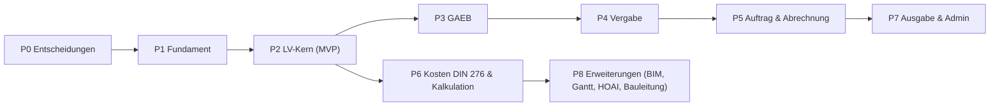

# Arbeitsplan: Eigene AVA-Software (angelehnt an NOVA AVA)

> **Abgelöst am 2026-11-09** durch `.scratch/ava-oss/plan.md` (parallele Stränge und Wellen) und `docs/regeln.md`. Dieses Dokument bleibt als Herkunft der Tickets `issues/01`–`17` stehen, die weiter gelten. Phasenzeilen zu Postgres, REST und Auth sind überholt.

## 0. Was im Worktree schon steht

| Bestand | Inhalt | Nutzen für die Umsetzung |
|---|---|---|
| `GLOSSARY.md` | AVA-Begriffe (LV, OZ-Maske, Positionsarten, GAEB X81–X89, BIM/IFC, DIN 276) | Gemeinsame Sprache für Code, Tickets und Tests |
| `docs/research/nova-ava/` (git-ignored, ca. 195 KB) | 5 Bereichskarten + 6 Deep-Dives + Referenz für 88 Controller / 858 RPCs, 28 REA-Captures | Fachliche Spezifikation und **Testorakel** (gemessene Rundungs- und Summenwerte) |
| `.scratch/nova-ava-research/spec.md` | Abgeschlossene Recherche-Spec | Grenzen: keinen NOVA-Code, keine Assets, keine STLB-Texte übernehmen |
| `docs/agents/*`, `.claude/skills/*` | Lokaler Tracker (`.scratch/<feature>/issues/NN-*.md`), Labels, Skills (`to-spec`, `to-tickets`, `tdd`, `implement`, `wayfinder`, `domain-modeling`) | Ablauf pro Session |
| **Fehlt** | `docs/adr/`, Tech-Stack, Zielgruppe/Umfang, jeglicher Anwendungscode | Phase 0 |

### Wichtige Erkenntnisse aus der Recherche, die das Design prägen
- **Architektur von NOVA:** PHP-Seitenrouting plus ein einziger RPC-Bus (`method`/`action`). Der **Server rechnet alles** und schickt ein `changeSet` mit Deltas zurück (Zeilen über die ID, Gesamtsumme unter `-1`). Der Client (SlickGrid) wendet nur noch an.
- **LV-Modell:** Lose (optional), bis zu 5 Gliederungsebenen, Positionen (`bkdn=10`), Hinweistexte. OZ-Maske z. B. `NN.NN.NNNN[.A]`, Positionen in 10er-Schritten, Umnummerierung pro Teilbaum.
- **Positionsarten:** Normal, Bedarf (mit/ohne GB), Grund/Wahl (Gruppen-Nr., `V001.1`), Zulage (Menge×EP oder % auf verknüpfte Positionen), Stundenlohn, Hinweis. Dazu die Flags Pauschal, freie Menge, Schwerpunkt, entfällt.
- **Rechenregeln (gemessen):** Menge 3 Nachkommastellen, EP 2–3, GP = round_half_up(Menge×EP, 2). Summen = Summe der **gerundeten** GPs. MwSt wird **auf Summenebene** aus der Netto-Summe nach Nachlass gerechnet, nicht als Summe der Positions-MwSt. Nachlass in % oder als Betrag.
- **Lebenszyklus pro LV:** LV → Versand/E-Vergabe → Preisspiegel → Auftrag/Nachträge → Aufmaß (REB 23.003) → Soll/Ist → Rechnungsprüfung.
- **Weitere Bereiche:** DIN-276-Kostenplanung (335 KG), EP-Kalkulation (EPA `upcomp1..6`, UpCalc), GAEB-Import/-Export und formale Prüfung, BIM-Viewer (IFC, GUID-Verknüpfung), HOAI, Gantt, Bauleitung, Portale, Druck/Excel, Admin/IAM.

> [!IMPORTANT]
> Clean-Room-Regel: Die Recherche-Dokumente dienen nur als Verhaltensbeschreibung. Code, UI und Texte schreiben wir selbst. Die Captures dürfen als lokale Testorakel dienen, werden aber nie committet.

---

## 0b. Getroffene Entscheidungen (2026-11-09)

| Thema | Entscheidung |
|---|---|
| Zielgruppe | Planer, Architekten, Ingenieurbüros |
| MVP | LV-Editor + Berechnung + GAEB-Import/-Export + Preisspiegel/Zuschlag (P0–P4) |
| Plattform | Rein lokale Web-App als installierbare **PWA** (offline). **Kein Server in v1.** Austausch nur über Dateien (GAEB, JSON-Projektdatei) |
| Stack | TypeScript, React, TanStack Table + Virtualisierung (eigener Baum und eigene Editierung), TipTap/ProseMirror mit eingeschränktem, GAEB-kompatiblem Schema |
| Berechnung | Reine TS-Bibliothek im Client, Decimal-Arithmetik. ChangeSet-Konzept bleibt intern für inkrementelle Neuberechnung |
| Speicherung | SQLite-WASM in OPFS (relational). Export/Import als Projektdatei = Backup |
| Historie | Undo/Redo + benannte LV-Stände („Versand“, „Auftrag“), kein Event-Log |
| Benutzer | Einzelbenutzer, keine Auth, keine Mandanten |
| Normen | Nur Deutschland (GAEB DA XML 3.3, VOB, DIN 276, REB 23.003) |
| Qualität | TDD mit Vitest (Golden Tests aus der Recherche), Playwright-E2E für Kernabläufe, CI muss grün sein |
| Umsetzung | Überwiegend KI-Agenten mit AFK-fähigen Tickets, Review durch dich |
| Sprache | Deutsche UI. Deutsche Bezeichner für Fachbegriffe (`Leistungsverzeichnis`, `Einheitspreis`), englische für Technik (`render`, `store`, `useX`) |
| Lizenz/Ziel | Privates Lern-/Open-Source-Projekt, **AGPL-3.0** |

**Folgen für den Plan:** Entscheidungen 0.1/0.2 sind erledigt (nur noch ADRs schreiben). P1.3 heißt jetzt SQLite-WASM/OPFS statt Postgres. P1.4 wird zur internen Store-/ChangeSet-API statt REST. P1.5 (Auth) entfällt und wird durch eine Projektliste mit Projektdatei-Import/-Export ersetzt. P7.4/7.5 (Rollen, Mandanten, API, Deployment) entfallen; dafür kommen PWA-Installierbarkeit und Offline-Tests dazu. Ein optionaler Sync-Server ist frühestens nach v1 ein Thema.

## 1. Session-Ablauf (gleich für jede Session)

1. Ticket claimen (`.scratch/<feature>/issues/NN-*.md`, `Status: claimed`).
2. Den genannten Recherche-Abschnitt lesen und die Begriffe gegen `GLOSSARY.md` prüfen.
3. Mit `/tdd` arbeiten: Tests zuerst. Rechenfälle aus den Deep-Dives werden Golden Tests.
4. Ticket auf resolved setzen, `okf/project/overview.md` aktualisieren und mit `/handoff` die Notiz für die nächste Session schreiben.

Ziel pro Session: ein vertikaler Schnitt, ca. 2–4 h, am Ende grüne Tests und ein lauffähiger Stand.

---

## 2. Phasen und Sessions

### P0 – Entscheidungen (ohne Code)
| # | Session | Ergebnis |
|---|---|---|
| 0.1 | `/grill-me`: Zielgruppe (Planer/Architekten vs. Bieter), MVP-Umfang, Single- oder Multi-Tenant, Web oder Desktop | `.scratch/ava-mvp/spec.md` |
| 0.2 | Tech-Stack-ADR (Vorschlag: TypeScript-Monorepo, Postgres, Rechenkern als reine Library, Decimal-Arithmetik statt Float, Grid-Komponente z. B. AG Grid/TanStack) | `docs/adr/0001…0003` |
| 0.3 | `/domain-modeling`: Aggregate (Projekt, LV, Knoten, Position, Bieter/Angebot, Auftrag, Aufmaß, Rechnung, Kostenermittlung), ID-Strategie, Versionierung | ADR + `GLOSSARY.md` ergänzt |
| 0.4 | `/to-tickets` für P1–P2 | `.scratch/ava-mvp/issues/01..NN` |

### P1 – Fundament
| # | Session | Fertig, wenn … |
|---|---|---|
| 1.1 | Repo-Gerüst, Lint/Format, CI, Test-Runner | CI ist grün |
| 1.2 | Money/Decimal-Modul: round_half_up, Formatierung de-DE, Mengen-/Preis-Skalen | Property-Tests bestehen |
| 1.3 | DB-Schema v1 + Migrationen (Projekt, LV, Knoten), Repository-Schicht | CRUD-Integrationstests |
| 1.4 | API-Stil festlegen (REST/RPC) inklusive **ChangeSet-Antwortformat** (Deltas + Gesamtsumme) | ADR + Contract-Tests |
| 1.5 | Auth (lokale Benutzer), Projektliste, App-Shell | Login → Projekt anlegen |

### P2 – LV-Kern (MVP-Herzstück)
| # | Session | Quelle | Fertig, wenn … |
|---|---|---|---|
| 2.1 | Hierarchie: Lose/Gliederungsebenen/Positionen/Hinweise, insert-after-Logik | lv-deep-dive §1 | Baum-Tests |
| 2.2 | OZ-Maske konfigurieren, OZ vergeben (+1 / +10), Index, Umnummerierung | §2 | Golden Test für das Renumber-ChangeSet |
| 2.3 | Rechenkern: GP, Summen, Nachlass, MwSt auf Summenebene | §6 | Fälle 1,235×10 → 12,35; 3,333×4,56 → 15,20; MwSt 5,23 / Brutto 32,78 |
| 2.4 | Positionsarten Teil 1: Normal, Bedarf ±GB, Stundenlohn, Pauschal, entfällt | §3 | Summenwirkung wie in der Tabelle |
| 2.5 | Positionsarten Teil 2: Grund/Wahl-Gruppen, Zulage (Menge und % mit Verknüpfungen) | §3 B/C | Zulage 15,20 × 10 % = 1,52 |
| 2.6 | Inkrementelle Neuberechnung + ChangeSet (nur betroffene Teilbäume) | README §3.1 | Delta-Tests |
| 2.7 | LV-Grid-UI: Baum, Inline-Edit, Einklappen, Summenzeile, Tastaturnavigation | map-lv §2 | E2E: LV aufbauen |
| 2.8 | Positionsdialog: Kurz-/Langtext (Rich-Text, eigener Editor), Einheitenkatalog, Flags | §4–5 | E2E |
| 2.9 | Copy/Cut/Paste/Move, Löschen mit Papierkorb | §1.2, catalogs §1.4 | Summen stimmen nach dem Verschieben |
| 2.10 | Formale LV-Prüfung (fehlender Langtext, Menge 0, fehlender AG …) mit Sprunglinks | §7 | Prüfregeln getestet |
| 2.11 | EPA (`upcomp1..6`, Zeitansatz) und Aggregation | §5.3 | Summen je Anteil |

**Meilenstein M1:** Ein vollständiges LV lässt sich anlegen, berechnen und prüfen.

### P3 – GAEB-Austausch
| # | Session | Fertig, wenn … |
|---|---|---|
| 3.1 | GAEB-DA-XML-3.3-Modell + Parser (X81/X83), eigene Testdateien | Roundtrip-Test |
| 3.2 | Export X81/X83/X86, gekoppelt mit der Prüfung (Entwurfsmodus) | XSD-valide |
| 3.3 | Import X84 (Angebote) → Bieter | Preise korrekt übernommen |
| 3.4 | Optional: GAEB 90/2000, X31 (Mengen), ÖNORM/SIA | — |

### P4 – Vergabe und Preisspiegel
| # | Session | Quelle |
|---|---|---|
| 4.1 | Bieter anlegen, Angebots-EPs erfassen, Bietersummen mit Nachlass/MwSt | map-vergabe §3 (Golden: 402,73 → 390,65 → 464,87) |
| 4.2 | Preisspiegel-Matrix-UI, virtuelle Bieter (Min/Max/Mittel/Zielpreis) | §2 |
| 4.3 | Wertung: Ranking, Ausreißer, ABC-Analyse, Wahlpositions-Simulation | §2.3 |
| 4.4 | Zuschlag → Auftrags-LV erzeugen | `appointBidder` |

**M2:** Ausschreiben, Angebote vergleichen und den Zuschlag erteilen funktioniert durchgängig.

### P5 – Auftrag, Aufmaß und Abrechnung
| # | Session | Quelle |
|---|---|---|
| 5.1 | Auftrags-LV, Nachträge (Versionen, Status) | map-kosten §4.1 |
| 5.2 | Mengenermittlung nach REB 23.003: Formel-Parser, Aufmaßblätter | §3 |
| 5.3 | Leistungserfassung und Soll/Ist | §4.2 |
| 5.4 | Rechnungsprüfung: Abschlags-/Schlussrechnung, Einbehalte, Abzüge | §4.3 |
| 5.5 | E-Rechnung (XRechnung/ZUGFeRD), Import und Prüfung | §4.3 |

### P6 – Kostenplanung und Kalkulation
| # | Session | Quelle |
|---|---|---|
| 6.1 | DIN-276-Katalog (selbst erfasst bzw. lizenzrechtlich geprüft), Kostenermittlung mit Versionen | map-kosten §2 |
| 6.2 | Detailzeilen pro KG und Übernahme aus LVs | §2.2 |
| 6.3 | Kostenkontrolle: Budget ↔ Vergabe ↔ Abrechnung je KG | gantt-and-controlling §2–3 |
| 6.4 | EP-Kalkulation (Kostenarten, Zuschläge), Variablen, Kennwerte | upcalc-deep-dive |
| 6.5 | Muster-LV, Textbausteine, Vorlagen, LV-übergreifender Preisspiegel | catalogs §1, upcalc §5 |

### P7 – Ausgabe, Administration, Betrieb
| # | Session |
|---|---|
| 7.1 | PDF-Druck (LV, Preisspiegel, Rechnung) mit Vorlagen |
| 7.2 | Excel-Export/-Import |
| 7.3 | Hintergrund-Jobs (Import/Export/Druck) |
| 7.4 | Rollen/Rechte, Mandanten, Audit-Log, DSGVO-Export |
| 7.5 | API-Keys/Webhooks (optional), Deployment, Backups |

### P8 – Erweiterungen (je nach Bedarf, je 2–5 Sessions)
- **BIM:** IFC-Viewer (z. B. web-ifc / That Open), Bauteil-GUID ↔ Position/KG, modellbasierte Mengen, BCF (map-bim)
- **Bauzeitenplan:** Gantt, Arbeitskalender, Vorgänge ↔ LV, Mittelabfluss (gantt-deep-dive)
- **HOAI:** Honorarrechner, Planerverträge und -rechnungen, Zeiterfassung (hoai-deep-dive)
- **Bauleitung:** Pläne mit Pins, Mängel, Protokolle, Bautagebuch (site-management)
- **Portale:** Bieterportal (Angebotsabgabe), externe Beteiligte
- **KI-Assistent:** Langtext-Vorschläge, Kontext aus dem LV (architecture §3)

---

## 3. Umfang grob
| Phase | Sessions |
|---|---|
| P0–P2 (MVP) | ca. 20 |
| P3–P5 | ca. 13 |
| P6–P7 | ca. 10 |
| P8 | je Modul 2–5 |

## 4. Offene Entscheidungen
1. Zielgruppe und MVP-Grenze (Empfehlung: Planer-Seite, P0–P4)
2. Tech-Stack und Web vs. Desktop
3. Lizenzfragen: DIN-276-Katalogtexte, STLB-Bau-Anbindung, GAEB-XSDs
4. Mandantenfähigkeit ab v1?
