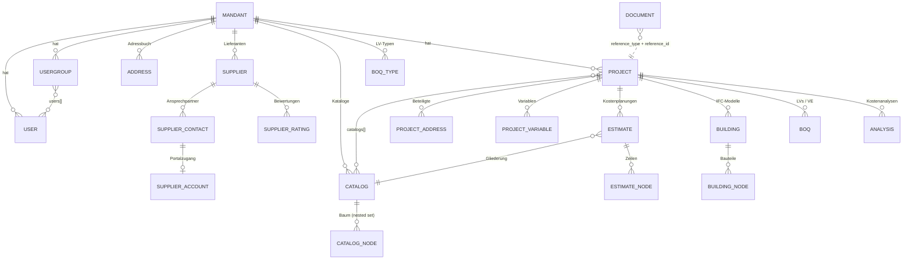
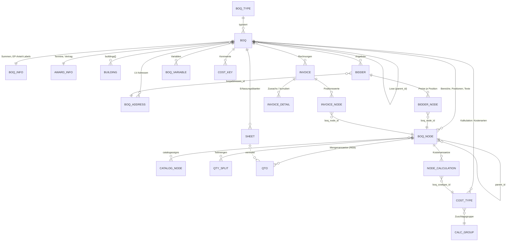

# NOVA AVA: öffentliche API, Datenmodell und technische Schnittstellen

> Stand der Recherche: 2026-11-09. Grundlage ist vor allem die frei abrufbare, maschinenlesbare API-Spezifikation (OpenAPI 3.1.0, API-Version 1.4.3) [1]. Es wurden **keine** authentifizierten Aufrufe gemacht; Feldbedeutungen stammen aus Spezifikation, Beispielantworten, Handbuch und Herstellerbeiträgen. Interpretationen sind als „Einschätzung“ markiert.
>
> **Begriffe für Nicht-Architekten:** *AVA* = Ausschreibung, Vergabe, Abrechnung. *LV* (Leistungsverzeichnis, engl. bill of quantities, in der API „boq“) = strukturierte Liste der zu bauenden Leistungen mit Positionen, Mengen und Preisen. *OZ* (Ordnungszahl) = hierarchische Positionsnummer wie `01.02.0030`. *EP/GB* = Einheitspreis / Gesamtbetrag einer Position. *GAEB* = deutscher Standard für den LV-Datenaustausch, siehe [GAEB DA XML](/okf/research/standards/gaeb-da-xml.md). Weitere Begriffe werden beim ersten Auftreten erklärt.

## Kurzfassung

- **Öffentliche REST-API vorhanden und gut auffindbar:** Die Doku unter `api.avanova.de/v1/docs` ist eine Scalar-Seite, die eine frei abrufbare OpenAPI-3.1-Spezifikation lädt (API-Version 1.4.3, 78 Pfade, 108 Operationen, 14 Themenbereiche) [1][2].
- **Anmeldung:** Die API nutzt einen OAuth2-Client-Credentials-Ablauf, der ein JWT (HS512) liefert. Das Access-Token gilt 60 Minuten, das Refresh-Token 90 Tage. Den Mandanten bestimmt ein `TENANT`-Header oder die Subdomain. Tokens sind an Benutzer und „Applikation“ gebunden, Scopes gibt es nicht [1].
- **Drosselung nach Lizenz:** Standard sind 100 Anfragen/Minute, mit Lizenzmerkmal „award“ 200, mit „settlement“ 600. Eine ältere Doku nannte 60/200/600 für die Pakete Starter/Easy/Business (Stand 2026-11-09) [1][3].
- **Die API ist vor allem zum Lesen gebaut:** 71 von 108 Operationen sind GET. Schreiben geht für Stammdaten, Projekte, LV-Hüllen (anlegen, umbenennen, kopieren, löschen), Importe (GAEB, IFC, CSV), Dokumente und Benutzer. **Positionen, Angebotspreise, Aufmaße, Rechnungen und Kostenplanungen lassen sich nicht direkt schreiben** [1].
- **Was fehlt:** Webhooks bzw. Events, ein GAEB-Export über die API, Kalenderdaten (nur per CalDAV), virtuelle Preisspiegel-Bieter und archivierte Angebote [1][27].
- **Datenmodell:** Ein einziges LV-Objekt begleitet den ganzen Lebenszyklus. Je nach Modul (`TENDER`/`CONTRACT`/`SETTLEMENT`) liefert es Ausschreibungs- oder Vertragswerte. Die Knoten tragen GAEB-nahe Feldnamen (`rnopart`, `outlinetext`, `upcomp1…6`). Jede Position lässt sich mehrfach über Kataloge einordnen: DIN 276 in fünf Fassungen, Leistungsbereiche, Kostenträger, Orte, BIM [1].
- **Schwächen im Schema:** Geldbeträge sind Gleitkommazahlen, Texte kommen als HTML, Feldnamen enthalten Tippfehler (`quantitiy`). Viele Schemas wurden aus Beispielen abgeleitet. **Positionsarten (Bedarfs-/Wahlposition) sind in der API nicht sichtbar** [1].
- **Betrieb:** Die Indizien sprechen für einen PHP-Monolithen (`api.php`) hinter AWS-Load-Balancern in Frankfurt (eu-central-1), mit Wildcard-Subdomain je Kunde [7]. Die Statusseite meldet 99,95 % Gesamtverfügbarkeit über 30 Tage und 4 öffentliche Störungen in 90 Tagen [4]. Vertraglich sagen die AGB nur 98 % im Jahresmittel zu, das SLA 99,8 % je Monat ohne Wartungsfenster [56][63]. Unterauftragnehmer laut AVV: AWS (Region Frankfurt), easybill und sipgate [60].
- **Breite Formatunterstützung:** Unterstützt werden u. a. GAEB 90/2000/XML 3.1–3.3 (Phasen X81–X86, X31, neu X50/X51), ÖNORM A2063, Excel, Datanorm 4.0, IFC 2x3/4/4x3, BIM-LV-Container, BCF, XRechnung/ZUGFeRD sowie MS Project und Primavera. Der BVBS führt „NOVA AVA 4“ weiter auf seiner Liste GAEB-zertifizierter Software; die 3.3-Urkunden galten aber nur bis 10.10.2026, eine Erneuerung ist nicht belegt [11][12][16][20][32][58][62].
- **Mittleres bis hohes Lock-in:** Einen Komplettexport gibt es nicht. Nach der Kündigung bleiben die Daten 12 Monate gespeichert, aber ohne Zugriff. Der Auftragsverarbeitungsvertrag verpflichtet NOVA zwar, die Daten nach Vertragsende nach Wahl des Kunden zurückzugeben oder zu löschen; Format und Verfahren regelt er aber nicht [60]. Die AGB (Stand April 2020) verlangen vom Nutzer eine tägliche Sicherung per Download und geben NOVA weitreichende Rechte an selbst erstellten LV-Positionen [30][50][56].
- **Neu 2026:** Der KI-Assistent NEO (Beta) bringt laut Hersteller eine MCP-Anbindung, über die externe KI-Clients per OAuth NOVA-Daten lesen und schreiben können. Das MCP-Add-on ist in der Beta kostenlos und kostet ab 01.02.2027 40 € pro Nutzer und Monat [52][61].
- **Folgerung für uns:** Das phasenübergreifende, GAEB-nahe LV-Modell lohnt sich als Vorbild. Ergänzen sollten wir Dezimal-Geldbeträge, explizite Positionsarten, stabile UUIDs, Webhooks und einen echten Vollexport. Eine Migration aus NOVA ist mit GAEB-Export plus API-Lesezugriff machbar, aber langsam, weil viele Daten pro Position einzeln abgefragt werden müssen.

## 1. Technische Oberfläche im Überblick

### 1.1 Domains, Hosts und erkennbarer Technik-Stack

| Host | Zweck | Beobachtung am 2026-11-09 (normale Seitenabrufe, Header, DNS) | Quelle |
|---|---|---|---|
| `nova-ava.de` | Marketing-Website | nginx, `X-Powered-By: PHP/8.3.36` und `PleskLin`; WordPress, laut Datenschutzerklärung bei HostPress GmbH gehostet | [7][55] |
| `avanova.de`, `www.avanova.de` | ältere Markendomain | Apache 2.4.62 (Amazon Linux), 302-Weiterleitung auf nova-ava.de; IP im AWS-Netz eu-central-1 | [7] |
| `TENANT.avanova.de` | die eigentliche Anwendung je Kundenkonto (Mandant, engl. tenant) | Wildcard-DNS: jede Subdomain löst auf den AWS-Load-Balancer „nova-frontend-load-balancer“ (eu-central-1) auf. App-Links nutzen PHP-typisches Query-Routing, z. B. `?s=boq&contract=…` | [1][7] |
| `api.avanova.de` | REST-API und Doku | nginx, gleicher Load Balancer; Antworten mit `Access-Control-Allow-Origin: *` und HSTS (beobachtet bei Doku/Spec) | [2][7] |
| `login.avanova.de` | Vorschalt-Login: Die Seite fragt nach der E-Mail und leitet zur Firmen-Subdomain weiter | `X-Powered-By: PHP/8.2.30`, `X-Frame-Options: DENY`; UI-Kit Tabler; ein Client-Skript merkt sich den letzten Mandanten im Cookie und spiegelt ein serverseitiges Rate-Limit-Fenster von 300 s | [6][7] |
| `signup.avanova.de` | Kontoeröffnung | AWS-IP (eu-central-1) | [7] |
| `handbuch.avanova.de` → `manual.avanova.io` | Online-Handbuch „Novadex“ | React-Single-Page-App, die Artikel aus einer JSON-API (`/api/articles/…`) lädt; nginx 1.27.5; Load Balancer „labs“ (eu-central-1) | [7][8] |
| `health.avanova.io` | öffentliche Statusseite | Eigenbau (Tabler-UI, deutschsprachig), nginx 1.26.3, Load Balancer „labs“ | [4][7] |

- Einschätzung: Der Kern ist wahrscheinlich ein **PHP-Monolith** mit integrierter API. Dafür sprechen der API-Einstieg `https://TENANT.avanova.de/api.php`, das Query-Routing und der Hinweis im Fehler-Schema der Spec auf eine Funktion in `public/api/api_functions.php` [1].
- Einschätzung: Auf der Statusseite tauchen Hilfsdienste als eigene Komponenten auf: „IFC Translation Service“, „BIM Database“, „SmartPool“, „GANTT Print/Conversion Service“ [4]. Das deutet auf Microservices rund um den Monolithen hin.
- Das Frontend-Framework der eigentlichen Anwendung blieb unbekannt, weil sie nur nach Login erreichbar ist.
- Das Hosting beschreibt der Hersteller als ISO-27001-zertifizierte Rechenzentren in Deutschland [52][57] bzw. als „eigene Serverinfrastruktur“ [54]. Die DNS-Auflösung zeigt für App, API und Login **AWS Frankfurt** [7].

### 1.2 Verfügbarkeit laut Statusseite

Die Statusseite gliedert sich in **Frontend** (NOVA AVA, Kundenportal, Login Service), **Backend** (Database, BIM Database, REST API), **Services** (SmartPool, IFC Translation Service, GANTT Print Service, GANTT Conversion Service) und **Allgemein** (nova-ava.de, extern) [4].

| Gruppe (Stand 2026-11-09, 17:25 Uhr) | 24 h | 7 Tage | 30 Tage | 90 Tage |
|---|---|---|---|---|
| Gesamtverfügbarkeit | 100,00 % | 99,85 % | 99,95 % | 99,84 % |
| Frontend | 100,00 % | 99,85 % | 99,97 % | 99,88 % |
| Backend | 100,00 % | 100,00 % | 99,99 % | 99,93 % |
| Services | 100,00 % | 100,00 % | 100,00 % | 99,98 % |

Einzelwerte über 30 Tage: REST API 99,96 %, NOVA AVA (Frontend) 99,96 %, die Website nova-ava.de 99,29 %, alle übrigen Dienste 100 % [4].

| Incident | Gemeldet | Komponente | Schweregrad | Dauer |
|---|---|---|---|---|
| #7 | 16.08.2026 04:15 | NOVA AVA (Frontend) offline | S1 – Kritisch | 3 min |
| #8 | 21.08.2026 13:46 | IFC Translation Service offline | S3 – Mittel | 10 min |
| #9 | 28.08.2026 08:20 | NOVA AVA (Frontend) offline | S1 – Kritisch | 2 min |
| #10 | 05.09.2026 03:11 | BIM Database offline | S2 – Hoch | 24 min |

Quelle: [4][5]. Zu keinem Incident gibt es öffentliche Updates oder eine Ursachenanalyse.

- Einschätzung: Die Tagesbalken zeigen weitere Tage mit Einbußen ohne zugehörigen Incident, z. B. REST API am 16.09.2026 mit 97,9 % [4]. Incidents werden offenbar nur bei vollständigem Ausfall angelegt.
- Vertraglich schuldet NOVA nur **98 % Verfügbarkeit im Jahresmittel** am Übergabepunkt [56]. Rechnerisch wären damit gut 7 Ausfalltage pro Jahr vertragskonform.

### 1.3 Identität, Anmeldung und Sicherheit (technisch)

- **Single Sign-On (SSO):**
  - SAML über einen externen Identity Provider; Beispiele im Handbuch: OneLogin, ADFS, Google [28].
  - LDAP-Synchronisation [28].
  - Externe Logins über Google, Microsoft oder Generic OpenID; die E-Mail-Adresse muss zu einem bestehenden Benutzer passen [28].
  - Seit Februar 2026 lässt sich der Passwort-Login für alle abschalten, abgesichert durch einen Wiederherstellungsschlüssel [42].
- **Zwei-Faktor-Authentifizierung (2FA)** kann der Admin erzwingen; der Code kommt per E-Mail oder Authenticator-App [28].
- **Externe Teilnehmer** (Bieter, Auftragnehmer) melden sich per Benutzername plus Zugangslink oder klassisch mit Passwort an [28].
- **Penetrationstest:** secuvera testete zwischen 5. Februar und 9. Mai 2020 die Webanwendung 3.0 und die API 1.2.1. Grundlage waren das BSI-Durchführungskonzept und der OWASP Testing Guide v4; ausnutzbare Schwachstellen wurden nicht gefunden (laut Hersteller und Fachpresse) [49][57]. Neuere öffentliche Testergebnisse fanden sich nicht.
- **Patch-Stand:** Im Oktober 2026 meldete der Hersteller, kritische PHP-Sicherheitslücken auf seinen Servern zeitnah gepatcht zu haben [54].

## 2. Die REST-API im Detail

### 2.1 Dokumentation, Version und Herkunft

- **Doku-Seite:** `https://api.avanova.de/v1/docs` ist eine minimale HTML-Seite. Sie lädt das Open-Source-Werkzeug *Scalar API Reference* von jsDelivr, und zwar **ohne Versionsangabe**, und darin `./openapi.json` [2].
- **Spezifikation:** `https://api.avanova.de/v1/openapi.json`, OpenAPI 3.1.0, `info.version` = 1.4.3, Lizenz „Proprietary“, rund 495 KB groß [1].
  - Server-URL: `https://api.avanova.de`, Pfad-Versionierung `/v1` [1].
  - `GET /v1/version` liefert Version und Endpunkt, `GET /v1/checkstatus` den Status samt Wartungsfenster („cloudstatus“) [1].
- **Herkunft:** Die Spec wurde aus einer Postman-Sammlung konvertiert.
  - Parameterbeschreibungen enthalten Hinweise auf „Beispielwerte aus der Postman-Doku“, und viele Antwortschemas sind aus Beispielantworten abgeleitet [1].
  - Die Postman-Doku ist weiterhin online; sie wurde am 2022-07-06 veröffentlicht und im Juli 2025 noch als offizielle Doku verlinkt [3][40].
  - Mit dem Update August 2026 wechselte die Doku auf ein neues Werkzeug. Sie ist zusätzlich je Mandant unter `https://TENANT.avanova.de/api.php/v1/docs` erreichbar [44].
- **„Legacy-API“:** Das Status-Schema heißt in der Spec „Status block included in every Legacy-API response“ [1].
  - Einschätzung: Intern gilt die v1 offenbar als Altbestand. Eine v2 ist denkbar, aber nicht angekündigt.

### 2.2 Verbindung und Authentifizierung (Ablauf)

1. **Zugangsdaten:** Der Kunde braucht eine „Applikation“ mit ClientID und Secret. Die Limits gelten je Applikation [1].
   - Wie Kunden diese erhalten, ist öffentlich nicht beschrieben. Laut Handbuch lassen sich Zusatzschnittstellen und Applikationen nicht selbst aktivieren; zuständig ist der Support [9].
2. **Token holen:** `POST /v1/token` mit HTTP-Basic-Auth [1].
   - Benutzername ist die E-Mail-Adresse bzw. der Benutzername des API-Users, Passwort ist das Applikations-Secret.
   - Im Body steht `grant_type=client_credentials`, als `multipart/form-data` oder `application/x-www-form-urlencoded`.
3. **Antwort:** `access_token` (JWT, HS512, `expires_in` 3600 s), `refresh_token` (90 Tage) und `token_type: Bearer` [1].
4. **Aufrufen:** Mit `Authorization: Bearer …` gegen eine der beiden Adressen [1]:
   - `https://api.avanova.de/v1/…` plus Header `TENANT: <Subdomain>`, oder
   - `https://TENANT.avanova.de/api.php/v1/…` ohne Header.
5. **Erneuern:** Mit `grant_type=refresh_token` plus `refresh_token` [1].
6. **Fehlerfälle beim Token:** `401 invalid_client`, `400 invalid_request`, `400 invalid_grant` und `400 unsupported_grant_type`. Bei Fachendpunkten bedeutet `403` „ungültige Lizenz oder fehlende Rechte“ [1].

Aus den Beispiel-Tokens in der Spec ergibt sich die Claim-Struktur [1]:
- Standard-Claims `sub`, `iat`, `nbf`, `exp`, `iss`.
- Ein Objekt `_data` mit `userId` und `applicationId`.
- Einschätzung: Ein Token handelt mit den Rechten eines konkreten Benutzers. Feingranulare Berechtigungen pro Integration (Scopes) gibt es nicht.

### 2.3 Allgemeine Konventionen

| Thema | Regel laut Spec | Quelle |
|---|---|---|
| Paginierung | Parameter `page` (ab 1). `limit`: Standard 100, Maximum 1000. Antworthülle mit `page`, `pages`, `limit`, `total`, `items` und `_links` (`base`, `self`, `prev`, `next`) | [1] |
| Filter | Feldname als Query-Parameter, z. B. `name1=…`. Mehrere Werte kommagetrennt oder als Array; innerhalb eines Feldes ODER, zwischen Feldern UND; exakte Treffer. SQL-Platzhalter `%`/`_` nur bei Textfiltern von Adressen und Lieferanten sowie beim Plan-Dateinamen | [1] |
| Eigene Merkmale | Filter `attribute[key]=value`, z. B. bei Projekten, Adressen und Lieferanten. Die Merkmale kommen als freies Objekt `attributes` zurück | [1] |
| HTML-Felder | Texte werden als HTML geliefert. `htmlAsPlain=true` liefert stattdessen Klartext | [1] |
| Datum/Zeit | `date` = `Y-m-d`, `datetime` = `Y-m-d H:i:s`, **ohne Zeitzone**. Bei älteren Datensätzen können IDs und Datumsfelder `null` sein | [1] |
| Request-Formate | POST erwartet `multipart/form-data`. PUT erwartet **nur JSON**, Form-Bodies werden bei PUT ignoriert. PATCH gibt es nicht | [1] |
| Statusblock | Jede Antwort enthält `status` mit `state` (success/error), `errorcode`, `servertime`, `executiontime` und `message` | [1] |
| HTTP-Fehler | 400, 401, 403, 404, 409 (z. B. „LV wird gerade kopiert“), 414 (Request-Zeile über 4094 Bytes), 429 (mit `Retry-After`) | [1] |
| Links in die App | Viele Objekte enthalten `_resourceUrl`, z. B. `https://%s.avanova.de/?s=boq&contract=54683` | [1] |

### 2.4 Rate-Limits, Pakete und API-Zugang

| Quelle | Stufe 1 | Stufe 2 | Stufe 3 |
|---|---|---|---|
| OpenAPI 1.4.3 (Stand 2026-11-09) | 100 Anfragen/min (Standard) | 200/min mit Lizenzmerkmal `award` | 600/min mit Lizenzmerkmal `settlement` |
| Postman-Doku (ältere Fassung, veröffentlicht 2022) | 60/min (Paket STARTER) | 200/min (EASY) | 600/min (BUSINESS) |

Quellen: [1][3].

Die Pakete laut Preisseite (Stand 2026-11-09, netto je Lizenz und Monat) [50]:
- **Starter** (49 €): u. a. Kostenplanung, Kostenanalyse, LV-Erstellung.
- **Easy** (89 €): zusätzlich Ausschreibung, Preisspiegel, Vergabe.
- **Business** (129 €): zusätzlich Nachträge, Aufmaß, Rechnungsprüfung, Abrechnung.

Einschätzung: Die Lizenzmerkmale `award` und `settlement` entsprechen den Paketen Easy und Business. Die API ist damit grundsätzlich in allen Paketen vorgesehen, aber nach Paket gedrosselt. Ob für den Zugang Kosten anfallen, ist öffentlich nicht dokumentiert. Einzelheiten zu Preisen stehen in [Produkt, Editionen, Preise](/okf/research/nova-ava/product-and-pricing.md).

### 2.5 Endpunkt-Inventar (108 Operationen)

| Bereich (Tag) | Ops | Lesen | Schreiben | Inhalt |
|---|---|---|---|---|
| Authentication | 1 | – | 1 | `POST /v1/token` |
| Addresses | 5 | 2 | 3 | globales Adressbuch: anlegen, ändern, löschen |
| Suppliers | 14 | 6 | 8 | Lieferanten, Ansprechpartner, Portalzugänge (mit NDA-Pflicht, Passwortwechsel, Ablaufdatum) und Bewertungen (nur lesen) |
| Documents | 4 | 3 | 1 | Dateien mit Bezug auf PROJECT, BOQ, ESTIMATE, BUILDING, GANTT, BOQNODE oder ANALYSIS; Upload und Download |
| Projects | 14 | 8 | 6 | Projekte (CRUD), Projektadressen (CRUD), Projektvariablen, Kostenanalysen samt Report |
| Buildings | 8 | 7 | 1 | IFC-Modelle: Bauteilbaum, Eigenschaften, Mengen, Download (Original-IFC oder internes XML), IFC-Import |
| Estimates | 4 | 4 | 0 | Kostenplanungen und ihre Zeilen (nur lesen) |
| BoQs | 33 | 27 | 6 | LVs (Liste, Detail, anlegen, umbenennen, kopieren, löschen, GAEB-Import, GAEB-Nachtragsimport), dazu Knoten, Teilmengen, Mengenansätze, Bieter und Angebotspreise, Kalkulation, Erfassungsblätter, Rechnungen, Variablen, Kennwerte |
| Analysis | 1 | 1 | 0 | projektübergreifende Kostenanalyse nach Katalog, nach LV (`boq`) oder nach Kostenart (`costtypes`) |
| Users / User groups | 10 | 4 | 6 | Benutzer (Anlage mit Passwort) und Gruppen |
| Catalogs | 10 | 5 | 5 | Kataloge (CRUD), Knoten, CSV-Download, CSV-Import und -Update |
| BoqTypes | 2 | 2 | 0 | LV-Typen (Vertrags- bzw. LV-Arten) |
| System | 2 | 2 | 0 | Version, Status |

Quelle: [1], ausgezählt am 2026-11-09. Nach HTTP-Methode: 71 GET, 18 POST, 9 PUT und 10 DELETE.

### 2.6 Was die API kann – und was nicht

**Lesen (vollständig oder weitgehend):**
- LV-Struktur mit Kurz- und Langtexten, Mengen, Einheiten und EP/GB, getrennt nach Ausschreibungs- und Vertragswerten [1].
- Bieter mit Angebotssummen und Positionspreisen [1].
- Kalkulationsdaten der Auftragnehmerseite [1].
- Erfassungsblätter, Mengenansätze nach REB 23.003, Rechnungen inklusive Zuwachs- und kumulierten Werten [1].
- Kostenplanungen, Kostenanalysen, IFC-Bauteile samt Mengen und Eigenschaften [1].
- Dokumente, Kataloge (auch als CSV), Adressen, Lieferanten, Benutzer [1].
- Rechnungen projektübergreifend und inkrementell (`GET /v1/invoices?date=…&uid=…`, „nur neuere als …“). Laut Hersteller zielt die API auf Anbindungen wie Power BI oder SAP [1][40].

**Schreiben (eingeschränkt):**
- Stammdaten (Adressen, Lieferanten, Kataloge, Benutzer, Gruppen) und Projekte [1].
- LV-Hüllen anlegen (seit Februar 2026), umbenennen, kopieren und löschen (seit Oktober 2026) [42][45].
- Inhalte gelangen nur über **Dateiimporte** hinein: GAEB-LV, GAEB-Nachtrag (seit Juli 2025), IFC und Katalog-CSV [1][40].

**Nicht verfügbar** (nach Spec, Stand 2026-11-09):
- **GAEB-Export** und PDF- oder Excel-Ausgaben; diese laufen nur über die Oberfläche [1][11].
- **Direktes Schreiben** von Positionen, Mengenansätzen, Angebotspreisen, Zuschlag, Nachtragsstatus, Erfassungsblättern und Rechnungen [1]. Einzige Ausnahme: das Feld `is_external` bei Erfassungsblättern ist laut Doku beschreibbar, einen Schreib-Endpunkt dafür gibt es aber nicht.
- **Webhooks oder Events.** Integrationen müssen abfragen statt benachrichtigt zu werden. Webhooks erwähnt das Handbuch nur als Rückkanal von E-Signatur-Anbietern zu NOVA [1][10].
- **Virtuelle Bieter und archivierte Angebote** (LV-Kostenanschlag, Ideal-, Mittel- und Median-Bieter) [1].
- **Kalender:** ausdrücklich nicht über die API, stattdessen CalDAV [27].
- **Weitere Module** sind in der Spec nicht vertreten: Ausschreibungsvorgang (Einladungen, Bieterkommunikation), Bautagebuch, Tickets, Besprechungen, HOAI-Modul, Terminpläne (nur als Dokumenttyp GANTT), Druck- und Excel-Vorlagen, Textspeicher [1].
- **Positionsmerkmale in den Beispielen:** Positionsart (Normal-, Bedarfs-, Wahl- oder Zuschlagsposition), Bieterlücken bzw. Textergänzungen und Nachtragskennzeichen tauchen in den Beispielantworten nicht auf. Positionen mit Menge und EP, aber GB = 0, sind vermutlich Alternativ- oder Bedarfspositionen, ohne dass ein Feld das kenntlich macht [1].

- Einschätzung (Datenabzug): Viele Detaildaten gibt es nur **pro Position** über eigene Endpunkte: `qtos` (Mengenansätze), `qtysplits` (Teilmengen), `calculations` (Kalkulationsansätze) und `costtypes` (Kostenarten). Ein vollständiger Abzug braucht deshalb sehr viele Anfragen (N+1-Problem).
  - Rechenbeispiel: Ein LV mit 2.000 Positionen braucht rund 8.000 Anfragen. Bei 100/min dauert das etwa 80 Minuten, bei 600/min etwa 13 Minuten.
  - 50 solcher LVs kosten im Starter-Takt rund 67 Stunden.

### 2.7 Öffentlich belegte API-Historie

| Datum | Änderung | Quelle |
|---|---|---|
| 11/2015 | „RESTful API“ eingeführt. Laut Hersteller für Systemadministratoren, zum Austausch mit Adressverwaltung, Kalendern, Auswertungstools und ERP | [46] |
| 02–05/2020 | Pentest von App 3.0 und API 1.2.1 | [57] |
| 2022-07-06 | Postman-Dokumentation veröffentlicht | [3] |
| 22.07.2025 | Neuer Endpunkt für Nachtrags-GAEB-Import; zusätzliche Filter, z. B. nach Projektmerkmalen; Hinweis auf Power BI und SAP | [40] |
| 25.10.2025 | Kostenarten des Schlussblatts optional mit Positionen bzw. Kostenansätzen | [41] |
| 26.02.2026 | LVs (VE) per API anlegen; Kostenanalyse-API ans neue Schema angepasst | [42] |
| 21.04.2026 | STLV-Nummer (`mlv_ref`) in den Positionsendpunkten; Auftragnehmer und Kreditoren-Nr. in der Kostenanalyse; Zuschlagsarten je Kostenart in der Kalkulation | [43] |
| 24.08.2026 | Doku auf neues Werkzeug umgestellt (Scalar); Status der Erfassungsblätter; `boq_id` und `boq_node_id` in der Kostenanalyse; Korrekturen beim ODER-Filter und bei `supplier_id` | [44] |
| 07.10.2026 | LVs umbenennen, kopieren, löschen | [45] |
| 09.11.2026 | Spec-Version 1.4.3 | [1] |

Einschätzung: Die API wächst stetig, aber in kleinen Schritten, und zwar überwiegend beim **Lesen**. Fachliche Schreibzugriffe kommen nur über Datei-Importe hinzu.

## 3. Rekonstruiertes Domänenmodell

### 3.1 ER-Diagramm A: Mandant, Stammdaten, Projekt

### 3.2 ER-Diagramm B: LV-Lebenszyklus (Ausschreibung → Vergabe → Abrechnung)

Quelle für beide Diagramme: Pfadstruktur, Fremdschlüssel und Beispiele in [1]. Gestrichelte Linien sind nicht eindeutig belegt.

### 3.3 Entitäten im Überblick

| Entität (API) | Bedeutung | Wichtige Felder | Beziehungen |
|---|---|---|---|
| Mandant (`TENANT`) | Kundenkonto (Subdomain) | Permalink/Subdomain | Wurzel für alles. Fremde Datensätze liefern 404 („gehört nicht zu diesem Client“) |
| `users`, `usergroups` | Benutzer und Gruppen | `username`, `email`, `is_admin`, `is_active`, `source` (vermutlich lokal/LDAP/SAML), `last_login_at`, `last_pw_change_at`, `language` | Projekte, LVs und Kostenplanungen tragen `users[]` und `groups[]` als Sichtbarkeitslisten |
| `addresses` | globales Adressbuch | `name1…name4`, Anschrift, `iln` (Global Location Number), `vat_id`, `leitweg_id` (Routing-ID für E-Rechnungen an Behörden), `tax_number`, Bankdaten, Handelsregister (`register_number`, `register_type`, `court`), `exemption_available` und `exemption_date` (Freistellungsbescheinigung zur Bauabzugsteuer), `labels`, `attributes`, `external_id` | Vorlage für Projekt- und LV-Adressen |
| `suppliers` (+ `contacts`, `account`, `ratings`) | Lieferanten- bzw. Unternehmerstamm | `supplierno`, `vendorno` (Kreditoren-Nr.), Bank, `hrgno`, `category1…3`, `employees`, `rating`, `last_activity`; Portalzugang mit `nda_status`, `expires_at`; Bewertung als Liste aus Kriterium, Punkten und Notiz | Bewertungen verweisen per `reference_type`/`reference_id` auf den Vorgang |
| `projects` | Bauprojekt | `key`, `name`, `standard` (vermutlich GAEB/ÖNORM/SIA), `currency`, `vat`, `tax`, `catalogs[]`, `attributes`, Rollen-Fremdschlüssel: `owner_id` (Bauherr), `planner_id` (Planer), `requester_id`, `construction_site_id` (Baustelle), `submission_site_id` (Angebotsabgabe), `notification_site_id`, `additional1…4_id`; `archived_at`, `deleted_at` | Die Rollen zeigen auf Projektadressen |
| `projects/{p}/addresses` | Projektbeteiligte | wie Adresse | – |
| `variables` (Projekt/LV) | benannte Mengenvariablen | `name` (z. B. BGF = Bruttogrundfläche), `formula`, `condition`, `unit`, `result`, `is_invalid` | Werden in Mengenansätzen und Kostenplanung verwendet |
| `catalogs` / `nodes` | Klassifikationen | `type` (siehe 3.7), `is_default`, `is_required`, `is_active`; Knoten mit `code`, `name`, `quantity_unit`, `hint` als **Nested Set** (`lft`, `rgt`, `lvl`, `parent_id`) | Werden Projekten zugeordnet und an Positionen, Mengen und Rechnungen gehängt |
| `estimates` / `nodes` | Kostenplanung (z. B. Kostenschätzung nach DIN 276) | `catalog_id`, `mode` (net/brutto), Summen netto, MwSt. und brutto, `marked_for_analysis`, `finalized_at`; Zeilen mit `code` (Kostengruppe), `quantity`, `unit_price`, `addition` und `total_with_addition` (Zuschlag), `is_summary` | Gliederung über einen Katalog |
| `buildings` / `nodes` | IFC-Modell (versioniert) und Bauteilkatalog | `version`, `status`; Bauteil mit `code` (z. B. „Wall-7“), `ifc_metadata` (`guid`, `type`, `type_name`, `predefined_type`, `layer`, `storey`, `category`, `tag`); Eigenschaften und Mengen als frei verschachtelte Objekte (Property- und Quantity-Sets) | Werden LVs über `buildings[]` zugeordnet |
| `boqs` | Leistungsverzeichnis bzw. Vergabeeinheit (VE), auch Los, Rahmenvertrag oder Direktauftrag | `boqtype_id`, `parent_id` (Lose), `workflow_step`, `status` (z. B. „tendering“), `key` (Name, max. 60 Zeichen), `name` (Bezeichnung, max. 256), `is_template`, `is_readonly`, `language`, `catalogs[]`, `buildings[]`, `archived_at`, `deleted_at` | Container für alles Weitere |
| `boqtypes` | LV-Typ bzw. Vertragsart | `name`, `breakdown` (OZ-Maske, z. B. `1122PPPPI`), `type`, `item_states`, `item_negotiation`, `is_default` | Steuert die Gliederung, z. B. für Rahmenverträge [37] |
| `boqinfo` | Kopfdaten und Summen je Modul | `dp_number`, `dv_number`, `award_number`, `cpv_number`/`cpv_text` (EU-Vergabevokabular), EP-Anteil-Labels (`label_upcomp1…6`, z. B. Lohn, Stoffe, Geräte, Sonstiges, Nachunternehmer), `total`, Nachlass, MwSt., `total_gross`, `is_appointed` | 1:1 zum LV |
| `awardinfo` | Vergabe- und Vertragsdaten | `category`, `type`, `contract_number`, `contract_date`, `closing_date`/`_time`, `submission_date`/`_time`/`_location`, `evaluation_end`, Bauzeit (`construction_start_date`, `construction_end_date`, `construction_duration`), Abnahme (`accept_type`, `accept_date`), Gewährleistung (`warranty_duration`/`unit`/`end_date`) | 1:1 zum LV |
| `nodes` (LV-Knoten) | Bereiche, Positionen, Texte | siehe 3.4 | Baum über `parent_id` |
| `qtysplits` | Teilmengen einer Position | `quantity`, `quantity_percent`, `catalogassigns` | Verteilt eine Position auf Kostenträger, Kostengruppen oder Leistungsbereiche |
| `qtos` | Mengenansätze nach REB 23.003 | siehe 3.8 | je Position |
| `bidders` / `nodes` | Angebote im Preisspiegel | `bidder_date`, `bidder_score`, Summen, Nachlässe (`discount_percent`, `discount_amt`, `total_lumpsum`), `is_incomplete`, `is_valid`, `is_available`, **`is_appointed`/`appointed_at`** (Zuschlag erteilt); je Position: `unit_price`, `total`, `score`, `is_ignored`, `is_missing`, `status` | über `boqaddresses_id` mit einer LV-Adresse verknüpft |
| `calcinfo`, `costtypes`, `calculations`, `calctotals`, `costkeys` | Kalkulation, v. a. für ausführende Firmen (Add-on) | Zuschlagsgruppen mit Prozentsätzen (z. B. BGK = Baustellengemeinkosten, AGK = Allgemeine Geschäftskosten, G = Gewinn); Kostenarten mit `type` (TIME = Lohn, AMOUNT = Material, PLANT = Geräte) und `upcomp`-Zuordnung; Ansätze mit `factor1`/`factor2`; Kennwerte wie „Lohnstunden pro m² BGF“ | je LV und Position |
| `sheets` | Erfassungsblätter bzw. Aufmaßblätter | `uid`, `number`, Leistungszeitraum (`vesting_period_start`/`_end`), `total_growth`, `total`, `clerk`, `location`; Status `is_external` (vom Auftragnehmer eingereicht), `is_released` (für Abrechnung freigegeben), `is_invoiced` | je LV |
| `invoices` (+ `details`, `nodes`) | Rechnungen des Auftragnehmers bzw. Prüfrechnungen | `type`, `uid`, `number`, Eingangs- und Rechnungsdatum, AN-Rechnungsnummer, AN-Betrag und geprüfter Betrag, Zahlungsziel, Skonto, Bauabzugsteuer (`construction_tax`), Freigabe (`is_released`, `release_*`), Storno (`is_canceled`, `cancel_*`); Details als Blöcke **growth** (Zuwachs) und **cumulative** (kumuliert) mit Abzügen, Einbehalt (`deposit`), MwSt., Rundungsdifferenzen und Zahlbeträgen; Zuordnung zu Kostenteilungs-Katalogen über `assigns` | je LV, dazu globale Liste |
| `analysis` (+ `report`) | Kostenanalyse bzw. Kostenkontrolle | Kennzahlen siehe 3.7; Zeilen hierarchisch nach Katalog, optional mit LV- und Positionszeilen (`boq_id`, `boq_node_id`), `contractor`, `vendorno` | je Projekt oder global |
| `documents` | Dateiablage | `reference_type` (PROJECT, BOQ, ESTIMATE, BUILDING, GANTT, BOQNODE, ANALYSIS), `reference_id`, `filename`, `checksum`, `filesize`, `version`, `is_public`, `shortcode` | **polymorph**, d. h. sie können an verschiedenartigen Objekten hängen |

Quellen: [1]; LV-Typen [37]; Kostenteilung [38].

### 3.4 LV-Knoten und Nähe zu GAEB

Ein LV-Knoten hat ein `type`-Feld. In Beispielen und Beschreibung kommen vor: `AwardBefore`, `Category`, `Item`, `SubDescription`, `Award`, `Remark` und `PerformanceDescription`. Preis- und Mengenfelder haben nur `Item`-Knoten [1].

| NOVA-Feld | Bedeutung | Mutmaßliches GAEB-DA-XML-Pendant (Einschätzung) |
|---|---|---|
| `type = Category` | LV-Bereich (Titel, Abschnitt) | `BoQCtgy` |
| `type = Item` | Position | `Item` |
| `type = SubDescription` | Unterbeschreibung, OZ in Klammern wie „(01)“ | `SubDescr` |
| `type = Remark` / `PerformanceDescription` | Hinweistext / Ausführungsbeschreibung | `Remark` / `PerfDescr` |
| `type = AwardBefore` | Vorbemerkung vor dem LV (Beispieltext) | Vortexte auf Vergabeebene |
| `on` | vollständige OZ als Text, z. B. `01.01.0010` | aus `RNoPart`-Kette zusammengesetzt |
| `rnopart`, `rnoindex` | OZ-Teil dieser Ebene und Index | `RNoPart`, `RNoIndex` |
| `breakdown` | Gliederungsebene (im Beispiel 1 und 2 für Bereiche, 10 für Positionen, 0 für Texte) | Stelle in der OZ-Maske (`BoQBkdn`) |
| `outlinetext` / `detailtext` | Kurztext / Langtext, **als HTML** (``, ` `) | `OutlineText` / `DetailTxt` (in GAEB als eigenes Textformat) |
| `quantitiy` (sic), `quantity_unit` | Menge und Einheit als Freitext („Psch“ = pauschal, „St“ = Stück, „m2“) | `Qty`, `QU` |
| `unit_price`, `total`, `unit_price_date` | EP, GB, Preisdatum | `UP`, `IT` |
| `unit_price_calculation`, `total_calculation` | kalkulierter EP und GB | – |
| `discount_percent`, `discount_amt`, `discount_value`, `total_after_discount`, `total_lumpsum` | Nachlässe und Pauschalsumme | Nachlass-Elemente |
| `upbkdn.upcomp1…6`, `upbkdn.time`, `is_active` | EP-Anteile (Einheitspreisanteile wie Lohn oder Material) und Zeitansatz | `UPComp1…6`; die Labels stehen in `boqinfo` |
| `mlv_ref` | Referenz auf einen Standardleistungstext (STLV-Nummer, laut Hersteller) [43] | Verweis auf STLB-Bau oder StLK, siehe [Leistungstexte](/okf/research/standards/stlb-bau-tender-texts.md) |
| `articleno` | Artikelnummer, z. B. aus Datanorm | – |
| `catalogassigns[]` | Zuordnungen zu Katalogknoten (Kostengruppe, Leistungsbereich, Kostenträger …) | teilweise GAEB-Kataloge (`CtlgAssign`) |

Quelle: [1]. Die GAEB-Zuordnung ist eine Einschätzung anhand der Namensgleichheit, siehe [GAEB DA XML](/okf/research/standards/gaeb-da-xml.md).

### 3.5 Lebenszyklus und Statusfelder

1. **Ein LV, mehrere Sichten:** `nodes`, `boqinfo`, `awardinfo`, `qtysplits` und `qtos` nehmen den Parameter `module` an: `TENDER`, `CONTRACT` oder `SETTLEMENT`. Laut Beschreibung liefern TENDER und AWARD die Ausschreibungswerte, CONTRACT, SETTLEMENT und PERFORMANCE die Vertragswerte [1].
   - Einschätzung: Knoten-IDs bleiben über alle Phasen stabil. Ausschreibungs- und Vertragsstand werden als getrennte Wertesätze am selben Knoten gespeichert.
2. **LV-Status:** `status` (Beispiel „tendering“) und `workflow_step` (Ganzzahl). Mögliche Werte sind nicht dokumentiert [1].
3. **Angebot und Vergabe:** Bieterflags `is_incomplete`, `is_valid`, `is_available` und `is_appointed`/`appointed_at`. Am LV zeigt `boqinfo.is_appointed`, ob es beauftragt ist [1].
4. **Nachträge** (vom Vertrag abweichende Zusatzleistungen): Sie lassen sich als GAEB importieren [1][35]. In der Kostenanalyse erscheinen sie als `changeorder` und `changeorder_expected` [1]. Ein eigener Nachtrags-Endpunkt fehlt.
5. **Aufmaß bzw. Leistung:** Erfassungsblätter durchlaufen eingereicht (`is_external`) → für die Abrechnung freigegeben (`is_released`) → in einer Rechnung verarbeitet (`is_invoiced`) [1][44]. Mengenansätze tragen `status` (z. B. „OK“), `is_valid` und `error` [1].
6. **Rechnung:** freigegeben (`is_released`, mit Benutzer, Datum und Kommentar) bzw. storniert (`is_canceled`, ebenso) [1]. Im UI lassen sich mit der Freigabe auch die zugehörigen Aufmaße sperren [38].
7. **Kostenplanung:** `finalized_at` (festgeschrieben) und `marked_for_analysis` [1].
8. **Allgemein:** Weiche Löschung über `deleted_at`. Ein über die API gelöschtes LV landet samt Losen und Dateien im Papierkorb; wiederherstellen kann es nur ein Admin [1]. Archivierung über `archived_at` [1].

### 3.6 Geld, Mengen, Einheiten, Steuern

- **Geldbeträge** sind JSON-Zahlen (Gleitkomma) mit meist 2 Nachkommastellen, z. B. `"total": 274414.27` [1].
  - Prozentsätze haben bis zu 3 Nachkommastellen, z. B. Zuschlag 6,283 % [1].
  - Die Schemas typisieren dieselben Felder teils als `integer`, teils als `number`, je nach Beispiel [1].
- **Währung** steht nur auf Dokumentebene (Projekt, Kostenplanung, LV-Info, Bieter) als `currency`, `currency_name` und `currency_symbol`. Einzelne Beträge tragen keine Währung [1].
  - Die Hersteller-Updates nennen u. a. CLP und RSD als Währungen. Seit Februar 2026 nutzen Kostenanalysen die Projektwährung [42][43].
- **Steuern:** `vat` als Prozentwert, im Beispiel ganzzahlig 19 [1].
  - Daneben gibt es ein zweites Feld `tax` mit `total_tax`. Wofür, ist nicht dokumentiert.
  - Bei Rechnungen kommen Bauabzugsteuer (15 % Einbehalt nach § 48 EStG, wenn keine Freistellungsbescheinigung vorliegt) und Skonto hinzu [1].
- **Mengen:** Gleitkomma, z. B. `15396.34`; Teilmengen auch in Prozent [1].
  - Die Rundung der Mengenvorermittlung legt der Admin global fest [39].
- **Einheiten** sind Freitext pro Position. Der Admin kann festlegen, ob sie frei eingegeben oder aus einer Auswahlliste gewählt werden [1][39].
- **Werte aus IFC-Eigenschaften:** Sie werden auf 3 Nachkommastellen gerundet und nicht umgerechnet; Millimeter bleiben also Millimeter. Ein Dezimalkomma wird nicht erkannt [20].

### 3.7 Kataloge, DIN 276, Kostenteilung und Kostenanalyse

**Katalogtypen laut API** [1]:
- `cost group DIN 276-81`, `-93`, `-06`, `DIN 276-1 2008-12` und `DIN 276 2018-12`, also fünf Fassungen der Kostengruppen. Die DIN 276 gliedert Baukosten in nummerierte **Kostengruppen**, etwa 300 = Bauwerk/Baukonstruktionen; siehe [DIN 276](/okf/research/standards/din-276-cost-planning.md).
- `locality` (Ort, Bauabschnitt).
- `work category` (Leistungsbereich bzw. Gewerk, im Beispiel „001 Gerüstarbeiten“).
- `cost unit` (Kostenträger, z. B. Fördergeber oder Mieter).
- `BIM`, `miscellaneous`.
- Daneben Kennwert-Gruppen wie „DIN277“ in `costkeys`.

**Zuordnung:**
- Positionen, Teilmengen, Mengenansätze, Kostenplanungszeilen und Rechnungsdetails tragen `catalogassigns` mit `catalog_id`, `catalog_type`, `catalog_node_id`, `code` und `name` [1].
- So lässt sich eine Position gleichzeitig nach DIN 276, Gewerk und Kostenträger auswerten.
- Mit Teilmengen (`qtysplits`) lässt sich eine Position auch anteilig verteilen, z. B. 31,75 % / 15,87 % / 52,38 % [1].

**Kostenteilung in der Abrechnung:**
- Pro Katalogzuordnung kann je eine eigene Rechnung entstehen [38].
- Rundungsdifferenzen landen auf einer virtuellen Kostenstelle „NZ“ (nicht zugeordnet) [38].
- Die Kostenteilung lässt sich nur aktivieren, solange es noch keine Rechnung gibt [38].

**Kennzahlen der Kostenanalyse** (`totals`) [1]:
- `estimate`, `own_calculation`, `calculation`
- `order`, `changeorder`, `changeorder_expected`, `contract`, `contract_expected`
- `performance`, `billing`
- `forecast`, `forecast_expected`, `evaluation`, `evaluation_percent`

Einschätzung zur Bedeutung: Kostenplanung → eigene bzw. LV-Kalkulation → Auftrag → Nachträge (beauftragt bzw. erwartet) → Vertragssumme → Leistungsstand → abgerechnet → Prognose → Abweichung.

Das deckt sich gut mit dem Kostenkontroll-Ablauf in Leistungsphase 8, also der Bauüberwachung nach HOAI (der Honorarordnung für Architekten); siehe [AVA-Prozess II](/okf/research/process/billing-and-cost-control.md).

### 3.8 Mengenermittlung nach REB 23.003

Die REB 23.003 ist ein Regelwerk für prüfbare Mengenberechnungen mit nummerierten Formeln und Zeilenadressen. Sie ist Grundlage der Austauschformate DA11 und X31. NOVA bildet sie in den `qtos` direkt ab [1]:

| Feld | Bedeutung |
|---|---|
| `formula` | Formelnummer nach REB, z. B. „91“ für eine freie Formel |
| `details[].address` | REB-Zeilenadresse, z. B. „1A0“ |
| `details[].order` | Reihenfolge der Zeile |
| `details[].free_entry` | Rechenansatz als Text, z. B. `10*20=` |
| `details[].value1…5`, `operator1…5` | strukturierte Variante des Rechenansatzes |
| `factor`, `interim_result`, `result` | Faktor, Zwischen- und Endergebnis |
| `flag`, `comment`, `status`, `is_valid`, `error` | Prüfstatus der Zeile |
| `estimate` | im Beispiel 1; vermutlich Kennzeichen „Mengenvorermittlung“ (Einschätzung) |
| `catalogassigns` | Zuordnung der Zeile, z. B. zu Kostenträger oder Leistungsbereich |

Weitere Regeln aus dem Handbuch:
- Beim Import aus DA11 oder X31 wird die Kostenstelle der Datei wahlweise übernommen, überschrieben oder verworfen [18].
- Gibt man im UI einen prozentualen Leistungsstand ein, erzeugt das System automatisch einen Ansatz mit Formel 91 [18].
- Ein Export ist bei REB-Fehlern blockiert; beim Import werden syntaktisch falsche Ansätze dagegen übernommen [18][19].

### 3.9 BIM-Teilmodell

- **IFC-Import** [20][22]:
  - Dateien `.ifc`, `.ifczip` oder `.zip`; aus einem Archiv wird nur die erste IFC-Datei gelesen.
  - Versionen IFC2x3, IFC4 und IFC4x3; ifcXML wird nicht unterstützt.
  - Elemente ohne GUID (die weltweit eindeutige IFC-Bauteil-ID) werden übersprungen.
  - Gruppen, Systeme, Zonen und Terminangaben werden nicht übernommen.
  - Ein Verarbeitungsschritt, der länger als eine Stunde läuft, wird abgebrochen.
  - Die BIM-Add-on-Seite nennt nur IFC2x3 und IFC4; ein buildingSMART-Zertifikat besteht laut Hersteller für den IFC2x3-Import [51].
- **Bauteilkatalog** [20]:
  - Gliederung Projekt → Grundstück → Gebäude → Geschoss → Sammelknoten je IFC-Klasse → Bauteil.
  - Nummern wie „Wall-14“ bleiben über Versionen stabil, solange die GUID gleich bleibt; neue Bauteile bekommen die nächste freie Nummer.
  - Ältere Modelle tragen noch Altnummern wie „Decke-10“.
- **Versionen** [21]:
  - Eine neue Modellversion bekommt einen eigenen Katalog; die alte bleibt unverändert.
  - Kostenplanungen und LVs arbeiten mit ihrer Version weiter, bis sie ausdrücklich umgestellt werden.
  - Rechte sind fein getrennt, z. B. „3D-Modell als IFC-Datei herunterladen“.
- **Mengen als Variablen** [20]:
  - Wahlweise alle Zahlenwerte oder nur `BaseQuantities` (die IFC-Basismengen) als Variablen.
  - NOVA ergänzt `Count = 1` und bei Türen und Fenstern `OverallHeight`/`OverallWidth`.
  - Variablennamen werden normalisiert, z. B. „3D-Länge“ → `Var3DLaenge`.
- **In der API** [1]:
  - `buildings/{id}/nodes` liefert den Baum.
  - `…/properties` und `…/quantities` liefern Eigenschafts- und Mengensätze als frei verschachtelte JSON-Objekte; die Schlüssel stammen aus dem CAD-Programm, z. B. „ArchiCADQuantities“.
  - `…/download?type=ifc|xml` liefert das Original oder das interne XML.
  - `POST …/buildings/import` lädt eine IFC-Datei hoch, mit den Optionen `onlyBaseQuantities` und `pipeline` (Doku: immer „complex“ verwenden).
- **Verknüpfung Position ↔ Bauteil:** Sie ist in der API **nicht** direkt abrufbar. Nach außen gelangt sie über GAEB X31/X8x mit IFC-Bezug [11][19] oder den BIM-LV-Container [23].

### 3.10 Benennung und Qualität des Schemas

| Beobachtung | Beispiel | Quelle |
|---|---|---|
| Durchgehend englische Feldnamen; Inhalte und einzelne Schlüssel deutsch | `outlinetext`; Eigenschaftsschlüssel wie „Höhe zu Meereshöhe“ | [1] |
| Tippfehler im Vertrag | `quantitiy` in vielen Endpunkten; Filterbeschreibungen „contry“, „suplierNo“ | [1] |
| Uneinheitliche Namen für dasselbe | Adresse: `vendor_number`, `bank_name`, `account_number`; Lieferant: `vendorno`, `bank`, `acctno`, `brno` | [1] |
| Typen aus Beispielen abgeleitet | Summen mal `integer`, mal `number`; `null`-Typen bzw. Objekte mit `type: array` als Platzhalter; projektspezifische Merkmale („testmerkmal“) im Schema | [1] |
| Polymorphe Pfadparameter | `GET /v1/analysis/{id}`: `id` ist eine Katalog-ID oder das Literal `boq` bzw. `costtypes` | [1] |
| Gemischte Hierarchie-Modelle | Kataloge, Kostenplanung und Bauteile als Nested Set (`lft`/`rgt`/`lvl`), LV-Knoten nur über `parent_id` | [1] |
| Fortlaufende Ganzzahl-IDs | z. B. Knoten 16285429; Mandantentrennung serverseitig (404 bei fremden Daten) | [1] |
| Kein Nebenläufigkeitsschutz in der API | keine ETags oder Versionsfelder an Objekten; nur `409`, solange ein LV kopiert wird | [1] |

## 4. Import-/Export-Formate und Integrationen

### 4.1 Formatmatrix

| Format | Import | Export | Wo bzw. Phase | Anmerkungen | Quelle |
|---|---|---|---|---|---|
| GAEB 90 / GAEB 2000 | LV | GAEB 90 (auch „GAEB 90 HVA StB“ mit Textlängengrenzen) | LV | Export von GAEB 2000 nicht genannt | [11][12] |
| GAEB DA XML 3.1 / 3.2 / 3.3 | LV, Angebot (X84), Auftrag (X86), Nachträge (X86) | X81–X86 | 81–83 in LV-Erstellung und Ausschreibung, 84–86 in Vergabe und Abrechnung | 3.2 in X83 ohne Kostenanschlagspreise; trotz Prüffehlern auf Nachfrage exportierbar („formal fehlerhaft“); ein DSGVO-Schalter verwirft beim Import Ansprechpartner, Telefon, Fax und E-Mail | [11][12][13][29][35] |
| GAEB X83/X84 für Nachträge | X84 (Nachtragsangebot) | X83 (Nachtragsanfrage) | Auftrag/Nachträge | seit Februar 2026 | [42] |
| GAEB X31 / DA11 (Mengen) | ja | ja | LV-Erstellung, Aufmaß, Soll-Ist | REB-Prüfung vor dem Export; X31 optional mit IFC-Bauteilbezug | [18][19] |
| GAEB X50 / X51 | Kataloge (X50), Kostenplanung (X51) | ja | Kostenplanung | im August 2026 neu aufgesetzt; der Import im proprietären BKI-XML wurde dafür entfernt | [11][44] |
| ÖNORM A2063 (`.onlv`, `.onlb`) | ja | ja | österreichische LVs | ÖNORM B2063 (DTA/DTN) wird nicht unterstützt | [12][17] |
| Excel `.xlsx` | LV (mit Spaltenzuordnung), Angebot (Vorlage), Aufmaß (Vorlage), Bestellmengen | LV, Preisspiegel, Kostenplanung, Kostenanalyse (mit Formeln, Blattschutz, eigene Vorlagen) | viele Module | Copy & Paste aus Excel in Tabellen wird nicht unterstützt | [12][13][14][18][34][37] |
| Datanorm 4.0 | Artikel und Leistungen (optional mit Warengruppen) | – | LV | Format aus Handel und Handwerk | [12] |
| CSV | Adressen, Lieferanten, Kataloge, Kostenansätze | Adressen, Lieferanten, Tickets, Projektbeteiligte, Kataloge | | Exporte berücksichtigen aktive Filter | [15][31][34] |
| vCard | ja | einzeln | Adressbuch | | [31] |
| IFC 2x3 / 4 / 4x3 | ja | Original-Download | 3D-Modelle | siehe 3.9 | [20][22] |
| BIM-LV-Container `.mmc` (laut Add-on-Seite nach DIN SPEC 91350; diese ist zurückgezogen und durch DIN 18290-1/-2:2023-11 ersetzt, das Handbuch nennt keine Norm; welche Fassung NOVA schreibt, ist offen (widersprüchlich - siehe Offene Fragen)) | ja | ja | LV-Erstellung, Vergabe, Auftrag | enthält IFC + GAEB (ohne Preise) + Verknüpfungsmodell; Phasen 81/82/83/86 | [23][51][64] |
| BCF | ja | ja | Tickets, Viewer | BIM-Austauschformat für Modellkommentare | [51] |
| XRechnung / ZUGFeRD | – | ja | Abrechnung (Prüfrechnung) | Pflichtfeldprüfung; Leitweg-ID oder Käuferreferenz (BT-10) | [16] |
| PDF | – | ja | nahezu alle Module | Druckdesigner mit Platzhaltern | [33] |
| MS Project (`.mpp`/`.mpx`/`.xml`), Primavera P6 (`.xer`/`.xml`), GanttProject (`.gan`), Project XML | ja | „offene Standards“ und Excel | Terminpläne (Add-on) | Ressourcen werden nicht übernommen | [32][48] |
| CalDAV | – | Kalender-Abo je Projekt | Kalender | ausdrücklich nicht über die API | [27] |

GAEB-Zertifizierung:
- Der BVBS (Bundesverband Software und Digitalisierung im Bauwesen) führt „NOVA AVA 4“ in seiner Liste der „aktuell zertifizierten“ Programme in den Bereichen „AVA“ und „Bauausführung“ [58]. Die Liste nennt aber keine Daten: Laut Urkunden wurden die 3.3-Zertifikate am 11.10.2021 ausgestellt und galten bis 10.10.2026. Eine Erneuerung war am 09.11.2026 nicht auffindbar [62].
- Laut Hersteller wurde NOVA AVA im Oktober 2021 als eine der ersten Anwendungen für GAEB XML 3.3 in diesen Bereichen zertifiziert [47].
- Der BVBS führt außerdem einen kostenlosen „NOVA GAEB-Service“ (Online-Viewer und -Konverter) und eine „NOVA Aufmaß App“ als Produkte [59].

### 4.2 Integrationen mit Drittsystemen

| Dienst | Zweck | Richtung und Technik | Quelle |
|---|---|---|---|
| Catenda Hub | CDE (Common Data Environment, gemeinsame Projektplattform) | Projekte verknüpfen, IFC-Revisionen importieren und aktualisieren; BCF-Tickets; Zugangsdaten je Nutzer im Profil | [10][24] |
| BIM.permit | IDS-Prüfung von IFC (IDS = maschinenlesbare Anforderungen an ein Modell) | NOVA lädt das Modell hoch und zeigt das Ergebnis; Systemkonto oder eigene Zugangsdaten | [10][25] |
| DBD-BIM | Bauteilkatalog mit Positionen und Preisen | Import in die Kostenplanung; ein DBD-Zugang je NOVA-Benutzer (Lizenzbedingung von DBD), verschlüsselt gespeichert | [26] |
| STLB-Bau, StLB/StLK, Heinze (ATM, VOB), Ausschreiben.de, NOVA SmartPool | Textquellen für Positionen | Einfügen in LV bzw. Kostenplanung | [36] |
| Dropbox, Google Drive | Quelle für Dokumente | nur Import, keine Synchronisation; der Kunde legt dafür eigene Apps bei den Anbietern an | [10] |
| Adobe Sign, DocuSign | E-Signatur von Angeboten und Aufträgen | Konto verbinden; Rückspielen signierter Dokumente per Webhook beim Anbieter | [10] |
| LDAP, SAML, Google/Microsoft/OpenID | Identität | siehe 1.3 | [28] |
| CalDAV-Clients (Outlook, Apple, Thunderbird) | Projektkalender | eigenes CalDAV-Passwort | [27] |
| Power BI, SAP u. a. | Auswertung, ERP | laut Hersteller über die REST-API (lesend) | [40] |
| NEO + MCP-Add-on (Beta) | KI-Assistent; externe KI-Clients wie ChatGPT, Claude, Copilot, Gemini | MCP (Model Context Protocol) mit OAuth, lesen und schreiben mit Benutzerrechten; per Admin und Benutzer abschaltbar; im Beta-Zeitraum kostenlos, ab 01.02.2027 40 € pro Nutzer und Monat (Ankündigung vom 29.10.2026) [61]; laut Hersteller in Deutschland gehostet, standardmäßig ohne externe KI-Dienste, keine Nutzung zum Training | [52][53] |
| „kundenspezifische Schnittstellen“ | Einzelanbindungen | nur über den Support | [9][45] |

Eine DATEV- oder FiBu-Exportschnittstelle wurde in den gesichteten Quellen nicht gefunden. Der globale Rechnungsendpunkt mit inkrementellem Abruf ist der erkennbare Weg in die Buchhaltung [1].

### 4.3 Hintergrundjobs

- Importe, Exporte und Druckausgaben laufen als „NOVA Jobs“ im Hintergrund [14][33].
- Ergebnisse liegen in der Liste „Jobs & Ausgaben“, die sich nach **sieben Tagen** selbst bereinigt [14].
- Optional landen Exportdateien zusätzlich als Dokument am Element [11][14].
- Einschätzung: Massen-Exporte sind damit asynchron, aber nur über die Oberfläche erreichbar. Weder Jobs noch Exportdateien sind über die API steuerbar.

## 5. Datenportabilität und Lock-in

### 5.1 Was ein Kunde herausbekommt

| Datenart | Weg | Vollständigkeit (Einschätzung) |
|---|---|---|
| LV-Struktur, Texte, Mengen, Preise | GAEB-Export je LV und Phase (UI); API-Lesezugriff auf die Knoten | hoch über GAEB; über die API fehlen Positionsarten und Bieterlücken |
| Angebote, Preisspiegel | GAEB X84 je Bieter (UI); API: Bieter und Positionspreise | ohne virtuelle Bieter und archivierte Angebote [1] |
| Nachträge | GAEB X86 bzw. X83 (UI) | Status und Historie nur im UI |
| Aufmaß, Mengenansätze | DA11/X31 (UI); API: `qtos`, `sheets` | gut, aber N+1-Abfragen |
| Rechnungen | XRechnung/ZUGFeRD je Rechnung (UI); API: Kopf, Details, Positionen | gut lesbar |
| Kostenplanung | GAEB X51 und Excel (UI); API nur lesend | gut |
| Dokumente, IFC-Originale | API-Download | gut |
| Adressen, Lieferanten, Kataloge | CSV (UI und API) | gut |
| Bautagebuch, Tickets, Protokolle, HOAI, Terminpläne, Kalender | PDF, CSV, CalDAV, Excel (UI) | nur teilweise maschinenlesbar |
| Einstellungen, Rechte, Druck- und Excel-Vorlagen, Textspeicher | nicht dokumentiert | praktisch nicht portierbar |

Quellen: [1][11][14][15][16][19][27][33].

### 5.2 Vertragliche Lage

- **AGB (Stand April 2020)** [56]:
  - **Download:** Nutzer dürfen erstellte Dokumente in den angebotenen Formaten herunterladen (§ 2 Abs. 3).
  - **Eigentum:** Datenbanken, die beim Kunden entstehen, gehören dem Nutzer, auch über das Vertragsende hinaus (§ 6 Abs. 2).
  - **Datensicherung:** Der Nutzer muss seine Daten **mindestens täglich per Download sichern** (§ 9 Abs. 4).
  - **Schnittstellen:** Für die Kontrolle der Daten, die über Schnittstellen ein- und ausgehen, ist allein der Nutzer verantwortlich (§ 9 Abs. 5).
  - **Verfügbarkeit:** 98 % im Jahresmittel (§ 4 Abs. 2).
- **Nutzungsrecht an LV-Positionen (§ 7 Abs. 3):** Nutzer räumen NOVA an selbst erstellten LV-Positionen ein unbefristetes, unwiderrufliches, unterlizenzierbares und unentgeltliches Nutzungsrecht ein, „nach automatisierter und DSGVO-konformer Anonymisierung“ [56].
  - Einschätzung: Das ist vermutlich die rechtliche Grundlage für den Community-Positionspool „SmartPool“, nach Herstellerangabe über 2,5 Mio. Positionen mit Preisen (Stand 2023) [48].
  - Rechtlich bewertet ist das hier nicht; mehr in [Nutzerstimmen](/okf/research/nova-ava/user-feedback.md) bzw. [Schmerzpunkte](/okf/research/market/pain-points.md).
- **Nach Kündigung** bleiben die Daten bis zu 12 Monate gespeichert, aber **ohne Zugriff**. Ein Wiedereinstieg erfordert ein neues Abo [30][50].
- **Datenrückgabe bei Vertragsende:** Der Auftragsverarbeitungsvertrag (Stand 15.05.2025) verpflichtet NOVA in § 15, nach Vertragsende alle Daten und Verarbeitungsergebnisse nach Wahl des Kunden zurückzugeben oder zu löschen; die Löschung ist zu dokumentieren [60]. Ein **technisches Verfahren** dafür (Format, Umfang, Frist) beschreiben aber weder AVV noch AGB noch Handbuch [30][56][60]. Einschätzung: Der Anspruch besteht, sein praktischer Wert hängt vom gelieferten Format ab.
- **Unterauftragnehmer laut AVV-Anlage 2:** AWS (Region Frankfurt; Webhosting und Datensicherung), easybill GmbH (CRM und Faktura) und sipgate GmbH (Telefonanlage) [60].

### 5.3 Einschätzung

- Das **Lock-in ist mittel bis hoch.** Die fachlich wichtigsten Daten (LVs, Angebote, Aufmaße, Rechnungen) lassen sich über GAEB, XRechnung und die API grundsätzlich herauslösen, aber nur LV für LV, teils nur über die Oberfläche, und ohne Prozesshistorie.
- Ein **„Alles exportieren“** gibt es nicht. Die AGB-Pflicht zur täglichen Sicherung per Download ist praktisch nicht erfüllbar. Der Rückgabeanspruch aus § 15 AVV mildert das nur, wenn NOVA ein brauchbares Format liefert (offen) [60].
- Für eine **Migration** zu unserem Werkzeug eignet sich dieser Weg:
  1. GAEB X86 bzw. X84 je LV aus dem UI exportieren.
  2. Rechnungen, Erfassungsblätter, Mengenansätze und Kostenanalysen per API nachladen.
  3. Dokumente und IFC-Originale per API herunterladen.

## 6. Bewertung der Modellierungsentscheidungen (Einschätzung)

| NOVA-Entscheidung | Bewertung | Für unser Modell |
|---|---|---|
| Ein LV-Objekt über alle Phasen, Werte je Modul (Ausschreibung vs. Vertrag) | **gut**: stabile Positions-IDs von der Ausschreibung bis zur Rechnung | übernehmen; Phasenstände aber als explizite, unveränderliche Versionen (Snapshots) speichern |
| GAEB-nahe Feldstruktur (RNoPart, EP-Anteile, Kurz- und Langtext) | **gut**: verlustarmer GAEB-Austausch | übernehmen, zusätzlich mit sauberem Mapping-Layer |
| Mehrfachklassifikation per Katalogzuordnung und Teilmengen | **sehr gut**: deckt DIN 276, Gewerk, Kostenträger und Fördermittel ab | übernehmen (n:m-Zuordnung mit Anteil) |
| Mengenansätze strukturiert nach REB 23.003 | **gut**: direkte Rundreise über X31/DA11 | übernehmen |
| Rechnung mit Zuwachs- und kumulierten Blöcken, Abzügen, Einbehalt, Skonto, Bauabzugsteuer | **gut**: bildet die Abrechnungspraxis ab | übernehmen; siehe [AVA-Prozess II](/okf/research/process/billing-and-cost-control.md) |
| Kennzahlen der Kostenanalyse (Budget → Auftrag → Nachtrag → Prognose) | **gut** als Vorlage für die Kostenkontrolle | übernehmen |
| IFC-Bauteile über GUID versioniert, stabile Nummern | **gut** | übernehmen, falls BIM in den Scope kommt |
| Geld als Gleitkomma, Währung nur am Dokument | **problematisch**: Rundungsfehler, Mischwährungen | Dezimaltyp (z. B. `NUMERIC` bzw. Dezimal-String) und Währung je Betrag |
| Texte als HTML-Fragmente | **problematisch**: verlustbehaftet gegenüber GAEB-Textformat | strukturiertes Textmodell (z. B. ProseMirror/JSON) mit GAEB-Konverter |
| Positionsarten, Bieterlücken, Nachtragskennzeichen nicht in der API | **problematisch** für Portabilität | als First-Class-Felder modellieren und vollständig exportieren |
| Ganzzahl-IDs, Datumswerte ohne Zeitzone | **mittel**: einfach, aber anfällig bei Fristen | UUIDs; Zeitstempel in UTC plus Zeitzone; Angebotsfristen als zeitzonenbewusste Werte (vgl. Bugfix zu Sommer- und Winterzeit [42]) |
| Nested Sets für Bäume | **mittel**: schnelle Leseabfragen, teure Einfügungen | eher `parent_id` + Sortierschlüssel bzw. materialisierter Pfad |
| Schreiben nur per Dateiimport, keine Events | **schwach** für Integrationen | API-first mit voller CRUD-Abdeckung, Webhooks und Idempotenz-Keys |
| Rechte = Benutzerrechte, keine Scopes | **mittel** | OAuth-Scopes je Integration |
| Postman-generierte, uneinheitliche Schemas | **schwach** | OpenAPI-first, generierte Clients, Vertragstests |

## Relevanz für unser Projekt

**Muss-Anforderungen (abgeleitet):**
1. **Vollständiger, maschinenlesbarer Export:** Ein Klick für ein ganzes Projekt oder das ganze Konto, als Bündel aus JSON, GAEB-Dateien und Dokumenten. Das ist zugleich der schärfste Kontrast zu NOVA (5.1–5.3).
2. **GAEB DA XML 3.3:** Import und Export für X81–X86 und X31; später X50/X51 und Nachtrags-Austausch (X83/X84/X86). Ohne das ist der Austausch mit Bietern und öffentlichen Auftraggebern nicht möglich; siehe [GAEB in der Praxis](/okf/research/standards/gaeb-tooling-interop.md).
3. **Datenmodell:**
   - phasenübergreifendes LV mit stabilen Positions-IDs;
   - explizite Positionsarten, Bieterlücken und Nachtragskennzeichen;
   - Mehrfachklassifikation (DIN 276 in mehreren Fassungen, Gewerk, Kostenträger) mit Teilmengen;
   - Mengenansätze nach REB 23.003;
   - Rechnungen mit Zuwachs- und kumulierten Werten;
   - Geld als Dezimalzahl.
4. **Öffentliche, versionierte API nach OpenAPI** mit Schreibzugriff auf Fachobjekte, Webhooks bei Statuswechseln (z. B. Angebot eingegangen, Rechnung freigegeben) und großzügigen Limits, die nicht vom Paket abhängen.
5. **NOVA-Importer**, um einem Umsteiger wie dem Architekten-Freund den Wechsel zu ermöglichen: GAEB-Import plus optionaler API-Abzug mit den Zugangsdaten des Kunden.

**Differenzierungschancen:**
- Klare Datenrechte: kein pauschales Nutzungsrecht an Kundentexten wie in § 7 der NOVA-AGB; ein Preispool höchstens als ausdrückliches Opt-in.
- Self-Hosting bzw. EU-souveränes Hosting als Option (NOVA läuft erkennbar auf AWS).
- Webhooks, Events und Ereignisprotokoll; prüfbare Historie je Position (wichtig für Vergabedokumentation und Nachtragsstreit).
- Offenes Datenformat und Open-Source-Clients; MCP bzw. KI-Anbindung auf Basis einer offenen API statt eines kostenpflichtigen Add-ons.

**Risiken:**
- **GAEB-Konformität:** Prüfdateien und Kriterien des BVBS sind öffentlich [58]; eine offizielle Zertifizierung kostet Aufwand und Geld.
- **Lizenzen von Textquellen:** STLB-Bau und DBD-BIM erlauben nur einen Zugang je Nutzer [26]; siehe [Leistungstexte](/okf/research/standards/stlb-bau-tender-texts.md).
- **API-Abzug aus NOVA:** Nutzungsbedingungen beachten. Die Verantwortung für Schnittstellendaten liegt beim Kunden [56]; die Rate-Limits machen große Abzüge langsam (2.6).
- **BIM/IFC-Verarbeitung:** hoher Rechenaufwand, Spezialwissen nötig; eher später angehen; siehe [BIM und AVA](/okf/research/standards/bim-and-ava.md).

**Grobe Aufwandsschätzung (Einschätzung, ein erfahrener Entwickler, Personentage):**

| Baustein | Aufwand |
|---|---|
| Kern-Datenmodell (Projekt, LV-Baum, Positionen, Kataloge, Angebote, Auftrag, Nachtrag, Aufmaß, Rechnung) inkl. Migrationen | 25–40 PT |
| OpenAPI-first REST-API mit Auth, Paginierung, Filtern und Webhooks | 15–25 PT |
| GAEB DA XML 3.3 Import und Export (X81–X86, X31), mit vorhandenen Bibliotheken | 20–40 PT; siehe [Open-Source-Bausteine](/okf/research/open-source/building-blocks-and-licensing.md) |
| Vollexport (ZIP: JSON + GAEB + Dokumente) und Re-Import | 5–10 PT |
| NOVA-Importer (GAEB-basiert + optionaler API-Client gegen die öffentliche Spec) | 8–15 PT |

**Abgleich (09.11.2026):** Die 20–40 PT für GAEB entsprechen ≈ 1–2 PM. Andere Notizen schätzen denselben Baustein auf 1,5–2,5 PM ohne X31 ([GAEB DA XML](/okf/research/standards/gaeb-da-xml.md)), 1–3 PM ([Schmerzpunkte](/okf/research/market/pain-points.md)) und 3–4 PM inkl. X31 und Tests ([NOVA-Handbuch](/okf/research/nova-ava/manual-and-workflows.md)). Der Umfang (X31/REB-Rechenkern, Testsuite, Datenmodell) erklärt das nur teilweise (widersprüchlich - siehe Offene Fragen). Gegenüberstellung aller Schätzungen: [Schmerzpunkte, Aufwandsschätzung](/okf/research/market/pain-points.md).

## Offene Fragen

**Zur API und zu NOVA (öffentlich nicht beantwortbar):**
- Ist der API-Zugang in allen Paketen kostenlos enthalten? Wer legt Applikation und Secret an: Kunde, Admin oder nur der Support [9]?
- Liefert die API Positionsarten (Bedarfs-, Wahl-, Zuschlagsposition), Bieterlücken, Nachtragsnummer und -status? In den Beispielen fehlen sie [1].
- Welche Werte haben `boq.status`, `workflow_step`, `invoice.type`, `payment_target_type`, `cash_discount_type`, `project.standard`, `dp_number` und `dv_number`? Nicht dokumentiert [1].
- In welchem Format, Umfang und in welcher Frist erfüllt NOVA die Rückgabepflicht aus § 15 AVV (z. B. Datenbankauszug, GAEB-Paket, Dokumente)? Der Anspruch selbst ist geklärt [60].
- Welche Daten fließen tatsächlich in den SmartPool (§ 7 AGB)? Gibt es ein Opt-out?
- Geklärt (09.11.2026): Unterauftragnehmer laut AVV-Anlage 2 sind AWS (Region Frankfurt), easybill und sipgate [60]. Offen bleibt nur, wie die Herstellerangabe „eigene Serverinfrastruktur“ (NEO, AI Hub) dazu passt; ein KI-Unterauftragnehmer ist im AVV nicht gelistet [7][54][57][60].
- Umfang und Werkzeuge des MCP-Add-ons [52]? Der Preis ist geklärt: 40 € pro Nutzer und Monat ab 01.02.2027 [61].
- Ist die GAEB-3.3-Zertifizierung nach dem 10.10.2026 erneuert worden? Die BVBS-Liste nennt keine Daten [58][62].
- Welche Fassung des BIM-LV-Containers schreibt NOVA: die zurückgezogene DIN SPEC 91350 (Add-on-Seite) oder DIN 18290-2:2023-11? Das Handbuch nennt nur das Dateiformat `.mmc` [23][51][64].
- Aufwandsschätzungen abgleichen: Die Notizen nennen für gleiche Umfänge Werte, die um den Faktor 2–3 auseinanderliegen (Gegenüberstellung in [Schmerzpunkte](/okf/research/market/pain-points.md)). Offen ist eine gemeinsame Bottom-up-Schätzung mit einheitlichem Umfang, einheitlicher Einheit (1 PM ≈ 4 PW ≈ 20 PT) und klaren Annahmen.

**Fragen an den Architekten-Freund:**
- Nutzt du die NOVA-API oder Exporte (GAEB-Version, Excel, XRechnung) regelmäßig? Welche Dateien bekommst du von Bietern bzw. öffentlichen Auftraggebern?
- Müssten alte Projekte vollständig migriert werden oder reicht ein Archiv (PDF + GAEB)?
- Welche Daten sind dir am wichtigsten: eigene Textbibliothek, Preise aus früheren Projekten, Kostenanalysen?
- Nutzt du BIM/IFC, Kostenteilung nach Kostenträgern, E-Signatur oder den Bieterzugang (Angebotscockpit)?
- War dir § 7 der NOVA-AGB (Nutzungsrecht an deinen LV-Positionen) bekannt? Ist das ein Thema für dich?

## Quellen

1. NOVA AVA REST API – OpenAPI-Spezifikation (Version 1.4.3, OpenAPI 3.1.0) – NOVA Building IT – https://api.avanova.de/v1/openapi.json – Primärquelle/Herstellerangabe – abgerufen 2026-11-09
2. NOVA AVA — REST API (Scalar-Dokuseite) – NOVA Building IT – https://api.avanova.de/v1/docs – Primärquelle – abgerufen 2026-11-09
3. NOVA AVA – API-Dokumentation (Postman Documenter, veröffentlicht 2022-07-06) – Postman/NOVA – https://documenter.getpostman.com/view/16460278/UzJJtc4t – Primärquelle (ältere Fassung) – abgerufen 2026-11-09
4. Systemstatus – NOVA Building IT – https://health.avanova.io/monitors – Primärquelle – abgerufen 2026-11-09
5. Incident #10 „BIM Database — Offline“ (analog #7–#9 unter /incidents/7…9) – NOVA Building IT – https://health.avanova.io/incidents/10 – Primärquelle – abgerufen 2026-11-09
6. Kundenlogin | NOVA AVA (Startseite und Skript `js/prelogin.js`) – NOVA Building IT – https://login.avanova.de/ – Primärquelle – abgerufen 2026-11-09
7. Eigene Beobachtung: HTTP-Antwortheader (`curl -sI`) und DNS-Auflösung (`dig`) für nova-ava.de, avanova.de, api/login/signup/handbuch.avanova.de, health/manual/www.avanova.io – keine URL – Primärquelle (eigene Messung) – erhoben 2026-11-09
8. Novadex-Handbuch – Sitemap und Artikel-API – NOVA Building IT – https://manual.avanova.io/sitemap.xml – Primärquelle – abgerufen 2026-11-09
9. Handbuch: Protokolle und Schnittstellen – https://manual.avanova.io/articles/protokolle-und-schnittstellen-ueberwachen – Primärquelle – abgerufen 2026-11-09
10. Handbuch: Integration externer Dienste und E-Signaturen – https://manual.avanova.io/articles/integration-externer-dienste-und-e-signaturen – Primärquelle – abgerufen 2026-11-09
11. Handbuch: GAEB-Dateien exportieren und Austauschphasen festlegen – https://manual.avanova.io/articles/gaeb-dateien-exportieren-und-austauschphasen-festlegen – Primärquelle – abgerufen 2026-11-09
12. Handbuch: Leistungsverzeichnisse importieren – https://manual.avanova.io/articles/leistungsverzeichnisse-importieren – Primärquelle – abgerufen 2026-11-09
13. Handbuch: Angebote erstellen, importieren und verwalten – https://manual.avanova.io/articles/angebote-erstellen-importieren-und-verwalten – Primärquelle – abgerufen 2026-11-09
14. Handbuch: Excel-Dateien aus verschiedenen Modulen exportieren – https://manual.avanova.io/articles/excel-dateien-aus-verschiedenen-modulen-exportieren – Primärquelle – abgerufen 2026-11-09
15. Handbuch: CSV-Dateien exportieren – https://manual.avanova.io/articles/csv-dateien-exportieren – Primärquelle – abgerufen 2026-11-09
16. Handbuch: Elektronische Rechnungen exportieren – https://manual.avanova.io/articles/elektronische-rechnungen-exportieren – Primärquelle – abgerufen 2026-11-09
17. Handbuch: ÖNORM-Dateien exportieren und Druckvorlagen auswählen – https://manual.avanova.io/articles/oenorm-dateien-exportieren-und-druckvorlagen-auswaehlen – Primärquelle – abgerufen 2026-11-09
18. Handbuch: Aufmaße erfassen – direkte Eingabe und Import – https://manual.avanova.io/articles/aufmasse-erfassen-direkte-eingabe-und-import – Primärquelle – abgerufen 2026-11-09
19. Handbuch: Mengen-Dateien exportieren – https://manual.avanova.io/articles/mengen-dateien-exportieren – Primärquelle – abgerufen 2026-11-09
20. Handbuch: So liest NOVA AVA ein IFC-Modell ein – https://manual.avanova.io/articles/so-liest-nova-ava-ein-ifc-modell-ein – Primärquelle – abgerufen 2026-11-09
21. Handbuch: 3D-Modelle importieren, versionieren und verwalten – https://manual.avanova.io/articles/3d-modelle-importieren-versionieren-und-verwalten – Primärquelle – abgerufen 2026-11-09
22. Handbuch: Häufige Fragen zu IFC-Import und 3D-Modellen – https://manual.avanova.io/articles/haeufige-fragen-zu-ifc-import-und-3d-modellen – Primärquelle – abgerufen 2026-11-09
23. Handbuch: BIM-LV-Container erstellen und Modellvergleiche ausgeben – https://manual.avanova.io/articles/bim-lv-container-erstellen-und-modellvergleiche-ausgeben – Primärquelle – abgerufen 2026-11-09
24. Handbuch: Modelle aus Catenda Hub importieren und aktualisieren – https://manual.avanova.io/articles/modelle-aus-catenda-hub-importieren-und-aktualisieren – Primärquelle – abgerufen 2026-11-09
25. Handbuch: IFC-Modell mit BIM.permit prüfen – https://manual.avanova.io/articles/ifc-modell-mit-bim-permit-pruefen – Primärquelle – abgerufen 2026-11-09
26. Handbuch: DBD-BIM-Zugangsdaten verwalten – https://manual.avanova.io/articles/dbd-bim-zugangsdaten-verwalten – Primärquelle – abgerufen 2026-11-09
27. Handbuch: Kalender in externe Anwendungen einbinden (CalDAV) – https://manual.avanova.io/articles/kalender-in-externe-anwendungen-einbinden-caldav – Primärquelle – abgerufen 2026-11-09
28. Handbuch: Anmelde- und Sicherheitseinstellungen konfigurieren – https://manual.avanova.io/articles/anmelde-und-sicherheitseinstellungen-konfigurieren – Primärquelle – abgerufen 2026-11-09
29. Handbuch: DSGVO-Konfiguration und Datenschutz – https://manual.avanova.io/articles/dsgvo-konfiguration-und-datenschutz – Primärquelle – abgerufen 2026-11-09
30. Handbuch: Abonnement kündigen und pausieren – https://manual.avanova.io/articles/abonnement-kuendigen-und-pausieren – Primärquelle – abgerufen 2026-11-09
31. Handbuch: Adressen importieren und exportieren – https://manual.avanova.io/articles/adressen-importieren-und-exportieren – Primärquelle – abgerufen 2026-11-09
32. Handbuch: Terminpläne importieren – https://manual.avanova.io/articles/terminplaene-importieren – Primärquelle – abgerufen 2026-11-09
33. Handbuch: Dokumente als PDF drucken und Dateien exportieren – https://manual.avanova.io/articles/dokumente-als-pdf-drucken-und-dateien-exportieren – Primärquelle – abgerufen 2026-11-09
34. Handbuch: Bulk-Import von Kostenansätzen per CSV – https://manual.avanova.io/articles/bulk-import-von-kostenansaetzen-per-csv – Primärquelle – abgerufen 2026-11-09
35. Handbuch: Nachträge und Nachtragsangebote importieren – https://manual.avanova.io/articles/nachtraege-und-nachtragsangebote-importieren – Primärquelle – abgerufen 2026-11-09
36. Handbuch: DIN-276-Kostenplanung – Daten importieren und Zeilen einfügen – https://manual.avanova.io/articles/din-276-kostenplanung-daten-importieren-und-zeilen-einfuegen – Primärquelle – abgerufen 2026-11-09
37. Handbuch: Vergabeeinheiten und Rahmenverträge erstellen – https://manual.avanova.io/articles/vergabeeinheiten-und-rahmenvertraege-erstellen – Primärquelle – abgerufen 2026-11-09
38. Handbuch: Rechnungen freigeben und Kostenteilung festlegen – https://manual.avanova.io/articles/rechnungen-freigeben-und-kostenteilung-festlegen – Primärquelle – abgerufen 2026-11-09
39. Handbuch: Voreinstellungen für Projekte, LVs und Datenprüfung – https://manual.avanova.io/articles/voreinstellungen-fuer-projekte-lvs-und-datenpruefung – Primärquelle – abgerufen 2026-11-09
40. Update Juli 2025 (02) – GAEB, Bauzeitenplan, Bauabrechnung (inkl. REST-API-Ausbau) – nova-ava.de – https://nova-ava.de/gaeb-bauzeitenplan-bauabrechnung/ – Herstellerangabe – abgerufen 2026-11-09
41. Update Oktober 2025 – nova-ava.de – https://nova-ava.de/update-oktober-2025-nova-ava/ – Herstellerangabe – abgerufen 2026-11-09
42. Update Februar 2026 – nova-ava.de – https://nova-ava.de/update-februar-2026/ – Herstellerangabe – abgerufen 2026-11-09
43. Update April 2026 – Rahmenverträge und mehr – nova-ava.de – https://nova-ava.de/update-april-2026-rahmenvertraege-und-mehr/ – Herstellerangabe – abgerufen 2026-11-09
44. Update August 2026 – nova-ava.de – https://nova-ava.de/update-august-2026/ – Herstellerangabe – abgerufen 2026-11-09
45. Terminplan-Update Oktober 2026 – nova-ava.de – https://nova-ava.de/terminplan-update-oktober-2026/ – Herstellerangabe – abgerufen 2026-11-09
46. NOVA AVA updates from 2015 – a compact summary of one year – nova-ava.de – https://nova-ava.de/en/nova-ava-updates-from-2015-a-compact-summary-of-one-year/ – Herstellerangabe – abgerufen 2026-11-09
47. NOVA AVA Updates aus 2021 (u. a. GAEB-XML-3.3-Zertifikat) – nova-ava.de – https://nova-ava.de/nova-ava-updates-aus-2021-kontinuierlich-verbessert/ – Herstellerangabe – abgerufen 2026-11-09
48. NOVA AVA Updates aus 2023 (GAEB + IFC, Terminplan-Schnittstellen, SmartPool V2) – nova-ava.de – https://nova-ava.de/nova-ava-updates-aus-2023-echte-frottschritte/ – Herstellerangabe – abgerufen 2026-11-09
49. NOVA AVA Updates aus 2020 (u. a. Sicherheitsprüfung) – nova-ava.de – https://nova-ava.de/nova-ava-updates-aus-2020/ – Herstellerangabe – abgerufen 2026-11-09
50. Preise – nova-ava.de – https://nova-ava.de/preise/ – Herstellerangabe – abgerufen 2026-11-09
51. Add-on BIM – nova-ava.de – https://nova-ava.de/add-ons/bim/ – Herstellerangabe – abgerufen 2026-11-09
52. NEO – Baukosten-KI – nova-ava.de – https://nova-ava.de/neo-baukosten-ki/ – Herstellerangabe – abgerufen 2026-11-09
53. BIM World 2026: NOVA präsentiert NEO (29.10.2026) – nova-ava.de – https://nova-ava.de/bim-world-2026-nova-praesentiert-neo/ – Herstellerangabe/Presse – abgerufen 2026-11-09
54. NOVA AVA – PHP-Sicherheitsstand aktuell (22.10.2026) – nova-ava.de – https://nova-ava.de/nova-ava-php-sicherheitsstand-aktuell/ – Herstellerangabe – abgerufen 2026-11-09
55. Datenschutzerklärung (Website) – nova-ava.de – https://nova-ava.de/datenschutz/ – Herstellerangabe – abgerufen 2026-11-09
56. Allgemeine Geschäftsbedingungen (Stand April 2020) – nova-ava.de – https://nova-ava.de/agb/ – Primärquelle (Vertragstext) – abgerufen 2026-11-09
57. Anwendungssicherheit von Nova AVA erneut bestätigt (03.07.2020) – baulinks.de – https://www.baulinks.de/bausoftware/2020/0061.php4 – Presse – abgerufen 2026-11-09
58. Zertifizierungen (GAEB DA XML 3.1/3.2/3.3, Listen „AVA“ und „Bauausführung“) – BVBS – https://www.bvbs.de/zertifizierungen/ – Primärquelle (Verband) – abgerufen 2026-11-09
59. Mitgliedsprofil NOVA Building IT GmbH – BVBS – https://www.bvbs.de/project/nova-building-it-gmbh/ – Primärquelle (Verband) – abgerufen 2026-11-09
60. Auftragsverarbeitungsvertrag (AVV), Stand 15.05.2025 (§ 15 Beendigung; Anlage 2 Unterauftragnehmer) – NOVA BUILDING IT GmbH – https://nova-ava.de/wp-content/uploads/NOVA_AVV_2025-05-15.pdf – Primärquelle (Vertragsdokument) – abgerufen 2026-11-09
61. Einheitliches Preismodell für Add-ons ab 1.2.2027 (29.10.2026; u. a. NEO MCP Server 40 € pro User und Monat) – nova-ava.de – https://nova-ava.de/neues-preismodell-nova-ava-add-ons/ – Herstellerangabe – abgerufen 2026-11-09
62. BVBS-Zertifikate GAEB DA XML 3.3 „AVA“ (Nr. 15/2021) und „Bauausführung“ (Nr. 16/2021) für NOVA AVA 4, ausgestellt 11.10.2021, gültig bis 10.10.2026 – NOVA Building IT GmbH / BVBS – https://nova-ava.de/wp-content/uploads/Urkunde-NOVABuilding-AVA-4_AVA_3.3_202110.pdf und https://nova-ava.de/wp-content/uploads/Urkunde-NOVABuilding-AVA-4_Bauausfg_3.3_202110.pdf – Primärquelle (Zertifikat) – abgerufen 2026-11-09
63. NOVA AVA – Service Level Agreement (PDF; 99,8 % Verfügbarkeit, monatlich gemessen) – NOVA BUILDING IT GmbH – https://nova-ava.de/wp-content/uploads/NOVA-AVA-SLA.docx.pdf – Primärquelle (Herstellerdokument) – abgerufen 2026-11-09
64. DIN SPEC 91350:2016-11 (zurückgezogen, ersetzt durch DIN 18290-1:2023-11 und DIN 18290-2:2023-11) – DIN Media – https://www.dinmedia.de/en/technical-rule/din-spec-91350/263151122 – Primärquelle (Normenkatalog) – abgerufen 2026-11-09
