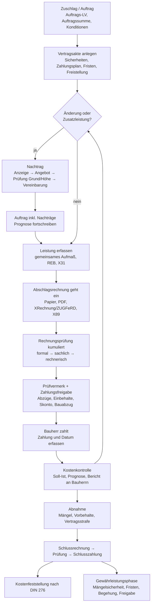

# Der AVA-Prozess II: Nachträge, Aufmaß, Rechnungsprüfung und Kostenkontrolle (HOAI LPH 8)

> **Lesehilfe für Nicht-Architekten.** Diese Notiz beschreibt die „Abrechnungs“-Hälfte der AVA (Ausschreibung, Vergabe, Abrechnung): alles, was zwischen dem Zuschlag an eine Baufirma und der Freigabe der letzten Sicherheit Jahre später passiert. In der HOAI (Honorarordnung für Architekten) gehört das zur **Leistungsphase 8 „Objektüberwachung“** (LPH 8, engl. *construction supervision*) und teils zur LPH 9. **AG** = Auftraggeber (Bauherr), **AN** = Auftragnehmer (Baufirma), **LV** = Leistungsverzeichnis (engl. *bill of quantities*), **OZ** = Ordnungszahl (Positionsnummer im LV), **EP/GP** = Einheits-/Gesamtpreis, **VE** = Vergabeeinheit (ein Auftrag, oft ein Gewerk). Rechtsregeln (VOB/B, BGB, HOAI, Steuern) stehen ausführlich in [HOAI, VOB/B/C, BGB](/okf/research/standards/hoai-vob-b-c.md); hier geht es um **Praxis, Daten und Reibungsverluste**. Keine Rechtsberatung.

## Kurzfassung

- **Abrechnung ist eine Schleife je Auftrag, kein Einzelschritt.** Nachtrag → Aufmaß → Abschlagsrechnung → kumulierte Prüfung → Prüfvermerk und Freigabe → Zahlung durch den Bauherrn → Kostenkontrolle läuft für alle Aufträge eines Projekts parallel über Monate. Sie endet erst mit der Freigabe der letzten Mängelsicherheit, oft Jahre nach der Abnahme (Abschnitt 1).
- **Kernprinzip kumulierte Prüfung:** Jede Abschlagsrechnung weist die Gesamtleistung aus und zieht alle früheren Zahlungen ab. Fehler früherer Abschläge müssen später „glattgezogen“ werden (OLG München, 27 U 3914/16) [4]. Die Software braucht deshalb unveränderliche Prüfstände je Rechnung (Abschnitt 5.2).
- **Vertragskonditionen steuern jede Rechnung.** Nachlass, Skonto, Sicherheiten, Umlagen, Bauabzugsteuer und USt-Modus wirken auf jede Rechnung, Reihenfolge und Bemessungsgrundlage legt der Vertrag fest. Viele Klauseln sind angreifbar: Umlagen (KG Berlin 2025), Übersicherung (BGH 2010), Nachlass auf Nachträge (strittig) [3][20][24]. → Alles muss **je Auftrag konfigurierbar** sein.
- **Nachträge sind teuer und langsam.** Bei 48 Landesbaumaßnahmen in Baden-Württemberg betrugen sie im Mittel 17 % (Sanierung) bzw. 6 % (Neubau) der genehmigten Gesamtbaukosten. Vom Angebot bis zur Beauftragung vergingen im Mittel 63 Tage, und 15 % wurden erst nach Fertigstellung vereinbart [17]. Geprüft wird dem Grunde und der Höhe nach. Für die Höhe konkurrieren zwei Methoden: Fortschreibung der Urkalkulation und tatsächlich erforderliche Kosten (§ 650c BGB) [9][10][25].
- **Haftung und Skonto machen die Prüfung zeitkritisch.** Prüft der Architekt fehlerhaft, entsteht der Schaden laut BGH schon mit dem Prüffehler [6]. Unberechtigte Kürzungen kosten den Bauherrn das ganze Skonto [14]. Das VHB lässt die Skontofrist am Tag nach Eingang der prüfbaren Rechnung beginnen [19].
- **E-Rechnung ersetzt die Prüfung nicht.** Laut BMF-Schreiben vom 15.10.2026 darf eine Bau-E-Rechnung im strukturierten Teil nur Gewerkesummen enthalten; das LV kommt als Anlage, optional als GAEB-Datei. Abschläge dürfen bis 30.06.2030 in der Endrechnung summarisch (BT-113) abgezogen werden [1]. Für Bau gibt es eigene Typcodes 875/876/877 [11]. Maßgeblich bleiben Aufmaß und Auftrags-LV.
- **Wirtschaftliches Gewicht:** Laut Siemon-Tabellen entfallen auf Aufmaß und Rechnungsprüfung 4–7 % des gesamten Architektenhonorars. Mit Kostenkontrolle und Kostenfeststellung sind es 5,5–9,5 %, also etwa ein Sechstel bis knapp ein Drittel der LPH 8 [15].
- **Praxis heute:** Aufmaße und Rechnungen kommen oft als Papier, PDF oder Excel. Abschläge werden ohne Gesamtüberblick geprüft, Kostenberichte entstehen in Excel. In NOVA aktualisieren sich Rechnungen und Kostenanalyse nicht von selbst, und LPH-8-Funktionen gibt es nur im teuersten Paket (Abschnitt 9.4).
- **Beste frei verfügbare Prozessvorlage:** VHB Bund mit Richtlinie 400 (Abrechnung, Zahlung, Skonto, Nachlass) und Formblättern 421–466 und 510–523 [19]. Ergänzend die Prüfcheckliste eines bayerischen Bauamts [9] und der E-Rechnungsleitfaden der Deutschen Bahn [12].

## 1. Überblick: Wer macht was nach dem Zuschlag?

### 1.1 Rollen

| Rolle | Aufgabe in der Abrechnung | Typisches Werkzeug heute (Einschätzung) |
|---|---|---|
| **Bauherr (AG)** | schließt die Bauverträge, ordnet Änderungen an, zahlt, hält Sicherheiten, führt bei Unternehmereigenschaft die Bauabzugsteuer ab | Buchhaltung/ERP, bei Privatleuten Onlinebanking |
| **Architekt / Objektüberwacher** | gemeinsames Aufmaß, Prüfung von Aufmaß, Nachträgen und Rechnungen, Kostenkontrolle, Kostenfeststellung, Mängel- und Fristenlisten (LPH 8 f–p, siehe [HOAI-Notiz](/okf/research/standards/hoai-vob-b-c.md)) | AVA-Software, daneben Excel, PDF-Stempel, E-Mail |
| **Baufirma (AN)** | stellt Aufmaße, Nachtragsangebote, Abschlags- und Schlussrechnungen, stellt Sicherheiten (Bürgschaften) | Bau-ERP/Kalkulation, Aufmaß-Apps, E-Rechnung |
| Fachplaner (TGA, Tragwerk) | prüfen Aufmaße und Rechnungen ihrer Gewerke fachtechnisch vor | eigene AVA oder Excel |
| Projektsteuerer (große Projekte) | übergreifendes Kostencontrolling und Berichte | Controlling-Werkzeuge |
| Zahlstelle (öffentliche AG) | formale Anordnung, Haushaltsmittel, E-Rechnungsportal | Haushalts-/ERP-Systeme |

Wichtig für das Datenmodell: **Der Architekt zahlt nie selbst.** Er prüft, vermerkt und gibt frei; der Bauherr zahlt. Ein System, das nur der Architekt bedient, kennt den tatsächlichen Zahlungsfluss deshalb nur, wenn jemand ihn zurückmeldet (Einschätzung). NOVA erlaubt die Erfassung der tatsächlichen Zahlung zum Beispiel nur für die zuletzt freigegebene Rechnung ([NOVA-Handbuch](/okf/research/nova-ava/manual-and-workflows.md)).

### 1.2 Gesamtablauf



Die Schleife C → F → G → H → I → J → K läuft **je Auftrag** mehrfach (eine Abschlagsrechnung je Monat oder je Baufortschritt), und zwar für alle Aufträge eines Projekts parallel. Nachträge können jederzeit dazwischenkommen. Die Abnahme (L) beendet die Ausführung eines Auftrags und startet Schlussrechnung und Gewährleistung.

## 2. Vertragsverwaltung nach der Beauftragung

### 2.1 Was „der Vertrag“ in der Software ist

- **Auftrags-LV** (auch Vergabe-LV, Vertrags-LV): das LV des Zuschlagsbieters mit seinen Preisen, nach Verhandlung und Nachlässen. Es kommt aus dem Angebot (GAEB X84) und wird mit X86 an die Firma bestätigt, siehe [GAEB DA XML](/okf/research/standards/gaeb-da-xml.md) und [Prozess I](/okf/research/process/tendering-and-award.md). Ab hier sind **Struktur und Nummerierung eingefroren**; alles Neue kommt als Nachtrag dazu (so auch NOVA, [NOVA-Handbuch](/okf/research/nova-ava/manual-and-workflows.md)).
- **Vertragsart:** Einheitspreisvertrag (Abrechnung nach Aufmaß), Pauschalvertrag (Abrechnung nach Leistungsstand) oder Stundenlohnvertrag, siehe [HOAI-Notiz, 3.2](/okf/research/standards/hoai-vob-b-c.md). Die Vertragsart steuert, ob überhaupt aufgemessen wird.
- **Positionsarten mit Abrechnungswirkung:** Normalposition; Bedarfs- bzw. Eventualposition (nur bei Anordnung abrechenbar); Alternativposition (nur wenn gewählt); Pauschalposition (Menge 1, abgerechnet in Anteilen ≤ 1); Zuschlagsposition; Stundenlohnposition; entfallene Position ([GAEB DA XML](/okf/research/standards/gaeb-da-xml.md)).
- **Auftragssumme:** netto und brutto, mit Nachlass. Sie ist der Ausgangswert für Sicherheiten (z. B. 5 % Vertragserfüllung) und für die Kostenkontrolle.

### 2.2 Vertragskonditionen, die jede Rechnung beeinflussen

| Kondition | Typisches Beispiel | Wirkung in der Rechnungsprüfung | Quelle |
|---|---|---|---|
| **Nachlass** | 3 % auf die Abrechnungssumme oder ein fester Betrag | in jeder Rechnung abziehen; prüfen, ob er laut Vertrag auch für Nachträge gilt (öffentliche Checklisten fragen das ausdrücklich ab) | [9]; [NOVA-Handbuch](/okf/research/nova-ava/manual-and-workflows.md) |
| **Skonto** | 2 % bei Zahlung binnen 14 Tagen | gilt nur, wenn vereinbart und fristgerecht gezahlt (BGH, 22.09.2005, VII ZR 63/04); unberechtigte Kürzungen in der Rechnungsprüfung kosten das ganze Skonto (BGH, 10.02.2005, VII ZR 22/04); die Prüfung muss so schnell sein, dass der Bauherr die Frist halten kann. Das VHB lässt die Frist am Tag nach Eingang der prüfbaren Rechnung beginnen und berücksichtigt Skonti nur, wenn die Frist bei sorgfältiger Prüfung samt Zahlungsweg einhaltbar ist | [5][13][14][19]; [HOAI-Notiz](/okf/research/standards/hoai-vob-b-c.md) |
| **Vertragserfüllungssicherheit** | Bürgschaft oder Einbehalt, öffentlich höchstens 5 % der Auftragssumme | Einbehalt von Abschlägen bis zur Sicherheitssumme, wenn keine Bürgschaft vorliegt | [HOAI-Notiz, 3.9](/okf/research/standards/hoai-vob-b-c.md) |
| **Mängelsicherheit** (Gewährleistung) | öffentlich höchstens 3 % der Abrechnungssumme | Einbehalt aus der Schlussrechnung oder Ablösung durch Bürgschaft; Rückgabe nach Ablauf | [HOAI-Notiz, 3.9](/okf/research/standards/hoai-vob-b-c.md) |
| **Umlagen** | Bauwasser, Baustrom, Sanitärcontainer, Bauwesenversicherung, SiGeKo | prozentualer Abzug je Rechnung oder in der Schlussrechnung; Wirksamkeit der Klauseln umstritten | [3] |
| **Vorauszahlung** | Betrag gegen Vorauszahlungsbürgschaft | mit späteren Rechnungen verrechnen | [HOAI-Notiz, 3.8](/okf/research/standards/hoai-vob-b-c.md) |
| **Freistellungsbescheinigung** (§ 48b EStG) | gültig bis Datum X | ohne gültige Bescheinigung 15 % Bauabzugsteuer, wenn der Bauherr Unternehmer oder öffentliche Hand ist | [HOAI-Notiz, 6.1](/okf/research/standards/hoai-vob-b-c.md) |
| **USt-Modus** | 19 % oder Steuerschuld des Bauherrn (§ 13b UStG) | prüfen, ob die Rechnung die USt richtig ausweist | [HOAI-Notiz, 6.2](/okf/research/standards/hoai-vob-b-c.md) |
| **Zahlungsplan / Abschlagsrhythmus** | monatlich oder nach Bauabschnitten; beim Verbraucherbauvertrag höchstens 90 % Abschläge | Abgleich der Rechnung mit dem Plan | [HOAI-Notiz, 3.8–3.9](/okf/research/standards/hoai-vob-b-c.md) |
| **Vertragsstrafe** | Tagessatz und Obergrenze laut Vertrag | Vorbehalt bei der Abnahme, sonst verloren; Abzug erst in der Schlussrechnung | [HOAI-Notiz, 3.10](/okf/research/standards/hoai-vob-b-c.md) |
| **Abtretung / Pfändung** | Forderung an Bank oder Lieferanten abgetreten | Zahlung an den richtigen Empfänger; vor jeder Zahlung prüfen | [HOAI-Notiz, 3.6](/okf/research/standards/hoai-vob-b-c.md) |

**Einschätzung:** Reihenfolge und Bemessungsgrundlage der Abzüge (netto oder brutto, vor oder nach Nachlass, je Rechnung oder nur in der Schlussrechnung) legt der jeweilige Vertrag fest. Eine Software muss sie **je Auftrag konfigurierbar** machen und darf keine Reihenfolge fest verdrahten. NOVA lässt Abzüge netto oder brutto definieren; eine spätere Änderung der Vertragsinformationen wirkt dort nicht auf bereits erstellte Rechnungen ([NOVA-Handbuch](/okf/research/nova-ava/manual-and-workflows.md)).

### 2.3 Sicherheiten: Register statt Aktenordner

Für jede Sicherheit braucht man über Jahre hinweg einen Datensatz (Einschätzung, abgeleitet aus VOB/B § 17 und HOAI LPH 8 o / LPH 9, siehe [HOAI-Notiz](/okf/research/standards/hoai-vob-b-c.md)):

- Art (Vertragserfüllung, Mängelansprüche, Vorauszahlung, Abschlagszahlung), Form (Bürgschaft, Bareinbehalt, Hinterlegung), Betrag, Bezugsgröße.
- Bürge (Bank/Versicherer), Bürgschaftsnummer, Datum, Original-Ablageort (Bürgschaften sind Originalurkunden und werden bei Rückgabe physisch zurückgegeben).
- Einbehaltene Beträge je Rechnung (kumuliert), Sperrkonto bei Bareinbehalt (VOB/B: Einzahlung binnen 18 Werktagen).
- Rückgabebedingung und -termin: Vertragserfüllungssicherheit nach Abnahme und Stellung der Mängelsicherheit; Mängelsicherheit nach vereinbarter Frist (VOB/B-Regelfall 2 Jahre), offene Mängel als Hindernis.
- Status: angefordert, eingegangen, geprüft, gegen Einbehalt ausgetauscht, teilweise freigegeben, zurückgegeben.

**Vorsicht beim Kombinieren:** Der BGH hat eine AGB-Kombination aus 10 % Vertragserfüllungsbürgschaft und Zahlung der geprüften Abschläge zu nur 90 % als Übersicherung gewertet; beide Klauseln waren unwirksam, der Bauherr stand ohne Sicherheit da (Urteil vom 09.12.2010, VII ZR 7/10) [24]. Die Übersicherung wächst mit dem Baufortschritt, weil Abschläge ohnehin nicht den vollen Leistungswert abdecken [24]. **Einschätzung:** Eine Software kann so etwas nicht rechtlich bewerten, aber sie kann die Summe aller Sicherheiten und Einbehalte je Auftrag laufend in Prozent der Auftragssumme anzeigen und ab einer konfigurierbaren Schwelle warnen.

### 2.4 Zahlungsplan und Mittelabfluss

Einen **Zahlungsplan** aufzustellen und fortzuschreiben ist nach HOAI eine Besondere Leistung der LPH 8 (gesondert zu vergüten), siehe [HOAI-Notiz, 2.6](/okf/research/standards/hoai-vob-b-c.md). Für Bauherren mit Finanzierung (Bankdarlehen in Tranchen) oder Haushaltsmitteln ist die Frage „Wann fließt wie viel Geld?“ trotzdem zentral. NOVA kündigt eine Mittelabflussplanung für den 01.02.2027 an und zeigt seit Oktober 2026 Kostenganglinien im Terminplan ([NOVA-Handbuch](/okf/research/nova-ava/manual-and-workflows.md)).

## 3. Nachtragsmanagement

Ein **Nachtrag** (engl. *change order*, *variation*) ist eine zusätzliche Vergütungsforderung für Leistungen, die nicht oder anders im Vertrag stehen. Rechtsgrundlagen (VOB/B § 2 Abs. 3, 5, 6, 8, 10; BGB §§ 650b, 650c) und Formblätter des Bundes (521–523) stehen in der [HOAI-Notiz, 3.4–3.5](/okf/research/standards/hoai-vob-b-c.md).

### 3.1 Anlässe

| Anlass | Typisches Beispiel | Rechtsgrundlage (Kurz) |
|---|---|---|
| geänderte Leistung | Planänderung: anderer Bodenbelag, andere Wandstärke | § 2 Abs. 5 VOB/B, §§ 650b/650c BGB |
| zusätzliche Leistung | Brandschutzauflage verlangt zusätzliche Türelemente | § 2 Abs. 6 VOB/B |
| Mengenänderung über ±10 % | mehr Erdaushub als im LV angesetzt | § 2 Abs. 3 VOB/B |
| Leistung ohne Auftrag | Firma führt eigenmächtig aus | § 2 Abs. 8 VOB/B (grundsätzlich keine Vergütung) |
| Bauzeit / Behinderung | Vorgewerk verspätet, Stillstand | § 6 VOB/B, „bauwirtschaftlicher Nachtrag“ |
| Stundenlohnarbeiten | nicht im LV beschreibbare Kleinarbeiten | § 2 Abs. 10, § 15 VOB/B |

### 3.2 Ablauf in zehn Schritten

1. **Auslöser dokumentieren:** Anordnung des Bauherrn, Planänderung (Planstand/Index), Behinderungs- oder Bedenkenanzeige der Firma, Fotos, Bautagebuch.
2. **Ankündigung bzw. Änderungsbegehren:** Bei zusätzlichen Leistungen muss die Firma den Anspruch vor der Ausführung ankündigen (VOB/B); im BGB-Vertrag beginnt mit dem Änderungsbegehren eine 30-Tage-Einigungsfrist ([HOAI-Notiz, Fristen](/okf/research/standards/hoai-vob-b-c.md)).
3. **Nachtragsangebot der Firma:** Nachtrags-LV mit neuen Positionen, Mengen, Preisen, Begründung und gegebenenfalls Kalkulationsnachweisen (Urkalkulation oder EFB-Preisblätter 221–223) [9].
4. **Formale Prüfung:** Ist der Nachlass des Hauptauftrags eingerechnet? Hat die Firma eigene AGB ins Angebot geschrieben (streichen)? Enthält das Angebot Vorbehalte zur Bauzeitverlängerung? Stimmt die Summe? [9]
5. **Prüfung dem Grunde nach** (Anspruchsprüfung): Ist die Leistung nicht schon Teil des Vertrags, etwa als Nebenleistung? Ist jede Position stichhaltig begründet, also mit Anlass und Ursache? Die bayerische Checkliste zeigt als Negativbeispiel eine Begründung, die nur den Einbau beschreibt, und als Positivbeispiel eine, die Auflage, Zeitpunkt der Kenntnis und entfallende Hauptpositionen benennt [9].
6. **Prüfung der Höhe nach** (Preisprüfung): Sind Zeit- und Mengenansätze realistisch? Passen Verrechnungslohn und Zuschläge zu den Preisblättern des Hauptangebots? Bei Stundenlohn: Mittellohn nachvollziehen [9]. Methodenfrage siehe 3.3.
7. **Prüfvermerk:** Vermerk „fachtechnisch und rechnerisch richtig“ mit geprüftem Betrag, Name, Datum, Unterschrift; die bayerische Checkliste wertet „fachtechnisch geprüft“ ohne Betrag ausdrücklich als falsch [9]. Öffentliche AG nutzen dafür die VHB-Formblätter 521/522 ([HOAI-Notiz](/okf/research/standards/hoai-vob-b-c.md)).
8. **Verhandlung und Entscheidung des Bauherrn:** Der Architekt empfiehlt, der Bauherr beauftragt. Zusatzaufträge im Namen des Bauherrn darf der Architekt grundsätzlich nur mit ausdrücklicher Vollmacht erteilen; nach Verkehrssitte gilt das allenfalls für kleine Ergänzungen und technische Änderungen. Handelt er ohne Vollmacht und genehmigt der Bauherr nicht, kann der Architekt selbst gegenüber der Firma haften. Ausnahmen über Anscheins- und Duldungsvollmacht sind Einzelfallfragen [16]. → Die Software sollte festhalten, **wer** einen Nachtrag beauftragt hat und auf welcher Vollmacht das beruht.
9. **Beauftragung:** Nachtragsvereinbarung (öffentlich: Formblatt 523), elektronisch als X86 mit Nachtragsnummer ([GAEB DA XML](/okf/research/standards/gaeb-da-xml.md)). Ab jetzt zählt der Nachtrag zur Auftragssumme.
10. **Abrechnung und Kostenkontrolle:** Nachtragspositionen werden wie Hauptpositionen aufgemessen und abgerechnet. Bei einer Anordnung nach § 650b BGB ohne Einigung darf die Firma in Abschlagsrechnungen 80 % der in ihrem Nachtragsangebot genannten Mehrvergütung ansetzen, solange weder eine Einigung noch eine gerichtliche Entscheidung vorliegt; die volle Mehrvergütung wird erst nach der Abnahme fällig, Überzahlungen sind verzinst zurückzuzahlen (§ 650c Abs. 3 BGB) [25]. NOVA bildet das als Option „VOB 80-Prozent-Regelung“ ab ([NOVA-Handbuch](/okf/research/nova-ava/manual-and-workflows.md)).

### 3.3 Wie wird der Nachtragspreis ermittelt?

| Methode | Grundlage | Wo üblich | Praxisproblem |
|---|---|---|---|
| **Vorkalkulatorische Preisfortschreibung** | Urkalkulation bzw. EFB-Preisblätter des Hauptangebots; nach gängiger Faustformel bleibt ein guter Preis gut und ein schlechter schlecht | Verwaltungspraxis des Bundes (VHB) | Urkalkulation liegt oft nicht vor oder ist nicht aussagekräftig ([HOAI-Notiz](/okf/research/standards/hoai-vob-b-c.md)) |
| **Tatsächlich erforderliche Kosten + Zuschläge** | § 650c Abs. 1 BGB; BGH 2019 für Mehrmengen | BGB-Verträge, zunehmend auch VOB/B-Streitfälle | lässt sich laut Fachbeitrag meist erst nach der Ausführung genau bestimmen; Nachweise nötig [10] |
| **Vertraglich vereinbarte Methode** | z. B. Preisindizes statt Lieferantenrechnungen, feste Stunden- und Gerätesätze | wird empfohlen, aber selten vereinbart [10] | muss beim Vertragsschluss geregelt sein |
| **Stundenlohn** | vereinbarte Stundensätze, Stundenlohnzettel | Kleinarbeiten | nur vergütet, wenn vor Beginn vereinbart ([HOAI-Notiz, 3.7](/okf/research/standards/hoai-vob-b-c.md)) |

**Einschätzung:** Ein Prüfmodul sollte beide Rechenwege nebeneinander zeigen können: Fortschreibung aus den Preisanteilen des Hauptauftrags (Lohn, Stoffe, Geräte, Nachunternehmer, Zuschläge) und Kostennachweis plus Zuschläge. Dafür muss die Software die Preisaufgliederung des Hauptangebots (EFB 221–223 oder EP-Anteile aus GAEB) beim Auftrag speichern.

### 3.4 Nachtrags-LV und Nummerierung

- Eine **Nachtragsnummer** (NA-Nr., z. B. „NA 07“) fasst die Positionen eines Nachtragsangebots zusammen. In GAEB trägt jede Nachtragsposition die Nummer im Feld `CONo` und den Status im Feld `COStatus` ([GAEB DA XML](/okf/research/standards/gaeb-da-xml.md)).
- **Positionsnummern:** Es gibt zwei Grundmuster.
  - *Einsortieren:* Neue Positionen kommen in den passenden Abschnitt des Hauptauftrags und werden gekennzeichnet. Im bayerischen Beispiel tragen sie die OZ plus Suffix „N“, etwa 1.3.6N oder 1.4.41N [9].
  - *Eigener Nachtragstitel:* ORCA legt einen Nachtrag als eigenen Gliederungspunkt an; jede dort eingefügte Position ist automatisch Nachtragsposition dieses Nachtrags. Alternativ lassen sich Nachtragspositionen im Hauptauftrag oder Mehr- und Mindermengen als „Nachtragsteilmengen“ an bestehenden Positionen führen [22].
  - Öffentliche Auftraggeber geben oft eine feste OZ-Maske vor (Bayern im Straßenbau z. B. 2 Stellen Abschnitt, 2 Stellen Unterabschnitt, 4 Stellen Position, Index nicht benutzen) [23]; die Nachtragsnummerierung muss in diese Maske passen (Einschätzung).
- **Änderungsnachtrag** an bestehenden Positionen: Menge oder Preis ändern, Position entfallen lassen, Eventualposition beauftragen, Alternative statt Grundposition wählen. NOVA legt dafür eine Historie mit Kopie der Originalzeile an ([NOVA-Handbuch](/okf/research/nova-ava/manual-and-workflows.md)).

### 3.5 Status und Wirkung auf Budget und Prognose

| Status (GAEB-Vokabular) | Bedeutung | Wirkung (Beispiel ORCA/NOVA) |
|---|---|---|
| erkannt | Architekt oder Firma sieht einen möglichen Nachtrag | nur Prognose bzw. Risiko |
| angemeldet | Firma hat angekündigt | Risiko |
| angeboten | Nachtragsangebot liegt vor | Risiko (mit Angebotsbetrag) |
| sachlich anerkannt | dem Grunde nach berechtigt, Höhe offen | Risiko bzw. Prognose |
| genehmigt | beauftragt | Auftragssumme und Prognose |
| abgelehnt / Widerspruch | Bauherr lehnt ab, Firma widerspricht | Risiko (Streitwert) |
| zurückgezogen | erledigt | keine |

Quellen: Statusliste aus [GAEB DA XML](/okf/research/standards/gaeb-da-xml.md); Wirkungsregeln aus [DIN 276](/okf/research/standards/din-276-cost-planning.md) (ORCA) und [NOVA-Handbuch](/okf/research/nova-ava/manual-and-workflows.md) (Spalte „Risiko (NA)“). In ORCA setzt der Status eine „Wirksamkeit“ (aktiv = Auftrag und Prognose, nur Prognose, inaktiv), die sich teils von Hand übersteuern lässt; ein genehmigter Nachtrag geht immer in die Auftragssumme ein, ein abgelehnter oder zurückgezogener nie [22]. Abgerechnet werden darf nur ein genehmigter Nachtrag.

### 3.6 Typische Konfliktfelder

- **Nachlass auf Nachträge:** Gilt der Hauptauftrags-Nachlass auch für Nachtragspreise? Im Angebotsschreiben des Bundes (VHB-Formblatt 213, Ziffer 4) bezieht sich der unbedingte Preisnachlass auf die Abrechnungssumme und ausdrücklich auch auf die Preise angeordneter Leistungen, die auf Grundlage der Preisermittlung für die vertragliche Leistung zu bilden sind [19]; die bayerische Checkliste fragt deshalb ab, ob der Nachlass im Nachtragsangebot eingerechnet ist [9]. Ein Fachanwalt hält diese Klausel für intransparent und nach § 307 BGB unwirksam und meint, ohne ausdrückliche Erklärung gelte ein Nachlass nicht automatisch für Nachträge [20]. **Folgerung:** Die Software braucht je Auftrag ein Feld „Nachlass gilt für Nachträge: ja/nein/nur preisfortgeschriebene“, statt den Nachlass pauschal auf alles anzuwenden.
- **Vorbehalte und AGB im Nachtragsangebot:** Firmen schreiben Bauzeitvorbehalte oder eigene Geschäftsbedingungen in Nachtragsangebote; Prüfer sollen sie streichen bzw. Ausführungsfristen fortschreiben [9].
- **Nebenleistung oder Nachtrag?** Was nach VOB/C Nebenleistung ist, wird nicht gesondert vergütet, auch wenn es aufgemessen wurde ([HOAI-Notiz, 3.6](/okf/research/standards/hoai-vob-b-c.md)). Der Rechnungshof Baden-Württemberg fand 2026 bei Landesbaustellen Nachträge für Nebenleistungen der Baustelleneinrichtung, die beauftragt oder vergütet wurden, obwohl die Begründungen keinen Beleg für ein lückenhaftes LV enthielten; in einem Gegenbeispiel wurde eine Forderung von 200.000 € für einen geänderten Kranstandort auf unter 10.000 € reduziert [18].
- **Zeitdruck:** Die Leistung wird oft ausgeführt, bevor der Preis vereinbart ist. Beim Land Baden-Württemberg vergingen vom Nachtragsangebot bis zur schriftlichen Beauftragung im Mittel 63 Kalendertage (über 100 geprüfte Fälle, ohne Ausreißer von weit über 100 Tagen); 15 % der Nachtragsvereinbarungen kamen erst nach Fertigstellung der Leistung zustande, und bei 18 % fehlten nötige neue Vertragsfristen [17].
- **Dokumentation:** Bei der Mehrheit der geprüften Maßnahmen fehlten Preiskalkulation oder stichhaltige Begründung, sodass Nachträge nicht prüfbar waren [17].

## 4. Aufmaß

### 4.1 Zweck

Das **Aufmaß** (engl. *measurement*, *quantity survey*) stellt fest, welche Mengen tatsächlich gebaut wurden. Beim Einheitspreisvertrag ist es die Grundlage der Vergütung; Wikipedia nennt es das „Urdokument“ der Abrechnung [8]. Gemessen wird nach den Abrechnungsregeln der jeweiligen ATV (VOB/C, Abschnitt 5). Beispiel: Bei Betonarbeiten werden Öffnungen in Flächen nur abgezogen, wenn sie einzeln größer als 2,5 m² sind; eine normale Türöffnung in einer Betonwand wird also übermessen [8]. Ausführlich: [HOAI-Notiz, 4.3](/okf/research/standards/hoai-vob-b-c.md).

### 4.2 Arten

| Art | Beschreibung | Wann |
|---|---|---|
| **Örtliches Aufmaß** | Messen am Bauwerk (Meterstab, Laser, Tachymeter) | sichtbare, unregelmäßige Leistungen, Bestand |
| **Aufmaß nach Plänen** | Mengen aus Ausführungs- oder Abrechnungszeichnungen [8] | planmäßig ausgeführte Leistungen |
| **Gemeinsames Aufmaß** | AG und AN messen zusammen und unterschreiben (§ 14 Abs. 2 VOB/B) [8] | Grundleistung LPH 8 f; besonders bei später verdeckten Leistungen |
| **Leistungsstand in %** | Fortschritt von Pauschalen oder Pauschalverträgen | Pauschalpositionen, Abschläge |
| **Stundenlohnzettel** | Stunden, Material, Geräte | Stundenlohnarbeiten |
| **Digitale Mengenermittlung** | aus PDF/CAD-Plänen oder BIM-Modellen, teils KI-gestützt | wachsend, siehe [BIM und AVA](/okf/research/standards/bim-and-ava.md) |

Das VHB sieht die Reihenfolge so: Die Leistung wird aus Zeichnungen ermittelt, soweit die Ausführung ihnen entspricht; fehlen solche Zeichnungen, wird in der Regel gemeinsam aufgemessen. Leistungen, die später verdeckt werden, sind vorher zu prüfen und aufzumessen. Ein gemeinsames Aufmaß bindet beide Seiten bei den Mengen, nicht aber bei der Frage, ob diese Mengen gesondert vergütet werden (Beispiel Nebenleistung) [19].

### 4.3 Ablauf eines gemeinsamen Aufmaßes

1. Termin vereinbaren, bevor Leistungen verdeckt werden (Estrich über Leitungen, Erdreich über Fundamenten).
2. Abrechnungspläne und Auftrags-LV bereitstellen; Firma bringt vorbereitete Aufmaßblätter mit.
3. Vor Ort messen, Abzüge nach ATV klären, Skizzen und Fotos machen.
4. Aufmaßblätter von beiden Seiten unterschreiben lassen, Unstimmigkeiten vermerken.
5. Firma überträgt die Daten (DA11/X31, Excel oder App) und rechnet ab.
6. Architekt prüft die Übertragung gegen die unterschriebenen Blätter und gibt Positionen frei.

### 4.4 Inhalt eines Aufmaßblatts

| Bereich | Felder |
|---|---|
| Kopf | Projekt, Auftrag/VE, Firma, Blattnummer, Datum, Leistungszeitraum, Bauteil/Geschoss/Achse, Teilnehmer |
| Zeile | OZ, Ortsangabe, Erläuterung, Rechenansatz oder Formelnummer, Faktor/Stückzahl, Vorzeichen (Abzug), Ergebnis |
| Summen | Zwischensummen, Positionssumme, Übertrag in die Mengenzusammenstellung |
| Anlagen | Skizzen, Fotos, Lieferscheine, Wiegescheine |
| Status | ungeprüft, korrigiert, abgelehnt, freigegeben; Unterschriften beider Seiten |

Quelle: eigene Zusammenstellung aus REB-VB 23.003 ([HOAI-Notiz, 5.2](/okf/research/standards/hoai-vob-b-c.md)) und den Erfassungsblättern in NOVA ([NOVA-Handbuch](/okf/research/nova-ava/manual-and-workflows.md)).

### 4.5 Rechenansätze (schematisches Beispiel)

Eigenes Beispiel, vereinfacht und nicht im 80-Zeichen-Festformat der REB:

```text
OZ 02.03.0040  Stahlbetonwand d = 25 cm, Schalung beidseitig    Einheit m²
  Achse A, EG     Rechteck   2 × 6,000 × 3,000            =  36,000
  Tür T1          1,010 × 2,135 = 2,156 m² ≤ 2,5 m²        =   0,000  (übermessen)
  Tor T2          Abzug  −2 × 2,260 × 2,135                =  −9,650  (> 2,5 m², Abzug)
                                               Positionssumme  26,350
```

Die REB-VB 23.003 kennt dafür Formelnummern für Standardfiguren, freie Formeln, Hilfswerte, Zwischensummen und Adressen; Ergebnisse werden mit drei Nachkommastellen ausgegeben ([HOAI-Notiz, 5.2](/okf/research/standards/hoai-vob-b-c.md)). Wer ein Aufmaß prüft, rechnet idealerweise jeden Ansatz nach, statt nur die Summe zu übernehmen.

### 4.6 Austauschformate und Werkzeuge

- **DA11** (REB-Festformat, 9-stellige OZ) und **GAEB X31** (seit DA XML 3.2, laut Wikipedia seit Oktober 2013; seit 2023-01 mit eingebetteten Bildern) [8]; Details in [GAEB DA XML](/okf/research/standards/gaeb-da-xml.md). Software mit eigenem REB-Rechenkern rechnet importierte Ansätze nach; bei Abweichung gilt die eigene Rechnung.
- **Apps und Web-Werkzeuge:** NOVA Aufmaß App mit Auftragnehmer-Zugang ([NOVA-Handbuch](/okf/research/nova-ava/manual-and-workflows.md)); grafisches Aufmaß auf PDF/DWG (GRAVA), Aufmaß-Software für Firmen (MWM-Libero), KI-Prototypen und Dienstleister (PlanQ, condesk), siehe [Cloud- und Nischenanbieter](/okf/research/market/cloud-and-niche-vendors.md).
- **Stolperstein:** NOVA übernimmt beim DA11/X31-Import auch syntaktisch falsche Ansätze ([NOVA-Handbuch](/okf/research/nova-ava/manual-and-workflows.md)).

### 4.7 Mengenabweichungen

Je Position werden Vordersatz (LV-Menge), abgerechnete Menge und Abweichung geführt. Liegt die Abweichung über ±10 %, ist im VOB/B-Vertrag auf Verlangen ein neuer Preis zu vereinbaren (§ 2 Abs. 3); Rechenbeispiel und Ausgleichsberechnung in der [HOAI-Notiz, 3.4](/okf/research/standards/hoai-vob-b-c.md). Für die Kostenkontrolle ist die Mengenabweichung die wichtigste Frühwarnung, weil Abschläge sie erst spät sichtbar machen (siehe Abschnitt 7).

## 5. Abschlagsrechnungen und Rechnungsprüfung

### 5.1 Rechnungsarten

| Rechnungsart | Inhalt | Besonderheit |
|---|---|---|
| **Vorauszahlungsrechnung** | Betrag vor Leistung | nur bei Vereinbarung, meist gegen Bürgschaft |
| **Abschlagsrechnung** | kumulierte Leistung bis Stichtag minus bisherige Abschläge | vorläufig; Fälligkeit 21 Tage (VOB/B) |
| **Teilschlussrechnung** | abgeschlossener, abgenommener Leistungsteil | endgültig für diesen Teil |
| **Schlussrechnung** | gesamte Leistung inkl. Nachträgen minus aller Zahlungen | Ausschlusswirkung der vorbehaltlosen Schlusszahlung |
| **Stundenlohn-/Regierechnung** | anerkannte Stundenlohnzettel | spätestens alle 4 Wochen (VOB/B) |
| **Rechnung über Einbehalt** | Auszahlung eines Sicherheitseinbehalts | nach Ablösung durch Bürgschaft oder Fristablauf |

Fristen und Rechtsfolgen: [HOAI-Notiz, 3.8 und 7](/okf/research/standards/hoai-vob-b-c.md). XRechnung-Typcodes: siehe Abschnitt 6.3.

ORCA unterscheidet zwei Abrechnungslogiken: **kumulative** Rechnungsfreigabe (jede Teilrechnung betrachtet den gesamten Leistungsstand, alle bisherigen Zahlungen werden abgezogen) und **separate** Rechnungsfreigabe (jede Rechnung weist nur Zuwachs, Teillieferung oder einen Pauschalbetrag aus; verrechnet wird erst in der Schlussrechnung). Regie- und Nachtragsrechnungen lassen sich als Einzelrechnungen außerhalb der Folge anlegen. In der Rechnungsfolge ist nur die jeweils letzte Rechnung voll änderbar [22]. Erfasst werden je Rechnung u. a. Belegnummer der Firma, Rechnungsdatum, Eingangsdatum, Zahlungsziel, geforderter Betrag (nur informativ) und zugestandener Betrag [22].

### 5.2 Grundprinzip: kumulierte Abrechnung

Jede Abschlagsrechnung weist die **gesamte bisher erbrachte Leistung** aus und zieht alle früheren Abschläge ab. Dadurch korrigiert sich ein Fehler in einer früheren Abschlagsrechnung in der nächsten von selbst, **wenn** er dort bemerkt wird. Das OLG München hat entschieden: Übernimmt der Bauherr ab der 12. Abschlagsrechnung die Prüfung selbst, haftet der frühere Planer nicht mehr für eine Überzahlung in der 11. Rechnung, die später nicht glattgezogen wurde (Urteil 13.02.2017, 27 U 3914/16; Nichtzulassungsbeschwerde vom BGH am 04.09.2019 zurückgewiesen, VII ZR 80/17) [4].

**Folgerung für die Software (Einschätzung):** Geprüft wird immer der kumulierte Stand je Position, nicht der Zuwachs. Jede Rechnung muss einen unveränderlichen Prüfstand speichern (Snapshot), und die nächste Prüfung muss Abweichungen zum vorherigen Stand sichtbar machen.

### 5.3 Drei Prüfstufen

1. **Formale Prüfung (Prüfbarkeit):** Ist die Rechnung nach § 14 Abs. 1 VOB/B prüfbar aufgestellt, also in der Reihenfolge der Positionen, mit Aufmaßen und Belegen, Nachträge getrennt? Der BGH sieht Prüfbarkeit nicht als Selbstzweck: Wie detailliert eine Rechnung sein muss, hängt vom Einzelfall und den Kenntnissen des Auftraggebers und seiner Berater ab (BGH, 08.10.1998) [7]. Für Abschlagsrechnungen genügt, was das Informations- und Kontrollinteresse des Auftraggebers erfüllt (BGH, 18.05.2000, VII ZR 69/99, zitiert nach [5]). Das VHB verlangt, **jede** Rechnungsart sofort nach Eingang auf Prüfbarkeit und Vollständigkeit der Unterlagen zu prüfen und nicht prüfbare Rechnungen unverzüglich schriftlich mit Gründen zurückzuweisen [19].
2. **Sachliche (fachtechnische) Prüfung:** Ist die Leistung erbracht und vertragsgemäß? Stimmen die Mengen mit dem freigegebenen Aufmaß? Sind abgerechnete Nachträge beauftragt? Gibt es Mängel, die einen Einbehalt rechtfertigen?
3. **Rechnerische Prüfung:** Menge × Vertrags-EP, Summen, Nachlass, Umlagen, USt, Einbehalte, Abzug früherer Zahlungen. Ein Fachbeitrag betont, dass auch geprüft werden muss, ob die eingesetzten Preise den Vertragspreisen entsprechen [5].

### 5.4 Rechenweg einer Prüfrechnung (Zahlenbeispiel)

Eigenes Beispiel: VOB/B-Einheitspreisvertrag, Nachlass 3 %, Umlage Bauwasser/Baustrom 0,5 %, Sicherheitseinbehalt 5 % (brutto, mangels Bürgschaft), Skonto 2 % bei Zahlung binnen 14 Tagen, Freistellungsbescheinigung liegt vor. Dritte Abschlagsrechnung.

| Schritt | Betrag (€) |
|---|---:|
| Kumulierte Leistung Hauptauftrag laut freigegebenem Aufmaß, netto | 120.000,00 |
| + kumulierte Leistung aus genehmigten Nachträgen, netto | 8.000,00 |
| = kumulierte Leistung, netto | 128.000,00 |
| − Nachlass 3 % (hier auch auf Nachträge, laut Vertrag zu prüfen) | −3.840,00 |
| − Umlage Bauwasser/Baustrom 0,5 % | −620,80 |
| = Rechnungsbetrag nach Abzügen, netto | 123.539,20 |
| + USt 19 % | 23.472,45 |
| = kumulierter Bruttobetrag | 147.011,65 |
| − Sicherheitseinbehalt 5 % | −7.350,58 |
| − bereits freigegebene Abschläge 1 und 2 | −100.000,00 |
| = **Freigabebetrag dieser Rechnung** | **39.661,07** |
| − Skonto 2 %, falls fristgerecht gezahlt | −793,22 |
| = Überweisungsbetrag | 38.867,85 |
| (ohne Freistellungsbescheinigung zusätzlich 15 % Bauabzugsteuer auf die Zahlung einbehalten und ans Finanzamt abführen) | – |

NOVA rechnet in derselben Grundreihenfolge (Leistung inkl. Nachlass → Abzüge netto → USt → Abzüge brutto → Vorrechnungen → Ausgleich früherer Zahlungsdifferenzen → Skonto → Bauabzug), siehe [NOVA-Handbuch](/okf/research/nova-ava/manual-and-workflows.md). **Offene Detailfrage:** Ob in der kumulierten Folgerechnung die früheren Freigabebeträge (vor Skonto) oder die tatsächlich gezahlten Beträge abgezogen werden, und wie verlorenes oder zu Unrecht gezogenes Skonto ausgeglichen wird, habe ich in keiner Quelle einheitlich beschrieben gefunden (siehe Offene Fragen). NOVA führt dafür eine eigene Zeile „Ausgleich aus vorherigen Zahlungen“.

### 5.5 Abzüge und Einbehalte im Detail

| Abzug | Grundlage | Typische Höhe | Fallstricke |
|---|---|---|---|
| Nachlass | Angebot/Verhandlung | z. B. 2–5 % (Einschätzung) | Geltung für Nachträge; Umrechnung pauschaler Nachlässe in Prozent für GAEB-Rechnungen ([GAEB DA XML](/okf/research/standards/gaeb-da-xml.md)) |
| Umlagen Baustrom, Bauwasser, Sanitär | Vertragsklausel | Klauseln über 1,5 % sind verbreitet [3][21]; das KG Berlin hält 1 % der Abrechnungssumme für alle Verbrauchsumlagen zusammen für die Obergrenze [3] | Klausel kann unwirksam sein (KG, 18.07.2025, 21 U 176/24; OLG Schleswig, 31.08.2022, 12 U 119/21); Umlage nur bei tatsächlicher Nutzung; Firma muss sich selbst versorgen bzw. geringeren Verbrauch nachweisen dürfen [3][21] |
| Umlage Bauwesenversicherung | Vertragsklausel | laut Vertrag | gilt als umlagefähig, weil nur der Bauherr diese Versicherung abschließen kann [21] |
| Umlage Baureinigung, SiGeKo | Vertragsklausel | z. B. 1 % für SiGeKo im KG-Fall [3] | pauschale Reinigungsumlagen gelten als regelmäßig unwirksam, SiGeKo-Umlagen als wahrscheinlich unwirksam, weil der Bauherr selbst verantwortlich ist [3][21] |
| Sicherheitseinbehalt Vertragserfüllung | Vertrag, § 17 VOB/B | bis 10 % je Zahlung, bis zur Sicherheitssumme (öffentlich max. 5 % der Auftragssumme) | Sperrkonto binnen 18 Werktagen; Austausch gegen Bürgschaft ([HOAI-Notiz, 3.9](/okf/research/standards/hoai-vob-b-c.md)) |
| Mängeleinbehalt (Gewährleistung) | Vertrag | öffentlich max. 3 % | ab Schlussrechnung; Rückgabe nach Frist |
| Einbehalt wegen Mängeln | § 641 Abs. 3 BGB | i. d. R. das Doppelte der Beseitigungskosten | Mängel dokumentieren, Einbehalt wieder auflösen |
| Vorauszahlung | Vertrag | – | Verrechnung nicht vergessen |
| Skonto | Vertrag | z. B. 2–3 % (Einschätzung) | Frist ab Rechnungseingang; Prüfdauer frisst Skontofrist [5] |
| Bauabzugsteuer | § 48 EStG | 15 % der Bruttozahlung | nur wenn Bauherr Unternehmer/öffentliche Hand und keine Freistellung ([HOAI-Notiz, 6.1](/okf/research/standards/hoai-vob-b-c.md)) |
| Vertragsstrafe | Vertrag | laut Vertrag | nur bei Vorbehalt bei der Abnahme |

### 5.6 Prüfvermerk und Zahlungsfreigabe

- Der Prüfvermerk enthält mindestens: geprüften Betrag, Vermerk „fachtechnisch und rechnerisch richtig“ (oder gesonderte Vermerke), Name, Datum, Unterschrift [9].
- Zur Prüfrechnung gehört ein **Prüfbericht** (Inhalt als Einschätzung, abgeleitet aus [9][19] und den Ausgaben in NOVA/ORCA): Rechnungsnummer und -datum der Firma, Eingangsdatum, geforderter und geprüfter Betrag, Kürzungen je Position mit Grund (Menge nicht nachgewiesen, Preis abweichend, Nachtrag nicht beauftragt, Nebenleistung, Mangel), Abzüge und Einbehalte, Zahlbetrag, Skontofrist, Hinweis auf fehlende Unterlagen.
- Der Architekt leitet Rechnung, Prüfrechnung und Empfehlung an den Bauherrn weiter, der zahlt. Bei öffentlichen AG folgen formale Anordnung und Zahlung durch die Kasse.
- Vor jeder Zahlung: Abtretungen und Pfändungen prüfen ([HOAI-Notiz, 3.6](/okf/research/standards/hoai-vob-b-c.md)).
- Ist die Schlussrechnungsprüfung verzögert, ist der unbestrittene Betrag sofort als Abschlag zu zahlen (§ 16 Abs. 3 Nr. 3 VOB/B) [7][19].
- Zahlungen sind so anzuweisen, dass das Geld **innerhalb der Frist gutgeschrieben** ist; Abschläge binnen 21 Kalendertagen, ohne Nachfrist drohen nach 30 Kalendertagen Verzugszinsen [19]. Für den Architekten heißt das: Prüfdauer + Weiterleitung + Zahlungslauf des Bauherrn müssen zusammen in die Frist passen.
- Abschläge für angelieferte, noch nicht eingebaute Stoffe oder Bauteile und Vorauszahlungen gibt es im VHB nur gegen Sicherheit in voller Höhe (Formblatt 423) [19].

**Formblätter des Bundes als Datenvorlage.** Die VHB-Formblätter zur Bauausführung sind eine frei verfügbare, bewährte Liste der Dokumente, die ein öffentliches Projekt nach dem Zuschlag erzeugt [19]:

| Formblatt | Zweck |
|---|---|
| 411 / 412 | Bautagebuch, Baustellenausweis |
| 421 / 422 / 423 | Vertragserfüllungs-, Mängelansprüche-, Abschlagszahlungs- bzw. Vorauszahlungsbürgschaft |
| 431 / 432 | Abtretungserklärungen |
| 441 / 442 / 443 | Zustandsfeststellung, Abnahme, Abnahme der Mängelbeseitigung |
| 451 / 452 | Datenträger Abrechnung, Mitteilung über die Schlusszahlung |
| 453 / 454 | Mitteilungen über Zahlungen (Mitteilungsverordnung) |
| 461–466 | Abhilfeaufforderung, Mahnung, Androhung und Erklärung der Kündigung bei Schlechtleistung |
| 510 / 521 / 522 / 523 | Leitfaden Nachtragsvergütung, Vergütungszuordnung und -berechnung, Prüfungsvermerk, Nachtragsvereinbarung |

Ob wir die Formblätter nachbauen dürfen, klärt [Vergaberecht und E-Vergabe, 7.3](/okf/research/standards/procurement-law-e-vergabe.md).

### 5.7 Schlussrechnung und Schlusszahlung

1. **Abnahme** (förmlich, mit Protokoll, Mängelliste und Vorbehalten) – sie macht die Schlussrechnung fällig.
2. **Schlussrechnung** der Firma binnen 12 Werktagen nach Fertigstellung (plus 6 je weitere 3 Monate Ausführungsfrist), mit allen Aufmaßen und Nachträgen ([HOAI-Notiz, 3.6](/okf/research/standards/hoai-vob-b-c.md)).
3. **Prüfung:** alle Positionen gegen das abschließende Aufmaß, alle Nachträge gegen Beauftragung, Mengenabweichungen über ±10 %, Abzug aller Abschläge und Vorauszahlungen, Mängel- und Vertragsstrafeneinbehalte, Umlagen, Gewährleistungseinbehalt.
4. **Frist:** Zahlung binnen 30 Tagen (bis 60 Tage bei Vereinbarung) nach Zugang ([HOAI-Notiz, 3.8](/okf/research/standards/hoai-vob-b-c.md)) [7].
5. **Schlusszahlung** mit schriftlicher Mitteilung und Hinweis auf die Ausschlusswirkung; danach Vorbehaltsfrist der Firma (28 + 28 Tage).
6. **Kostenfeststellung** aus den geprüften Schlussrechnungen (Abschnitt 7.4).

### 5.8 Typische Fehler in der Rechnungsprüfung

| Fehler | Folge | Gegenmaßnahme in Software (Einschätzung) |
|---|---|---|
| Preise weichen von den Vertragspreisen ab | Überzahlung, Haftung [5] | EP immer aus dem Auftrags-LV ziehen, nie aus der Rechnung |
| Überzahlung in Abschlag wird später nicht korrigiert | Schaden bei Schlusszahlung [4] | kumulierter Vergleich mit dem vorherigen Prüfstand; Warnung bei negativen Zuwächsen |
| nicht beauftragter Nachtrag wird bezahlt | Überzahlung | nur Status „genehmigt“ abrechenbar ([GAEB DA XML](/okf/research/standards/gaeb-da-xml.md)) |
| Nachlass oder Umlage vergessen bzw. unwirksam abgezogen | Überzahlung bzw. Rückforderung durch die Firma [3] | Abzüge aus Vertragsdaten automatisch, mit Klausel-Hinweis |
| Pauschalposition über 100 % abgerechnet, Leistung an nicht beauftragten Positionen | Überzahlung | automatische Plausibilitätsprüfungen wie bei NOVA seit Oktober 2025 ([NOVA-Handbuch](/okf/research/nova-ava/manual-and-workflows.md)) |
| Skontofrist verstrichen | Skonto verloren, Schadensersatzrisiko [5][13] | Eingangsdatum erfassen, Fristampel |
| Rechnung ohne Grund gekürzt | Bauherr zahlt zu wenig und verliert dadurch das gesamte Skonto; ein berechtigter Mängeleinbehalt schadet dagegen laut Fachbeitrag nicht [14] | jede Kürzung mit Begründung und Rechtsgrund erfassen |
| Bauabzugsteuer übersehen, Freistellungsbescheinigung abgelaufen | Haftung des Bauherrn | Gültigkeit je Zahlung prüfen |
| Zahlungen, die der Bauherr direkt geleistet hat, nicht berücksichtigt | Doppelzahlung (Einschätzung) | Zahlungsrückmeldung des Bauherrn als eigener Schritt |
| Stundenlohnzettel nicht binnen 6 Werktagen zurückgegeben | gelten als anerkannt | Eingangskorb mit Frist ([HOAI-Notiz, 3.7](/okf/research/standards/hoai-vob-b-c.md)) |
| Mengen über 110 % ohne Preisprüfung durchgewunken | Mehrkosten | Abweichungsampel je Position |

### 5.9 Haftung des Architekten

- Prüft der Architekt fehlerhaft und zahlt der Bauherr deshalb zu viel, entsteht der Schaden laut BGH bereits mit dem Prüffehler, unabhängig davon, ob der Bauherr das Geld von der Firma zurückholen kann. Der Architekt kann direkt in Anspruch genommen werden, aber nur Zug um Zug gegen Abtretung des Rückforderungsanspruchs gegen die Firma (BGH, Beschluss vom 15.03.2023, VII ZR 449/21, laut Bericht des Berufshaftpflichtversicherers HDI; nicht im Volltext geprüft) [6]. Offen bleibt laut HDI, ob Architekt und Firma dann als Gesamtschuldner haften.
- Bietet die Firma Skonto an, muss der Architekt die Skontofrist bei seiner Prüfung berücksichtigen; das gehört zu den Grundleistungen [5].
- **Einschätzung:** Für eine Software folgt daraus: Nachvollziehbarkeit (wer hat wann was mit welchem Ergebnis geprüft) ist kein Komfort, sondern Haftungsschutz.

## 6. E-Rechnungen im Eingang

### 6.1 Rechtslage in Kürze

Seit 01.01.2025 müssen alle inländischen Unternehmen E-Rechnungen empfangen können; die Ausstellungspflicht wird bis 2028 gestaffelt eingeführt; Privatpersonen sind nicht erfasst. Formate sind XRechnung (reines XML) und ZUGFeRD/Factur-X (PDF mit eingebettetem XML). Details und Versionen in [Vergaberecht und E-Vergabe, 9](/okf/research/standards/procurement-law-e-vergabe.md) und [HOAI-Notiz, 6.3](/okf/research/standards/hoai-vob-b-c.md).

### 6.2 Sonderregeln für Bauleistungen (BMF-Schreiben vom 15.10.2026)

Das dritte BMF-Schreiben zur E-Rechnung vom 15.10.2026 (GZ III C 5 - S 7287-a/00019/021/017) enthält eigene Regeln für Bau- und Abschlagsrechnungen [1]:

| Rn. | Regel (sinngemäß) | Bedeutung für die Rechnungsprüfung |
|---|---|---|
| 2 | Anzahlungs-, Voraus- und Abschlagsrechnungen, die vor Beginn der eigenen E-Rechnungspflicht ausgestellt wurden, müssen nicht nachträglich als E-Rechnung kommen | Übergangsprojekte mischen Papier/PDF und E-Rechnung |
| 3 | bis 30.06.2030 nicht beanstandet: In der Endrechnung werden die bereits erhaltenen Teilzahlungen als Summe im Feld BT-113 („Paid amount“) abgezogen, die Details im Freitext BT-22 | die Liste der Abschläge steht nicht strukturiert in der XML |
| 4 | alternativ: Abzug der Teilzahlungen in einem eingebetteten, unstrukturierten Anhang, wenn der strukturierte Teil darauf hinweist (bis 30.06.2030) | Anhang (PDF) muss gelesen werden |
| 13–14 | Das Kern-Datenmodell kann ein LV nicht abbilden; deshalb wird derzeit nicht beanstandet, wenn der strukturierte Teil nur die Gewerke mit Summen enthält. Eine menschenlesbare eingebettete Anlage muss das LV aufschlüsseln; zusätzlich darf das LV strukturiert, z. B. als GAEB-Datei, mitgeschickt werden; auch eine Extension kann vereinbart werden | **Die positionsgenaue Prüfung bleibt auf Anhänge angewiesen** |

Die Deutsche Handwerks Zeitung berichtete schon im Juli 2026 über diese Erleichterungen, die auf eine Initiative von ZDH und ZDB zurückgehen, und nannte für beide Regeln den 30.06.2030 als Frist [2]. Im finalen Schreiben trägt die Datumsgrenze nur Rn. 3 und 4; Rn. 14 spricht von „derzeit“ [1].

### 6.3 Rechnungstypen und Felder für Bauleistungen

Für Rechnungen zwischen deutschen Partnern sieht die deutsche Geschäftsregel (in Peppol BIS als DE-R-017 geführt) für das Feld BT-3 („Invoice type code“, Codeliste UNTDID 1001) neben den allgemeinen Codes 326, 380, 384, 389 und 381 drei Bau-Codes vor [11]:

| Code | Englisch | Deutsch (gebräuchlich) |
|---|---|---|
| 875 | Partial construction invoice | Abschlagsrechnung (Bau) |
| 876 | Partial final construction invoice | Teilschlussrechnung |
| 877 | Final construction invoice | Schlussrechnung |

Wie ein großer öffentlich geprägter Bauherr die Felder konkret belegt, zeigt der Lieferantenleitfaden der Deutschen Bahn für Bau-XRechnungen (Stand 26.02.2024) [12]:

- **Zuordnung:** Bestellnummer in BT-13, iTWO-Vertrags- bzw. Vergabeeinheitennummer in BT-11 (Projektreferenz), optional Rahmenvertrag in BT-12, Bauvertragsnummer in BT-14, Vergabenummer/Los in BT-17, Objektkennung in BT-18.
- **Abschlagsrechnung:** Positionen werden über den Leistungszuwachs laut abgestimmter Buchungsliste gebildet; die Buchungsliste (CSV) soll als erster Anhang in die XML eingebettet werden.
- **Schlussrechnung (kumuliert):** Frühere Abschlagsrechnungen werden mit Nummer und Datum in BT-25/BT-26 referenziert; ein eigenes Betragsfeld dafür gibt es nicht. Die Summe der Abschläge steht brutto in BT-113 („Paid amount“), wobei die enthaltene Steuer nicht getrennt ausgewiesen wird. Alternativ wird je Abschlag eine negative Rechnungsposition eingefügt.
- **Einbehalte** (Vertragserfüllung, Gewährleistung) bucht die DB selbst nach Vertrag; ein Hinweis kann im Freitext BT-22 stehen.
- **Bauabzugsteuer:** Die Freistellungsbescheinigung nach § 48b EStG wird gesondert eingereicht.

**Einschätzung:** Die XRechnung transportiert also Rechnungskopf, Summen und Steuer sauber, aber Einbehalte, Abschlagshistorie und LV-Positionen nur behelfsmäßig (Freitext, Anhang, negative Positionen). Für die Rechnungsprüfung bleibt das freigegebene Aufmaß bzw. das Auftrags-LV die maßgebliche Rechengrundlage; die E-Rechnung ist der Beleg, gegen den abgeglichen wird.

### 6.4 GAEB X89 und X89B

- **X89** ist eine vollständige Rechnung im GAEB-Format mit Rechnungsmengen (`BillQty`) und Prüfvermerken (`CheckNote`); den Rechnungsaufbau legt der Auftraggeber schon mit X86 fest ([GAEB DA XML](/okf/research/standards/gaeb-da-xml.md)).
- **X89B** ist eine LV-basierte, rechnungsbegründende Unterlage zu einer E-Rechnung (XRechnung/ZUGFeRD) und selbst keine Rechnung ([GAEB DA XML](/okf/research/standards/gaeb-da-xml.md)). Genau das passt zur Lösung des BMF: E-Rechnung mit Gewerkesummen plus LV-Aufschlüsselung als Anlage [1].
- NOVA dokumentiert keinen X89-Import und keinen Import von E-Rechnungen, nur den Export der eigenen Prüfrechnung als XRechnung/ZUGFeRD ([NOVA-Handbuch](/okf/research/nova-ava/manual-and-workflows.md)). ORCA AVA 27 erzeugt laut Hersteller Zahlungsfreigaben direkt aus XRechnungen ([Etablierte Anbieter](/okf/research/market/established-vendors.md)).

### 6.5 Wie eine E-Rechnung in die Prüfung kommt (Soll-Ablauf, Einschätzung)

1. **Empfang** beim Bauherrn (E-Mail, Peppol, Portal) – nicht beim Architekten. Der Bauherr leitet die Originaldatei weiter oder gibt dem Architekten Zugang.
2. **Validieren und anzeigen:** XML gegen EN 16931/XRechnung prüfen und menschenlesbar darstellen (bei ZUGFeRD zusätzlich das PDF).
3. **Zuordnen:** über Bestellnummer (BT-13), Projektreferenz (BT-11, bei der DB die Vergabeeinheit), Vertragsreferenz (BT-12), Vergabe-/Losnummer (BT-17), Vorrechnungen (BT-25/BT-26) und Absender zum Auftrag und zur Rechnungsfolge [12]. **Folgerung:** Wer schon im Auftrag (X86, Auftragsschreiben) vorgibt, welche Nummern die Firma in welche Felder schreiben soll, kann eingehende E-Rechnungen später automatisch zuordnen.
4. **Anlagen auspacken:** LV-Aufschlüsselung (PDF), Aufmaß (X31/PDF), gegebenenfalls X89B oder andere GAEB-Datei.
5. **Prüfrechnung erstellen** wie in 5.4, auf Basis des freigegebenen Aufmaßes; Abweichungen zur Rechnung je Position.
6. **Prüfvermerk** und Freigabebetrag zurück an den Bauherrn; die Original-E-Rechnung archiviert der Bauherr als Unternehmer 8 Jahre ([HOAI-Notiz, 6.3](/okf/research/standards/hoai-vob-b-c.md)).

## 7. Kostenkontrolle über das ganze Projekt

### 7.1 Das Vertragskonto je Auftrag

| Wert | Herkunft | Kommentar |
|---|---|---|
| Budget der VE | Kostenberechnung (LPH 3), auf VE umgelegt | siehe [DIN 276](/okf/research/standards/din-276-cost-planning.md) |
| Bepreistes LV (Kostenanschlag des Planers) | LPH 6 | |
| Vergabesumme | Zuschlagsangebot | [Prozess I](/okf/research/process/tendering-and-award.md) |
| Auftragssumme | Vertrag inkl. Nachlass | |
| + genehmigte Nachträge | Nachtragsvereinbarungen | |
| = Auftrag inkl. Nachträgen | berechnet | HOAI LPH 8 h verlangt diesen Vergleich |
| offene Nachträge (Risiko) | Status angemeldet bis Widerspruch | getrennt ausweisen |
| Leistungsstand (geprüft) | Aufmaß | |
| freigegeben / gezahlt | Rechnungsprüfung, Zahlungsrückmeldung | |
| Einbehalte | Sicherheiten, Mängel | |
| **Prognose** (voraussichtliche Endkosten) | Regeln, siehe 7.2 | |
| Abweichung zum Budget | Prognose − Budget | Ampel |

### 7.2 Prognoseregeln

- **NOVA:** vor Vergabe der jeweils höhere Wert aus Kostenplanung und LV bzw. Vergabevorschlag; nach Beauftragung der höhere Wert aus Auftragswert und erbrachter Leistung; nach Schlussrechnung die Leistung; nicht freigegebene Nachträge als „Risiko“; die Analyse aktualisiert sich nur auf Knopfdruck ([NOVA-Handbuch](/okf/research/nova-ava/manual-and-workflows.md)).
- **ORCA:** Liegt eine Schlussrechnung vor, gilt die freigegebene Rechnung; pauschale Abschläge verdecken Mehrmengen, bis die Auftragssumme überschritten ist ([DIN 276](/okf/research/standards/din-276-cost-planning.md)). Pauschale Abschlagszahlungen ohne Mengen lassen sich zudem keiner Kostengruppe zuordnen, sodass eine KG-Auswertung des Abgerechneten dann nicht möglich ist [22].
- **Einschätzung:** Eine bessere Prognose rechnet je Position hoch: Auftragsmenge oder (wenn höher) aufgemessene Menge plus erwarteter Restmenge, mal Vertragspreis, plus Nachträge nach Status. Die Regeln sollten sichtbar und konfigurierbar sein.

### 7.3 Projektebene und Berichte an den Bauherrn

- Summen über alle VE, dazu die Kostengruppen nach DIN 276 (zweite Sicht), noch nicht vergebene Leistungen (Budget), Baunebenkosten (KG 700) und Kosten ohne LV-Bezug (Gebühren, Anschlüsse). Zwei Sichten und der „Systembruch“ zwischen ihnen: [DIN 276](/okf/research/standards/din-276-cost-planning.md).
- **Kostenbericht** (Inhalt, Einschätzung, gestützt auf [DIN 276](/okf/research/standards/din-276-cost-planning.md)): Gesamtstand gegen Budget, Tabelle je VE (Budget, Auftrag, Nachträge, Prognose, Abweichung), Nachtragsliste mit Status, Rechnungsliste (eingegangen, geprüft, freigegeben, gezahlt), offene Risiken, Mittelabfluss. Öffentliche AG verlangen zusätzlich Projektkostenziel, Änderungs- und Risikoregister.
- Häufigkeit: Eine verbindliche Vorgabe (etwa „monatlich“) fand ich weder in der HOAI noch in Kammer-Merkblättern; üblich ist sie vertraglich oder nach Absprache mit dem Bauherrn (Einschätzung, Frage an den Freund).

### 7.4 Kostenfeststellung

Die Kostenfeststellung nach DIN 276 ist Grundleistung der LPH 8 (j) und beruht auf den geprüften Schlussrechnungen; sie ist zugleich die Grundlage für eigene Kostenkennwerte des Büros ([DIN 276](/okf/research/standards/din-276-cost-planning.md), [HOAI-Notiz](/okf/research/standards/hoai-vob-b-c.md)). Austausch als GAEB X51 möglich.

### 7.5 Nach der Abnahme: Mängel, Gewährleistung, Sicherheiten

- Mängelliste aus der Abnahme mit Fristen und Status überwachen (LPH 8 p); Verjährungsfristen je Auftrag auflisten (LPH 8 o): VOB/B 4 Jahre, BGB 5 Jahre ab Abnahme ([HOAI-Notiz, 3.11](/okf/research/standards/hoai-vob-b-c.md)).
- LPH 9: Objektbegehung vor Ablauf der Verjährungsfristen, Mitwirkung bei der Freigabe von Sicherheiten ([HOAI-Notiz, 2.6](/okf/research/standards/hoai-vob-b-c.md)).
- Sicherheitenregister (2.3) mit Wiedervorlage vor Rückgabeterminen.

## 8. Datenliste je Prozessschritt

| Schritt | Eingänge | Erzeugte Daten | Austauschformat | Status/Fristen |
|---|---|---|---|---|
| Beauftragung | Zuschlagsangebot, Verhandlungsprotokoll | Auftrags-LV, Auftragssumme, Konditionen, Vertragsart, Positionsarten | X86, X87; PDF-Vertrag | Vertragsdatum, Ausführungsfristen |
| Sicherheiten | Bürgschaften | Sicherheitenregister | Papier/PDF | 18 Werktage Einbehalt-Konto; Rückgabetermine |
| Nachtrag | Anordnung, Anzeige, Nachtragsangebot, Kalkulationsnachweise | NA-Nr., NA-Positionen, Begründung, Prüfvermerk, Status, Vereinbarung | X83, X84/X85, X86 (CONo, COStatus) | Ankündigung vor Ausführung; 30 Tage § 650b |
| Aufmaß | Pläne, Messungen, Fotos | Aufmaßblätter, Rechenansätze, Freigabestatus je Position | DA11, X31, Excel, App | gemeinsames Aufmaß vor Verdeckung |
| Stundenlohn | Stundenlohnzettel | anerkannte Stunden, Material, Geräte | Papier/PDF | 6 Werktage Rückgabe |
| Rechnungseingang | Rechnung, Anlagen | Rechnungsbuch: Nummer, Typ, Eingangsdatum, Betrag | PDF, XRechnung, ZUGFeRD, X89/X89B | Eingangsdatum startet 21/30 Tage und Skontofrist |
| Prüfung | Rechnung, freigegebenes Aufmaß, Vertrag | Prüfrechnung, Kürzungen mit Begründung, Prüfvermerk | PDF, XRechnung-Export | Prüfung vor Ablauf der Skontofrist |
| Freigabe/Zahlung | Prüfvermerk | Freigabebetrag, Zahlungsdatum, Ist-Zahlung, Bauabzug | Überweisung beim Bauherrn | Bauabzug bis 10. des Folgemonats |
| Kostenkontrolle | alle obigen | Vertragskonto, Prognose, Kostenbericht, Snapshots | PDF/Excel, X51 | regelmäßig |
| Abnahme | Begehung | Protokoll, Mängelliste, Vorbehalte | PDF | 12 Werktage; Vorbehalt Vertragsstrafe |
| Schlussrechnung | Schlussrechnung, Schlussaufmaß | geprüfte Schlussrechnung, Schlusszahlungsmitteilung | wie oben | 30/60 Tage; 28+28 Tage |
| Kostenfeststellung | geprüfte Schlussrechnungen | Kostenfeststellung nach KG | X51, PDF | – |
| Gewährleistung | Mängelanzeigen | Mängelregister, Fristen, Sicherheitsfreigaben | – | 2/4/5 Jahre |

## 9. Mengengerüst, Aufwand und Reibungsverluste

### 9.1 Wie viel Arbeit steckt in der Abrechnung?

Die HOAI bewertet die LPH 8 bei Gebäuden mit 32 % des Gesamthonorars ([HOAI-Notiz](/okf/research/standards/hoai-vob-b-c.md)). Wie sich das auf die einzelnen Grundleistungen verteilt, regelt die HOAI nicht. Verbreitete Anhaltswerte sind die **Siemon-Tabellen** (private Bewertungshilfe, HOAI 2013, Stand Oktober 2013, kein Gesetz) [15]:

| Grundleistung LPH 8 bzw. 9 (Buchstabe) | Anteil am Gesamthonorar |
|---|---|
| f + g: gemeinsames Aufmaß, Rechnungsprüfung einschließlich Prüfen der Aufmaße | 4,00–7,00 % |
| h + i: Vergleich mit Auftragssummen inkl. Nachträgen, Kostenkontrolle | 1,00–1,50 % |
| j: Kostenfeststellung | 0,50–1,00 % |
| k, l, n, o: Abnahme, Mängelfeststellung, Übergabe, Verjährungsfristen auflisten | 1,00–3,00 % |
| p: Mängelbeseitigung überwachen | 0,25–1,50 % |
| LPH 9 b + c: Objektbegehung vor Fristablauf, Mitwirken bei Freigabe von Sicherheiten | 1,00–1,75 % |
| zum Vergleich a–c: Überwachen der Ausführung, Koordination | 20,00–23,00 % |

**Einschätzung:** Der Abrechnungskern (f–j) entspricht damit etwa 5,5–9,5 % des Gesamthonorars bzw. etwa einem Sechstel bis knapp einem Drittel der LPH 8 (32 %). Bei einem Honorar von 100.000 € stehen also grob 5.500–9.500 € für Aufmaß, Rechnungsprüfung, Kostenkontrolle und Kostenfeststellung. Eine Software, die diesen Teil spürbar beschleunigt, spart dem Büro bares Geld; eine, die ihn verlangsamt, kostet es. Die Tabellen beziehen sich auf die HOAI 2013; da die Novelle 2021 vor allem die Verbindlichkeit der Honorare und nicht die Liste der Grundleistungen betraf, sind sie als Größenordnung weiter brauchbar (Einschätzung; Leistungsbild siehe [HOAI-Notiz](/okf/research/standards/hoai-vob-b-c.md)).

### 9.2 Mengengerüst (Einschätzung, zu verifizieren)

Belastbare Zahlen zu „Rechnungen pro Projekt“ habe ich nicht gefunden. Eigene Grobschätzung als Planungsgröße:

| Projekttyp | Vergabeeinheiten | Rechnungen je VE | Rechnungen gesamt | Nachträge |
|---|---|---|---|---|
| Einfamilienhaus, privat | 15–25 | 1–3 Abschläge + Schlussrechnung | ca. 40–100 | einige bis einige Dutzend |
| Mehrfamilienhaus / Gewerbe, 3–10 Mio. € | 20–40 | monatliche Abschläge über 12–24 Monate | einige Hundert | Dutzende |
| öffentliche Schule/Kita, 5–20 Mio. € | 30–60 Lose | monatliche Abschläge über 18–30 Monate | mehrere Hundert | Dutzende bis über hundert |

Dazu kommen je Rechnung Aufmaßblätter, Stundenlohnzettel und Nachweise. Für die Software heißt das: Listen mit Hunderten Rechnungen und Tausenden Aufmaßzeilen je Projekt müssen flüssig bedienbar bleiben.

### 9.3 Nachtragsvolumen: die beste gefundene Zahl

Der Rechnungshof Baden-Württemberg untersuchte 48 große Baumaßnahmen des Landes (über 2 Mio. € Gesamtbaukosten, fertiggestellt 2017) [17]:

- Nachträge machten bezogen auf die genehmigten Gesamtbaukosten im Mittel **17 % bei Sanierungen** und **6 % bei Neubauten** aus.
- Ursachen nach Wert: Leistungsänderungen 45 %, Planungsänderungen 32 %, Mängel im LV 9 %, bauordnungsrechtliche Auflagen 7 %; dazu Nutzerwünsche, Behinderungen, Witterung.
- Mehr als die Hälfte der Nachträge wäre laut Rechnungshof durch sorgfältigere Grundlagenermittlung und Planung vermeidbar gewesen.

Eine oft zitierte „branchenübliche Nachtragsquote von 8–15 %“ fand ich nur auf einer Anbieterseite ohne Quellenangabe; ich übernehme sie nicht. Für private Kleinprojekte gibt es keine belastbaren Daten.

### 9.4 Was heute in Software und was in Excel passiert

| Tätigkeit | Verbreitete Praxis | Reibung | Quelle |
|---|---|---|---|
| Aufmaß | Firma liefert Papier, PDF oder Excel; DA11/X31 nur, wenn die Firma Software hat | Abtippen; fehlerhafte Importe | [Schmerzpunkte](/okf/research/market/pain-points.md), [NOVA-Handbuch](/okf/research/nova-ava/manual-and-workflows.md) |
| Rechnungseingang | Papier/PDF per Post oder E-Mail an den Bauherrn, zunehmend E-Rechnung | XML ohne Viewer unlesbar; Datei landet beim Bauherrn, nicht beim Architekten (Einschätzung) | [1][12] |
| Rechnungsprüfung | AVA, wo vorhanden; sonst Excel-Kopie des LV und PDF-Stempel | Abschläge werden ohne Überblick über Gezahltes und offene Nachträge geprüft | [Schmerzpunkte](/okf/research/market/pain-points.md) |
| Nachträge | Angebote als PDF/Word, Statuslisten in Excel, Abstimmung per E-Mail | lange Laufzeiten, lückenhafte Dokumentation | [17] |
| Kostenkontrolle | Excel-Berichte, weil Bauherren Excel erwarten | Daten aus mehreren Quellen zusammengesetzt | [Schmerzpunkte](/okf/research/market/pain-points.md) |
| Datenwechsel | GAEB trägt LV, Aufmaß und Rechnung, aber keine Kostenverläufe und keine Prüfhistorie | Anbieterwechsel mitten im Projekt praktisch unmöglich | [Schmerzpunkte](/okf/research/market/pain-points.md), [Cloud- und Nischenanbieter](/okf/research/market/cloud-and-niche-vendors.md) |

Produktspezifische Reibung am Beispiel NOVA: Rechnungen und Kostenanalyse aktualisieren sich nicht von selbst; geänderte Abzüge wirken nicht auf bestehende Rechnungen; die Neubeauftragung nach „Auftrag aufheben“ ignoriert bestehende Nachträge; Nachträge, Aufmaß und Rechnungsprüfung gibt es nur im teuersten Paket ([NOVA-Handbuch](/okf/research/nova-ava/manual-and-workflows.md), [NOVA-Nutzerstimmen](/okf/research/nova-ava/user-feedback.md)).

## Relevanz für unser Projekt

### Muss-Anforderungen (erste nutzbare LPH-8-Version)

| Nr. | Anforderung | Begründung |
|---|---|---|
| M1 | **Vertragsakte je Auftrag** mit konfigurierbaren Konditionen. Dazu gehören: Nachlass inkl. Schalter „gilt für Nachträge“, Skonto mit Frist, Sicherheiten, Umlagen, Abzugsreihenfolge und Bemessungsgrundlage (netto/brutto), USt-Modus und Freistellungsbescheinigung mit Gültigkeit | Abschnitt 2; Verträge unterscheiden sich, Klauseln sind teils unwirksam [3][20][21][24] |
| M2 | **Nachtragsregister:** NA-Nr., Positionen (eigener Titel oder einsortiert), GAEB-Status und Wirksamkeit, Begründung, Prüfung dem Grunde und der Höhe nach, Prüfvermerk, Beauftragender mit Vollmacht, Fristen, Laufzeitmessung, 80-%-Regel | Abschnitt 3; [9][16][17][22] |
| M3 | **Aufmaß** je Position mit Freigabestatus, REB-23.003-Rechenkern, Abzugslogik und Import/Export von DA11/X31 mit Validierung | Abschnitt 4; [HOAI-Notiz](/okf/research/standards/hoai-vob-b-c.md) |
| M4 | **Kumulierte Prüfrechnung** mit eingefrorenen Ständen, Kürzungen mit Grund, Prüfvermerk und Prüfbericht als PDF; kumulierte und separate Rechnungslogik; Einzelrechnungen für Regie und Nachträge | Abschnitt 5; [4][22] |
| M5 | **Rechnungseingangsbuch und Fristen:** Eingangsdatum, Skontofrist, 21/30 Tage, Stundenlohnzettel 6 Werktage, Schlusszahlungsfristen, Bauabzug-Meldetermin | [19]; [HOAI-Notiz, 7](/okf/research/standards/hoai-vob-b-c.md) |
| M6 | **Vertragskonto und Prognose** je VE, Projektbericht in VE- und KG-Sicht, Excel-Export; Prognoseregeln sichtbar und konfigurierbar, ohne manuelles „Aktualisieren“ | Abschnitt 7; [NOVA-Handbuch](/okf/research/nova-ava/manual-and-workflows.md) |
| M7 | **Sicherheiten- und Gewährleistungsregister** mit Wiedervorlagen (Rückgabe, Verjährung, Begehung LPH 9) und Warnung bei hoher Gesamtsicherung | Abschnitte 2.3, 7.5; [24] |

### Soll und Kann

- **Soll:**
  - E-Rechnungs-Import (XRechnung UBL/CII, ZUGFeRD) mit Validierung, lesbarer Anzeige, Zuordnung über BT-11/12/13/17/25 und Entpacken der Anlagen [1][12].
  - GAEB X89/X89B lesen und schreiben; X86 mit Vorgaben zum Rechnungsaufbau.
  - Nachtragspreisprüfung mit EFB- bzw. EP-Anteilen neben dem Kostennachweis.
  - Webzugang für Firmen (Aufmaß, Nachtragsangebote) ohne Lizenzkosten für die Firma.
  - Zahlungsrückmeldung durch den Bauherrn (Erfassung oder CSV-Import).
- **Kann:**
  - mobiles bzw. planbasiertes Aufmaß und BIM-Mengen (siehe [BIM und AVA](/okf/research/standards/bim-and-ava.md));
  - Mittelabflussplanung;
  - Plausibilitätsprüfungen (Pauschale > 100 %, Leistung an nicht beauftragten Positionen, Mengen > 110 %).

### Differenzierungschancen (Einschätzung)

- **Live und erklärbar:** Prognose und Kostenstand aktualisieren sich laufend, jede Zahl lässt sich bis zur Aufmaßzeile zurückverfolgen. NOVA verlangt dafür einen manuellen, nicht umkehrbaren Abruf.
- **Haftungsschutz durch Protokoll:** Wer hat wann was geprüft, gekürzt und freigegeben? Das ist bei Streit und Haftungsfragen entscheidend [6][4].
- **LPH 8 nicht hinter Paywall:** Wettbewerber sperren LPH 8 oft in teure Editionen ([Schmerzpunkte](/okf/research/market/pain-points.md)).
- **Fristen-Cockpit** über alle Aufträge: Skonto, Zahlungsfristen, Stundenlohnzettel, Sicherheiten.
- **E-Rechnung plus GAEB in einer Ansicht:** die BMF-Lösung (Gewerkesummen + LV-Anlage) sauber unterstützen, statt nur eigene XRechnungen zu exportieren.
- **Offener Export** des ganzen Vertragskontos (Nachträge, Aufmaße, Rechnungen, Prüfstände) als dokumentiertes Format.

### Risiken

- **Fachliche Korrektheit und Haftung:** Rechenwege, Rundung und Abzugsreihenfolge brauchen Testfälle mit echten Prüfrechnungen des Freundes. Die Software sollte rechnen und warnen, aber keine Rechtsbewertung vortäuschen.
- **Konfigurationsvielfalt:** Jeder Vertrag ist anders. Zu viele Schalter machen die Software unbedienbar, zu wenige machen sie falsch. Vorlagen je Vertragstyp (VOB/B öffentlich, VOB/B privat, BGB) sind ein Ausweg.
- **Bewegliche Standards:** XRechnung 4.0 (erwartet 2027), BMF-Erleichterungen nur befristet bzw. „derzeit“, geplantes Meldesystem [1]; siehe auch [Vergaberecht und E-Vergabe](/okf/research/standards/procurement-law-e-vergabe.md).
- **Datenschutz:** Rechnungen, Bürgschaften und Bankdaten sind personen- und geschäftsbezogene Daten (Einschätzung).
- **Lizenzen:** VHB-Formblätter, REB-Texte und ATV-Normtexte; siehe [Vergaberecht](/okf/research/standards/procurement-law-e-vergabe.md) und [HOAI-Notiz](/okf/research/standards/hoai-vob-b-c.md).

### Grobe Aufwandsschätzung (Einschätzung, 1 Entwickler, Personenmonate)

| Baustein | PM |
|---|---|
| Vertragsakte, Konditionen, Sicherheitenregister | 1–1,5 |
| Nachtragsregister inkl. GAEB-Status und Prüfvermerken | 1,5–2 |
| Aufmaß mit REB-23.003-Rechenkern, DA11/X31 | 2–3 |
| Kumulierte Prüfrechnung, Rechnungsbuch, Fristen, PDF-Ausgaben | 2–2,5 |
| Vertragskonto, Prognose, Berichte, Kostenfeststellung | 1,5–2 |
| E-Rechnungs-Import und X89/X89B | 1–1,5 |
| **Summe** | **9–12,5** |

**Abgleich (09.11.2026):** Für LPH 8 allein nennen andere Notizen 8–12 PM ([Etablierte Anbieter](/okf/research/market/established-vendors.md)), 6–12 PM ([NOVA Produkt](/okf/research/nova-ava/product-and-pricing.md)), 5,5–8,5 PM (Teilsumme im [NOVA-Handbuch](/okf/research/nova-ava/manual-and-workflows.md)) und 4–8 PM ([Schmerzpunkte](/okf/research/market/pain-points.md)). Die 9–15 PM in [NOVA-Nutzerstimmen](/okf/research/nova-ava/user-feedback.md) gelten für die ganze LPH 6–8, nicht für LPH 8 allein; dort bleiben für LPH 8 rechnerisch etwa 5–7 PM. Die Summe hier ist die höchste, weil sie Sicherheiten- und Nachtragsregister, Fristen, E-Rechnungs-Import und X89 einrechnet. Das erklärt den Faktor 2–3 aber nur teilweise (widersprüchlich - siehe Offene Fragen). Gegenüberstellung aller Schätzungen: [Schmerzpunkte, Aufwandsschätzung](/okf/research/market/pain-points.md).

## Offene Fragen

### Nicht gefunden oder nicht verifiziert

- **Mengengerüst:** Belastbare Zahlen zu Rechnungen pro Projekt, Prüfdauer je Rechnung und Streitquote fehlen; Abschnitt 9.2 ist eine eigene Schätzung.
- **Skonto in kumulierten Rechnungen:** Werden in Folgerechnungen Freigabe- oder Zahlbeträge abgezogen, und wie wird zu Unrecht gezogenes Skonto ausgeglichen? Keine einheitliche Quelle gefunden.
- **BMF Rn. 14:** Die DHZ nennt für die Gewerkesummen-Erleichterung den 30.06.2030 [2]; im finalen Schreiben steht nur „derzeit“ [1]. Gilt eine Frist?
- **XRechnung-Regel:** Die Typcodes 875–877 habe ich über die Peppol-Regel DE-R-017 belegt [11], nicht im KoSIT-Originaldokument (BR-DE-17) gelesen.
- **BGH VII ZR 449/21:** Nur über den HDI-Newsletter belegt, nicht im Volltext [6].
- **Nachtragsquote privater Projekte:** keine Daten; die Rechnungshof-Zahlen beziehen sich auf große Landesbaumaßnahmen [17].
- **Typische Höhen** von Nachlass, Skonto und Bauwesenversicherungs-Umlage: nur Einschätzungen bzw. Einzelbeispiele.
- **Nachtragsnummerierung im Privatbau:** keine verbreitete Konvention belegt; zwei Muster (Suffix im Abschnitt, eigener Titel) [9][22].
- **Kostenbericht:** Keine Vorgabe zu Häufigkeit und Mindestinhalt gefunden.
- **Aufwandsschätzungen abgleichen:** Für LPH 8 allein nennen die Notizen 4–12,5 PM (Gegenüberstellung in [Schmerzpunkte](/okf/research/market/pain-points.md)). Offen ist eine gemeinsame Bottom-up-Schätzung mit einheitlichem Umfang, einheitlicher Einheit (1 PM ≈ 4 PW ≈ 20 PT) und klaren Annahmen.

### Fragen an den Architekten-Freund

1. Wie viele Aufträge und Rechnungen hat ein typisches Projekt? Kommen Abschläge monatlich oder nach Baufortschritt?
2. In welcher Form kommen Aufmaße und Rechnungen heute (Papier, PDF, Excel, DA11/X31, XRechnung/ZUGFeRD)? Wer empfängt E-Rechnungen, du oder der Bauherr?
3. Misst du gemeinsam vor Ort, oder ermittelst du nach Plan? Nutzt du den Firmenzugang oder die Aufmaß-App von NOVA?
4. Welche Vertragskonditionen nutzt du standardmäßig (Nachlass auch auf Nachträge, Skonto, Sicherheiten, Umlagen)? Eigene ZVB-Vorlage? VOB/B oder BGB, öffentlich und privat getrennt?
5. Wie prüfst du Nachträge der Höhe nach (Urkalkulation, EFB-Blätter, Vergleichspreise)? Hast du Vollmacht, kleine Nachträge selbst zu beauftragen?
6. Welche Berichte will der Bauherr sehen, wie oft und in welchem Format (Excel, PDF)?
7. Übernimmst du LPH 9 (Begehung vor Fristablauf, Freigabe von Sicherheiten)? Wie verfolgst du diese Fristen heute?
8. Was stört dich in NOVA bei LPH 8 am meisten (manuelles Aktualisieren, Rechnungen neu erzeugen, Paketpreis, fehlender E-Rechnungs-Import)?
9. Sind deine Bauherren meist Privatleute oder Unternehmer bzw. öffentliche Hand (Bauabzugsteuer, E-Rechnungspflicht)?
10. Wie gehst du mit Skonto um, wenn du eine Rechnung kürzt oder wenn ein früherer Abschlag zu viel bezahlt wurde?

## Quellen

1. Bundesministerium der Finanzen: Einführung der obligatorischen elektronischen Rechnung bei Umsätzen zwischen inländischen Unternehmern ab dem 1. Januar 2025 – Ergänzende Regelungen, Schreiben vom 15.10.2026, GZ III C 5 - S 7287-a/00019/021/017 – bereitgestellt vom ZDH – https://www.zdh.de/fileadmin/Oeffentlich/Steuern_und_Finanzen/Themen/E-Rechnung/20261015_BMF-Schreiben_E-Rechnung_final.pdf – Art: Primärquelle (Verwaltungsanweisung) – abgerufen 2026-11-09
2. Zwei Erleichterungen für Baubetriebe bei der E-Rechnung (09.07.2026) – Deutsche Handwerks Zeitung – https://www.deutsche-handwerks-zeitung.de/zwei-erleichterungen-fuer-baubetriebe-bei-der-e-rechnung-380722/ – Art: Presse – abgerufen 2026-11-09
3. Umlageklauseln: Auf den zweiten Blick oft bares Geld wert (05.11.2026) – Bauprofessor (f:data) – https://www.bauprofessor.de/news/umlageklauseln-auf-den-zweiten-blick-oft-bares-geld-wert/ – Art: Fachportal/Presse – abgerufen 2026-11-09
4. Rechnungsprüfung: Fehler bei Abschlagsrechnungen müssen später „glattgezogen“ werden (17.06.2021) – IWW Planungsbüro professionell – https://www.iww.de/pbp/architektenrecht/lph-8-rechnungspruefung-fehler-bei-abschlagsrechnungen-muessen-spaeter-glattgezogen-werden-f138677 – Art: Fachpresse (teils Paywall) – abgerufen 2026-11-09
5. Skontoabzug für Auftraggeber: Die zeitgerechte Rechnungsprüfung ist Grundleistung des Planers (26.06.2014) – IWW Planungsbüro professionell – https://www.iww.de/pbp/vob/werkvertragsrecht-skontoabzug-fuer-auftraggeber-die-zeitgerechte-rechnungspruefung-ist-grundleistung-des-planers-f77158 – Art: Fachpresse (teils Paywall) – abgerufen 2026-11-09
6. INGletter Juni 2024: Haftungsrecht – HDI Versicherung – https://www.hdi.de/mediaservice/Datei/Newsletter/INGLetter/hdi-ingletter-juni2024-haftungsrecht.pdf – Art: Fachpresse (Versicherer) – abgerufen 2026-11-09
7. Schlussrechnungsprüfung (07.05.2016) – Bauprofessor (f:data) – https://www.bauprofessor.de/schlussrechnungspruefung/ – Art: Fachportal – abgerufen 2026-11-09
8. Aufmaß – Wikipedia – https://de.wikipedia.org/wiki/Aufma%C3%9F – Art: Enzyklopädie – abgerufen 2026-11-09
9. Checkliste Nachtragsprüfung (Beispiele zum Nachtragsmanagement) – Staatliches Bauamt Schweinfurt – https://stbasw.bayern.de/mam/service/beispiele_zu_nachtragsmanagement_818.pdf – Art: Primärquelle (Bauverwaltung, Arbeitshilfe) – abgerufen 2026-11-09
10. Nachtrag: tatsächlich erforderliche Kosten (19.06.2025) – Bauprofessor (f:data) – https://www.bauprofessor.de/news/nachtrag-tatsaechlich-erforderliche-kosten/ – Art: Fachportal – abgerufen 2026-11-09
11. Peppol BIS Billing 3.0, Regel DE-R-017 (Invoice type code bei deutschen Partnern) – OpenPeppol – https://docs.peppol.eu/poacc/billing/3.0/rules/ubl-peppol/DE-R-017/ – Art: Primärquelle (Spezifikation) – abgerufen 2026-11-09
12. Optimized construction invoicing (Stand 26.02.2024) – Deutsche Bahn AG, Lieferantenportal – https://lieferanten.deutschebahn.com/resource/blob/8733332/26a8c8ddb0cfbdfabaa7ded88c6f9337/Guidance-optimized-construction-accounting-Status-26-02-2024--data.pdf – Art: Primärquelle (Auftraggeber-Leitfaden) – abgerufen 2026-11-09
13. BGH, Urteil vom 22.09.2005, VII ZR 63/04 (Skonto, ersparte Aufwendungen) – Haufe – https://www.haufe.de/id/entscheidung/bgh-urteil-vom-22092005-vii-zr-6304-HI1445182.html – Art: Rechtsprechung (Wiedergabe) – abgerufen 2026-11-09
14. Werkvertragsrecht: Skontoabzug nur bei vollem Rechnungsausgleich (01.04.2005; BGH, Beschluss vom 10.02.2005, VII ZR 22/04) – IWW Planungsbüro professionell – https://www.iww.de/pbp/archiv/werkvertragsrecht-skontoabzug-nur-bei-vollem-rechnungsausgleich-f16720 – Art: Fachpresse – abgerufen 2026-11-09
15. HOAI 2013 – Anhaltswerte für das Leistungsbild Gebäude (Siemon-Tabellen, Okt. 2013) – ibr-online / K.-D. Siemon – https://www.ibr-online.de/IBRMustertexte/202/HOAI_2013_Siemon_Gebaeude.pdf – Art: Fachliteratur (Bewertungshilfe) – abgerufen 2026-11-09
16. Die Vollmacht des Architekten hört da auf, wo das Portemonnaie des Bauherrn beginnt (01.08.2023) – Rödl & Partner – https://www.roedl.com/insights/vollmacht-architekt-zusatzauftraege/ – Art: Fachbeitrag (Kanzlei) – abgerufen 2026-11-09
17. Denkschrift 2020, Beitrag Nr. 17: Nachtragsmanagement im Staatlichen Hochbau – Rechnungshof Baden-Württemberg – https://rechnungshof.baden-wuerttemberg.de/fileadmin/Denkschriften/Denkschrift_2020_-_Beitrag_Nr._17.pdf – Art: Primärquelle (Rechnungshof) – abgerufen 2026-11-09
18. Jahresbericht 2026, Beitrag 24: Baustellenplanung bei Baumaßnahmen des Landes – Rechnungshof Baden-Württemberg – https://rechnungshof.baden-wuerttemberg.de/fileadmin/Denkschriften/Jahresbericht_2026/Beitrag_024_Baustelle.pdf – Art: Primärquelle (Rechnungshof) – abgerufen 2026-11-09
19. Vergabe- und Vertragshandbuch für die Baumaßnahmen des Bundes (VHB Bund), Ausgabe 2017, Lesefassung 2023 (Richtlinien 400, Formblätter 213, 4xx, 5xx) – BMWSB / Fachinformation Bund (fib-bund.de) – https://fib-bund.de/Inhalt/Vergabe/VHB/VHB_2017_Lesefassung_2023.pdf – Art: Primärquelle (Verwaltungsvorschrift) – abgerufen 2026-11-09
20. Gelten Preisnachlässe auch für Vertragsnachträge? (10.08.2023) – Bauprofessor (f:data) – https://www.bauprofessor.de/news/gelten-preisnachlaesse-auch-fuer-vertragsnachtraege/ – Art: Fachportal (Fachanwalt) – abgerufen 2026-11-09
21. Wirksamkeit von Baukostenumlagen (01.08.2023) – Rödl & Partner – https://www.roedl.com/insights/baukostenumlage-wirksamkeit/ – Art: Fachbeitrag (Kanzlei) – abgerufen 2026-11-09
22. Seminar „AVA in zwei Tagen komplett“, Tag II: Vergabe und Abrechnung (Seminarunterlage) – ORCA Software GmbH – https://www.orca-software.com/wp-content/uploads/Seminar-AVA-in-zwei-Tagen-komplett-Tag-II.pdf – Art: Herstellerangabe (Schulungsunterlage) – abgerufen 2026-11-09
23. Zusätzliche Vertragsbestimmungen zur Erstellung von Ausschreibungsunterlagen und Datenaustausch nach GAEB XML (ZVB – DV-Anwendungen, VI.6) – Bayerisches Staatsministerium für Wohnen, Bau und Verkehr – https://www.mobilitaet.bayern.de/assets/stmi/buw/bauthemen/vergabeundvertragswesen/vhf/vi-6_zvb-dvanwendung1018a_bearb.pdf – Art: Primärquelle (Vertragsbedingungen der Bauverwaltung) – abgerufen 2026-11-09
24. Vorsicht bei Sicherheiten! (09.12.2024) – Bauprofessor (f:data) – https://www.bauprofessor.de/news/vorsicht-bei-sicherheiten/ – Art: Fachportal (Fachanwalt) – abgerufen 2026-11-09
25. § 650c BGB – Vergütungsanpassung bei Anordnungen nach § 650b Absatz 2 – Bundesministerium der Justiz / gesetze-im-internet.de – https://www.gesetze-im-internet.de/bgb/__650c.html – Art: Gesetz – abgerufen 2026-11-09
