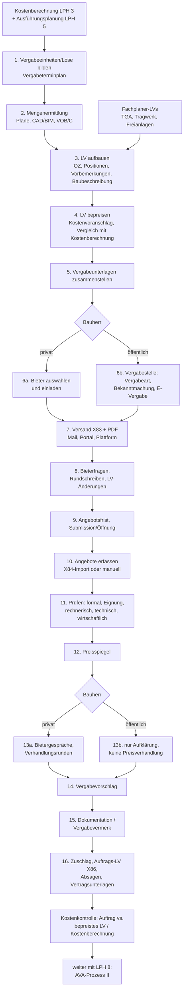

# Der AVA-Prozess I: von der Kostenplanung bis zur Vergabe (HOAI LPH 6–7)

> **Lesehinweis.** Stand der Recherche: 9.11.2026. Diese Notiz beschreibt die *Praxis* (wer macht was, mit welchen Dokumenten und Daten, wo hakt es). Rechtsregeln stehen in den Nachbarnotizen und werden hier nur verlinkt: [HOAI/VOB](/okf/research/standards/hoai-vob-b-c.md), [Vergaberecht und E-Vergabe](/okf/research/standards/procurement-law-e-vergabe.md), [GAEB DA XML](/okf/research/standards/gaeb-da-xml.md), [Leistungstexte/STLB-Bau](/okf/research/standards/stlb-bau-tender-texts.md), [DIN 276](/okf/research/standards/din-276-cost-planning.md). Wie NOVA AVA den Ablauf abbildet, steht in [NOVA AVA: Funktionsweise](/okf/research/nova-ava/manual-and-workflows.md). Die Fortsetzung (Nachträge, Aufmaß, Rechnungsprüfung) ist [Der AVA-Prozess II](/okf/research/process/billing-and-cost-control.md). Abkürzungen: **AG** = Auftraggeber/Bauherr, **AN** = Auftragnehmer, **LV** = Leistungsverzeichnis, **VE** = Vergabeeinheit, **OZ** = Ordnungszahl, **EP/GP** = Einheits-/Gesamtpreis, **LPH** = Leistungsphase der HOAI, **KT** = Kalendertage, **TGA** = Technische Gebäudeausrüstung. „Einschätzung:“ kennzeichnet eigene Bewertungen ohne direkten Beleg.

## Kurzfassung

- **Der Architekt bereitet vor und wirkt mit – er entscheidet nicht.** LPH 6 (LV, Mengen, bepreistes LV, Vergabeunterlagen) und LPH 7 (Angebote einholen, prüfen, werten, Preisspiegel, Bietergespräche, Vergabevorschlag, Dokumentation) sind Grundleistungen; Vergabeart, Submissionstermin, Ausschluss und Zuschlag entscheidet der Bauherr bzw. dessen Vergabestelle. Verträge entwerfen ist nach dem Rechtsdienstleistungsgesetz Anwaltssache [1].
- **Arbeitseinheit ist die Vergabeeinheit (VE):** meist ein Gewerk mit eigenem LV, eigenen Terminen, eigenem Bieterkreis, eigenem Preisspiegel und am Ende eigenem Auftrag. Bei Fachlosvergabe im Hochbau sollen es laut einem Fachbeitrag nicht mehr als 20 bis 30 VEs sein; der Vergabeterminplan führt je VE Soll-Kosten und Soll-Termine [9].
- **Kette der Artefakte:** Vergabeterminplan → Mengenermittlung → LV (GAEB X81) → bepreistes LV (X82) → Vergabeunterlagen und Angebotsaufforderung (X83) → Angebote (X84, Nebenangebote X85) → Preisspiegel → Vergabevorschlag → Auftrags-LV (X86) [2] ([GAEB-Phasen](/okf/research/standards/gaeb-da-xml.md)).
- **Der Preisspiegel ist das Herzstück von LPH 7:** Positions-, Titel- und Summenvergleich aller Bieter mit Vergleichswerten (günstigster Preis, Mittelwert, Planerpreis, Budget, theoretischer „Idealbieter“), Prozentabweichungen und Ausreißer-Markierung. Wahl- und Bedarfspositionen sowie Nachlässe verändern die Rangfolge und müssen als Varianten durchrechenbar sein [2].
- **Prüfen hat vier bis fünf Stufen:** formal (vollständig, fristgerecht), Eignung, technisch (Fabrikate, Gleichwertigkeit), wirtschaftlich (Preisstruktur, Spekulation, Mischkalkulation) und Preis-Leistungs-Bewertung; rechnerisch gilt bei Widersprüchen der Einheitspreis [1][3][4].
- **Privat vs. öffentlich** unterscheidet sich vor allem bei Bieterauswahl, Kommunikation, Öffnung, **Verhandlung** (privat frei, öffentlich in Ausschreibungen verboten) und **Dokumentation** (öffentlich Vergabevermerk Pflicht; privat trotzdem haftungsrelevant). Auch private Bauherren müssen Vergaberecht beachten, wenn Fördermittel das verlangen [1] ([Vergaberecht](/okf/research/standards/procurement-law-e-vergabe.md)).
- **Bieter sind knapp:** Auf der Ausschreibungsplattform Cosuno kamen 2023 auf 371.014 Einladungen 50.940 Angebote – rechnerisch rund 14 % Rücklauf; die Spanne zwischen höchstem und niedrigstem Angebot lag bei Abbruch- und Malerarbeiten über 47 % [6]. EU-weit sank die Zahl der Bieter je öffentlichem Verfahren 2011–2021 von knapp sechs auf drei [11][21].
- **Ein Durchgang dauert Wochen:** Ein Praxisratgeber nennt 6–8 Wochen vom Versand bis zur geprüften Vergabe (privat, mit Architekt) [8]; öffentliche Verfahren haben gesetzliche Mindestfristen (EU-offenes Verfahren: Angebotsfrist ≥ 35 KT, verkürzbar) ([Vergaberecht](/okf/research/standards/procurement-law-e-vergabe.md)).
- **Reibung entsteht an den Medienbrüchen:** LV in Word/Excel, Angebote als PDF/Papier zum Abtippen, selbstgebaute Excel-Preisspiegel, Bieterfragen per E-Mail, Vergabevorschlag in Word ([Schmerzpunkte](/okf/research/market/pain-points.md)). Einschätzung: Hier liegt der größte Nutzen einer durchgängigen AVA – ein Datenmodell vom Vergabeterminplan bis zum Auftrags-LV.

## 1. Einordnung: Wo LPH 6 und 7 im Projekt liegen

- **Honorargewicht:** LPH 6 (Vorbereitung der Vergabe) bringt bei Gebäuden 10 %, LPH 7 (Mitwirkung bei der Vergabe) 4 % des Grundleistungshonorars ([HOAI-Notiz](/okf/research/standards/hoai-vob-b-c.md)). Die Grundleistungen a–f (LPH 6) und a–h (LPH 7) sind dort tabellarisch mit Software-Folgerungen aufgeführt; diese Notiz beschreibt, wie sie praktisch ablaufen.
- **Zeitliche Lage:** Ein Fachbeitrag zur Terminplanung teilt Projekte in Planung (LPH 2–4), Ausführungsvorbereitung (LPH 5–7) sowie Ausführung und Abschluss (LPH 8) und verlangt, dass schon der Terminplan der Ausführungsplanung (LPH 5) die Vergabeeinheiten enthält [9]. Einschätzung: In der Praxis laufen LPH 5–8 **je Vergabeeinheit versetzt**: Der Rohbau wird ausgeschrieben, während der Ausbau noch geplant wird, und wenn der Rohbau beginnt, laufen die Ausbau-Vergaben. Eine AVA muss deshalb viele VEs in unterschiedlichen Zuständen gleichzeitig führen.
- **Kostenkette:** Kostenberechnung (LPH 3) → vom Planer bepreistes LV (LPH 6, in DIN 276:2018 „Kostenvoranschlag“) → Ausschreibungsergebnis/Auftrag (LPH 7) → Abrechnung (LPH 8). Jeder Übergang ist ein Soll-Ist-Vergleich, der eine Kostengruppen-Zuordnung je Position braucht ([DIN 276](/okf/research/standards/din-276-cost-planning.md)).
- **Zwei Welten:** Für öffentliche Auftraggeber (und geförderte private Vorhaben) gilt Vergaberecht mit festen Verfahren, Fristen und Formularen; private Bauherren sind frei, verhandeln und vergeben oft informeller [1] ([Vergaberecht](/okf/research/standards/procurement-law-e-vergabe.md)). Der Architekten-Freund arbeitet für beide.

## 2. Akteure und Rollen

| Akteur | Rolle im Vergabeprozess | Typische Artefakte | Beleg |
|---|---|---|---|
| **Bauherr, privat** (Familie, Bauherrengemeinschaft, Unternehmen, Wohnungsunternehmen) | entscheidet über Vergabestrategie, Bieterkreis, Vertragsbedingungen und Zuschlag; unterschreibt den Bauvertrag | Freigaben, Bauvertrag | [1] |
| **Bauherr, öffentlich** (Bund, Land, Kommune, Zuwendungsempfänger) mit **Vergabestelle** | verfahrensleitende Entscheidungen (Vergabeart, Fristen), Bekanntmachung, Öffnung, Ausschluss, Zuschlag, Bieterinformation, Vergabevermerk | Formblätter, Niederschrift, Vergabevermerk | [1], [Vergaberecht](/okf/research/standards/procurement-law-e-vergabe.md) |
| **Architekt / Objektplaner** | Vergabeterminplan, LVs der Architektengewerke, Mengen, bepreistes LV, Vergabeunterlagen, Koordination der Fachplaner-LVs, Prüfung/Wertung, Preisspiegel, Bietergespräche, Vergabevorschlag, Dokumentation, Mitwirkung bei der Auftragserteilung | LV, Preisspiegel, Vergabevorschlag | [1][9], [HOAI](/okf/research/standards/hoai-vob-b-c.md) |
| **Fachplaner** (TGA: Heizung, Lüftung, Sanitär, Elektro, Aufzüge; Tragwerksplanung; Freianlagen) | liefern rechtzeitig ihre Vergabeeinheiten und stellen ihre Vergabeunterlagen selbst zusammen und übergeben sie geordnet dem Architekten; der Objektplaner koordiniert sie technisch und terminlich im Vergabeterminplan | LV als GAEB-Datei oder PDF, Termine | [9][20] |
| **Projektsteuerer** (optional, eher bei größeren Projekten) | steuert Termine, Kosten und Entscheidungen auf Bauherrenseite; fordert Berichte und Freigaben | Terminrahmen, Kostenberichte | (Rolle aus HOAI-/AHO-Umfeld, hier nicht weiter belegt) |
| **Bieter** (Bauunternehmen, Handwerksbetriebe) | kalkulieren auf Basis des LV, stellen Fragen, geben Angebote ab (Papier, PDF, Excel oder GAEB X84), führen ggf. Gespräche | Angebot, Kalkulationsangaben, Nachweise | [2][3] |
| **E-Vergabe-Plattform / Bieterportal** | technische Kanäle für Bekanntmachung, Unterlagen, Fragen und Angebote; viele öffentliche Plattformen sind nur Vergabestellen zugänglich | Bekanntmachung, Angebotsdateien | [1] |

Kernaussagen des Praxishinweises der Architektenkammer NRW (Stand Mai 2024) [1]:

- Der Architekt wird durch LPH 7 **nicht zur Vergabestelle**; „Mitwirkung“ meint Unterstützung. Wesentliche Entscheidungen (z. B. die Wahl der Vergabeart) muss der öffentliche AG selbst treffen; die Angebotsöffnung darf er nicht komplett an Dritte auslagern. Für die Wahl der Vergabeart wäre eine vergaberechtliche Prüfung nötig, die der Architekt wegen Rechtsdienstleistungsgesetz und Haftpflichtdeckung nicht leisten darf.
- Ob „Angebote einholen“ auch die Veröffentlichung über eine Vergabeplattform umfasst, ist gerichtlich ungeklärt; üblich ist, dass der AG mit den Unterlagen aus LPH 6 selbst veröffentlicht – bei Bedarf mit Unterstützung des Architekten.
- Prüfen und Werten, Bietergespräche, Vergabevorschlag und Mitwirkung an der Dokumentation bleiben Architektenaufgabe. Unvollständige Dokumentation gilt als erhebliches Haftungsrisiko, besonders bei geförderten Maßnahmen (Verweis auf OLG Naumburg, Urteil vom 16.12.2022 – 7 U 40/22). Bei der Wertung sind auch die Ausschlussgründe des § 16 VOB/A zu beachten; bei Zweifeln soll der Architekt anwaltlichen Rat empfehlen.
- „Vergabeunterlagen zusammenstellen“ ist **keine** Vertragserstellung. Vertragsentwürfe, Preisgleitklauseln oder Vertragsmuster soll der Architekt nicht liefern (Verweis auf BGH, Urteil vom 9.11.2023 – VII ZR 190/22).

**Einschätzung:** Für die Software heißt das: Entscheidungen des Bauherrn (Vergabeart, Bieterliste, Zuschlag) brauchen eigene Freigabeschritte mit Person und Zeitstempel; Vertragsbausteine sind vom Bauherrn bzw. Anwalt gelieferte Dokumente, nicht „vom Programm erzeugt“.

## 3. Der Ablauf Schritt für Schritt

Jeder Schritt nennt Zweck, Ein- und Ausgaben, die **Daten**, die eine Software dafür halten muss, und die Unterschiede privat/öffentlich. Die Nummern entsprechen dem Diagramm.

### 3.1 Vergabeeinheiten und Lose bilden, Vergabeterminplan (LPH 6a)

- **Vergabeeinheit:** legt fest, welche Leistungen ein Auftragnehmer in einem Vertrag (oder Teillos) erbringt: Art der Leistung (**Fachlos**, z. B. Trockenbau), Umfang (**Teillos**, z. B. Bauabschnitt), Ausführungsdauer, Haftung und Mängelansprüche [9].
- **Grobe Gruppen im Hochbau:** Rohbau mit Baustelleneinrichtung und Baugrube; Technische Ausrüstung mit Aufzügen; Ausbau/Innenausbau; Freianlagen; Ausstattung. Bei Fachlosvergabe sollen es nicht mehr als 20 bis 30 VEs sein; Baustelleneinrichtung, Baufeinreinigung und ggf. Winterbaumaßnahmen werden leicht vergessen [9].
- **Vergabeterminplan (auch Vergabekalender):** enthält alle VEs mit Ordnungsnummer (z. B. „LV 021“), Objekt und Art der Leistung, Soll-Kosten und Soll-Terminen – mindestens Fertigstellung der Leistungsbeschreibung, Bekanntmachung, Submission, Zuschlag, Ausführungsdauer, Abnahme und Übergabe. Nach der Beauftragung kommen Auftragnehmer und Auftragssumme je VE dazu, ggf. Teillose, Bauabschnitte und Zwischentermine. Die TGA-Fachplaner müssen ihre VEs rechtzeitig beisteuern [9]. Laut Bayerischer Architektenkammer ist der Vergabeterminplan vor allem eine Forderung institutioneller Auftraggeber, die an Vergaberecht gebunden sind, und verlangt besondere Kenntnisse im öffentlichen Vergabewesen [20].
- **Rückwärtsrechnung (Einschätzung):** Praktisch rechnet man vom geplanten Ausführungsbeginn zurück: Vorlauf des AN nach Auftrag (im niedersächsischen Muster z. B. „2 Wochen nach Auftragsdatum“ [3]) → Zuschlag innerhalb der Bindefrist → Prüfung/Wertung/Vergabevorschlag → Angebotsfrist → Versand/Bekanntmachung → LV-Fertigstellung. Bei öffentlichen Vergaben kommen die Mindestfristen hinzu ([Fristen-Tabelle](/okf/research/standards/procurement-law-e-vergabe.md)).
- **Privat vs. öffentlich:** Privat entscheidet der Bauherr frei zwischen Einzelgewerken, Paketen und Generalunternehmer. Öffentlich ist losweise Vergabe die Regel, Abweichungen sind zu begründen ([Losgrundsatz](/okf/research/standards/procurement-law-e-vergabe.md)).

**Daten:** VE-Nummer, Bezeichnung, Objekt/Bauabschnitt, Gewerk bzw. Leistungsbereiche, verantwortlicher Planer (Architekt/Fachplaner), Kostengruppen-Bezug und Budget (Soll-Kosten), Vergabeart (öffentlich) bzw. Vergabeweg (privat), Soll-/Ist-Termine je Meilenstein, Status, später Auftragnehmer und Auftragssumme.

### 3.2 Mengenermittlung (LPH 6b)

- **Grundlage** sind die Ausführungspläne und Details aus LPH 5 sowie Beiträge der Fachplaner [9] ([HOAI 6b](/okf/research/standards/hoai-vob-b-c.md)). Mengen entstehen von Hand aus Plänen (Mengenermittlungsblätter mit Formeln), aus CAD- oder BIM-Modellen ([BIM und AVA](/okf/research/standards/bim-and-ava.md)) oder werden von Fachplanern geliefert.
- **Regeln:** Die Abrechnungsregeln der jeweiligen ATV (VOB/C, Abschnitt 5) bestimmen, wie gemessen wird; für prüfbare elektronische Mengenberechnungen gibt es die REB-Formeln (Grundlage von GAEB X31) ([VOB/C und REB](/okf/research/standards/hoai-vob-b-c.md)). Einschätzung: Wer die LV-Menge schon nach denselben Regeln ermittelt wie das spätere Aufmaß, vermeidet Mengenabweichungen und Streit in LPH 8.
- **Risiko:** Fehlerhafte LV-Mengen laden Bieter zu Spekulationspreisen ein (hoher EP, wo Mehrmengen erwartet werden; niedriger EP, wo Mindermengen erwartet werden) [4]. Mengenabweichungen über 10 % können nach VOB/B zu Preisanpassungen führen ([HOAI/VOB](/okf/research/standards/hoai-vob-b-c.md), [AVA-Prozess II](/okf/research/process/billing-and-cost-control.md)).
- NOVA kennt eine einfache Formel-Eingabe und eine REB-konforme Mengenvorermittlung je Position ([NOVA AVA](/okf/research/nova-ava/manual-and-workflows.md)).

**Daten:** je Position beliebig viele Mengenansätze (Formel/Formelnummer, Werte, Faktor, Ergebnis), Bezug auf Plan, Bauteil, Raum, Geschoss oder Bauabschnitt, Quelle (Hand, CAD, BIM, Fachplaner), Bearbeiter und Datum, Rundung.

### 3.3 LV aufbauen (LPH 6b und 6c)

**Struktur.** Ein LV gliedert sich in optionale Lose, Titel und Untertitel (Gliederungsebenen) und Positionen. Die **Ordnungszahl (OZ)** bildet diese Hierarchie ab. ORCA nennt als voreingestellte OZ-Maske „11.22.PPPPI“ (nach unserer Lesart: zwei zweistellige Gliederungsebenen, vierstellige Position, Index), weil sie mit allen gängigen GAEB-Programmen austauschbar sei; beim GAEB-Austausch muss die tatsächliche Gliederungstiefe mit den Einstellungen übereinstimmen [2]. Zum GAEB-Datenmodell siehe [GAEB DA XML](/okf/research/standards/gaeb-da-xml.md).

**Position.** Laut ORCA-Seminar trägt eine Position Nummer, Kurz- und Langtext, Menge, Einheit, Einheitspreis (Schätzpreis des Planers), Kostengruppe (z. B. DIN 276), Positionsart, ggf. Quellverweis auf eine Textbibliothek und bis zu vier Preisanteile (voreingestellt Material, Lohn, Geräte, Sonstiges) [2]. Dazu kommen Bieter-Textergänzungen (Lücken, in die der Bieter z. B. Fabrikat und Typ einträgt) ([NOVA AVA](/okf/research/nova-ava/manual-and-workflows.md)).

**Positionsarten** (Begriffe schwanken zwischen Quellen und Programmen):

| Positionsart | Bedeutung | Wirkung auf die Angebotssumme | Beleg |
|---|---|---|---|
| Normalposition (Ausführungsposition) | wird in jedem Fall ausgeführt | zählt | [13] |
| Grundposition + Wahl-/Alternativposition | Alternative „stattdessen“; der AG wählt spätestens bei der Vergabe | Grundposition zählt, Wahlposition nur mit EP; Umschalten verändert die Summe | [2][13] |
| Bedarfs-/Eventualposition | Ausführung ob und wieviel unklar | meist nur EP („ohne Gesamtbetrag“); mit Gesamtbetrag möglich | [2][13] |
| Zulageposition | Zuschlag für Erschwernisse zu einer Normalposition, oft aus den Besonderen Leistungen der VOB/C | zählt | [13] |
| Pauschalposition | Menge 1, Bieter nennt Pauschalbetrag | zählt | [13], [NOVA](/okf/research/nova-ava/manual-and-workflows.md) |
| Stundenlohnposition | Stundenlohnarbeiten, oft als Eventualposition | je nach Ausschreibung | [13] |
| Zuschlagsposition | prozentualer Zuschlag auf Positionen oder Bereiche | zählt | [13] |
| „Jumbo-“/Mischposition | mehrere Teilvorgänge in einer Position | zählt | [13] |

Öffentliche AG dürfen Bedarfspositionen nur ausnahmsweise verwenden; der Bund lässt Bedarfs- und Wahlpositionen gar nicht zu ([Regeln zur Leistungsbeschreibung](/okf/research/standards/stlb-bau-tender-texts.md)).

**Texte rund um die Positionen.** Die Leistungsbeschreibung besteht aus Baubeschreibung und LV (Vorbemerkungen und Teilleistungen). Vorbemerkungen sollen nur Regeln enthalten, die für alle Leistungen gelten, und VOB/B/C nicht wiederholen oder abändern ([VHB-Regeln](/okf/research/standards/stlb-bau-tender-texts.md)). Textquellen (STLB-Bau, Herstellertexte, Bürostandards) und ihre Lizenzen beschreibt die [STLB-Notiz](/okf/research/standards/stlb-bau-tender-texts.md).

**Fachplaner-LVs.** TGA-, Tragwerks- und Freianlagenplaner liefern eigene LVs; der Architekt stimmt die Schnittstellen ab (HOAI 6c) und führt sie im Vergabeterminplan [9]. Schnittstellen-Abstimmung heißt festzulegen, in wessen Zuständigkeit und in welchem Gewerk eine Leistung ausgeschrieben wird – Beispiel der Kammer: Kernbohrungen für TGA-Gewerke [20]. Einschätzung: Fachplaner-LVs kommen meist als GAEB-Dateien (X81/X83) aus fremden AVA-Programmen; ähnliche Grauzonen sind Durchbrüche, Brandschutz-Abschottungen, Gerüste oder Baustrom.

**Daten:** LV-Kopf (Nummer, Bezeichnung, VE, Norm GAEB/ÖNORM, OZ-Maske, Währung, MwSt), Gliederungsbaum, Positionen mit allen Feldern oben, Vorbemerkungen und Baubeschreibung als Textbausteine, Anlagenliste, LV-Version und Prüfstatus.

### 3.4 LV bepreisen und Kosten kontrollieren (LPH 6d und 6e)

- Der Planer trägt je Position einen **Schätzpreis** ein; ausgegeben wird das als „LV-Kostenschätzung“ oder GAEB X82 [2]. Preisquellen sind eigene frühere Vergaben, Baupreisdatenbanken und Erfahrungswerte ([DIN 276](/okf/research/standards/din-276-cost-planning.md)); NOVA führt dafür ein „Preisverzeichnis“ mit Mittel-, Median- und ausreißerbereinigten Preisen aus früheren Vergaben ([NOVA AVA](/okf/research/nova-ava/manual-and-workflows.md)).
- Die Bayerische Architektenkammer nennt das Bepreisen sehr zeitaufwendig und haftungsrechtlich wichtig; es setze detaillierte, aktuelle Kostendaten (Einheitspreisstatistiken) voraus [20].
- Das bepreiste LV wird mit der **Kostenberechnung** verglichen (HOAI 6e): Ist das Budget aus LPH 3 – ggf. per Index fortgeschrieben – nach der Werkplanung noch zu halten? Konjunktureinflüsse sollen dabei erkennbar sein [20]. DIN 276:2018 nennt diese Stufe „Kostenvoranschlag“ ([DIN 276](/okf/research/standards/din-276-cost-planning.md)).
- Es dient später als Maßstab: ORCA zeigt „LV-Schätzpreis“ und „Budget“ als eigene Vergleichsspalten neben den Angeboten [2]; das niedersächsische Muster vergleicht die Auftragssumme mit der „voraussichtlichen Vergabesumme“ aus dem bepreisten LV und nennt als Beispiel eine Schätzungstoleranz von 5 % [3]. Öffentliche AG schätzen damit auch den Auftragswert für die Schwellenwerte und prüfen die Angemessenheit der Angebote ([Vergaberecht](/okf/research/standards/procurement-law-e-vergabe.md)).

**Daten:** Planer-EP je Position mit Quelle, Preisstand/Datum und ggf. Index, Summen je Titel/VE/Kostengruppe, Budget je VE, Abweichung zur Kostenberechnung, eingefrorene Stände (Snapshots) für die spätere Kostenkontrolle.

### 3.5 Vergabeunterlagen zusammenstellen (LPH 6f)

| Bestandteil | Öffentlich (VHB-Formblatt) | Privat (Einschätzung, übliche Entsprechung) |
|---|---|---|
| Anschreiben / Aufforderung zur Angebotsabgabe | 211 | Anschreiben mit Terminen, Abgabeform, Bindefrist, Ansprechpartner |
| Regeln für das Verfahren | 212 Teilnahmebedingungen | „Bewerbungsbedingungen“ (z. B. Nebenangebote ja/nein, Fragen nur schriftlich) |
| Angebotsformular | 213 Angebotsschreiben | Angebotsschreiben mit Summe, Nachlass, Skonto, Unterschrift |
| Vertragsbedingungen | 214 Besondere Vertragsbedingungen; ZVB des AG; ZTV | BVB/ZVB des Bauherrn bzw. Anwalts; VOB/B oder BGB als Basis |
| Leistungsbeschreibung | Baubeschreibung + LV (PDF und GAEB X83) | dto. |
| Kalkulationsangaben | 221/222/223 (Preisermittlung, EP-Aufgliederung) | selten verlangt |
| Eignung, Nachunternehmer | 124, 233–236 | Referenzen, Nachunternehmerliste |
| Wertung | 226 (Nebenangebote), 227 (Zuschlagskriterien) | meist nur Preis |
| Anlagen | Pläne, Gutachten (z. B. Baugrund, Schadstoffe), Terminplan | dto. |

Formblatt-Nummern laut [Vergaberecht-Notiz](/okf/research/standards/procurement-law-e-vergabe.md); Rangfolge der Vertragsbestandteile nach § 1 Abs. 2 VOB/B in der [HOAI/VOB-Notiz](/okf/research/standards/hoai-vob-b-c.md). Wichtig: Das Zusammenstellen ist keine Vertragserstellung; die vertraglichen Bestandteile stellt der Auftraggeber bzw. sein Anwalt [1][20]. Die Grundleistung 6f betrifft die Leistungsbereiche des Architekten; Fachplaner übergeben ihre Unterlagen geordnet an ihn [20].

**Daten:** Dokumentliste je VE (Dokument, Version, Quelle/Verfasser, Pflicht/optional, vom Bieter auszufüllen ja/nein, Rangfolge im Vertrag), Freigabe durch den Bauherrn, Paket-Version für den Versand.

### 3.6 Bieter auswählen und einladen (LPH 7b)

- **Öffentlich:** Wer anbieten darf, folgt aus der Vergabeart: bei Öffentlicher Ausschreibung jeder, bei Beschränkter Ausschreibung ein ausgewählter, wechselnder Kreis (ohne Teilnahmewettbewerb i. d. R. mindestens drei Unternehmen); die Vergabestelle entscheidet und dokumentiert die Firmenliste ([Verfahrensarten](/okf/research/standards/procurement-law-e-vergabe.md)). Bei beschränkten Verfahren wird die Eignung vor der Aufforderung geprüft [3].
- **Privat:** Einschätzung: Der Architekt schlägt eine Bieterliste aus eigener Erfahrung vor (Region, Gewerk, Kapazität, frühere Leistung), der Bauherr ergänzt oder gibt frei. Weil der Rücklauf niedrig ist (Cosuno 2023: rund 14 % der Einladungen führten zu einem Angebot [6]), lädt man deutlich mehr Firmen ein, als man Angebote braucht.
- NOVA filtert den Lieferantenstamm nach Gewerk, Bewertung und Umkreis und lädt per E-Mail-Vorlage ein ([NOVA AVA](/okf/research/nova-ava/manual-and-workflows.md)).

**Daten:** Firmenstamm (Name, Anschrift, Ansprechpartner, Gewerke, Region, PQ-Nummer, Bewertung/Notizen), Bieterliste je VE mit Freigabe, Einladung (Datum, Kanal), Rückmeldung (Teilnahme ja/nein, Absagegrund), Zugangsdaten zum Portal.

### 3.7 Versand: GAEB X83, PDF, Bieterportal, E-Vergabe

- Das LV geht als **GAEB X83** (Angebotsaufforderung, ohne Preise) und als PDF hinaus; der Bieter liest die X83 in seine Kalkulationssoftware ein und schickt eine **X84** zurück [2]. Kleine Betriebe ohne GAEB-Software arbeiten mit PDF oder Excel ([Schmerzpunkte](/okf/research/market/pain-points.md)).
- **Kanäle:** E-Mail oder Download-Link (privat üblich), Bieterportal einer AVA (z. B. NOVA-„Angebotscockpit“), öffentliche E-Vergabe-Plattform (über die Vergabestelle) [1] ([E-Vergabe](/okf/research/standards/procurement-law-e-vergabe.md)).

**Daten:** Versandpaket (Dateien, Versionen, Prüfsummen), Empfänger, Zeitpunkt, Kanal, Abruf-/Download-Protokoll, Angebotsfrist.

### 3.8 Bieterfragen und Rundschreiben

- **Öffentlich, national:** Erbitten Unternehmen zusätzliche sachdienliche Auskünfte, sind diese **allen** Unternehmen unverzüglich und in gleicher Weise zu erteilen (§ 12a Abs. 4 VOB/A 2019; eine feste Tagesfrist nennt die Vorschrift nicht) [18]. **EU:** spätestens sechs Kalendertage vor Fristende ([Fristen](/okf/research/standards/procurement-law-e-vergabe.md)).
- **Praxisregeln aus der Rechtsprechung** (Fachbeitrag vom 13.1.2025 zu VK Nordbayern, 11.9.2024) [19]: Antworten gehören in einen Fragen- und Antwortenkatalog für alle; eine nur einem Bieter gegebene Antwort kann rechtswidrig sein und im entschiedenen Fall musste neu zur Angebotsabgabe aufgefordert werden. Fragen, die die Unterlagen ändern oder die Kalkulation berühren, sind immer an alle zu geben; verrät eine Frage den Fragesteller, wird sie behutsam umformuliert (Anonymisierung). Der AG darf eine Frist für Fragen setzen; werden späte Fragen beantwortet, ist eine Verlängerung der Angebotsfrist zu prüfen. Eine Frage kann zugleich eine **Rüge** sein (der Bieter hält das Verfahren für rechtswidrig) und braucht dann eine eigene Antwort an diesen Bieter. Den Katalog empfiehlt der Beitrag als Anlage zum Vertrag.
- **Privat:** keine Pflicht. Einschätzung: Dieselbe Praxis lohnt sich trotzdem, weil nur gleich informierte Bieter vergleichbare Preise liefern; übliche Form ist ein nummeriertes „Bieterrundschreiben“ per E-Mail.
- Ändert sich das LV, braucht es eine neue LV-Version und ggf. eine längere Angebotsfrist. NOVA sperrt das LV nach der Einladung; Änderungen erfordern das Sperren der Zugänge und eine Information über den Fragenkatalog, der Fragen anonymisiert veröffentlicht ([NOVA AVA](/okf/research/nova-ava/manual-and-workflows.md)).

**Daten:** Frage (Eingang, Bieter – nur intern sichtbar, Wortlaut, betroffene OZ), Antwort, Freigabe, Veröffentlichung, Rundschreiben-Nummer, ausgelöste LV-Änderung und neue Version, Fristverlängerung.

### 3.9 Angebotsfrist, Submission und Öffnung

- **Öffentlich:** Öffnung durch zwei Vertreter des AG mit Niederschrift; der Architekt ist i. d. R. nicht beteiligt ([Öffnung](/okf/research/standards/procurement-law-e-vergabe.md)); der AG darf die Öffnung nicht vollständig auslagern [1].
- **Privat:** keine Formvorschrift. Einschätzung: Gute Praxis ist, alle Angebote erst nach Fristablauf gemeinsam zu öffnen und eine Eingangsliste mit Summen zu führen – das schützt vor dem Vorwurf, Preise seien weitergegeben worden. NOVA bietet dafür eine Öffnung nach Vier-Augen-Prinzip mit Submissionsprotokoll ([NOVA AVA](/okf/research/nova-ava/manual-and-workflows.md)).
- **Bindefrist** (Zeitraum, in dem der Bieter an sein Angebot gebunden ist): öffentlich national länger als 30 KT nur begründet, EU regelmäßig 60 KT ([Fristen](/okf/research/standards/procurement-law-e-vergabe.md)); das Muster des Landes Niedersachsen führt das Ende der Bindefrist im Kopf des Vergabevorschlags [3].

**Daten:** Eingang je Angebot (Zeitpunkt, Form, verspätet ja/nein), Angebotssumme laut Bieter, Nachlässe, Anzahl Nebenangebote, öffnende Personen, Submissionsprotokoll, Ende der Bindefrist.

### 3.10 Angebote erfassen

Belegt laut ORCA-Seminarunterlage (Stand Mai 2022) [2]:

- Ein Angebot setzt immer auf ein vorhandenes LV auf; ohne LV kein Angebot.
- **Wege:** manuelle Erfassung (Preise je Position, auch direkt in einer Tabelle) oder **GAEB-Import (X84)** per Datei oder Drag & Drop; Bietername, Bieter-Textergänzungen und Preise kommen aus der Datei; weicht die LV-Struktur ab, gibt es eine Meldung.
- **Auf- und Abschläge** (Zuschläge/Nachlässe) lassen sich je Position, je Titel/Los oder auf das ganze Angebot erfassen, prozentual oder pauschal; ein pauschaler Abschlag erzeugt laut Hersteller fast zwangsläufig **Rundungsdifferenzen** in Kostengruppen-Auswertungen und in der Abrechnung.
- **Papierangebote:** Bei mehrseitigen Ausdrucken sollen die **Seitenüberträge** des Bieters mit einer kumulierten Spalte nachgerechnet werden, weil dort Rechenfehler vorkommen.
- **Vollständigkeitsprüfung:** Suchroutinen finden leere Preise (leer ist nicht 0,00), negative Preise oder Mengen, Bieter-Textergänzungen, ungültige OZ und Einträge mit Status „Prüfen“.

GAEB-Regeln dazu: Die X84 muss Struktur und Schlüssel der X83 unverändert zurückgeben; „nicht angeboten“ ist etwas anderes als ein Preis von 0,00 ([GAEB DA XML](/okf/research/standards/gaeb-da-xml.md)). NOVA ergänzt ein Bieterportal, in dem Bieter online bepreisen, und Kontrollspalten gegen Tippfehler ([NOVA AVA](/okf/research/nova-ava/manual-and-workflows.md)).

**Daten:** Angebot (Bieter, Eingang, Quelle: X84/Excel/manuell/Portal, Version), Preise je Position (EP, ggf. EP-Anteile, „nicht angeboten“), Textergänzungen, Auf-/Abschläge je Ebene, Skonto-Angebot, Importbericht.

### 3.11 Angebote prüfen

Das Muster des Landes Niedersachsen für den Vergabevorschlag freiberuflicher Planer (Version 1.7) zeigt, wie die Prüfung je Angebot dokumentiert wird [3]:

1. **Formale Prüfung:** Beanstandungen? Fehlende Erklärungen fristgerecht nachgereicht?
2. **Eignung:** Präqualifikation (PQ-Nummer) oder Eigenerklärung; Fachkunde, Leistungsfähigkeit, Zuverlässigkeit, keine Ausschlussgründe. Bei beschränkten Verfahren wurde die Eignung schon vor der Aufforderung geprüft; neue Erkenntnisse werden vermerkt.
3. **Technische Prüfung:** Erfüllt das Angebot die Anforderungen der Leistungsbeschreibung, insbesondere bei Produkten und Verfahren? Bei abweichenden Spezifikationen: Gleichwertigkeit nachgewiesen?
4. **Wirtschaftliche Prüfung:** Ist die Preisstruktur nachvollziehbar? Bei Unklarheiten Aufklärung beim Bieter; Hinweise auf **Mischkalkulation** (Kosten zwischen Positionen verschoben) werden aufgeklärt; lässt sie sich schlüssig nachweisen, soll das Angebot ausgeschlossen werden.
5. **Preis-Leistungs-Bewertung:** Hilfsmittel sind Preisspiegel, die voraussichtliche Vergabesumme aus dem bepreisten LV, Erfahrungswerte aus zeitnahen Vergaben und die Kalkulationsangaben des Bieters (Formblätter 221/222/223, ggf. Urkalkulation). Ergebnis: angemessen oder unangemessen, mit Begründung.
6. **Wertungssumme:** Angebotssumme einschließlich unbedingter Nachlässe (im Muster ggf. plus Instandhaltungskosten über einen Wertungszeitraum).

Ergänzend:

- **Rechnerisch** gilt bei Abweichung zwischen Menge × EP und Positionsbetrag der Einheitspreis ([Wertungsregeln](/okf/research/standards/procurement-law-e-vergabe.md)); Seitenüberträge und leere Preise prüfen [2].
- **Spekulationspreise:** Lassen sich EPs nicht erklären, soll man zuerst das eigene LV (vor allem die Mengen) auf Fehler prüfen. Liegt ein Bieter mit möglicherweise spekulativen Preisen vorn und sind LV-Fehler nicht auszuschließen, wird mit korrigierten Mengen nachgerechnet; ändert sich die Rangfolge, ist ein Ausschluss oder sogar die Aufhebung zu prüfen. Der BGH (19.6.2018, X ZR 100/16) hält Angebote für nicht zuschlagsfähig, die den AG bei nicht ganz unwahrscheinlichen Entwicklungen erheblich übervorteilen würden [4].
- **Haftung:** Der Architekt soll bei der Wertung die Ausschlussgründe des § 16 VOB/A im Blick haben und bei Zweifeln anwaltlichen Rat empfehlen [1].

**Daten:** Prüfstatus je Stufe und Angebot (offen/ok/Mangel/Ausschluss) mit Begründung, Nachforderungen (was, Frist, Eingang), Aufklärungsanfragen und Antworten, nachgerechnete Summe vs. Summe laut Bieter, markierte Positionen (Ausreißer, Spekulation, Fehler), Anlagen.

### 3.12 Preisspiegel

Siehe [Abschnitt 4](#4-preisspiegel-im-detail).

### 3.13 Bietergespräche und Verhandlung (LPH 7d)

- **Öffentlich** sind in Ausschreibungen und offenen/nicht offenen Verfahren nur **Aufklärungsgespräche** erlaubt, keine Preisverhandlungen; verhandelt werden darf nur in Verhandlungsverfahren bzw. Freihändiger Vergabe/Verhandlungsvergabe ([Aufklärung statt Verhandlung](/okf/research/standards/procurement-law-e-vergabe.md)).
- **Privat** darf nach eigenem Ermessen nachverhandelt werden; laut Bauprofessor ist das in der Praxis der Regelfall. Basis ist der Preisspiegel des Architekten mit Angebotssummen und Einheitspreisen; Ergebnis ist meist eine neue Angebotssumme [16]. Öffentlich ist das Nachverhandeln in Ausschreibungen nach § 15 Abs. 3 VOB/A unstatthaft (Ausnahme: unumgängliche kleine technische Änderungen bei Nebenangeboten und Leistungsprogrammen) [16].
- **Grenze für den Architekten:** Vertragliche Punkte gehören laut Bayerischer Architektenkammer nicht in seine Bietergespräche, weil sie in der Verantwortung des Auftraggebers liegen [20].
- **Verhandlungsprotokoll:** Wird nach Angebotsabgabe verhandelt, soll darüber ein Protokoll entstehen, das im Bauvertrag ausdrücklich als Vertragsbestandteil aufgeführt wird – neben dem Angebot und dem vom Bauherrn bzw. Architekten versandten LV [17].
- Einschätzung: Typische Themen sind Nachlass, Skonto, Ausführungstermine, technische Alternativen, Nachunternehmer und Zahlungsmodalitäten; oft gibt es mehrere Runden bis zu einem „letzten Angebot“. Für die Software zählt, dass jede Runde als eigene, unveränderliche Angebotsversion erhalten bleibt.
- NOVA unterstützt Verhandlungsrunden durch eingefrorene Angebotsversionen, als „verhandelt“ gesperrte Positionen, das Umlegen von Summennachlässen auf die EPs (nicht umkehrbar) und eine Rückwärtsauktion als Zusatzmodul ([NOVA AVA](/okf/research/nova-ava/manual-and-workflows.md)).

**Daten:** Gespräch (Datum, Teilnehmer, Bieter, Themen), Ergebnis je Punkt, neue Angebotsversion je Runde (Snapshot), Protokoll mit Freigabe, Verweis auf das Protokoll als Vertragsbestandteil.

### 3.14 Vergabevorschlag (LPH 7e)

Felder des niedersächsischen Musters (Version 1.7, Ausfüllbeispiel 2019) [3]:

| Block | Inhalt |
|---|---|
| Kopf | Verfasser (Planungsbüro), Vergabenummer, Ende der Bindefrist, Baumaßnahme, Gewerk |
| Vorschlag | Zuschlag auf Haupt- oder Nebenangebot von Bieter X; PQ-Nummer oder Eigenerklärung; Auftragssumme brutto – oder Aufhebung mit Begründung und weiterem Vorgehen |
| Verfahren | Vergabeart (national/EU), Anzahl eingegangener Haupt- und Nebenangebote, Nebenangebote zugelassen ja/nein |
| Prüfung und Wertung | wer rechnerisch geprüft hat, Preisspiegel; Zuschlagskriterien (z. B. Preis 100 % oder gewichtet mit Wertungsmatrix); vorgesehene Lohn-/Materialgleitklauseln |
| Ergebnisübersicht | Angebote der engeren Wahl mit nachgerechneter Summe und Ergebnis je Prüfstufe; ausgeschlossene bzw. nicht berücksichtigte Angebote mit Grund (z. B. Preis, unvollständig, nicht unterschrieben, nachgeforderte Unterlagen fehlen, Preise in wesentlichen Positionen fehlen) |
| Kosten | voraussichtliche Vergabesumme aus dem bepreisten LV; Abweichung innerhalb der Toleranz oder Begründung; Ausgleich von Mehrkosten durch Einsparungen in anderen Gewerken |
| Termine | Ausführungsfristen laut Vertragsunterlagen bestätigt oder neu vorgeschlagen (Beispiel: Beginn 2 Wochen nach Auftrag, 26 Wochen Dauer); aktueller Bauzeitenplan als Anlage |
| Abschluss | Ort, Datum, Unterschrift des Planers; Vermerk der Bauverwaltung „einverstanden/nicht einverstanden“ |
| Anlagen | je Angebot der engeren Wahl ein Prüf- und Wertungsblatt (siehe 3.11), Angebote, Öffnungsniederschrift, Schriftverkehr mit Bietern, Eignungsnachweise |

- **Kern laut Kammer:** Submissionsprotokoll (vom Auftraggeber), Preisspiegel, fachlich-technische und kaufmännische Wertung sowie die Vergabeempfehlung [20].
- **Privat** ist der Vergabevorschlag formlos. Einschätzung: meist ein Brief oder kurzer Bericht mit Preisspiegel-Auszug, Rangfolge, Empfehlung, Budgetvergleich und offenen Punkten. Ein Ratgeber empfiehlt, oft einen Bieter im preislichen Mittelfeld nahe der Kostenberechnung zu wählen [8] – Einschätzung: Das ist eine Risikoabwägung des privaten Bauherrn; öffentliche AG müssen das wirtschaftlichste Angebot nehmen.

**Daten:** alle Felder der Tabelle, verknüpft mit Prüfergebnissen, Preisspiegel-Stand und Kostenvergleich; Entscheidung des Bauherrn (Person, Datum, Ergebnis).

### 3.15 Dokumentation und Vergabevermerk (LPH 7e)

- **Öffentlich:** Der Vergabevermerk ist Pflicht und begleitet das Verfahren von der Wahl der Vergabeart bis zum Zuschlag (VHB-Formblätter 111, 311/312, 313, 315, 321, 331, 351) ([Vergabevermerk](/okf/research/standards/procurement-law-e-vergabe.md)).
- **Privat:** keine Formvorschrift, aber die „Dokumentation des Vergabeverfahrens“ ist Grundleistung, und Lücken sind ein Haftungsrisiko [1]. Private Bauherren mit Fördermitteln können an Vergaberecht gebunden sein [1].

**Daten:** Vergabeakte als chronologisches Ereignisprotokoll (wer hat wann was entschieden oder versandt), mit allen Dokumenten in der jeweils gültigen Version; unveränderbar nach Abschluss.

### 3.16 Zuschlag, Auftrags-LV und Vertragsunterlagen (LPH 7f–h)

- **Öffentlich:** Zuschlag durch die Vergabestelle; Absagen, bei EU-Verfahren zuvor Information nach § 134 GWB und Wartefrist; Auftragsschreiben (VHB 332–338) ([Ablauf](/okf/research/standards/procurement-law-e-vergabe.md)).
- **Privat:** Auftragsschreiben oder Bauvertrag mit Rangfolge der Vertragsbestandteile; die Vertragsklauseln kommen vom Bauherrn bzw. Anwalt [1] ([Rangfolge](/okf/research/standards/hoai-vob-b-c.md)).
- **Arbeitsteilung laut Kammer:** Der Architekt liefert vor allem das Auftrags-LV mit den nötigen Plänen; Zuschlags- bzw. Auftragsschreiben und individuelle Vertragsbedingungen legt der Auftraggeber vor [20].
- **Auftrags-LV:** das LV mit den vereinbarten Preisen; über Wahl- und Bedarfspositionen muss entschieden sein. In NOVA gelten im Preisspiegel deaktivierte Positionen bei Beauftragung als „entfällt“, Nachlässe lassen sich auf EPs umlegen ([NOVA AVA](/okf/research/nova-ava/manual-and-workflows.md)); ORCA warnt vor Rundungsdifferenzen bei Pauschalabschlägen [2]. Übergabe an den AN als **X86**, Bestätigung als X87 ([GAEB DA XML](/okf/research/standards/gaeb-da-xml.md)).
- **Kostenkontrolle (HOAI 7g):** Ausschreibungsergebnis gegen bepreistes LV oder Kostenberechnung ([HOAI](/okf/research/standards/hoai-vob-b-c.md)).

**Daten:** Auftrag (Nummer, AN, Datum, Vertragstyp VOB/B oder BGB, Einheitspreis- oder Pauschalvertrag, Auftragssumme netto/brutto, Nachlass, Skonto-Bedingungen, Sicherheiten, Fristen, Vertragsbestandteile mit Rangfolge), Auftrags-LV als eingefrorene Version, Absagen (Empfänger, Datum, Grund).

## 4. Preisspiegel im Detail

Ein **Preisspiegel** stellt die Angebote tabellarisch nebeneinander, auf Wunsch bis hinunter zu den einzelnen Teilleistungen; er hilft, Spekulationsangebote zu erkennen, und wird meist vom Architekten in LPH 7 erstellt [5]. Früher von Hand gebaut, erzeugen ihn heute AVA-Programme in mehreren Varianten automatisch [12]. Die HOAI verlangt als Grundleistung einen Preisspiegel „nach Einzelpositionen oder Teilleistungen“; Preisspiegel nach besonderen Anforderungen sind Besondere Leistung ([HOAI LPH 7](/okf/research/standards/hoai-vob-b-c.md)).

### 4.1 Arten

| Art | Inhalt | Wozu | Beleg |
|---|---|---|---|
| **Bieterübersicht / Summenspiegel** | je Angebot: Summe laut Bieter, nachgerechnete Summe, Nachlass, Wertungssumme, Rang, Abstand zum Günstigsten | Rangfolge; öffentlich ordnet der VHB-Preisspiegel nach nachgerechneter Summe | [2], [Wertung](/okf/research/standards/procurement-law-e-vergabe.md) |
| **Titel- bzw. Los-Spiegel** | Summen je Titel/Los und Bieter | sehen, *wo* die Unterschiede entstehen; Loswertung | [2] |
| **Positionspreisspiegel** | EP und GP je Position und Bieter plus Vergleichswerte und Prozentabweichung zu einem Bezugsangebot | Detailprüfung, Ausreißer, Grundlage für Gespräche | [2] |
| **Auffälligkeits-/Ausreißerliste** | nur Positionen über einer Schwelle, z. B. „EP mehr als 50 % über Vergleichsbieter“ (ORCA) oder Grenzen wie 80/115 % mit Mindestbeträgen (NOVA) | gezielte Aufklärung bzw. Verhandlung | [2], [NOVA](/okf/research/nova-ava/manual-and-workflows.md) |
| **ABC-/Schwerpunktanalyse** | Positionen nach Anteil an der Angebotssumme in Klassen | Prüfaufwand auf die wenigen teuren Positionen lenken | [2], [NOVA](/okf/research/nova-ava/manual-and-workflows.md) |
| **Kennzahlen-Preisspiegel (EFB)** | aus den Kalkulationsblättern 221–223: Einzelkosten nach Kostenarten, Deckungsbeitrag (Baustellen- und Allgemeine Geschäftskosten plus Wagnis und Gewinn) in % der Angebotssumme, Mittel-/Kalkulationslohn, Stundenumfang und Produktivität, Lohn-/Stoffanteile | Plausibilität der Kalkulation, Spekulation und spätere Nachtragspreise erkennen; nur vergleichbar bei gleicher Kalkulationsmethode | [15] |
| **Varianten-Preisspiegel** | Rangfolge bei umgeschalteten Grund-/Wahlpositionen, mit/ohne Bedarfspositionen, mit Nachlässen | Entscheidungsgrundlage für Varianten | [2] |
| **Historischer Preisvergleich** | Preise früherer Vergaben je Position (Mittel, Median, bereinigt) | Planerpreise und Angemessenheit | [NOVA](/okf/research/nova-ava/manual-and-workflows.md) |

### 4.2 Vergleichswerte und Statistik

Laut ORCA-Seminar [2] rechnet die Software aus den erfassten Angeboten automatisch:

| Vergleichswert | Berechnung | Hinweis |
|---|---|---|
| Günstigst | zeilenweise der günstigste real gebotene Positionspreis, Titelwert bzw. Angebotswert | – |
| Mittelwert | Zeilendurchschnitt der realen Positionspreise, Titelwerte und Gesamtangebote | – |
| Durchschnitt | durchschnittliche EPs je Position, aufsummiert zu Titel- und Angebotssumme | weicht vom Mittelwert der Summen ab |
| Idealpreis („Idealbieter“) | günstigster EP je Position, aufsummiert | rein theoretisch: positionsweise vergeben kann man nicht |
| LV-Schätzpreis | EPs des bepreisten LV als virtuelles Angebot | Bezug zur eigenen Kostenermittlung |
| Budget | im LV hinterlegte Budgets | Bezug zur Kostenvorgabe |

- In die Vergleichswerte gehen nur **aktive** Angebote ein; ein Bezugsangebot für die Prozentdarstellung ist frei wählbar [2]. NOVA ergänzt einen Medianbieter und erlaubt relative oder absolute Abweichungen ([NOVA AVA](/okf/research/nova-ava/manual-and-workflows.md)).
- Einschätzung: Bei typischerweise drei bis sechs Angeboten sind Statistiken schwach; der Median ist robuster als der Mittelwert, und ein Ausreißer kann den Mittelwert stark verschieben. Standardabweichung oder Streuungsmaße fanden sich in den gelesenen Herstellerunterlagen nicht.

### 4.3 Sonderfälle, die die Rangfolge verändern

| Fall | Regel / Praxis | Beleg |
|---|---|---|
| **Rechenfehler** | zwei Summen führen: „laut Bieter“ und „nachgerechnet“; öffentlich gilt bei Widerspruch der EP | [Wertung](/okf/research/standards/procurement-law-e-vergabe.md) |
| **Fehlende Preise** | leer ist nicht 0,00; öffentlich dürfen fehlende Preise grundsätzlich nicht nachgereicht werden (Ausnahme: unwesentliche Positionen) | [2][16], [Wertung](/okf/research/standards/procurement-law-e-vergabe.md) |
| **Grund-/Wahlpositionen** | standardmäßig zählt die Grundposition; wird die Wahlposition aktiviert, wird die Grundposition deaktiviert – und zwar in **allen** Angeboten zugleich; ganze Titel lassen sich als Alternativen umschalten | [2] |
| **Bedarfspositionen** | je LV bzw. Position einstellbar, ob sie mit Gesamtbetrag in die Summe eingehen; Bieter preisen sie oft sehr niedrig, weil sie vielleicht nie ausgeführt werden | [2][4] |
| **Nebenangebote** | eigenes Angebot (GAEB X85) bzw. eigene Spalte; erst technische Gleichwertigkeit prüfen, dann werten; öffentlich nur, wenn nicht ausgeschlossen; im niedersächsischen Muster stehen Haupt- und Nebenangebote gemeinsam in der Rangliste | [3][14], [GAEB](/okf/research/standards/gaeb-da-xml.md) |
| **Unbedingter Nachlass** | öffentlich nur an der vom AG bezeichneten Stelle wirksam, dann immer von der Angebotssumme abzuziehen; er gilt nach Auftragserteilung auch für spätere Nachträge (nicht aber für Beträge aus Lohn- und Stoffpreisgleitklauseln) | [14] |
| **Bedingter Nachlass** (z. B. „x % bei Baubeginn in KW 20“) | gilt öffentlich grundsätzlich als Nebenangebot und ist gesondert anzubieten | [14] |
| **Skonto** (Nachlass unter der Bedingung einer Zahlungsfrist) | öffentlich: unaufgefordert angeboten bleibt es bei der Wertung unberücksichtigt; Einschätzung privat: getrennt ausweisen, im Vertrag festhalten, in der Rangfolge nur bei realistischer Zahlungsfähigkeit berücksichtigen | [14] |
| **Erfassungsebene von Nachlässen** | je Position, Titel/Los oder Gesamtangebot, prozentual oder pauschal; pauschale Abschläge erzeugen Rundungsdifferenzen | [2] |
| **Weitere Zuschlagskriterien** | Gewichtung (VHB-Formblatt 227) und Wertungsmatrix; NOVA bildet das laut Handbuch nicht ab | [3], [NOVA](/okf/research/nova-ava/manual-and-workflows.md) |

**Einschätzung:** Der Preisspiegel ist kein einzelner Bericht, sondern eine **Rechenansicht über einem Szenario** (welche Angebote aktiv, welche Variante, welche Nachlässe, welches Bezugsangebot). Szenarien sollten speicherbar und im Vergabevorschlag referenzierbar sein, damit später nachvollziehbar bleibt, welche Rechnung der Entscheidung zugrunde lag.

## 5. Privat vs. öffentlich: Unterschiede je Schritt

„Öffentlich“ schließt private Bauherren ein, die wegen Fördermitteln Vergaberecht anwenden müssen [1]. Details und Paragrafen: [Vergaberecht](/okf/research/standards/procurement-law-e-vergabe.md).

| Schritt | Privater Bauherr | Öffentlicher Bauherr / geförderte Maßnahme |
|---|---|---|
| Vergabeeinheiten | frei: Einzelgewerke, Pakete oder Generalunternehmer | Losgrundsatz, Gesamtvergabe nur mit Begründung |
| Verfahrenswahl | formlos (Anfrage bei ausgewählten Firmen) | nach Wertgrenzen; Entscheidung und Vermerk durch die Vergabestelle, nicht durch den Architekten [1] |
| Leistungsbeschreibung | gestalterisch frei; Einschätzung: Leitfabrikate und Bedarfspositionen kommen vor | eindeutig, produktneutral, Bedarfs-/Wahlpositionen eingeschränkt (Bund: unzulässig) ([STLB-Notiz](/okf/research/standards/stlb-bau-tender-texts.md)) |
| Vergabeunterlagen | eigene Vorlagen; VOB/B oder BGB; Klauseln vom Anwalt | VHB- bzw. Landesformblätter (211–227) |
| Bieterkreis | frei; Architekt schlägt vor, Bauherr gibt frei | jeder (öffentliche Ausschreibung) oder ausgewählter, wechselnder Kreis mit Eignungsprüfung |
| Versand | E-Mail, Download-Link, Bieterportal | Bekanntmachung und E-Vergabe-Plattform über die Vergabestelle [1] |
| Bieterfragen | gute Praxis: alle gleich informieren | Pflicht: allen unverzüglich und gleich; EU spätestens 6 KT vor Fristende [18][19] |
| Öffnung | formlos; Einschätzung: trotzdem gemeinsam und protokolliert | zwei Vertreter des AG, Niederschrift, Angebote bis dahin verschlüsselt |
| Prüfung | frei, aber sorgfältig (Haftung) | Wertungsstufen, Ausschlussgründe, Nachforderung mit Frist, Dokumentation je Stufe [3] |
| Preisspiegel | frei gestaltbar | VOB/A-Rechenregeln, Nachlass- und Skonto-Regeln [14] |
| Bietergespräch | **Verhandlung** über Preis und Inhalt üblich, mehrere Runden, Protokoll [16][17] | in Ausschreibungen nur **Aufklärung**, keine Preisverhandlung [16] |
| Entscheidung | Bauherr, auch nach weichen Kriterien | Vergabestelle; wirtschaftlichstes Angebot nach bekanntgemachten Kriterien |
| Bieterinformation | formlose Absage | Absageschreiben; EU: Vorabinformation und Wartefrist |
| Dokumentation | empfehlenswert, haftungsrelevant [1] | Vergabevermerk Pflicht, Aufbewahrung |
| Vertrag | Bauvertrag mit Verhandlungsprotokoll als Bestandteil [17] | Zuschlag/Auftragsschreiben auf das unveränderte Angebot |

## 6. Typische Größenordnungen

Belastbare deutsche Statistiken *je Gewerk* gibt es kaum; die Tabelle sammelt, was sich belegen ließ, mit Kontext.

| Größe | Wert | Kontext, Stand | Beleg |
|---|---|---|---|
| Vergabeeinheiten je Hochbauprojekt | höchstens 20–30 (Empfehlung) | Fachlosvergabe; Fachbeitrag 2017 | [9] |
| Honoraranteil LPH 6 + 7 | 14 % (10 % + 4 %) | Gebäude, HOAI 2021 | [HOAI](/okf/research/standards/hoai-vob-b-c.md), [8] |
| Rücklaufquote privater Anfragen | 50.940 Angebote auf 371.014 Einladungen ≈ 13,7 % (eigene Rechnung) | Plattform Cosuno, Daten 2023; meistangefragtes Gewerk Sanitär (22.752 Anfragen) | [6] |
| Preisspanne höchstes zu niedrigstes Angebot | über 47 % bei Abbruch- und Malerarbeiten | Cosuno, Daten 2023 | [6] |
| Bieter je öffentlichem Verfahren (EU) | von knapp 6 (2011) auf rund 3 (2021); Anteil Verfahren mit nur einem Bieter von 23,5 % auf 41,8 % | EU-weit, Bau, Liefer- und Dienstleistungen zusammen; EuRH-Sonderbericht 28/2023, über Sekundärquellen | [11][21] |
| Anteil Verfahren mit nur einem Bieter, Deutschland | 20 % (EU-Durchschnitt 28 %) | 2024, Single Market Scoreboard (EU-weit bekanntgemachte Verfahren) | [10] |
| „Decision speed“ Deutschland | 47 Tage (EU 74) | 2024; Definition nicht geprüft (vermutlich Angebotsfrist bis Zuschlag) | [10] |
| Verfahrensarten unterhalb der Schwellen | Öffentliche Ausschreibung 38,9 %, Beschränkte 18,9 %, Freihändig/Verhandlungsvergabe 27,7 %, Sonstige 14,6 % (eigene Rechnung) | 2024, alle Auftragsarten, Destatis-Schätzwerte | [7] |
| EU-weite Bauaufträge Deutschland | 897 von 23.587 Aufträgen, aber rund 20 % des Werts (20,9 von 102,2 Mrd. €) | 2024, Destatis | [7] |
| Dauer Versand bis geprüfte Vergabe | 6–8 Wochen | privat, mit Architekt; Ratgeber, undatiert | [8] |
| Gesetzliche Mindestfristen | z. B. Angebotsfrist EU-offen ≥ 35 KT (−5 KT elektronisch), national „ausreichend“, ≥ 10 KT; Bindefrist national i. d. R. ≤ 30 KT, EU 60 KT | Stand 9.11.2026 | [Fristen](/okf/research/standards/procurement-law-e-vergabe.md) |
| Vorlauf Auftrag bis Ausführungsbeginn | z. B. 2 Wochen | Ausfüllbeispiel im Landesmuster | [3] |
| Toleranz Vergabesumme vs. bepreistes LV | z. B. 5 % | Ausfüllbeispiel im Landesmuster | [3] |
| Zweifel an der Preisangemessenheit | ab 10 % Abweichung | VHB Bund | [Vergaberecht](/okf/research/standards/procurement-law-e-vergabe.md) |
| Kalkulationskennzahlen | Deckungsbeitrag z. B. 20,5–27,4 % der Angebotssumme, Mittellohn z. B. 40,00–41,83 €/h | Beispielwerte eines EFB-Preisspiegels, undatiert | [15] |
| Positionen je LV | **nicht belastbar ermittelt** | nur Forenaussagen gefunden | – |

Einschätzung zur Bedeutung für die Software: Ein Projekt mit 20–30 VEs, je drei bis acht eingeladenen Bietern und mehreren Angebotsversionen ergibt schnell einige hundert Angebotsdokumente pro Projekt; Preisspiegel über Hunderte Positionen mal eine Handvoll Bieter sind rechnerisch klein. Die Herausforderung ist Übersicht und Nachvollziehbarkeit, nicht Rechenleistung.

## 7. Typische Fehler und Risiken

| Fehler | Ursache | Folge | Gegenmittel in der Software (Einschätzung) | Beleg |
|---|---|---|---|---|
| Lücken im LV | Leistung vergessen, Schnittstelle zu Fachplaner-LV ungeklärt | Angebotssumme zu niedrig, später Nachträge | Checklisten je Gewerk, Schnittstellenliste zwischen VEs, Hinweise auf Besondere Leistungen der VOB/C | [8], [STLB-Notiz](/okf/research/standards/stlb-bau-tender-texts.md) |
| Falsche LV-Mengen | Überschlag statt Ermittlung, Planstand veraltet | Spekulationspreise, Mengenabweichungen, Nachträge | nachvollziehbare Mengenansätze mit Plan-/Modellbezug, Plausibilität gegen Kennwerte | [4] |
| Rechenfehler im Angebot | Menge × EP falsch, Seitenüberträge, Tippfehler beim Abtippen | falsche Rangfolge | automatische Nachrechnung, Kontrollsumme beim Erfassen, zwei Summen führen | [2] |
| Unvollständige oder formfehlerhafte Angebote | fehlende Preise, Unterschrift, Erklärungen, Nachweise | Ausschluss (öffentlich), Unklarheit (privat) | Vollständigkeitsprüfung, Nachforderungs-Workflow mit Frist | [3] |
| Spekulation und Mischkalkulation | Bieter erwarten Mengenänderungen oder Nachträge; Kosten zwischen Positionen verschoben | Mehrkosten in LPH 8, Ausschluss | Ausreißerliste, EFB-Kennzahlen, Nachrechnung mit korrigierten Mengen | [4][15][3] |
| Ungleich informierte Bieter | Antworten nur an einen Bieter, LV-Änderungen nicht an alle | nicht vergleichbare Angebote; öffentlich ggf. Wiederholung | Fragenkatalog mit Pflicht-Veröffentlichung, LV-Versionen | [19] |
| Nachlass falsch platziert oder an Bedingung geknüpft | Bieter schreibt Nachlass ins Anschreiben | öffentlich nicht wertbar bzw. Nebenangebot | strukturierte Erfassung von Nachlassart und Fundstelle | [14] |
| Pauschalnachlass auf Summe | bequemer als prozentualer Nachlass | Rundungsdifferenzen in Kostengruppen und Abrechnung | Nachlass als eigene Rechenebene mit Rundungsausgleich | [2] |
| Bindefrist läuft ab | Entscheidung verzögert sich | Bieter nicht mehr gebunden, Preise neu | Fristenwarnung je VE | [3], [Fristen](/okf/research/standards/procurement-law-e-vergabe.md) |
| Dokumentationslücken | Entscheidungen per Telefon/E-Mail | Haftungsrisiko des Architekten, bei Förderung Rückforderungsrisiko | automatische Vergabeakte | [1] |
| Architekt formuliert Vertragsklauseln | Bauherr fragt „Was sollen wir vereinbaren?“ | unerlaubte Rechtsdienstleistung, Haftung | Vertragsbausteine nur als vom Bauherrn/Anwalt gelieferte Dokumente | [1] |
| Budgetüberschreitung zu spät erkannt | Vergleich mit Kostenberechnung erst nach Auftrag | Kosten laufen aus dem Ruder | Ampel je VE (Kostenberechnung → bepreistes LV → Angebote → Auftrag), Ausgleich über andere VEs zeigen | [3], [DIN 276](/okf/research/standards/din-276-cost-planning.md) |

## 8. Werkzeuge in der Praxis: Software, Excel, Word, E-Mail

| Schritt | Häufig genutzt | Reibung | Beleg |
|---|---|---|---|
| Vergabeterminplan | Einschätzung: Excel oder Terminplan-Software neben der AVA | Termine doppelt gepflegt, kein Bezug zu LV-Status | – |
| Mengenermittlung | Pläne + Excel, CAD-/BIM-Auszüge, AVA-Formeln | Übertragungsfehler, Planstand unklar | [BIM und AVA](/okf/research/standards/bim-and-ava.md) |
| LV | AVA, aber auch Word/Excel mit Texten aus Altprojekten; Fachplaner-LVs als GAEB aus anderen Programmen | Formatbrüche, GAEB-Varianten, Kopierfehler | [Schmerzpunkte](/okf/research/market/pain-points.md), [GAEB in der Praxis](/okf/research/standards/gaeb-tooling-interop.md) |
| Versand, Bieterfragen | E-Mail, Bieterportale, E-Vergabe-Plattformen | Kommunikation verstreut, Versionen unklar | [19], [E-Vergabe](/okf/research/standards/procurement-law-e-vergabe.md) |
| Angebote | PDF oder Papier, Excel, GAEB X84 | Abtippen, Tippfehler; kleine Bieter ohne GAEB | [2], [Schmerzpunkte](/okf/research/market/pain-points.md) |
| Preisspiegel | AVA oder selbstgebaute Excel-Tabelle | Rechenfehler fallen spät auf, Varianten mühsam | [Schmerzpunkte](/okf/research/market/pain-points.md) |
| Vergabevorschlag, Vermerk | Word plus Formblätter | Zahlen werden aus dem Preisspiegel abgeschrieben | [3] |
| Auftrag | Word-Vertrag (vom Anwalt), Auftrags-LV aus der AVA (X86) | Vertragsdokument und LV-Daten getrennt | [1][17] |

Einschätzung: Fast jede Reibung entsteht beim **Übergang zwischen zwei Werkzeugen**. Eine AVA, die Mengen, LV, Angebote, Preisspiegel, Vorschlag und Akte in einem Datenmodell hält und an den Rändern sauber importiert und exportiert (GAEB, Excel, PDF), beseitigt die meisten Brüche. Bieter ohne GAEB-Software sind der härteste Rand: Für sie braucht es Excel-Rückläufe oder ein einfaches Web-Formular.

## 9. Datenobjekte über den ganzen Prozess

| Objekt | Wichtigste Felder | Beziehungen | Schritt |
|---|---|---|---|
| Projekt | Bauherr (Typ privat/öffentlich/gefördert), Regelwerk-Modus, DIN-276-Fassung, Beteiligte | hat VEs | 1 |
| Vergabeeinheit | Nummer, Bezeichnung, Gewerk, Planer, Budget, Vergabeart/-weg, Soll-/Ist-Termine, Status | hat LV(s), Bieterliste, Angebote, Auftrag | 3.1 |
| LV (versioniert) | Kopf, OZ-Maske, Gliederung, Vorbemerkungen, Baubeschreibung, Version, Prüfstatus | gehört zu VE; hat Positionen | 3.3 |
| Position | OZ, Kurz-/Langtext, Menge, Einheit, Art, Kostengruppe, Textquelle, Bieterangaben, Preisanteile | hat Mengenansätze und Preisschichten | 3.3 |
| Mengenansatz | Formel, Werte, Ergebnis, Bezug (Plan, Bauteil, Raum), Quelle | gehört zu Position | 3.2 |
| Preisschicht | Typ (Planerpreis, Budget, Angebot je Bieter und Runde, Auftrag), EP, ggf. EP-Anteile, Quelle, Datum | gehört zu Position | 3.4, 3.10, 3.16 |
| Firma / Bieter | Stammdaten, Gewerke, Region, PQ-Nummer, Bewertung | wird eingeladen, gibt Angebote ab | 3.6 |
| Einladung | VE, Firma, Datum, Kanal, Rückmeldung | – | 3.6, 3.7 |
| Vergabeunterlage | Dokument, Version, Rolle (Vertragsbestandteil/Info), Rangfolge | gehört zu VE-Paket | 3.5 |
| Bieterfrage / Rundschreiben | Frage, Antwort, Status, betroffene OZ, Nummer, Veröffentlichung | kann LV-Version auslösen | 3.8 |
| Angebot (versioniert) | Bieter, Eingang, Form, Summe laut Bieter, nachgerechnete Summe, Nachlässe (Art, Ebene, Fundstelle), Skonto, Haupt-/Nebenangebot, Runde | gehört zu VE; hat Preise | 3.9–3.13 |
| Prüfvermerk | Stufe, Ergebnis, Begründung, Nachforderungen, Aufklärungen | gehört zu Angebot | 3.11 |
| Preisspiegel-Szenario | aktive Angebote, Varianten, Bedarfspositionen, Bezugsangebot, Schwellen | erzeugt Berichte | 4 |
| Gespräch / Protokoll | Datum, Teilnehmer, Ergebnisse | erzeugt Angebotsversion | 3.13 |
| Vergabevorschlag | Empfehlung, Begründung, Kostenvergleich, Termine | referenziert Szenario und Prüfvermerke | 3.14 |
| Entscheidung / Freigabe | wer, wann, was (Bieterliste, Zuschlag, Aufhebung) | – | 3.6, 3.14, 3.16 |
| Auftrag | AN, Summe, Vertragstyp, Bestandteile, Fristen, Sicherheiten, Nachlass, Skonto | aus Angebot; Basis für LPH 8 | 3.16 |
| Vergabeakte-Ereignis | Zeitpunkt, Person, Ereignistyp, Dokumentverweis | append-only Log | 3.15 |

## Relevanz für unser Projekt

**Muss-Anforderungen für LPH 6–7 (Einschätzung, abgeleitet aus den Belegen oben):**

1. **Vergabeeinheit als Kernobjekt** mit Statusfluss (geplant → LV in Arbeit → versandt → Angebote → geprüft → Vorschlag → beauftragt) und Vergabeterminplan je VE mit Soll/Ist-Terminen [9].
2. **LV-Editor** mit OZ-Maske, Positionsarten (mindestens Normal, Grund/Wahl, Bedarf mit/ohne Gesamtbetrag, Zulage, Pauschal, Stundenlohn), Kostengruppe, Planerpreis, Texten; GAEB-Ausgabe X81/X82/X83 und -Eingabe X84/X85, Ausgabe X86 ([GAEB DA XML](/okf/research/standards/gaeb-da-xml.md)).
3. **Angebotserfassung** über X84, Excel und manuell mit Kontrollsumme; „nicht angeboten“ getrennt von 0,00 [2].
4. **Preisspiegel als gespeichertes Szenario** (Varianten, Bedarfspositionen, Nachlässe auf drei Ebenen, Skonto getrennt), mit Vergleichswerten (Min, Mittel, Median, Planerpreis, Budget, Idealbieter), Ausreißerliste und PDF-/Excel-Export [2][14].
5. **Prüf-Checkliste je Angebot** (formal, Eignung, technisch, wirtschaftlich, Preis-Leistung) mit Begründungen, aus der der **Vergabevorschlag** automatisch entsteht – privat als Bericht, öffentlich nah am Landes-/VHB-Muster [3].
6. **Bieterfragen-Katalog** mit Veröffentlichung an alle, Rundschreiben-Nummern und LV-Versionierung [19].
7. **Vergabeakte** als unveränderliches Ereignisprotokoll mit Entscheidungen (Person, Zeit) [1].
8. **Kostenkontrolle je VE** über die Kette Kostenberechnung → bepreistes LV → Angebote → Auftrag ([DIN 276](/okf/research/standards/din-276-cost-planning.md)).
9. **Regelwerk-Modus je Projekt/VE** („privat“, „öffentlich national“, „öffentlich EU“, „gefördert“), der Regeln schaltet: Verhandlungsrunden sperren, Skonto-Wertung, Nachlass nur an bezeichneter Stelle, Warnung bei Bedarfs-/Wahlpositionen, Fristen [1][14][16].

**Differenzierungschancen:**

- **Bieterfreundlicher Rücklauf** ohne Lizenzkosten für Bieter: Excel-Rücklauf und einfaches Web-Formular neben GAEB ([Schmerzpunkte](/okf/research/market/pain-points.md)).
- **Bessere Auswertung:** Median und Streuung, EFB-Kennzahlen-Preisspiegel [15], Nachrechnung mit korrigierten Mengen bei Spekulationsverdacht [4] – das fand sich in den gelesenen NOVA- und ORCA-Unterlagen nicht vollständig.
- **Wertungsmatrix** für Nicht-Preis-Kriterien, die NOVA laut Handbuch fehlt ([NOVA AVA](/okf/research/nova-ava/manual-and-workflows.md)).
- **Vergabevorschlag und Vergabevermerk aus Daten** statt aus Word.

**Risiken:**

- **Rechtsdienstleistung:** Die Software darf nicht wie eine Rechtsberatung wirken; Regeln als datierte, quellenbelegte Hinweise, Vertragsbausteine nur als Dokumente des Bauherrn bzw. Anwalts [1].
- **Formblätter:** VHB-Formulare nur inhaltlich unverändert nachbauen ([Vergaberecht](/okf/research/standards/procurement-law-e-vergabe.md)).
- **Vertraulichkeit:** Angebote sind bis zur Öffnung und danach geheim zu halten; Rechte- und Protokollkonzept nötig ([Öffnung](/okf/research/standards/procurement-law-e-vergabe.md)).
- **Datenschutz:** Firmen- und Bewertungsdaten betreffen oft Einzelunternehmer (Einschätzung: DSGVO-relevant).

**Aufwand (grobe Einschätzung, Personentage für einen erfahrenen Entwickler, ohne Bieterportal):** VE und Terminplan 5–10; LV-Editor ohne Textkatalog 20–40; GAEB-Ein-/Ausgabe siehe [GAEB in der Praxis](/okf/research/standards/gaeb-tooling-interop.md); Angebotserfassung und Importe 10–20; Preisspiegel mit Szenarien und Export 20–40; Prüfung, Vergabevorschlag und Akte 15–25; Bieterfragen 5–10. Zusammen grob 75–145 Personentage plus GAEB. Ein Bieterportal wäre ein eigenes Teilprojekt.

## Offene Fragen

**An den Architekten-Freund:**

1. Wie viele Vergabeeinheiten hat ein typisches Projekt, wie viele Firmen lädt er je Gewerk ein und wie viele Angebote kommen zurück? Wie groß sind seine LVs (Positionen)?
2. Wie verteilen sich seine Projekte auf privat, öffentlich und gefördert? Wer veröffentlicht bei öffentlichen Bauherren auf welcher Plattform?
3. In welcher Form kommen Angebote an (GAEB X84, Excel, PDF, Papier, NOVA-Portal) – und in welchem Verhältnis?
4. Verhandelt er bei privaten Bauherren, in wie vielen Runden, und wie dokumentiert er das (Protokoll, neue Angebote)?
5. Wie sieht sein Vergabevorschlag für private Bauherren aus, und was erwarten die Bauherren (PDF, Excel, Präsentation)?
6. Wie liefern Fachplaner ihre LVs (GAEB-Version, PDF), und wo knirscht es an den Schnittstellen?
7. Nutzt er Bedarfs- und Wahlpositionen, Nebenangebote, Skonto? Welche Preisspiegel-Ansichten braucht er wirklich?
8. Führt er den Vergabeterminplan in NOVA oder anderswo? Was fehlt ihm in NOVA bei LPH 6–7 konkret?

**Recherchelücken:**

- Keine belastbaren Zahlen zu LV-Größen, eingeladenen Bietern je Gewerk und Dauer je Schritt im deutschen Hochbau; die Destatis-Auswertung nennt keine Angebotszahlen je Verfahren [7].
- Die Definition der Kennzahl „decision speed“ des Single Market Scoreboards wurde nicht geprüft [10].
- Der Volltext des EuRH-Sonderberichts 28/2023 wurde nicht gelesen; die Zahlen stammen aus zwei Fachbeiträgen [11][21].
- Der Kommentar zum Bauvertrag [17] war nur als Auszug lesbar (Bezahlschranke).
- Geklärt (09.11.2026): Die VOB/A „Ausgabe 2026“ hat nur die Abschnitte 2 (EU) und 3 (VS) neu gefasst. Abschnitt 1 gilt weiter in der Ausgabe 2019; geändert wurde dort nur § 3a (Wertgrenzen, befristet 2025 und neu gefasst zum 1.1.2026). Die hier zitierten nationalen Paragrafen (§§ 12a, 15, 16) sind damit unverändert, ebenso die Rechtsgrundlagen im ADD-Arbeitsblatt [14][22]. Details: [Vergaberecht-Notiz](/okf/research/standards/procurement-law-e-vergabe.md).
- Ob Architekten bei privaten Vergaben üblicherweise mindestens drei Angebote je Gewerk verlangen, ließ sich nicht aus Kammer- oder Fachquellen belegen.

## Quellen

[1] Mitwirkung bei der Vergabe (Praxishinweis 57) – Architektenkammer Nordrhein-Westfalen – https://aknw.de/fileadmin/user_upload/Praxishinweise/PH57_Mitwirkung_bei_der_Vergabe_Stand_Mai-2024.pdf – Art: Primärquelle (Kammer), Stand Mai 2024 – abgerufen 2026-11-09

[2] Seminar Ausschreibung und Vergabe („AVA in zwei Tagen komplett – Tag I“) – ORCA Software GmbH – https://orca-software.com/wp-content/uploads/Seminar-AVA-in-zwei-Tagen-komplett-Tag-I.pdf – Art: Herstellerangabe (Schulungsunterlage, PDF erstellt 19.05.2022) – abgerufen 2026-11-09

[3] Muster Vergabevorschlag des Freiberuflich Tätigen (FbT), Version 1.7 – Niedersächsisches Landesamt für Bau und Liegenschaften (NLBL) – https://www.nlbl.niedersachsen.de/download/148636/Muster_Vergabevorschlag.pdf – Art: Primärquelle (Verwaltungsmuster, Stand Mai 2017/2019) – abgerufen 2026-11-09

[4] Spekulationspreise – Bauprofessor (Lexikon) – https://www.bauprofessor.de/spekulationspreise/ – Art: Fachlexikon – abgerufen 2026-11-09

[5] Preisspiegel – Bauprofessor (Lexikon) – https://www.bauprofessor.de/preisspiegel/ – Art: Fachlexikon – abgerufen 2026-11-09

[6] „Vergabe-Report Bau 2024“ von Cosuno veröffentlicht – baulinks.de – https://www.baulinks.de/webplugin/2024/0429.php4 – Art: Presse (Herstellerangabe Cosuno), 27.03.2024 – abgerufen 2026-11-09

[7] Vergabestatistik 2021–2024: Auswertung – cosinex Blog – https://blog.cosinex.de/2026/05/22/vergabestatistik-2021-2024-auswertung/ – Art: Fachblog (Auswertung der Destatis-Statistik 79994), 22.05.2026 – abgerufen 2026-11-09

[8] Ausschreibung und Vergabe: ausführende Baufirmen suchen – sanier.de – https://www.sanier.de/architekt/ausschreibung-und-vergabe-ausfuehrende-baufirmen-suchen – Art: Ratgeber (Autorin Architektin, undatiert) – abgerufen 2026-11-09

[9] Kalusche, W.: Terminplanung – Zeit im Blick (Deutsches Architektenblatt, 2017) – BTU Cottbus-Senftenberg, Fachgebiet Bauökonomie – https://www-docs.b-tu.de/fg-bauoekonomie/public/Forschung/Publikationen/Kalusche-Wolfdietrich/2017/DAB_Terminplanung.pdf – Art: Fachbeitrag/Wissenschaft – abgerufen 2026-11-09

[10] Access to public procurement – Germany (2024) – Europäische Kommission, Single Market Scoreboard – https://single-market-scoreboard.ec.europa.eu/node/502_en – Art: Primärquelle (Statistik) – abgerufen 2026-11-09

[11] EuRH: Weniger Wettbewerb bei der Vergabe öffentlicher Aufträge in Europa – Vergabeblog – https://vergabeblog.de/2023-12-05/eurh-weniger-wettbewerb-bei-der-vergabe-oeffentlicher-auftraege-in-europa/ – Art: Fachpresse (Bericht über EuRH-Sonderbericht 28/2023), 05.12.2023 – abgerufen 2026-11-09

[12] Preisspiegel – Wikipedia – https://de.wikipedia.org/wiki/Preisspiegel – Art: Enzyklopädie (mit Belegmangel-Hinweis) – abgerufen 2026-11-09

[13] Positionsarten – Bauprofessor (Lexikon) – https://www.bauprofessor.de/positionsarten/ – Art: Fachlexikon – abgerufen 2026-11-09

[14] Arbeitsblatt Nr. 06: Preisnachlass, bedingter Preisnachlass, Skonto – VOB-Stelle Rheinland-Pfalz (ADD), Archivkopie edoweb-rlp – https://wayback.edoweb-rlp.de/weltweit/20241029mp_/https:/add.rlp.de/fileadmin/add/Abteilung_4/Vergaberecht/ARBEITSBLATT_6.pdf – Art: Primärquelle (Behörden-Arbeitshilfe, Stand Juli 2022) – abgerufen 2026-11-09

[15] EFB-Preisspiegel mit Kennzahlen – Bauprofessor (Lexikon) – https://www.bauprofessor.de/efb-preisspiegel-mit-kennzahlen/ – Art: Fachlexikon (Beispiel mit Software eines Werbepartners) – abgerufen 2026-11-09

[16] Preisverhandlung – Bauprofessor (Lexikon) – https://www.bauprofessor.de/preisverhandlung/ – Art: Fachlexikon – abgerufen 2026-11-09

[17] Fischer, P.: § 14 Bauvertrag / II. Anmerkungen – Haufe – https://www.haufe.de/id/beitrag/14-bauvertrag-ii-anmerkungen-HI16114390.html – Art: Fachkommentar (nur Auszug frei, undatiert) – abgerufen 2026-11-09

[18] § 12a VOB/A (Abschnitt 1, Fassung 2019): Versand der Vergabeunterlagen – dejure.org – https://dejure.org/gesetze/VOB-A/12a.html – Art: Normtext (Bekanntmachung) – abgerufen 2026-11-09

[19] Probst, P. M.: Zum richtigen Umgang mit Fragen (und Rügen) im Vergabeverfahren! – Vergabeblog – https://vergabeblog.de/2025-01-13/zum-richtigen-umgang-mit-fragen-und-ruegen-im-vergabeverfahren/ – Art: Fachbeitrag (zu VK Nordbayern, 11.09.2024, RMF-SG21-3194-9-18), 13.01.2025 – abgerufen 2026-11-09

[20] Erweiterter Grundleistungskatalog, Merkblatt 3 – HOAI – Bayerische Architektenkammer – https://byak.de/data/pdfs/Recht/Merkblaetter/M03-HOAI-2021-ErwGrundleistungen.pdf – Art: Primärquelle (Kammer), Stand 01/2021 – abgerufen 2026-11-09

[21] Vara Arribas, G.; Sesé Hernández, A.: The Future of Public Procurement: The Impact of the ECA's special report 28/2023 – European Institute of Public Administration (EIPA) – https://www.eipa.eu/blog/the-future-of-public-procurement-the-impact-of-the-ecas-special-report-28-2023/ – Art: Fachbeitrag, 29.01.2024 – abgerufen 2026-11-09

[22] Bekanntmachung der Änderung der VOB/A Abschnitt 1 vom 15.12.2025, BAnz AT 16.12.2025 B7 (nur § 3a neu gefasst; Basis: Fassung vom 31.1.2019, BAnz AT 19.02.2019 B2, zuletzt geändert BAnz AT 02.04.2025 B7, ebenfalls nur § 3a) – umwelt-online (Normtextwiedergabe) – https://www.umwelt-online.de/recht/bau/161225b7.htm – Art: Normtext (Bekanntmachung) – abgerufen 2026-11-09
