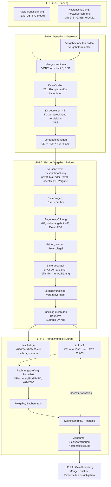

# Synthese: AVA-Software-Recherche

**Stand 09.11.2026.** Diese Notiz verdichtet die 23 Recherchenotizen unter `/okf/research/` (zusammen rund 1.390 Einzelquellen) zu einer Entscheidungsgrundlage für das Scoping einer Open-Source-AVA. Sie richtet sich an den Entwickler, der kein Architekt ist (Fachbegriffe in Abschnitt 2.4), und an den Architekten-Freund (bitte vor allem die Abschnitte 2–4 und 8 prüfen und korrigieren).

**Lesehilfe**
- *Einschätzung* heißt: Schlussfolgerung, kein Beleg. Preise sind netto, Stand 11/2026, sofern nicht anders angegeben.
- Alle NOVA-Aussagen stammen aus öffentlichen Quellen (Website, Handbuch, API-Spezifikation, AGB, AVV). Ein Test im echten System steht noch aus.
- Belege verweisen auf die Detailnotizen. Kürzel (jeweils Link): [MO](/okf/research/market/overview.md) Marktüberblick · [EV](/okf/research/market/established-vendors.md) Etablierte Anbieter · [CN](/okf/research/market/cloud-and-niche-vendors.md) Cloud- und Nischenanbieter · [PP](/okf/research/market/pain-points.md) Schmerzpunkte · [NP](/okf/research/nova-ava/product-and-pricing.md) NOVA Produkt und Preise · [NH](/okf/research/nova-ava/manual-and-workflows.md) NOVA Handbuch und Abläufe · [NA](/okf/research/nova-ava/api-and-data-model.md) NOVA API und Datenmodell · [NU](/okf/research/nova-ava/company-and-development.md) NOVA Unternehmen · [NS](/okf/research/nova-ava/user-feedback.md) NOVA Nutzerstimmen · [P1](/okf/research/process/tendering-and-award.md) AVA-Prozess I (LPH 6–7) · [P2](/okf/research/process/billing-and-cost-control.md) AVA-Prozess II (LPH 8) · [PG](/okf/research/process/price-escalation-and-grant-funding.md) Preisgleitung und Förderung · [GX](/okf/research/standards/gaeb-da-xml.md) GAEB DA XML · [GT](/okf/research/standards/gaeb-tooling-interop.md) GAEB in der Praxis · [ST](/okf/research/standards/stlb-bau-tender-texts.md) Leistungstexte und STLB-Bau · [HV](/okf/research/standards/hoai-vob-b-c.md) HOAI, VOB/B/C, BGB · [VR](/okf/research/standards/procurement-law-e-vergabe.md) Vergaberecht und E-Vergabe · [DK](/okf/research/standards/din-276-cost-planning.md) DIN 276 · [ÖA](/okf/research/standards/public-client-ava-requirements.md) Vorgaben öffentlicher Bauherren · [BIM](/okf/research/standards/bim-and-ava.md) BIM und AVA · [OS](/okf/research/open-source/existing-projects.md) Open-Source-Landschaft · [BL](/okf/research/open-source/building-blocks-and-licensing.md) Bausteine und Lizenzen · [GR](/okf/research/open-source/lv-editor-grid-and-collaboration.md) Grids, Excel, Mehrbenutzer.

## 1. Executive Summary

- **Die Marktlücke ist real, aber schmal.** Den Funktionskern der Leistungsphasen (LPH) 6–8 bieten alle ernsthaften Produkte, rund 25 Planer-AVA werden aktiv vertrieben. Es fehlt eine **selbst hostbare Browser-AVA ohne Editionssperren, mit vollständigem offenem Export und nativ auf Mac und Linux**. Auch Open Source schließt die Lücke nicht: Ein Scan von rund 1.400 Repos fand keine reife AVA für deutsche Planer; OpenConstructionERP ist ein generisches Bau-ERP (AGPL, keine externen Beiträge), OpenAVA hat keinen öffentlichen Code [MO](/okf/research/market/overview.md) [CN](/okf/research/market/cloud-and-niche-vendors.md) [OS](/okf/research/open-source/existing-projects.md).
- **Bei NOVA liegt der Preisschmerz in der Struktur, nicht im Grundpreis.** Nachträge, Aufmaß und Rechnungsprüfung gibt es nur im Business-Paket: 129 € je gleichzeitiger Lizenz und Monat bzw. 1.393 €/Jahr, +87 % seit 2016. Ab 01.02.2027 kostet jedes Add-on 40 € und gilt zwingend für alle Lizenzen; die bisher kostenlosen Betas HOAI, Baudokumentation und MCP werden kostenpflichtig. Drei Lizenzen mit BIM und Terminplanung kosten dann 6.771 € statt 5.475 € im Jahr (+24 %), mit HOAI und Baudokumentation 9.363 € (+71 %). Beim Grundpreis liegt NOVA Business im Mittelfeld (ORCA Professional 1.788 €/Jahr) [NP](/okf/research/nova-ava/product-and-pricing.md) [EV](/okf/research/market/established-vendors.md).
- **Lock-in bei NOVA: mittel bis hoch.** Es gibt keinen Gesamtexport. Nach Abo-Ende bleiben die Daten 12 Monate gespeichert, aber ohne Zugriff. Die AGB von 04/2020 geben NOVA ein unwiderrufliches, übertragbares Nutzungsrecht an selbst geschriebenen LV-Positionen (Grundlage des Textpools „SmartPool“). Eine Migration geht nur LV für LV über GAEB und API, und nur solange das Abo läuft [NA](/okf/research/nova-ava/api-and-data-model.md) [NP](/okf/research/nova-ava/product-and-pricing.md).
- **Schmerzpunkte über alle Produkte hinweg:** Preis und Lizenz sind am besten belegt (Bundesarchitektenkammer 2026, ARKO-Flyer von sechs Kammern 03/2026). Dazu kommen Lock-in, Excel-Abhängigkeit, schlechte Mac-Versorgung, Medienbrüche mit Bietern und zersplitterte Kostenkontrolle. Unabhängige Nutzerstimmen fehlen fast völlig. Die Schmerzpunkte des Freundes jenseits des Preises klärt nur das Interview [PP](/okf/research/market/pain-points.md) [NS](/okf/research/nova-ava/user-feedback.md).
- **Die Zielgruppe ist klein und preisempfindlich:** rund 35.000 Architekturbüros, 47 % davon Ein-Personen-Büros, 74,8 % mit höchstens 5 Beschäftigten. „Kostenlos“ allein ist kein Alleinstellungsmerkmal: SIDOUN Globe4all und AVAPLAN Base sind gratis, SJ AVA kostet 220 €/Jahr [MO](/okf/research/market/overview.md) [PP](/okf/research/market/pain-points.md) [CN](/okf/research/market/cloud-and-niche-vendors.md).
- **Der fachliche Kern ist gut spezifizierbar.** LPH 6–8 bringen 46 % des Gebäudehonorars. Die HOAI verlangt eine Kostenkontrollkette mit DIN-276-Zuordnung je LV-Position. BGB- und VOB/B-Verträge unterscheiden sich in fast jeder Abrechnungsregel, deshalb ist der **Vertragstyp je Auftrag** das zentrale Steuerungsmerkmal; rund 25 harte Fristen verlangen eine Fristen-Engine. Das VHB Bund ist die beste frei verfügbare Prozessbeschreibung [HV](/okf/research/standards/hoai-vob-b-c.md) [DK](/okf/research/standards/din-276-cost-planning.md).
- **Abrechnung ist eine Schleife je Auftrag:** Nachtrag → Aufmaß → kumulierte Prüfung → Freigabe → Zahlung → Kostenkontrolle, bis zur Rückgabe der letzten Sicherheit. Prüffehler sind Haftungsfälle. Genau hier hat NOVA dokumentierte Grenzen: keine automatische Aktualisierung, kein E-Rechnungs-Import, keine dokumentierte Bürgschaftsverwaltung [P2](/okf/research/process/billing-and-cost-control.md) [NH](/okf/research/nova-ava/manual-and-workflows.md).
- **GAEB DA XML 3.3 ist Pflicht, die Praxis aber versionsbunt.** Das Staatliche Baumanagement Niedersachsen (SBN) verlangt nur 3.2, Bayern 3.3, der BLB NRW GAEB 90 oder XML, der Flughafen München GAEB 90. Nötig sind **Export-Profile je Bauherr** mit Prüfung vor dem Export. Freie Bibliotheken (pyGAEB, gaebboss) tragen den XML-Teil; GAEB 90 und den Rückweg für Bieter ohne Software muss man selbst bauen. Die Lizenz der GAEB-Schemas ist ungeklärt [GX](/okf/research/standards/gaeb-da-xml.md) [GT](/okf/research/standards/gaeb-tooling-interop.md) [ÖA](/okf/research/standards/public-client-ava-requirements.md).
- **Texte und Kostendaten sind lizenzpflichtig.** STLB-Bau (Paket Architektur online rund 800 €/Jahr je Platz) darf nicht mitgeliefert werden, ist aber beim Bund „in der Regel“, beim SBN, in Bayern (Hochbau) und beim BLB NRW (mindestens 50 % der Positionen) Pflicht. Lösung: „Bring your own license“ plus verlustfreier Erhalt der STLB-Kennungen. Eine Online-Anbindung braucht einen Partnervertrag mit unbekannten Konditionen [ST](/okf/research/standards/stlb-bau-tender-texts.md) [ÖA](/okf/research/standards/public-client-ava-requirements.md).
- **Öffentlich und privat sind zwei Regelwelten, und 2026 ist ein Reformjahr:** Vergabebeschleunigungsgesetz seit 01.07.2026, VOB/A EU 2026 seit 08.09.2026, national weiter VOB/A 2019 mit neu gefasstem § 3a. Die Wertgrenzen sind ein Flickenteppich (Direktauftrag Bau: 20.000 € in Niedersachsen bis 750.000 € in Hessen). Daraus folgt eine datierte Regeldatenbank statt fester Zahlen. Eine eigene E-Vergabe-Plattform ist kein Ziel; der Austausch läuft über GAEB-Dateien [VR](/okf/research/standards/procurement-law-e-vergabe.md).
- **E-Rechnung wird Pflichtthema.** Unternehmen müssen E-Rechnungen seit 01.01.2025 empfangen können. Laut BMF-Schreiben vom 15.10.2026 enthält eine Bau-E-Rechnung im strukturierten Teil nur Gewerkesummen, das LV kommt als Anlage. NOVA exportiert nur eigene Prüfrechnungen; Import und Abgleich mit dem Aufmaß wären ein Vorsprung [P2](/okf/research/process/billing-and-cost-control.md) [VR](/okf/research/standards/procurement-law-e-vergabe.md) [NH](/okf/research/nova-ava/manual-and-workflows.md).
- **BIM gehört nicht ins erste Release, das Datenmodell muss aber BIM-fähig sein** (GUIDs, Herkunft jeder Menge, n:m-Kostengruppen). 70 % der Büros unter 10 Personen arbeiten ohne BIM. „BIM light“ mit IFC-Import, Viewer und Mengenübernahme ist mit offenen Bausteinen ein Phase-2-Ziel von rund 9–16 Personenwochen [BIM](/okf/research/standards/bim-and-ava.md).
- **Technik:** Kein freies Tabellen-Grid deckt alles ab; Tabulator und SlickGrid-Universal (MIT) kommen am nächsten, TanStack eignet sich als Basis für einen Eigenbau. Empfohlen sind ein server-autoritatives Modell mit optimistischer Nebenläufigkeit, Excel-Zwischenablage und durchgängiges Undo als Muss (bei NOVA fehlt das Einfügen aus Excel, viele Aktionen sind „nicht umkehrbar“), Dezimalarithmetik, die Anwendung unter AGPL-3.0-or-later und Bibliotheken unter MIT/Apache-2.0 [GR](/okf/research/open-source/lv-editor-grid-and-collaboration.md) [BL](/okf/research/open-source/building-blocks-and-licensing.md).
- **Betrieb und Recht:** Gehosteter Betrieb verlangt AV-Vertrag, technische und organisatorische Maßnahmen (TOM) und getestete Wiederherstellung. Der Data Act macht Datenexport und Anbieterwechsel zur Pflicht, Wechselentgelte sind ab 12.01.2027 verboten. Eine allgemeine Pflicht zu EU-Anbietern gibt es nicht; belegt sind der BSI-Mindeststandard für Cloud-Dienste im bayerischen Bundesbau und VS-NfD-Regeln, die für Selbstbetrieb sprechen [BL](/okf/research/open-source/building-blocks-and-licensing.md) [ÖA](/okf/research/standards/public-client-ava-requirements.md).
- **Der Aufwand ist die größte Unbekannte.** Die Notizen schätzen die vollständige LPH 6–8 auf 9–35 Personenmonate (PM), ein erstes LPH-6–7-Werkzeug auf 4–12 PM. Selbst bei gleichem Umfang liegen sie um Faktor 1,5–2 auseinander. Eine gemeinsame Bottom-up-Schätzung gehört ins Scoping [PP](/okf/research/market/pain-points.md).

## 2. Der AVA-Prozess auf einer Seite

AVA umfasst die HOAI-Leistungsphasen 6 (Vergabe vorbereiten), 7 (bei der Vergabe mitwirken) und 8 (Objektüberwachung mit Aufmaß, Rechnungsprüfung und Kostenkontrolle). Bei Gebäuden bringen sie 10 + 4 + 32 = 46 % des Honorars [HV](/okf/research/standards/hoai-vob-b-c.md). Die Kostenplanung (LPH 2–3) liefert das Budget; LPH 9 (Objektbetreuung) begleitet die Gewährleistungszeit bis zur Freigabe der Sicherheiten. Gearbeitet wird je **Vergabeeinheit** (meist ein Gewerk); weil LPH 5–8 je Vergabeeinheit versetzt laufen, sind in einem Projekt viele Vergabeeinheiten gleichzeitig in verschiedenen Zuständen [P1](/okf/research/process/tendering-and-award.md).

### 2.1 Ablauf

### 2.2 Schritte, Akteure, Dokumente, Formate

| Schritt (HOAI) | Wer handelt | Ergebnis | Datenformat | Privat ↔ öffentlich | Notiz |
|---|---|---|---|---|---|
| Kostenschätzung, -berechnung (LPH 2/3) | Architekt | Kostenermittlung nach DIN 276 (2. bzw. 3. Ebene) | X50/X51, Excel | öffentlich: RBBau-Struktur, Risiko gesondert | [DK](/okf/research/standards/din-276-cost-planning.md) |
| Vergabeeinheiten, Vergabeterminplan (6a) | Architekt; Fachplaner liefern ihre Einheiten | Liste der Vergabeeinheiten (empfohlen höchstens 20–30 je Hochbauprojekt) mit Soll-Kosten und -Terminen | Terminplan, Excel | öffentlich: Lose sind Regel, Gesamtvergabe begründen | [P1](/okf/research/process/tendering-and-award.md) |
| Mengen ermitteln (6b) | Architekt | Mengenansätze je Position | REB 23.003, X31; CAD/IFC | – | [P1](/okf/research/process/tendering-and-award.md) [HV](/okf/research/standards/hoai-vob-b-c.md) |
| LV aufstellen (6b, c) | Architekt; TGA-Fachplaner liefern eigene LVs | LV mit Ordnungszahlen, Titeln, Positionen, Vorbemerkungen | X81 | öffentlich: produktneutral (§ 7 VOB/A), STLB je Bauherr Pflicht, keine Wahlpositionen, Bedarfspositionen meist verboten | [GX](/okf/research/standards/gaeb-da-xml.md) [ST](/okf/research/standards/stlb-bau-tender-texts.md) [ÖA](/okf/research/standards/public-client-ava-requirements.md) |
| LV bepreisen, Kostenkontrolle (6d, e) | Architekt | „Kostenvoranschlag“ = bepreistes LV, Vergleich mit Kostenberechnung | X82 | SBN, BLB: Planer liefert X82 an die Vergabestelle | [DK](/okf/research/standards/din-276-cost-planning.md) [ÖA](/okf/research/standards/public-client-ava-requirements.md) |
| Vergabeunterlagen (6f) | Architekt; Vertragsbedingungen von Bauherr oder Anwalt | LV, Besondere/Zusätzliche Vertragsbedingungen, Formblätter | X83 + PDF | öffentlich: VHB-Formblätter (z. B. 211–227) | [VR](/okf/research/standards/procurement-law-e-vergabe.md) |
| Versand, Bekanntmachung (7b) | privat: Architekt im Auftrag; öffentlich: Vergabestelle | Einladung bzw. Bekanntmachung | X83; eForms (Vergabestelle) | öffentlich nur über die E-Vergabe-Plattform des Auftraggebers | [VR](/okf/research/standards/procurement-law-e-vergabe.md) |
| Bieterfragen (7b) | Architekt beantwortet, Antwort an alle | Fragenkatalog, ggf. geändertes LV | neue X83 | öffentlich: Auskünfte an alle Bieter | [P1](/okf/research/process/tendering-and-award.md) |
| Angebote, Öffnung (7b) | Bieter; Öffnung durch Bauherr/Vergabestelle | Angebote, Submissionsprotokoll bzw. Niederschrift | X84, X85; auch GAEB 90 (D84), Excel, PDF, Papier | öffentlich: förmliche Öffnung, Geheimhaltung | [GT](/okf/research/standards/gaeb-tooling-interop.md) [VR](/okf/research/standards/procurement-law-e-vergabe.md) |
| Prüfen, werten, Preisspiegel (7c) | Architekt | Preisspiegel, Prüfvermerke | Excel/PDF (X84P nur Beta) | öffentlich: vier Wertungsstufen, Einheitspreis maßgebend, Aufklärung ab 10 % Abweichung | [P1](/okf/research/process/tendering-and-award.md) [VR](/okf/research/standards/procurement-law-e-vergabe.md) |
| Bietergespräche (7d) | Architekt mit Bauherr | Protokoll, neue Angebotsversion | neue X84 | privat: Verhandlung frei; öffentlich in Ausschreibungen verboten | [P1](/okf/research/process/tendering-and-award.md) |
| Vergabevorschlag, Dokumentation (7e) | Architekt schlägt vor | Vergabevorschlag, Vergabevermerk | PDF | öffentlich: Vermerk Pflicht (§ 20 VOB/A); privat haftungsrelevant | [P1](/okf/research/process/tendering-and-award.md) |
| Zuschlag, Auftrag (7f–h) | Bauherr entscheidet und unterschreibt; Architekt wirkt mit | Auftrags-LV, Absagen, Kostenvergleich Auftrag ↔ bepreistes LV | X86 (Bestätigung X87) | öffentlich: Bieterinformation, oberhalb der EU-Schwelle Wartefrist | [VR](/okf/research/standards/procurement-law-e-vergabe.md) [HV](/okf/research/standards/hoai-vob-b-c.md) |
| Nachträge (7c, 8h) | Firma bietet an, Architekt prüft, Bauherr beauftragt | Nachtragsangebot, Prüfvermerk | X83/X84/X85/X86 mit Nachtragsnummer und Status | Bund (VHB): Urkalkulation fortschreiben; BGB: tatsächliche Kosten | [P2](/okf/research/process/billing-and-cost-control.md) [HV](/okf/research/standards/hoai-vob-b-c.md) |
| Aufmaß (8f) | Firma und Architekt gemeinsam | Aufmaßblätter | X31/DA11 (REB 23.003) | SBN: REB 2009 mit X31; VHB-Formblatt 451 nennt noch REB 1979 | [P2](/okf/research/process/billing-and-cost-control.md) [ÖA](/okf/research/standards/public-client-ava-requirements.md) |
| Rechnungsprüfung (8g) | Firma stellt, Architekt prüft, Bauherr zahlt | Prüfrechnung, Prüfvermerk, Zahlungsfreigabe | XRechnung/ZUGFeRD, GAEB X89/X89B | öffentlich: XRechnung mit Leitweg-ID, VHB-Richtlinie 400 | [P2](/okf/research/process/billing-and-cost-control.md) |
| Kostenkontrolle, -feststellung (8h–j) | Architekt für den Bauherrn | Kostenbericht, Kostenfeststellung | Excel/PDF, X51 | gefördert: Belegliste, Verwendungsnachweis | [P2](/okf/research/process/billing-and-cost-control.md) [PG](/okf/research/process/price-escalation-and-grant-funding.md) |
| Abnahme, Gewährleistung (8k–p, 9) | Bauherr nimmt ab, Architekt überwacht Fristen | Abnahmeprotokoll, Mängelliste, Rückgabe der Sicherheiten | – | Verjährung VOB/B 4 Jahre, BGB 5 Jahre | [HV](/okf/research/standards/hoai-vob-b-c.md) |

### 2.3 Wer entscheidet was

- **Der Architekt bereitet vor und wirkt mit, er entscheidet nicht.** Vergabeart, Bieterkreis, Ausschluss und Zuschlag entscheidet der Bauherr bzw. seine Vergabestelle; Verträge entwirft der Anwalt (Rechtsdienstleistungsgesetz). Die Software braucht deshalb Freigabeschritte mit Person und Zeitstempel [P1](/okf/research/process/tendering-and-award.md).
- **Der Architekt zahlt nie selbst.** Er prüft, vermerkt und gibt frei, der Bauherr zahlt. Die tatsächliche Zahlung kennt die Software nur, wenn jemand sie zurückmeldet [P2](/okf/research/process/billing-and-cost-control.md).
- **Öffentlich spricht nur die Vergabestelle mit den Bietern**, über ihre Plattform. Privat läuft die Kommunikation direkt aus der AVA [VR](/okf/research/standards/procurement-law-e-vergabe.md).
- **Fachplaner** (Haustechnik, Tragwerk, Freianlagen) liefern eigene LVs, meist als GAEB-Datei; der Architekt koordiniert Termine und Schnittstellen [P1](/okf/research/process/tendering-and-award.md).

### 2.4 Begriffe in einem Satz

| Begriff | Bedeutung |
|---|---|
| AVA | Ausschreibung, Vergabe, Abrechnung: Software der Bauherrenseite für die HOAI-Leistungsphasen 6–8. |
| HOAI, LPH | Honorarordnung für Architekten und Ingenieure; ihre Leistungsphasen (LPH) 1–9 gliedern die Arbeit eines Planers. |
| LV (Leistungsverzeichnis) | Gegliederte Liste der Bauleistungen eines Pakets mit Positionen, Mengen und Einheiten, in die Bieter Preise eintragen (bill of quantities). |
| OZ (Ordnungszahl), OZ-Maske | Hierarchische Positionsnummer (z. B. 01.02.0030, höchstens 14 Zeichen); die Maske legt Stufen und Stellen fest. |
| Positionsarten | Normal-, Bedarfs- (Eventual-), Wahl- bzw. Alternativ-, Zulage-, Pauschal- und Stundenlohnposition; sie bestimmen, ob und wie eine Position in die Summe zählt. |
| EP, GP | Einheitspreis je Mengeneinheit und Gesamtpreis (Menge × EP); bei Widerspruch gilt der EP. |
| Vergabeeinheit, Los | Leistungspaket, das an einen Auftragnehmer geht, meist ein Gewerk. |
| Preisspiegel | Gegenüberstellung aller Angebote je Position und Summe mit Abweichungen und Rangfolge. |
| Nachlass, Skonto | Preisminderung auf das Angebot bzw. Abzug bei Zahlung innerhalb einer Frist. |
| Nachtrag | Vergütung für geänderte oder zusätzliche Leistungen nach Vertragsschluss. |
| Aufmaß | Ermittlung der tatsächlich gebauten Mengen nach den Abrechnungsregeln der VOB/C. |
| Abschlagsrechnung (kumuliert) | Zwischenrechnung, die die gesamte bisherige Leistung ausweist und alle früheren Zahlungen abzieht. |
| Einbehalt, Sicherheit | Zurückgehaltener Teil der Zahlung oder Bürgschaft, z. B. für Vertragserfüllung und Mängelansprüche. |
| Bauabzugsteuer | 15 % Steuerabzug durch unternehmerische oder öffentliche Bauherren, wenn die Firma keine Freistellungsbescheinigung vorlegt (§ 48 EStG). |
| DIN 276, Kostengruppe (KG) | Norm zur Gliederung der Baukosten in KG 100–800 über drei Ebenen; DIN 277 liefert die zugehörigen Flächen und Rauminhalte. |
| VOB/A, VOB/B, VOB/C | Vergaberegeln für öffentliche Auftraggeber, Vertragsbedingungen für Bauverträge (AGB) und technische Normen mit Abrechnungsregeln. |
| GAEB DA XML | Deutsches Austauschformat für LV, Angebote, Aufträge, Aufmaße und Rechnungen; die Phase steht in der Dateiendung (X83 = Angebotsaufforderung, X84 = Angebot, X86 = Auftrag). |
| REB 23.003 | Formelkatalog für prüfbare elektronische Mengenberechnungen; Grundlage von X31 und DA11. |
| STLB-Bau | Lizenzpflichtiger Katalog standardisierter, produktneutraler Positionstexte (GAEB/DIN, umgesetzt von Dynamische BauDaten). |
| BVBS-Zertifikat | Prüfsiegel für die GAEB-Schnittstelle einer bestimmten Programmversion, fünf Jahre gültig. |
| Vergabevermerk | Pflichtdokumentation eines öffentlichen Vergabeverfahrens (§ 20 VOB/A). |
| E-Vergabe | Elektronische Plattform öffentlicher Auftraggeber für Bekanntmachung, Unterlagen, Bieterfragen und Angebote. |
| XRechnung, ZUGFeRD | Strukturierte E-Rechnungen nach EN 16931 (reines XML bzw. PDF mit eingebettetem XML). |
| VHB Bund | Vergabe- und Vertragshandbuch für Baumaßnahmen des Bundes mit nummerierten Formblättern und Prozessregeln. |

## 3. Fähigkeitslandkarte

**Legende.** *NOVA:* vorhanden, teilweise, fehlt oder unklar, jeweils laut öffentlichem Handbuch und Website [NH](/okf/research/nova-ava/manual-and-workflows.md) [NP](/okf/research/nova-ava/product-and-pricing.md). *Bedeutung* für ein Büro wie das des Freundes (privat und öffentlich, LPH 6–8): **Muss** = ohne das kein Wechsel; Soll; Kann. *Komplexität* (Einschätzung aus den Schätzungen der Notizen, eine erfahrene Person): S ≤ 2 Personenwochen (PW), M 2–6 PW, L 6–16 PW, XL > 16 PW; 1 PM ≈ 4 PW ≈ 20 Personentage (PT).

| ID | Fähigkeit | Beschreibung | Rechtliche/normative Grundlage | NOVA AVA | Bedeutung | Komplexität | Detailnotiz |
|---|---|---|---|---|---|---|---|
| | **A Grundlagen** | | | | | | |
| A1 | Regelwerk-Modus | Bauherrentyp (privat, öffentlich Bund/Land/Kommune, gefördert) und Bundesland je Projekt; Vertragstyp je Auftrag (BGB, Verbraucherbauvertrag, VOB/B; Einheitspreis, Pauschal, Stundenlohn); steuert Fristen, Formulare, Sperren | § 99 GWB; §§ 650a ff. BGB; VOB/B; ANBest | teilweise: Freitextfeld „Vergabeverfahren“, Vertragsinfos; keine Regellogik | Muss | M | [HV](/okf/research/standards/hoai-vob-b-c.md) [VR](/okf/research/standards/procurement-law-e-vergabe.md) [PG](/okf/research/process/price-escalation-and-grant-funding.md) |
| A2 | Benutzer, Rollen, Rechte | Rollen je Projekt und LV, Vier-Augen-Freigaben, Zwei-Faktor-Anmeldung, OIDC/SAML | Art. 32 DSGVO; Öffnung im Vier-Augen-Prinzip (VHB) | vorhanden: Rechte-Matrix je Phase, 2FA und Passkeys, SAML/OIDC, LDAP | Muss | M | [NH](/okf/research/nova-ava/manual-and-workflows.md) [GR](/okf/research/open-source/lv-editor-grid-and-collaboration.md) |
| A3 | Prüfpfad, eingefrorene Stände | Unveränderliches Protokoll (wer, was, wann, warum); Snapshots an Phasenwechseln (Angebotsrunde, Auftrag, Prüfrechnung) | § 20 VOB/A; § 8 VgV; Haftung (OLG Naumburg 2022); Förderkürzung bei Doku-Lücken | teilweise: Aktivitätenprotokoll, Archivstände (Wiederherstellen überschreibt) | Muss | M | [P1](/okf/research/process/tendering-and-award.md) [PG](/okf/research/process/price-escalation-and-grant-funding.md) [GR](/okf/research/open-source/lv-editor-grid-and-collaboration.md) |
| A4 | Rechenkern | Dezimalarithmetik, GAEB-Rundung (EP 3, GB 2 Nachkommastellen), kaufmännisches Runden, nachvollziehbare Rechenwege | GAEB-Fachdokumentation 3.3; § 16c VOB/A (EP maßgebend) | unklar: API liefert Geld als Gleitkommazahl | Muss | S | [GX](/okf/research/standards/gaeb-da-xml.md) [BL](/okf/research/open-source/building-blocks-and-licensing.md) [NA](/okf/research/nova-ava/api-and-data-model.md) |
| | **B Kosten** | | | | | | |
| B1 | Kostenplanung DIN 276 | Kataloge 2018-12 und 2008-12 (für die HOAI) mit n:m-Zuordnung, sechs Stufen mit Mindesttiefe, Kennwert × Menge (DIN 277), Baupreisindex (Destatis, frei nutzbar), brutto oder netto | DIN 276:2018-12; § 4 HOAI (DIN 276-1:2008-12); DIN 277:2021-08 | vorhanden: Formeln, Kenndaten, Vergleichsprojekte mit Index; Stufen frei benannt | Muss | L | [DK](/okf/research/standards/din-276-cost-planning.md) [NH](/okf/research/nova-ava/manual-and-workflows.md) |
| B2 | Zwei Kostensichten | Jede Position, auch anteilig, in Kostengruppe, Leistungsbereich und Vergabeeinheit; beide Summen stimmen überein („Systembruch“ überbrücken) | HOAI LPH 6e, 7g, 8h; DIN 276 | vorhanden: Mehrfachklassifikation, Kostenteilung | Muss | M | [DK](/okf/research/standards/din-276-cost-planning.md) [NA](/okf/research/nova-ava/api-and-data-model.md) |
| B3 | Kostenkontrolle, Prognose | Wertekette je Vergabeeinheit: Budget → Kostenberechnung → bepreistes LV → Vergabe → Auftrag mit Nachträgen → Abrechnung → Prognose; offene Nachträge als Risiko; live statt manuellem Abruf | HOAI LPH 6e, 7g, 8h–j; RBBau (Risikoanteile) | vorhanden, aber nur per manuellem, nicht umkehrbarem Abruf; Prognoseregel widersprüchlich beschrieben | Muss | L | [P2](/okf/research/process/billing-and-cost-control.md) [DK](/okf/research/standards/din-276-cost-planning.md) [NH](/okf/research/nova-ava/manual-and-workflows.md) |
| B4 | Bauherrenberichte | Kostenstand nach Vergabeeinheit und Kostengruppe, Vergabe- und Abrechnungsübersichten; Excel und PDF im Bürolayout | HOAI LPH 8 (Kostenkontrolle) | vorhanden: Druckdesigner für Deckblatt, Kopf und Fuß; Listenrumpf fest | Muss | M | [P2](/okf/research/process/billing-and-cost-control.md) [PP](/okf/research/market/pain-points.md) |
| | **C LV und Texte** | | | | | | |
| C1 | LV-Editor | Baum aus Losen, Titeln und Positionen mit OZ-Maske, alle Positionsarten, Langtext mit Tabellen und Bildern, Textergänzungen, EP-Anteile; Tastatur wie in Excel; Undo | GAEB DA XML 3.3; § 7 VOB/A; VOB/C Abschnitt 0 | vorhanden; viele Aktionen „nicht umkehrbar“ | Muss | L | [GX](/okf/research/standards/gaeb-da-xml.md) [NH](/okf/research/nova-ava/manual-and-workflows.md) [GR](/okf/research/open-source/lv-editor-grid-and-collaboration.md) |
| C2 | Excel-Brücke | Kopieren und Einfügen mit Excel (deutsches Zahlenformat, Vorschau, Einfügen in den Baum), Import mit Spaltenzuordnung, XLSX-Export mit Formeln | keine Norm; Excel bleibt in der Praxis De-facto-Standard | teilweise: Import und Export ja, kein Kopieren/Einfügen in Tabellen | Muss | M | [GR](/okf/research/open-source/lv-editor-grid-and-collaboration.md) [PP](/okf/research/market/pain-points.md) |
| C3 | Mengenermittlung | Mengenansätze je Position mit Formeln bzw. REB-Formelnummern; Herkunft je Menge (Hand, CAD, IFC, Fachplaner) | VOB/C Abschnitt 5; REB-VB 23.003 | vorhanden: einfache Formeln und REB (Ausgabe 2009) | Muss | M | [P1](/okf/research/process/tendering-and-award.md) [HV](/okf/research/standards/hoai-vob-b-c.md) |
| C4 | Eigene Textbibliothek | Stamm-LVs, Vorbemerkungen, Suche in Altprojekten, Kennzeichnung von Quelle und Lizenz je Text | § 7 VOB/A (eindeutige, erschöpfende Beschreibung) | vorhanden: Stamm-LV, Textblöcke; SmartPool mit Rechteabtretung | Muss | M | [ST](/okf/research/standards/stlb-bau-tender-texts.md) [NH](/okf/research/nova-ava/manual-and-workflows.md) |
| C5 | STLB-Bau, Fremdtexte | STLB-Kennungen (STLBBau-ID, Textergänzungen TA/TB) verlustfrei erhalten; Online-Anbindung mit der Lizenz des Nutzers; Herstellertexte per GAEB-Import | VHB Bund RL 100 Nr. 4.2.2; Pflichtenhefte SBN, Bayern, BLB NRW; STLB-Lizenzbedingungen | vorhanden: STLB-Bau Online, Heinze, ausschreiben.de (Lizenzen extra) | Muss (Erhalt), Soll (Anbindung) | S / L | [ST](/okf/research/standards/stlb-bau-tender-texts.md) [ÖA](/okf/research/standards/public-client-ava-requirements.md) |
| C6 | LV-Prüfung | GAEB-Regeln, Produktneutralität („oder gleichwertig“), je Bauherr verbotene Positionsarten, Kurztextlängen, KG-Pflicht | § 7 Abs. 2 VOB/A; VHB RL 100; Pflichtenhefte | teilweise: Prüfung nach GAEB-, STLB- und REB-Regeln vor jeder Ausgabe | Muss | M | [ST](/okf/research/standards/stlb-bau-tender-texts.md) [ÖA](/okf/research/standards/public-client-ava-requirements.md) |
| | **D Ausschreibung** | | | | | | |
| D1 | Vergabeeinheiten, Vergabeterminplan | Vergabeeinheit als Kernobjekt mit Status (geplant bis beauftragt), Budget, Soll- und Ist-Terminen | HOAI LPH 6a | teilweise: LV = Vergabeeinheit mit Status und Terminen; Vergabeterminplan als eigene Sicht nicht dokumentiert | Muss | M | [P1](/okf/research/process/tendering-and-award.md) [NH](/okf/research/nova-ava/manual-and-workflows.md) |
| D2 | Versand, Bieterfragen | Firmenstamm (Gewerk, Bewertung), Einladung, Unterlagen, Fragenkatalog an alle, Rundschreiben, LV-Versionen | § 12a VOB/A (Auskünfte an alle); VHB | vorhanden: Fragenkatalog anonymisiert, Registrierungslink | Muss | M | [P1](/okf/research/process/tendering-and-award.md) [NH](/okf/research/nova-ava/manual-and-workflows.md) |
| D3 | Bieterzugang ohne Software | Bepreisen im Browser per Link ohne Konto, Excel-Rücklauf, Ausgabe als X84 oder PDF | keine Pflicht; § 13 VOB/A (Kurzfassung nur mit unveränderten OZ) | vorhanden: Angebotscockpit, für Bieter kostenlos | Soll | L | [GT](/okf/research/standards/gaeb-tooling-interop.md) [NH](/okf/research/nova-ava/manual-and-workflows.md) |
| D4 | Übergabe an E-Vergabe | Paket aus GAEB, PDF und Formblättern für die Plattform der Vergabestelle; Import der Angebote nach der Öffnung | E-Vergabe-Pflicht oberhalb der EU-Schwellen seit 18.10.2018 | teilweise: Vorbereitung als GAEB/PDF, keine Schnittstelle | Muss (öffentlich) | S | [VR](/okf/research/standards/procurement-law-e-vergabe.md) |
| | **E Angebote und Vergabe** | | | | | | |
| E1 | Angebotserfassung, Öffnung | X84, X85, D84, Excel oder manuell mit Kontrollsumme; „nicht angeboten“ ≠ 0,00 €; Öffnung im Vier-Augen-Prinzip mit Protokoll | GAEB-Regeln; § 14 VOB/A | vorhanden | Muss | M | [GX](/okf/research/standards/gaeb-da-xml.md) [NH](/okf/research/nova-ava/manual-and-workflows.md) |
| E2 | Preisspiegel | Vergleichswerte (Minimum, Mittel, Median, Planerpreis, Budget, Idealbieter), Ausreißer, Varianten für Bedarfs- und Wahlpositionen, Nachlässe, Skonto getrennt, speicherbare Szenarien, Excel/PDF | HOAI LPH 7c; §§ 16c, 16d VOB/A; VHB (Prüfung ab 10 % Abweichung) | vorhanden und umfangreich (virtuelle Bieter, ABC-Analyse) | Muss | L | [P1](/okf/research/process/tendering-and-award.md) [NH](/okf/research/nova-ava/manual-and-workflows.md) |
| E3 | Wertung, Zuschlagskriterien | Vier Wertungsstufen, Ausschlussgründe, Nachforderungen, Punktbewertung für Nicht-Preis-Kriterien (Formblatt 227) | §§ 16–16d VOB/A; § 127 GWB | fehlt: Wertung rein über den Preis | Muss (öffentlich) | M | [VR](/okf/research/standards/procurement-law-e-vergabe.md) [NH](/okf/research/nova-ava/manual-and-workflows.md) |
| E4 | Verhandlung | Privat: Runden mit eingefrorenen Angebotsversionen; öffentlich: Sperre in Ausschreibungen | § 15 Abs. 3 VOB/A | teilweise: Runden und Auktionen, keine Sperre je Verfahrensart | Muss | S | [P1](/okf/research/process/tendering-and-award.md) [NH](/okf/research/nova-ava/manual-and-workflows.md) |
| E5 | Vergabevorschlag, Vergabevermerk | Aus den Daten erzeugt: privat als Bericht, öffentlich nach Landes- oder VHB-Muster | HOAI LPH 7e; § 20 VOB/A | teilweise: Vergabevorschlag als Druckliste (seit 03/2026), kein geführter Vermerk | Muss | M | [P1](/okf/research/process/tendering-and-award.md) [VR](/okf/research/standards/procurement-law-e-vergabe.md) |
| E6 | Zuschlag, Auftrag | Auftrags-LV (auch je Los), Absagen, Vertragsunterlagen in der Rangfolge der VOB/B | HOAI LPH 7f, h; § 1 Abs. 2 VOB/B; § 134 GWB | vorhanden | Muss | S | [NH](/okf/research/nova-ava/manual-and-workflows.md) [HV](/okf/research/standards/hoai-vob-b-c.md) |
| | **F Vertrag und Abrechnung** | | | | | | |
| F1 | Vertragsakte | Konditionen je Auftrag: Nachlass (auch auf Nachträge?), Skonto mit Frist, Sicherheiten, Umlagen, Abzugsreihenfolge, USt-Modus inkl. § 13b, Freistellungsbescheinigung | §§ 16, 17 VOB/B; § 48 EStG; § 13b UStG | teilweise: Abzüge, Einbehalte, Skonto; spätere Änderungen wirken nicht auf erstellte Rechnungen | Muss | M | [P2](/okf/research/process/billing-and-cost-control.md) [HV](/okf/research/standards/hoai-vob-b-c.md) |
| F2 | Nachträge, Mengenänderungen | Nachtragsnummer, Status wie in GAEB, Prüfung dem Grunde und der Höhe nach (Urkalkulation oder tatsächliche Kosten), 80-%-Regel, Laufzeit; Ausgleich bei ±10 % Mengenabweichung | HOAI LPH 7c; § 2 Abs. 3, 5, 6 VOB/B; §§ 650b, 650c BGB | teilweise: Register mit Status, Historie, 80-%-Regel; Mehr- und Minderkosten nur im Ausdruck; ±10-%-Ausgleich nicht dokumentiert | Muss | L | [P2](/okf/research/process/billing-and-cost-control.md) [HV](/okf/research/standards/hoai-vob-b-c.md) [NH](/okf/research/nova-ava/manual-and-workflows.md) |
| F3 | Aufmaß | Erfassungsblätter, REB-23.003-Rechenkern, DA11/X31 mit Validierung, Freigabestatus, Zugang für Firmen, Fotos | § 14 VOB/B; VOB/C Abschnitt 5; REB-VB 23.003 | vorhanden: App und Firmenzugang; höchstens 15 Blätter gleichzeitig; Import übernimmt fehlerhafte Ansätze | Muss | L | [P2](/okf/research/process/billing-and-cost-control.md) [HV](/okf/research/standards/hoai-vob-b-c.md) [NH](/okf/research/nova-ava/manual-and-workflows.md) |
| F4 | Rechnungsprüfung | Kumuliert mit eingefrorenen Prüfständen; Abschlags-, Teil- und Schlussrechnung, Regie und Stundenlohn; Abzüge, Einbehalte, Skonto, Bauabzug; Prüfvermerk; Zahlungsrückmeldung | § 16 VOB/B; §§ 632a, 650g BGB; § 48 EStG; VHB RL 400 | vorhanden; Rechnung aktualisiert sich nicht, Zahlung nur für die letzte Rechnung erfassbar | Muss | L | [P2](/okf/research/process/billing-and-cost-control.md) [NH](/okf/research/nova-ava/manual-and-workflows.md) |
| F5 | E-Rechnungseingang | XRechnung/ZUGFeRD lesen, prüfen (KoSIT-Validator), lesbar anzeigen, dem Auftrag zuordnen, Original archivieren; GAEB X89/X89B | § 14 UStG (Empfang B2B seit 01.01.2025); ERechV; BMF-Schreiben 15.10.2026 | fehlt: nur Export eigener Prüfrechnungen (seit 08/2026), kein X89 | Soll (ab 2027/28 faktisch Muss) | M | [P2](/okf/research/process/billing-and-cost-control.md) [BL](/okf/research/open-source/building-blocks-and-licensing.md) [VR](/okf/research/standards/procurement-law-e-vergabe.md) |
| F6 | Fristen-Engine | Werk- und Kalendertage mit Feiertagen je Land: Zahlungs- und Skontofristen, Stundenlohnzettel (6 Werktage), Abnahme, Sicherheiten, Verjährung, Bauabzug-Meldung | §§ 12–17 VOB/B; BGB; § 48a EStG | teilweise: Dashboard mit Submission, Zuschlagsfrist, Baubeginn, Gewährleistung | Muss | M | [HV](/okf/research/standards/hoai-vob-b-c.md) |
| F7 | Sicherheiten, Abnahme, Gewährleistung | Bürgschaften und Einbehalte mit Rückgabe, Abnahmeprotokoll mit Vorbehalten, Mängel, Verjährung, Begehung vor Fristablauf (LPH 9) | §§ 13, 17 VOB/B; §§ 640, 634a, 650f, 650m BGB | teilweise: Einbehalte, Gewährleistungsfristen im Dashboard; Bürgschaftsverwaltung nicht dokumentiert | Muss | M | [P2](/okf/research/process/billing-and-cost-control.md) [HV](/okf/research/standards/hoai-vob-b-c.md) |
| F8 | Preisgleitklauseln | Stoffpreisgleitung (Formblatt 225/225a), Lohngleitung (224), Indeximport (Destatis 61241-0004) mit Prüfprotokoll | VHB RL 225; Preisklauselgesetz; BGH 01.10.2014 | fehlt (bei keinem Anbieter öffentlich dokumentiert; GAEB kennt kein Datenelement) | Soll (öffentlich) | M | [PG](/okf/research/process/price-escalation-and-grant-funding.md) |
| | **G Öffentlich und gefördert** | | | | | | |
| G1 | Export-Profile je Bauherr | GAEB-Version (90, 3.2, 3.3), OZ-Schrittweite, Kurztextlänge, verbotene Positionsarten, KG-Pflicht, Anonymisierung, Dateinamen; Prüfbericht vor dem Export | SBN-Pflichtenheft 2024-01; BLB-AVA-Standard 07-2025; VHF Bayern 09/2025; Richtlinie Flughafen München | teilweise: Version wählbar, LV-Prüfung; keine gepflegten Profile | Muss (öffentlich) | M | [ÖA](/okf/research/standards/public-client-ava-requirements.md) |
| G2 | Wertgrenzen, Verfahrensarten | Datierte Regeldatenbank für Bund, Länder und Kommunen mit Quelle und Ablaufdatum; nur Hinweise, die Entscheidung trifft die Vergabestelle | § 3a VOB/A; UVgO; Landesvergaberecht; VgBG 2026 | fehlt | Soll | M + Pflege | [VR](/okf/research/standards/procurement-law-e-vergabe.md) |
| G3 | VHB-Formblätter | Kernsatz (z. B. 111, 211–216, 221–227, 321, 351) inhaltlich unverändert, dazu Landesvarianten | VHB Bund 2017 (Lesefassung 2023) | teilweise: EFB-Preisblätter 221–223 | Soll | M | [VR](/okf/research/standards/procurement-law-e-vergabe.md) [BL](/okf/research/open-source/building-blocks-and-licensing.md) |
| G4 | Fördermodus | Förderfähigkeit je Position und KG, Finanzierungsplan, Mittelabruf (Fenster 6 Wochen bis 6 Monate), Belegliste, KG-Kostenaufstellung, Verwendungsnachweis | ANBest-P/-K (Fassungen 2025/2026); NBest-Bau | teilweise: Kostenteilung nach Förderfähigkeit; Mittelabflussplanung für 02/2027 angekündigt | Soll (Muss bei Förderprojekten) | M | [PG](/okf/research/process/price-escalation-and-grant-funding.md) |
| | **H Austausch und Daten** | | | | | | |
| H1 | GAEB DA XML 3.3 und 3.2 | Import X81–X86 und X31; Export X81–X83 und X86; später X50/X51, X89/X89B, X84P; tolerant lesen, streng schreiben; Schema- und Fachprüfung | GAEB DA XML 3.3 (Herausgeber DIN); BVBS-Prüfkriterien | vorhanden (3.1–3.3), kein X89; 3.3-Urkunden nur bis 10.10.2026 gültig | Muss | L | [GX](/okf/research/standards/gaeb-da-xml.md) [GT](/okf/research/standards/gaeb-tooling-interop.md) |
| H2 | GAEB 90 | D84 lesen (Bieter mit Altsoftware); D81–D83 schreiben (BLB NRW, Flughafen München) | GAEB 90 (Spezifikation nicht öffentlich) | vorhanden: Import GAEB 90/2000, Export GAEB 90 | Muss (lesen), Soll (schreiben) | M | [GT](/okf/research/standards/gaeb-tooling-interop.md) [ÖA](/okf/research/standards/public-client-ava-requirements.md) |
| H3 | Vollexport, Archiv | Ganzes Projekt oder Konto als offenes Paket (JSON, GAEB, PDF/A, Original-XML), ohne Abo lesbar, wieder importierbar; Aufbewahrungs- und Löschkonzept | Data Act (Wechselentgelte ab 12.01.2027 verboten); § 8 VgV; § 147 AO; GoBD 2025 | fehlt | Muss | S–M | [BL](/okf/research/open-source/building-blocks-and-licensing.md) [NA](/okf/research/nova-ava/api-and-data-model.md) |
| H4 | Offene API | OpenAPI-Beschreibung, Schreibzugriff auf Fachobjekte, Webhooks, Limits unabhängig vom Paket | Data Act (Interoperabilität) | teilweise: REST-API v1.4.3, 71 von 108 Operationen nur lesend, keine Webhooks | Soll | M | [NA](/okf/research/nova-ava/api-and-data-model.md) |
| H5 | Weitere Formate | ÖNORM A 2063, SIA 451, Datanorm, BIM-LV-Container | ÖNORM A 2063:2021; DIN 18290-2:2023-11 | vorhanden: ÖNORM, Datanorm, Container | Kann | M | [GX](/okf/research/standards/gaeb-da-xml.md) [BIM](/okf/research/standards/bim-and-ava.md) |
| | **I Plattform und Betrieb** | | | | | | |
| I1 | Plattform, Betriebsform | Browser für Windows, Mac und Linux; Selbstbetrieb (Docker Compose, OIDC) und optional gehostet; Desktop-App später | BSI-Mindeststandard „Externe Cloud-Dienste“ (Bundesbau Bayern); VS-NfD-Regeln | teilweise: Browser ja, aber nur als SaaS bei AWS | Muss | M | [GR](/okf/research/open-source/lv-editor-grid-and-collaboration.md) [ÖA](/okf/research/standards/public-client-ava-requirements.md) |
| I2 | Mehrbenutzerbetrieb | Optimistische Nebenläufigkeit je Position, Live-Updates, Konfliktanzeige statt LV-Sperre, Undo als Serverbefehl | – | teilweise: exklusive Sperre bei Bearbeitung, fester 2-Stunden-Logout | Muss | M | [GR](/okf/research/open-source/lv-editor-grid-and-collaboration.md) [NH](/okf/research/nova-ava/manual-and-workflows.md) |
| I3 | Hosting-Pflichten | AV-Vertrag, Unterauftragnehmerliste, TOM, Verschlüsselung, getestete Wiederherstellung, Penetrationstest | Art. 28, 32 DSGVO; Cyber Resilience Act (ab 11.12.2027); neue Produkthaftung (ab 09.12.2026) | vorhanden: AVV, AWS Frankfurt, Pentest 2025, Wiederherstellung binnen 4 h; kein eigenes C5- oder ISO-27001-Zertifikat | Muss (nur bei Hosting) | M | [BL](/okf/research/open-source/building-blocks-and-licensing.md) [NP](/okf/research/nova-ava/product-and-pricing.md) |
| I4 | Offline | Aufmaß und Begehung ohne Netz, später synchronisieren | – | teilweise: Aufmaß-App für Firmen; Baudoku-App ab 02/2027 angekündigt | Kann (falls das Interview es bestätigt) | L | [GR](/okf/research/open-source/lv-editor-grid-and-collaboration.md) |
| | **J Erweiterungen** | | | | | | |
| J1 | BIM/IFC | IFC-Import, Viewer, regelbasierte Mengenübernahme, Modellversionen; später IDS, BCF, BIM-LV-Container, eigene Mengen nach VOB/C | ISO 16739-1:2024; DIN 18290; BIM-Stufenplan Bund (AwF 110 seit 2024/25, AwF 160 ab 03/2027) | vorhanden: Add-on 40 €; nur IFC-Basismengen | Kann (Phase 2) | L / XL | [BIM](/okf/research/standards/bim-and-ava.md) |
| J2 | KI-Assistenz | LV-Entwurf aus PDF, Textprüfung, KG-Vorschläge; lokales Modell oder eigener Schlüssel; jede Änderung protokolliert | Haftung bleibt beim Planer | teilweise: NEO (Beta); externe KI nur per MCP-Add-on | Kann | L | [CN](/okf/research/market/cloud-and-niche-vendors.md) [NU](/okf/research/nova-ava/company-and-development.md) |
| J3 | HOAI-Honorar | Honorarangebot, -abrechnung, -rechnungen | HOAI 2021 | teilweise: Beta seit 10/2026, ab 02/2027 40 € | Kann (eher Nicht-Ziel) | L | [NH](/okf/research/nova-ava/manual-and-workflows.md) [NP](/okf/research/nova-ava/product-and-pricing.md) |
| J4 | Baudokumentation | Bautagebuch, Mängeltickets, Protokolle, Behinderungsanzeigen | § 6 VOB/B; HOAI LPH 8 | teilweise: Beta seit 12/2025, ab 02/2027 40 € | Kann | M | [NH](/okf/research/nova-ava/manual-and-workflows.md) [HV](/okf/research/standards/hoai-vob-b-c.md) |
| J5 | Terminplanung, Mittelabfluss | Balkenplan, Kostenganglinie, Mittelabflussplan | Besondere Leistung in LPH 7/8 | vorhanden (Add-on); Mittelabfluss angekündigt | Kann | M | [NH](/okf/research/nova-ava/manual-and-workflows.md) [PG](/okf/research/process/price-escalation-and-grant-funding.md) |

**Lesart (Einschätzung):**
- 36 der 50 Fähigkeiten sind Muss, einige davon nur für öffentliche Projekte oder gehosteten Betrieb. Ein Büro, das öffentlich und privat ausschreibt und abrechnet, braucht also ein breites Werkzeug; die Bewertungen muss der Freund im Interview bestätigen.
- Bei NOVA sind 22 Fähigkeiten vorhanden (teils mit Einschränkungen), 22 teilweise vorhanden, 5 fehlen, 1 ist unklar. Im **Vergabe-Kern** (C1, D2, D3, E1, E2) ist NOVA stark; dort gewinnt man nur über Bedienung (C2, I2) und Offenheit.
- Die NOVA-Lücken ballen sich bei **öffentlicher Vergabe** (E3, E5, G1–G3), **Abrechnungstiefe** (F1, F2, F5–F8) und **Datenhoheit** (H3, H4, I1). Dort liegt die Differenzierung.

## 4. NOVA AVA kompakt

### 4.1 Steckbrief

| Merkmal | Befund | Notiz |
|---|---|---|
| Anbieter | NOVA BUILDING IT GmbH, Mühltal bei Darmstadt (HRB 4686); 2014 als Tochter der ARCHITEXT Software GmbH gegründet (AVA-Software seit 1985, Desktop-Produkt Pallas); Verschmelzung rückwirkend zum 01.01.2026; inhabergeführt, keine Investoren bekannt | [NU](/okf/research/nova-ava/company-and-development.md) |
| Team | 13 Personen auf der Website („knapp 20“ laut Profil), etwa drei namentlich genannte Entwickler | [NU](/okf/research/nova-ava/company-and-development.md) |
| Produkt | Reine Browser-SaaS seit 2014; PHP/SQL-Backend; AWS Frankfurt, nur eine Verfügbarkeitszone; kein Selbstbetrieb (Intranet-Paket bis 2021 auf der Preisseite) | [NA](/okf/research/nova-ava/api-and-data-model.md) [NP](/okf/research/nova-ava/product-and-pricing.md) |
| Umfang | Kostenplanung, LV, Ausschreibung mit Bieterportal, Preisspiegel, Vergabe, Nachträge, Aufmaß, Rechnungsprüfung, Kostenanalyse; Add-ons BIM, Terminplanung, Kalkulation, Lieferanten, Auktionen; Betas Baudokumentation, HOAI, KI „NEO“ | [NH](/okf/research/nova-ava/manual-and-workflows.md) |
| Takt | Laufende Auslieferung ohne Versionsnummern, etwa 8–10 dokumentierte Updates im Jahr; größtes Update 10/2026 | [NH](/okf/research/nova-ava/manual-and-workflows.md) |
| Schnittstellen | REST-API v1.4.3 (78 Pfade, 108 Operationen, OAuth2); GAEB 90/2000/XML 3.1–3.3, ÖNORM, Excel, Datanorm, IFC, BCF, XRechnung-Export | [NA](/okf/research/nova-ava/api-and-data-model.md) |
| Zertifikate | BVBS-Liste führt „NOVA AVA 4“ (AVA, Bauausführung), die Urkunden für GAEB XML 3.3 galten aber nur bis 10.10.2026, eine Erneuerung ist nicht belegt; IFC2x3-Zertifikat bis 2021 | [NU](/okf/research/nova-ava/company-and-development.md) [GT](/okf/research/standards/gaeb-tooling-interop.md) |
| Verträge | AGB von 04/2020 (nennen noch VOB/VOL/VOF), AVV vom 15.05.2025, SLA mit 99,8 % gegen 98 % in den AGB | [NP](/okf/research/nova-ava/product-and-pricing.md) |
| Kunden | Keine Kunden- oder Nutzerzahlen; unabhängige Bewertungen praktisch null; nur Wechselberichte *zu* NOVA | [NS](/okf/research/nova-ava/user-feedback.md) |

### 4.2 Stärken

| Stärke | Beleg |
|---|---|
| Bedienung ohne Schulung, moderne Oberfläche, im Browser und damit auf dem Mac nutzbar; von allen Stimmen gelobt | [NS](/okf/research/nova-ava/user-feedback.md) |
| Durchgängige Kette LPH 6–8 in einem Objektmodell: Ein LV ist die Vergabeeinheit und trägt seinen Lebenszyklus mit stabilen Positions-IDs | [NH](/okf/research/nova-ava/manual-and-workflows.md) [NA](/okf/research/nova-ava/api-and-data-model.md) |
| Bieterportal „Angebotscockpit“ (für Bieter kostenlos, ohne Software) und Aufmaß-App für Firmen | [NH](/okf/research/nova-ava/manual-and-workflows.md) |
| Sehr umfangreicher Preisspiegel: virtuelle Bieter (Ideal, Mittel, Median), ABC-Analyse, Ausreißer, Varianten, Verhandlungsrunden mit Archivständen | [NH](/okf/research/nova-ava/manual-and-workflows.md) |
| Breite Formatunterstützung und als einziger Anbieter eine öffentlich dokumentierte API | [NA](/okf/research/nova-ava/api-and-data-model.md) [EV](/okf/research/market/established-vendors.md) |
| Floating-Lizenz ist für kleine Teams fair: 5 Mitarbeitende kommen mit 3 Lizenzen aus, wenn nie mehr als drei gleichzeitig arbeiten | [NP](/okf/research/nova-ava/product-and-pricing.md) |
| Gelobter Support; Grundfunktionen für öffentliche Vergabe (Vier-Augen-Öffnung, Submissionsprotokoll, EFB-Preisblätter 221–223) | [NS](/okf/research/nova-ava/user-feedback.md) [NH](/okf/research/nova-ava/manual-and-workflows.md) |
| Sicherheitsniveau dokumentiert: Verschlüsselung, Backups alle 24 h plus Snapshots alle 8 h, Wiederherstellung binnen 4 h, Pentest 2025 | [NP](/okf/research/nova-ava/product-and-pricing.md) |

### 4.3 Schwächen

| Schwäche | Folge | Beleg |
|---|---|---|
| Abrechnung (LPH 8) nur im teuersten Paket; Add-ons gelten für alle Lizenzen; Muster „erst kostenlose Beta, dann 40 €“ | Kosten steigen mit jedem genutzten Modul für alle Plätze | [NP](/okf/research/nova-ava/product-and-pricing.md) |
| Kein Kopieren/Einfügen aus Excel; Kostenanalyse und Rechnungen aktualisieren sich nicht; viele Aktionen „nicht umkehrbar“; geänderte Rechnung = löschen und neu erzeugen | Fehlerquelle bei Berichten, Mehrarbeit | [NH](/okf/research/nova-ava/manual-and-workflows.md) |
| Öffentliche Vergabe dünn: kein Vergabevermerk, keine Wertungsmatrix, keine Logik für Verfahren und Wertgrenzen, keine Verhandlungssperre, keine Plattform-Schnittstelle | Medienbruch und Haftungsrisiko bei öffentlichen Projekten | [NH](/okf/research/nova-ava/manual-and-workflows.md) |
| Kein Import eingehender E-Rechnungen, kein GAEB X89; Bürgschaftsverwaltung nicht dokumentiert | Rechnungsprüfung bleibt teils manuell | [NH](/okf/research/nova-ava/manual-and-workflows.md) [P2](/okf/research/process/billing-and-cost-control.md) |
| Kein Gesamtexport; nach Abo-Ende kein Zugriff | Lock-in, Archivpflichten schwer erfüllbar | [NA](/okf/research/nova-ava/api-and-data-model.md) |
| Nutzungsrecht für NOVA an selbst erstellten LV-Positionen (AGB § 7) | Eigenes Text-Know-how fließt in den SmartPool | [NP](/okf/research/nova-ava/product-and-pricing.md) |
| BIM-Mengen nur als IFC-Basismengen („Volumen-Container“), Übertrag teils über Excel | BIM-Versprechen nur teilweise eingelöst | [NS](/okf/research/nova-ava/user-feedback.md) |
| Kleines Team, sehr breiter Umfang, lange Fehlerlisten je Update | Qualitätsrisiko | [NU](/okf/research/nova-ava/company-and-development.md) |
| API-Modell: Geld als Gleitkommazahl, Positionsarten nicht sichtbar, kaum Schreibzugriff, keine Webhooks | Integration und Migration mühsam | [NA](/okf/research/nova-ava/api-and-data-model.md) |
| Exklusive Sperre eines LV bei Bearbeitung, fester 2-Stunden-Logout | Teamarbeit am selben LV eingeschränkt (nicht verifiziert) | [NH](/okf/research/nova-ava/manual-and-workflows.md) |

### 4.4 Preise und Lizenz

**Pakete (je Lizenz = gleichzeitige Anmeldung, netto):**

| Paket | €/Monat | €/Jahr (−10 %) | Umfang |
|---|--:|--:|---|
| Starter | 49 | 529 | Projekte, Kostenplanung und -analyse, LV-Erstellung, SmartPool |
| Easy | 89 (bis 04/2026: 79) | 961 | zusätzlich Ausschreibung, Angebote und Preisspiegel, Vergabe |
| Business | 129 (bis 04/2026: 109) | 1.393 | zusätzlich Nachträge, Aufmaß, Soll-Ist, Rechnungsprüfung, Abrechnung |

Der Freund braucht für private und öffentliche Vergaben mit Abrechnung praktisch **Business** [NP](/okf/research/nova-ava/product-and-pricing.md).

**Add-ons je Lizenz und Monat:**

| Add-on | heute | ab 01.02.2027 |
|---|--:|--:|
| BIM | 40 € | 40 € |
| Terminplanung | 20 € | 40 € |
| Kalkulation (für Bauausführende) | 40 € | 40 € |
| Lieferantenmanagement | 40 € | 40 € |
| Auktionen | 30 € | 40 € (abgeleitet, nicht ausdrücklich genannt) |
| Baudokumentation, HOAI, NEO-MCP-Server | 0 € (Beta) | je 40 € |

**Lizenzregeln** [NP](/okf/research/nova-ava/product-and-pricing.md) [NH](/okf/research/nova-ava/manual-and-workflows.md):
- Paket, Add-ons und Laufzeit gelten immer für **alle** Lizenzen eines Kontos; Pakete lassen sich nicht mischen. Braucht nur eine Person BIM, zahlen alle Plätze BIM.
- Laufzeit 1, 3, 6 oder 12 Monate (Rabatt 0/5/7,5/10 %), automatische Verlängerung, online bis Laufzeitende kündbar, keine Erstattung. Jede Abo-Änderung startet ein neues Abo mit Restguthaben-Verrechnung; ein Reduzieren mitten in der Laufzeit ist dadurch praktisch blockiert (Einschätzung).
- Neue Preise greifen bei der nächsten Verlängerung. Benutzerkonten sind unbegrenzt, gezählt werden gleichzeitige Anmeldungen (Abmeldung nach 2 h Inaktivität).
- Preisgeschichte Business: 69 € (2016) → 89 € (07/2017) → 109 € (05/2022) → 129 € (05/2026), also +87 % in zehn Jahren; Erhöhungen etwa alle vier Jahre, dazu Add-on-Änderungen 2025 und 2027. NOVA begründete die Erhöhung 2026 mit gestiegenen Hosting-Kosten und neuen Funktionen [NU](/okf/research/nova-ava/company-and-development.md).

**Rechenbeispiele: Jahreskosten bei Jahreszahlung, netto** (Annahme: 10 % Jahresrabatt auch auf die Add-on-Preise ab 02/2027, nicht bestätigt; Quelle: Rechnung in [NP](/okf/research/nova-ava/product-and-pricing.md)):

| Szenario | je Lizenz | 1 Lizenz | 3 Lizenzen | 5 Lizenzen |
|---|--:|--:|--:|--:|
| A: nur Business, Preis bis 04/2026 | 1.177 € | 1.177 € | 3.531 € | 5.885 € |
| B: nur Business, ab 05/2026 | 1.393 € | 1.393 € | 4.179 € | 6.965 € |
| C: Business + BIM + Terminplanung, bis 04/2026 | 1.825 € | 1.825 € | 5.475 € | 9.125 € |
| D: wie C, 05/2026 bis 01/2027 | 2.041 € | 2.041 € | 6.123 € | 10.205 € |
| E: wie C, ab 02/2027 | 2.257 € | 2.257 € | 6.771 € | 11.285 € |
| F: E + HOAI + Baudokumentation, ab 02/2027 | 3.121 € | 3.121 € | 9.363 € | 15.605 € |
| G: F + NEO-MCP (externe KI), ab 02/2027 | 3.553 € | 3.553 € | 10.659 € | 17.765 € |

- Veränderung: A → B +18,4 %; C → E +23,7 %; C → F +71,0 %.
- Monatliche Zahlung ohne Rabatt: Business 1.548 € je Lizenz und Jahr; mit BIM und Terminplanung ab 02/2027 2.508 € (bis 289 €/Monat je Platz mit vier Add-ons).
- Fünf Jahre, drei Lizenzen, ohne weitere Erhöhungen: Szenario B rund 20.900 €, Szenario E rund 33.900 €. *Einschätzung:* So viel Budget könnte eine Open-Source-Lösung für Hosting, Support oder Entwicklung umlenken.
- Unabhängig von NOVA kommen Textlizenzen dazu, z. B. STLB-Bau Online Paket Architektur 799,43 € je Platz und Jahr (Vertriebspartner WESA) [ST](/okf/research/standards/stlb-bau-tender-texts.md).
- Bestehende Abos behielten die alten Paketpreise bis zum Laufzeitende; wer vor dem 01.05.2026 auf 12 Monate verlängert hat, zahlt bis spätestens April 2027 noch Szenario A bzw. C [NP](/okf/research/nova-ava/product-and-pricing.md).

### 4.5 Lock-in und Datenportabilität

| Daten | Weg aus NOVA | Vollständigkeit (Einschätzung) |
|---|---|---|
| LV: Struktur, Texte, Mengen, Preise | GAEB-Export je LV und Phase in der Oberfläche; API nur lesend | hoch über GAEB; die API zeigt keine Positionsarten |
| Angebote, Preisspiegel | X84 je Bieter; API mit Bieterpreisen | ohne virtuelle Bieter und archivierte Verhandlungsrunden |
| Nachträge | X86 bzw. X83 | Status und Historie nur in der Oberfläche |
| Aufmaß | DA11/X31; API | gut, aber viele Einzelabfragen |
| Rechnungen | XRechnung/ZUGFeRD je Rechnung; API | gut lesbar |
| Kostenplanung | X51 und Excel; API nur lesend | gut |
| Baudokumentation, Tickets, HOAI, Terminpläne | PDF, CSV, Excel, CalDAV | nur teilweise maschinenlesbar |
| Einstellungen, Rechte, Druck- und Excel-Vorlagen, Textspeicher | nicht dokumentiert | praktisch nicht portierbar |

Quelle: [NA](/okf/research/nova-ava/api-and-data-model.md), Abschnitt 5. **Vertraglich** [NP](/okf/research/nova-ava/product-and-pricing.md) [NA](/okf/research/nova-ava/api-and-data-model.md):
- Die Datenbanken gehören dem Kunden, auch nach Vertragsende (AGB § 6 Abs. 2).
- Der Kunde räumt NOVA an selbst erstellten LV-Positionen ein unbefristetes, unwiderrufliches, übertragbares, unterlizenzierbares Nutzungsrecht ein (AGB § 7 Abs. 3). Ein Opt-out für den SmartPool wird nicht erwähnt.
- Der Kunde soll seine Daten mindestens täglich per Download sichern (AGB § 9 Abs. 4); praktisch nicht erfüllbar.
- Nach Abo-Ende: bis zu 12 Monate Speicherung ohne Zugriff, Wiedereinstieg nur mit neuem Abo. Bis 2025 hieß es noch, die Daten würden unbefristet aufbewahrt.
- Der AVV verpflichtet NOVA nach Vertragsende, die Daten nach Wahl des Kunden zurückzugeben oder zu löschen (§ 15), nennt aber kein Format.
- *Einschätzung, rechtlich nicht geprüft:* Der Data Act verpflichtet SaaS-Anbieter seit 12.09.2025 zu Export und Wechselunterstützung; das stärkt die Verhandlungsposition des Freundes [BL](/okf/research/open-source/building-blocks-and-licensing.md).

**Migrationsweg** [NA](/okf/research/nova-ava/api-and-data-model.md): (1) GAEB X86 bzw. X84 je LV aus der Oberfläche exportieren; (2) Rechnungen, Aufmaße, Mengenansätze und Kostenanalysen per API nachladen (Limit 100–600 Anfragen pro Minute je Paket); (3) Dokumente und IFC-Originale per API herunterladen. Das muss **vor** dem Laufzeitende passieren.

## 5. Wettbewerbsvergleich

### 5.1 Produkte und Kriterien

Legende: ✓ vorhanden · (✓) eingeschränkt oder Zusatzmodul · k. A. keine öffentliche Angabe. „Gelistet“ heißt: steht auf der BVBS-Liste GAEB-zertifizierter Software; die Liste nennt keine Gültigkeitsdaten [MO](/okf/research/market/overview.md).

| Produkt (Eigentümer) | Betrieb (Deployment) | Preis-/Lizenzmodell (netto) | GAEB | Kostenplanung DIN 276 | Preisspiegel | Abrechnung, Rechnungsprüfung | BIM | Mac / Browser | Zielgruppe |
|---|---|---|---|---|---|---|---|---|---|
| **NOVA AVA** (NOVA BUILDING IT, inhabergeführt) | Browser-SaaS, AWS Frankfurt | Abo je gleichzeitiger Lizenz 49/89/129 €/Monat; Add-ons ab 02/2027 je 40 € | lesen 90/2000/XML 3.1–3.3, schreiben 90 und XML; gelistet (A, B), 3.3-Urkunden bis 10.10.2026 | ✓ ab Starter | ✓ ab Easy, sehr umfangreich | ✓ nur Business; E-Rechnung nur Export | (✓) Add-on, IFC-Basismengen | ✓ nativ | kleine bis mittlere Planer, auch öffentlich |
| **Phase0** (Phase0 GmbH, Wagniskapital) | Browser-SaaS, Hosting in DE | 80–200 € je Nutzer und Monat (jährlich −20 %); Preisdatenbank 20 € je Büro und Monat | GAEB 90/2000/XML; nicht gelistet | ✓ Kostenschätzung | ✓ Online-LV füllt Preisspiegel | ✓ Rechnungsprüfung, Kostenverfolgung | (✓) KI-Agent mit IFC laut Presse, widersprüchlich | ✓ | Büros mit 1–20 Personen; über 1.000 Büros (Herstellerangabe) |
| **SIRADOS 365 AVA** (WEKA) | Browser, offline nur Windows | ab 399 €/Jahr plus Baudaten; Paket „Architektur Complete“ 2.499 € | GAEB-Import; nicht gelistet | (✓) eigenes Modul ab 399 €/Jahr | ✓ Bieter geben im System ab | ✓ Soll-Ist, Nachträge | k. A. | ✓ | Planer; neu 2026 |
| **ORCA AVA 27** (Orca Group, LEA Partners) | Windows: Einzelplatz, Netz, Terminalserver | Abo SE 828 / PE 1.788 / EE 2.388 €/Jahr; Kauf auf Anfrage | gelistet A (23–25), M (25); DA11/X31 | ✓ | ✓ ab SE | ✓ ab PE (SE endet bei LPH 7); XRechnung-Import | (✓) IFC Basic ab PE, Advanced nur EE | nur per Virtualisierung oder Fernzugriff | Planer, öffentliche Hand; über 12.500 Installationen (SoftGuide) |
| **CaliforniaX V26** (G&W, unabhängig) | Windows + SQL Server; AVA4CLOUD = gehosteter Desktop | Kauf (z. B. 3.110 €) plus 18 % Pflege, Abo 1.296 €/Jahr, Kurz-Abo; Floating | gelistet A, B, M (V23–V25) | ✓ | ✓ | ✓; E-Rechnungsprüfung gegen das LV (Modul ERE) | ✓ BIM2AVA, BCF, BIM-LV-Container nach DIN 18290 | über AVA4CLOUD | Planer, öffentliche Hand (über 500 Kommunen); E-Vergabe-Kopplung EVC |
| **NEVARIS Build 2026.1** (Nemetschek) | Windows 11 + SQL Server | Subscription; Händler: „Planen Pro“ 65 €, „Rechnungen & Nachträge“ 35 € je Nutzer und Monat | gelistet A, B, M (2023–2026) | ✓ | ✓ inkl. Online-Preisspiegel | ✓; Regie-XRechnung | ✓ BIM-Modul, Viewer gratis | nicht vorgesehen | Planer und Bauunternehmen |
| **RIB iTWO** (Schneider Electric) | Installation; RIB Hosting; RIB 4.0 in Azure | nur auf Anfrage | gelistet A, B, M (2022); RIB 4.0 A (26.1) | ✓ inkl. RBBau | ✓ | ✓ Prüfrechnung, Hochrechnung | ✓ 5D | über Hosting | öffentliche Hand, große Büros; eigene E-Vergabe |
| **SIDOUN Globe, KIAVA, Globe4all** (inhabergeführt) | Windows + MS Office; lokal, Server, Cloud | Kauf plus Service, Preise nicht öffentlich; Globe4all gratis für bis zu 3 gleichzeitige Nutzer | GAEB 90/2000/XML; nicht gelistet | ✓ | ✓ | ✓ | laut Hersteller | nur per Parallels oder Boot Camp | Planer; KI über das eigene LLM-Konto des Kunden |
| **AVANTI 2026** (Orca Group) | Windows; Mengen im Browser (GRAVA connect) | Miete 125–250 €/Monat; Kauf 1.400–3.600 € | gelistet A (2022, 2023, 2025) | ✓ | ✓ | ✓; E-Rechnung nur Export | ✓ AVANTI BIM | k. A. | Planer |
| **AVAPLAN** (unabhängig) | Windows | Base gratis; Kauf 390–1.549 € plus 25 % Service ab Jahr 2; Abo 499/679 €/Jahr | GAEB 90/2000/XML 3.3, D11/X31; nicht gelistet | k. A. | ✓ ab Lite (Base unklar) | ✓ ab Lite (Base unklar) | (✓) Modul 390 € | nur per Virtualisierung | kleine Büros, öffentliche Hand |
| **OpenConstructionERP** (Open Source) | Web, selbst hostbar | AGPL-3.0 plus kommerzielle Lizenz; keine externen Beiträge | nur X83/X84; Doku verwechselt Phasen | ✓ (DACH-Paket) | (✓) Ausschreibung und Bieter, Tiefe ungeprüft | (✓) Nachträge, Rechnungen generisch | ✓ Mengen aus IFC/PDF/DWG | ✓ | generisches Bau-ERP für über 40 Märkte |
| **Zielbild Open-Source-Projekt** (Vorschlag) | Browser, selbst hostbar (Docker), optional gehostet; Desktop später | Software kostenlos, keine Sitz- oder Modulgrenzen; optional bezahltes Hosting und Support | XML 3.3/3.2 plus GAEB 90 lesen, Export-Profile; Zertifizierung später | ✓ 2018 und 2008 | ✓ mit Szenarien | ✓ inkl. E-Rechnungs-Import | Datenmodell vorbereitet, „BIM light“ in Phase 2 | ✓ auch Linux | kleine Büros, öffentlich und privat |

Quellen: [EV](/okf/research/market/established-vendors.md) [CN](/okf/research/market/cloud-and-niche-vendors.md) [MO](/okf/research/market/overview.md) [OS](/okf/research/open-source/existing-projects.md) [NP](/okf/research/nova-ava/product-and-pricing.md).

### 5.2 Was ein Arbeitsplatz kostet

Listenpreise netto ohne Text- und Preisdaten, Schulung und Rabatte; Einschätzung aus [CN](/okf/research/market/cloud-and-niche-vendors.md) und [EV](/okf/research/market/established-vendors.md).

| Produkt, Variante | 3 Plätze, ein Jahr | 1 Platz LPH 6–8, fünf Jahre |
|---|--:|--:|
| SIDOUN Globe4all (bis 3 gleichzeitige Nutzer; MS Office nötig) | 0 € | 0 € |
| AVAPLAN ProPlus (Abo bzw. Kauf mit 25 % Pflege) | 1.358 € | 3.098 € |
| Phase0 Einzellizenz AVA + Preisdatenbank (jährlich) | 3.120 € | – |
| CaliforniaX BAUKOSTEN SBE 10 (höchstens 10 aktive Bauvorhaben), Abo | – | 4.560 € |
| CaliforniaX BAUKOSTEN BE, Kauf + Pflege / Abo | – | 5.909 € / 6.480 € |
| NEVARIS Planen Pro + Rechnungen & Nachträge (+ Steuerung) | – | 6.000 € (7.800 €) |
| **NOVA AVA Business** | **4.179 €** | **6.965 €** |
| ORCA AVA Professional, Abo (Kauf, Preisstand 03/2025) | 4.644 € | 8.940 € (7.590 €) |
| Phase0 Volle Lizenz (AVA, HOAI, Bautagebuch) | 5.760 € | – |
| AVANTI pro, Miete (Annahme: Preis je Lizenz) | 6.300 € | 10.500 € |
| **NOVA Business + BIM + Terminplanung ab 02/2027** | **6.771 €** | – |

Zum Vergleich: SJ AVA kostet als Miete ab 220 € je Platz und Jahr; ob der Umfang für LPH 8 reicht, ist nicht geprüft [CN](/okf/research/market/cloud-and-niche-vendors.md).

*Einschätzung:* Kauflizenzen sind über fünf Jahre nur wenig günstiger als Abos; der Unterschied ist, dass man sie nach Ende der Pflege weiter nutzen darf. Der Preisschmerz entsteht durch Plätze mal Module mal Jahre plus Textdaten, nicht durch den Listenpreis eines Platzes [EV](/okf/research/market/established-vendors.md) [CN](/okf/research/market/cloud-and-niche-vendors.md).

### 5.3 Was der Vergleich zeigt

1. **Der Kern LPH 6–8 ist Standard.** Unterschiede liegen bei Bieterzugang, E-Vergabe-Anbindung, BIM, E-Rechnung, KI und Betriebsform [EV](/okf/research/market/established-vendors.md).
2. **Alle etablierten Produkte sind Windows-Programme;** „Cloud“ heißt dort meist gehosteter Windows-Desktop. Echt im Browser laufen nur NOVA, Phase0 und SIRADOS 365. **Selbst hostbar als Web-AVA ist kein Produkt** [EV](/okf/research/market/established-vendors.md) [CN](/okf/research/market/cloud-and-niche-vendors.md).
3. **Editionen sperren die Abrechnung:** ORCA Starter endet bei LPH 7, NOVA rechnet erst im Business-Paket ab; G&W begrenzt günstige Editionen auf 5, 10 oder 20 aktive Bauvorhaben [EV](/okf/research/market/established-vendors.md) [NP](/okf/research/nova-ava/product-and-pricing.md).
4. **E-Rechnungs-Import** bieten nur ORCA AVA 27 und CaliforniaX V26 (Modul ERE); AVANTI 2026 und NOVA exportieren nur [CN](/okf/research/market/cloud-and-niche-vendors.md) [NH](/okf/research/nova-ava/manual-and-workflows.md).
5. **Eine öffentlich dokumentierte API** hat nur NOVA; der übliche Ausstiegsweg ist überall GAEB [EV](/okf/research/market/established-vendors.md).
6. **Konsolidierung:** Die Orca Group (Fonds LEA Partners) bündelt seit 02/2026 acht Bausoftware-Firmen mit vier AVA-Programmen (ORCA AVA, AVANTI, AVA.relax, BUILDUP) und Ausschreiben.de; NEVARIS gehört zu Nemetschek, RIB zu Schneider Electric. Unabhängig sind vor allem G&W, SIDOUN und kleine Anbieter [MO](/okf/research/market/overview.md) [EV](/okf/research/market/established-vendors.md).
7. **Netzwerkeffekte der Cloud-Anbieter:** Phase0 baut aus Bieterpreisen eine Preisdatenbank (rund 5.000 LVs, 230.000 Positionen), NOVA aus Kundenpositionen den SmartPool (über 2,5 Mio. Positionen, Stand 2023). Ein dezentral betriebenes Open-Source-Projekt hat das nicht automatisch [CN](/okf/research/market/cloud-and-niche-vendors.md) [NA](/okf/research/nova-ava/api-and-data-model.md).
8. **Preisgleitklauseln** berechnet laut öffentlicher Dokumentation kein Anbieter, und keiner bewirbt einen Produktneutralitäts-Assistenten oder gepflegte Bauherren-Profile [PG](/okf/research/process/price-escalation-and-grant-funding.md) [ST](/okf/research/standards/stlb-bau-tender-texts.md) [ÖA](/okf/research/standards/public-client-ava-requirements.md).

## 6. Chancen und Risiken für ein Open-Source-Projekt

### 6.1 Chancen

| # | Chance | Warum (Beleg) | Konkrete Umsetzung |
|---|---|---|---|
| 1 | **Preis und Lizenz** | Bestbelegter Schmerzpunkt; Kammern nennen Lizenzkosten als Belastung; NOVA-Kosten steigen strukturell [PP](/okf/research/market/pain-points.md) [NP](/okf/research/nova-ava/product-and-pricing.md) | Keine Gebühr je Platz, Modul oder Leistungsphase; LPH 8 und BIM ohne Aufpreis; nur optionales Hosting oder Support zu veröffentlichten Festpreisen; kein „Beta, dann kostenpflichtig“ |
| 2 | **Datenhoheit** | Kein geprüfter Anbieter bewirbt einen Komplettexport jenseits von GAEB, PDF und Excel; NOVA: kein Zugriff nach Abo-Ende, Rechteabtretung an Texten [NA](/okf/research/nova-ava/api-and-data-model.md) [CN](/okf/research/market/cloud-and-niche-vendors.md) | Projektarchiv als ZIP (JSON, GAEB, PDF/A, Original-XML, Prüfsummen); lesbar ohne Abo; keine Rechte an Kundentexten; Preis-Pool höchstens per Opt-in |
| 3 | **Selbstbetrieb, plattformneutral** | Selbst hostbare Web-AVA fehlt; Mac-Büros schlecht versorgt; VS-NfD-Projekte schließen normales SaaS praktisch aus [CN](/okf/research/market/cloud-and-niche-vendors.md) [PP](/okf/research/market/pain-points.md) [ÖA](/okf/research/standards/public-client-ava-requirements.md) | Docker Compose mit OIDC; Browser für Windows, Mac und Linux; später signierte Desktop-App (Tauri 2) |
| 4 | **Offene Formate und API** | Etablierte haben keine öffentliche API; NOVA verlangt für MCP ab 02/2027 40 € [EV](/okf/research/market/established-vendors.md) [NU](/okf/research/nova-ava/company-and-development.md) | OpenAPI mit Schreibzugriff und Webhooks; offener MCP-Zugang; „GAEB-Doktor“ (prüft Dateien lokal im Browser, vergleicht X84 mit X83, erklärt Fehler auf Deutsch); Prototyp für den Preisspiegel-Austausch X84P [GT](/okf/research/standards/gaeb-tooling-interop.md) [GX](/okf/research/standards/gaeb-da-xml.md) |
| 5 | **Wechselhilfe aus NOVA** | Migration nur während des Abos möglich; API ist öffentlich dokumentiert [NP](/okf/research/nova-ava/product-and-pricing.md) [NA](/okf/research/nova-ava/api-and-data-model.md) | Import-Assistent: GAEB-Dateien plus API-Abzug mit den Zugangsdaten des Kunden |
| 6 | **Öffentlicher Modus besser als NOVA** | NOVA fehlen Vergabevermerk, Wertungsmatrix, Verfahrenslogik; Planer müssen Pflichtenhefte selbst umsetzen [NH](/okf/research/nova-ava/manual-and-workflows.md) [ÖA](/okf/research/standards/public-client-ava-requirements.md) | Gepflegte Profile „SBN 2024-01“, „BLB NRW 07-2025“, „VHF Bayern 09/2025“ mit Prüfbericht; Vergabevermerk aus Daten; Verhandlungssperre; gemeinsam gepflegter „Vergabe-Kompass“ mit Wertgrenzen aller Länder [VR](/okf/research/standards/procurement-law-e-vergabe.md) |
| 7 | **Bedienkomfort gegen dokumentierte NOVA-Grenzen** | Excel bleibt Standard; NOVA: kein Kopieren/Einfügen, „nicht umkehrbar“, manueller Abruf [PP](/okf/research/market/pain-points.md) [NH](/okf/research/nova-ava/manual-and-workflows.md) | Excel-Zwischenablage nach X1–X9 [GR](/okf/research/open-source/lv-editor-grid-and-collaboration.md), Undo, Live-Prognose, Konflikte anzeigen statt LV sperren |
| 8 | **Lücken aller Anbieter** | Keine Gleitberechnung, E-Rechnungs-Import selten, kein Fristen-Cockpit dokumentiert [PG](/okf/research/process/price-escalation-and-grant-funding.md) [P2](/okf/research/process/billing-and-cost-control.md) [HV](/okf/research/standards/hoai-vob-b-c.md) | Gleitrechner 225/225a mit Testfällen; E-Rechnung plus GAEB in einer Ansicht; Fristen-Cockpit; Sicherheitenregister; Förder-Exporte |
| 9 | **Transparente Rechenregeln** | Haftung des Architekten; NOVA-Prognoseregel widersprüchlich beschrieben [P2](/okf/research/process/billing-and-cost-control.md) [NH](/okf/research/nova-ava/manual-and-workflows.md) | Prognose, Rundung und Gleitung als offene, getestete Spezifikation; Regeln als Daten mit Quelle und Datum |
| 10 | **Verbündete und Gemeinschaft** | ARKO (Kammer-Genossenschaft in Gründung, Ziel Datensouveränität); Hochschulen; kein offenes Gemeinschaftsprojekt im deutschen Feld [PP](/okf/research/market/pain-points.md) [OS](/okf/research/open-source/existing-projects.md) | Steuerung über Verein oder Stiftung statt Doppellizenz; früh Kontakt zu ARKO und OpenAVA; Hochschulen als Testnutzer |

### 6.2 Harte Brocken und Risiken

| # | Brocken / Risiko | Warum hart | Gegenmaßnahme | Notiz |
|---|---|---|---|---|
| 1 | **GAEB-Konformität und Zertifizierung** | Viele Fachregeln stehen nur in Prosa; Dateien „aus der Wildbahn“ sind oft schemawidrig; mehrere Versionen parallel; BVBS-Zertifikat 2.950 € je Bereich für Nichtmitglieder (Preisstand 09/2021, veraltet?), versionsgebunden, braucht einen Antragsteller; Weitergabe der XSD nicht geregelt | GAEB als Adapter um ein eigenes Modell; offizielle XSD und BVBS-Prüfdateien nur zur Build-Zeit laden; Testkorpus aus anonymisierten Dateien des Freundes; Zertifizierung erst, wenn X83/X84/X86 stabil sind; Lizenz bei GAEB-Geschäftsstelle/DIN anfragen | [GX](/okf/research/standards/gaeb-da-xml.md) [GT](/okf/research/standards/gaeb-tooling-interop.md) |
| 2 | **STLB-Bau und Textlizenzen** | Lizenz verbietet Weitergabe von Texten, Codes und daraus erzeugten Datensätzen; Partner-API hinter Login, Konditionen unbekannt; ohne STLB kaum Bundes- und Landesbau | „Bring your own license“; Kennungen verlustfrei erhalten; synthetische Testdaten; ggf. getrenntes, nicht-offenes Plugin; früh beim Rechteinhaber anfragen | [ST](/okf/research/standards/stlb-bau-tender-texts.md) [ÖA](/okf/research/standards/public-client-ava-requirements.md) |
| 3 | **Fachliche und rechtliche Korrektheit** | Fehler in Preisspiegel oder Prüfrechnung haben Haftungsfolgen (laut BGH entsteht der Schaden schon mit dem Prüffehler); Auslegungsfragen wie Skonto in kumulierten Rechnungen oder Bagatellbasis bei Gleitklauseln sind nicht einheitlich geregelt | Testfälle aus echten Prüfrechnungen des Freundes; strittige Regeln konfigurierbar und im Prüfprotokoll ausgewiesen; Hinweise mit Quelle statt Rechtsberatung (Rechtsdienstleistungsgesetz); Haftungsausschluss | [P2](/okf/research/process/billing-and-cost-control.md) [PG](/okf/research/process/price-escalation-and-grant-funding.md) [P1](/okf/research/process/tendering-and-award.md) |
| 4 | **Regeln ändern sich laufend** | HOAI 2027 (kein Entwurf), VOB/B-Reform seit 2020 angekündigt, UVgO 2026/27, Landesreformen, XRechnung 4.0 (2027), GAEB 3.4 (Beta), ANBest-Fassungen 2025/2026 | Regeln als versionierte Daten mit Gültigkeit und Quelle; Pflegeprozess; Profile mit Datum | [HV](/okf/research/standards/hoai-vob-b-c.md) [VR](/okf/research/standards/procurement-law-e-vergabe.md) [PG](/okf/research/process/price-escalation-and-grant-funding.md) |
| 5 | **Urheberrecht an Normen und Regelwerken** | DIN 276/277 und VOB/C bleiben geschützt (§ 5 Abs. 3 UrhG); Status von VOB/A- und VOB/B-Volltext, KG-Katalog mit Bezeichnungen, REB-VB und VHB-Formblättern ungeklärt | Keine Normtexte im Repo; Formblätter inhaltsgleich mit Quelle; vor Veröffentlichung kurze anwaltliche Prüfung | [BL](/okf/research/open-source/building-blocks-and-licensing.md) [HV](/okf/research/standards/hoai-vob-b-c.md) |
| 6 | **Sicherheit und Datenschutz im Hostingbetrieb** | AV-Vertrag, TOM, Backups, Pentest; für Bundesbau-Kunden in Bayern der BSI-Mindeststandard; bei bezahltem Hosting Cyber Resilience Act und Produkthaftung | Zuerst Selbstbetrieb; Hosting erst mit Hosting-Grundpaket, Versicherung und anwaltlicher Prüfung | [BL](/okf/research/open-source/building-blocks-and-licensing.md) [ÖA](/okf/research/standards/public-client-ava-requirements.md) |
| 7 | **Aufwand und Durchhaltevermögen** | Schätzungen schwanken um Faktor 2–3; NOVA brauchte zwölf Jahre mit Jahrzehnten AVA-Wissen; Einzelentwickler-Projekte schlafen ein (Estimate, QCost) | Schmaler erster Schnitt, Pilot mit dem Freund, früh weitere Büros und Mitstreiter gewinnen | [PP](/okf/research/market/pain-points.md) [OS](/okf/research/open-source/existing-projects.md) [NU](/okf/research/nova-ava/company-and-development.md) |
| 8 | **Messlatte Bedienung und Support** | NOVA wird für einfache Bedienung und Support gelobt; mit schwächerer Oberfläche wechselt der Freund trotz Kostenvorteil kaum (Einschätzung) | UX-Tests mit dem Freund ab dem ersten Prototyp; Dokumentation, Community-Hilfe, bezahlte Supportpartner | [NS](/okf/research/nova-ava/user-feedback.md) |
| 9 | **„Gratis“ und finanzierte Konkurrenz** | Globe4all und AVAPLAN Base kosten nichts; Phase0 hat Wagniskapital, KI und über 1.000 Büros; OpenConstructionERP ist sichtbar | Positionierung über Datenhoheit plus Plattformfreiheit plus Vollständigkeit, nicht über den Preis allein | [CN](/okf/research/market/cloud-and-niche-vendors.md) [OS](/okf/research/open-source/existing-projects.md) |
| 10 | **Lizenzfallen bei Abhängigkeiten** | Proprietär oder kostenpflichtig: AG Grid Enterprise, MUI X Pro, Handsontable, iText, QuestPDF, EPPlus; GPL bei CKEditor 5 und TinyMCE ab 7; PDFsharp laut NuGet 10/2026 AGPL | Lizenzprüfung in der CI, Versionen festschreiben, Komponenten kapseln | [BL](/okf/research/open-source/building-blocks-and-licensing.md) [GR](/okf/research/open-source/lv-editor-grid-and-collaboration.md) |
| 11 | **Abgrenzung zu NOVA** | Marken- und Urheberrecht | Keine Namensnähe zu NOVA; weder Oberflächentexte noch Handbuch- oder SmartPool-Inhalte übernehmen; API-Abzug nur mit den Daten und Zugangsdaten des Kunden und nach den Nutzungsbedingungen | [NU](/okf/research/nova-ava/company-and-development.md) [NS](/okf/research/nova-ava/user-feedback.md) [NA](/okf/research/nova-ava/api-and-data-model.md) |

## 7. Mögliche erste Ausbaustufen (Vorschlag, nicht entschieden)

> **Vorschlag, nicht entschieden.** Die drei Schnitte sind Diskussionsgrundlage für das Scoping. Welcher passt, hängt vor allem von den Interviewantworten ab (Abschnitt 7.3). Alle Aufwände sind Einschätzungen für eine erfahrene Person; die Notizen weichen untereinander um Faktor 2–3 ab, die Gegenüberstellung steht in [PP](/okf/research/market/pain-points.md).

### 7.1 Fundament für jede Variante

| Baustein | Warum | Aufwand laut Notizen |
|---|---|---|
| Datenmodell: phasenübergreifendes LV mit stabilen IDs, explizite Positionsarten, Geld als Dezimalwert, n:m-Zuordnung (KG 2018/2008, Gewerk, Vergabeeinheit, Förderung) mit Anteilen, Herkunft jeder Menge inkl. GUID, unveränderliche Stände | Lehren aus NOVA; BIM-fähig ohne BIM-Aufwand | 25–40 PT [NA](/okf/research/nova-ava/api-and-data-model.md) [BIM](/okf/research/standards/bim-and-ava.md) [DK](/okf/research/standards/din-276-cost-planning.md) |
| GAEB-Adapter DA XML 3.3/3.2 auf Basis pyGAEB oder gaebboss, Schema- und Fachprüfung, Testkorpus | Ohne GAEB kein Austausch mit Bietern und Behörden | 20–40 PT mit Bibliothek [GT](/okf/research/standards/gaeb-tooling-interop.md) [NA](/okf/research/nova-ava/api-and-data-model.md) |
| Rechenkern (Dezimal, Rundung) mit Testkatalog | Haftung, GAEB-Regeln | 3–5 PT [BL](/okf/research/open-source/building-blocks-and-licensing.md) |
| Vollexport und Re-Import als offenes Paket | Kernversprechen, Data Act | 5–10 PT [BL](/okf/research/open-source/building-blocks-and-licensing.md) [NA](/okf/research/nova-ava/api-and-data-model.md) |
| Prüfpfad, Rechte, Selbstbetrieb (Docker Compose, OIDC, Backup/Restore) | Vergabeakte, öffentliche Kunden | 8–12 PT plus Anteil am Mehrbenutzerkern [GR](/okf/research/open-source/lv-editor-grid-and-collaboration.md) |
| Lizenzhygiene: AGPL-3.0-or-later, REUSE, DCO, Lizenzprüfung in der CI | Rechtssicherheit ab dem ersten Commit | 2–3 PT [BL](/okf/research/open-source/building-blocks-and-licensing.md) |

### 7.2 Drei alternative Schnitte

| | **A: Vergabe-Kern (LPH 6–7)** | **B: Schmale Vollkette (LPH 6–8)** | **C: Ausstieg und Prüfung zuerst** |
|---|---|---|---|
| Umfang (IDs aus Abschnitt 3) | Fundament + A1 (Grundmodus privat/öffentlich), B1 vereinfacht (Kostenberechnung per Excel übernehmen oder einfach erfassen), B2, B3 bis zum Auftrag, C1–C4, C5 (Erhalt), C6 (Basis), D1, D2, D4, E1–E6, H2 (lesen); PDF/Excel-Ausgaben | A + B1 vollständig, B3 bis zur Prognose, B4, F1–F4, F6, F7, G1 (Basis); Bieter antworten per GAEB oder Excel statt Portal; F5 als erste Erweiterung | Fundament + NOVA-Importer (GAEB + API), Archiv-Ansicht, „GAEB-Doktor“ (prüfen, X84 mit X83 vergleichen, nachrechnen), Excel ↔ GAEB |
| Begründung | Kürzester Weg zu echtem Nutzen; GAEB früh im Praxistest; diesen Schnitt empfiehlt der Marktüberblick [MO](/okf/research/market/overview.md) | Nur die Vollkette erlaubt den Wechsel, denn der Freund zahlt Business wegen LPH 8 [NP](/okf/research/nova-ava/product-and-pricing.md) | Datenhoheit ist die belegte Marktlücke; geringes Haftungsrisiko; testet das Datenmodell früh an echten NOVA-Daten; auch für andere Büros und Bieter nützlich [CN](/okf/research/market/cloud-and-niche-vendors.md) [GT](/okf/research/standards/gaeb-tooling-interop.md) |
| Was der Freund damit kann | Einzelne Vergaben parallel zu NOVA abwickeln; kündigen kann er noch nicht | NOVA kündigen, sobald ein Projekt vollständig durchläuft | Projekte vor einer Kündigung sichern, Archiv über 12 Monate hinaus, GAEB-Dateien prüfen |
| Aufwand (Einschätzung) | ca. 4–9 PM (Notizspanne 4–12 PM) [PP](/okf/research/market/pain-points.md) | ca. 10–20 PM (Notizspanne 9–35 PM; mit Bieterportal 2–4 PM mehr) [PP](/okf/research/market/pain-points.md) [NP](/okf/research/nova-ava/product-and-pricing.md) | ca. 4–7 PM (eigene Summe aus Bausteinschätzungen; rund drei Viertel davon Fundament für A und B) |
| Hauptrisiko | Löst den Preisschmerz nicht, solange NOVA Business für LPH 8 bleibt | Lange bis zum ersten Nutzen; Haftungsrisiko in der Abrechnung | Spart kein NOVA-Geld; der API-Abzug hängt am laufenden NOVA-Abo und an Ratenlimits |

*Einschätzung:* Die Schnitte lassen sich als Etappen verbinden, etwa C → A → B oder A → B. Wechselreif wird das Werkzeug erst mit B.

### 7.3 Welche Interviewantwort für welche Variante spricht

| Antwort des Freundes | spricht für |
|---|---|
| „Ich zahle Business nur wegen der Abrechnung; ich will kündigen.“ | B, ggf. mit A als Etappe |
| „Mich stören Abhängigkeit, Archiv nach Kündigung und die Rechte an meinen Texten.“ | C, dann A |
| „Am meisten nerven mich LV, Excel und Preisspiegel.“ | A |
| „Viele öffentliche Projekte mit Pflichtenheften und GAEB-Vorgaben.“ | A mit G1 (Export-Profile) und STLB-Erhalt früh |
| „Viele geförderte Projekte.“ | B mit G4 (Fördermodus) und F8 (Gleitklauseln) früh |
| „Mac im Büro, kein Server, keine IT-Betreuung.“ | gehostete Variante priorisieren; Selbstbetrieb später |
| „Ich nutze BIM und das BIM-Add-on intensiv.“ | J1 früher einplanen; sonst Phase 2 |

### 7.4 Nicht-Ziele für alle Varianten

- Eigene E-Vergabe-Plattform: über 120 PT plus Sicherheitsprüfung, für Planer nicht nötig [VR](/okf/research/standards/procurement-law-e-vergabe.md).
- Eigene Mengenberechnung aus BIM-Geometrie mit VOB-Übermessung, KI-Assistenz, HOAI-Honorarabrechnung, Auktionen, Bieter-Kalkulation [BIM](/okf/research/standards/bim-and-ava.md) [CN](/okf/research/market/cloud-and-niche-vendors.md).
- ÖNORM A 2063 und SIA 451/NPK (eigene Märkte für später) [MO](/okf/research/market/overview.md).
- Mitgelieferte STLB-, DIN- oder VOB/C-Texte und BKI- oder DBD-Daten [ST](/okf/research/standards/stlb-bau-tender-texts.md) [BL](/okf/research/open-source/building-blocks-and-licensing.md).
- BVBS-Zertifizierung im ersten Schritt (vorbereiten ja, beantragen später) [GT](/okf/research/standards/gaeb-tooling-interop.md).

## 8. Interviewleitfaden für den Architekten-Freund

Vorschlag: rund 90 Minuten, davon 20 Minuten gemeinsamer Durchlauf durch ein abgeschlossenes Projekt in NOVA. Die Fragen bündeln und priorisieren die über 100 Fragen der Einzelnotizen [NS](/okf/research/nova-ava/user-feedback.md) [NH](/okf/research/nova-ava/manual-and-workflows.md) [PP](/okf/research/market/pain-points.md) [P1](/okf/research/process/tendering-and-award.md) [P2](/okf/research/process/billing-and-cost-control.md) [VR](/okf/research/standards/procurement-law-e-vergabe.md) [ÖA](/okf/research/standards/public-client-ava-requirements.md).

**A. Preis und Lizenz (zuerst)**
1. Welches Paket (Starter, Easy, Business), wie viele gleichzeitige Lizenzen, welche Add-ons, welche Laufzeit, und was stand auf der letzten NOVA-Rechnung (netto pro Jahr)?
2. Was genau stört dich: die Höhe, die Erhöhung zum 01.05.2026, die 40-€-Add-ons ab 01.02.2027, die Regel „Paket und Add-ons für alle Lizenzen“, das Dauerabo trotz unregelmäßiger Ausschreibungen, die fehlende Kaufoption oder dass nach der Kündigung kein Zugriff bleibt?
3. Nutzt du die Betas HOAI, Baudokumentation oder NEO/MCP? Würdest du ab Februar 2027 dafür zahlen oder verzichten?
4. Welche Text- und Kostendaten bezahlst du zusätzlich (STLB-Bau, Heinze, BKI, SIRADOS), und wer trägt die STLB-Lizenz bei öffentlichen Projekten?
5. Was wäre dir eine Alternative wert (nichts, Hosting-Gebühr, Supportvertrag, einmalige Einrichtung)? Würdest du sie im Büro selbst betreiben (NAS, Server) oder lieber gehostet nutzen?

**B. Büro und Ablauf heute**
6. Wer im Büro arbeitet mit der AVA, auf welchen Rechnern (Mac oder Windows), mit welchem CAD, in 2D oder im 3D-Modell?
7. Wie viele Projekte und Vergaben im Jahr? Wie verteilen sie sich auf privat, öffentlich und gefördert? Typisch je Projekt: Anzahl Vergabeeinheiten, Positionen je LV, eingeladene Bieter und eingegangene Angebote je Gewerk?
8. Welche Leistungsphasen übernimmst du selbst (6, 7, 8, auch 9)? Wer macht Aufmaß und Rechnungsprüfung?
9. Können wir ein abgeschlossenes Projekt gemeinsam durchklicken, von der Kostenberechnung bis zur Kostenfeststellung? Wo springst du in Excel, Word oder E-Mail?
10. Woher kommen deine Positionstexte (STLB-Bau, Hersteller, eigene Bibliothek, SmartPool, Altprojekte)?

**C. NOVA: Lob und Frust**
11. Welche zwei NOVA-Funktionen würdest du am meisten vermissen?
12. Welche dokumentierten Grenzen stören dich wirklich: kein Kopieren und Einfügen aus Excel, manuelles Aktualisieren von Kostenanalyse und Rechnungen, gesperrte LVs, „nicht umkehrbare“ Aktionen, der 2-Stunden-Logout, höchstens 15 Aufmaßblätter?
13. Was fehlt dir in LPH 6–7 (Vergabeterminplan, Wertungsmatrix, Vergabevermerk, Verhandlungsprotokoll) und in LPH 8 (Bürgschaften, Fristen, E-Rechnungs-Import, Nachtragsübersicht, Bauherrenbericht)?
14. Hast du Ausfälle oder Langsamkeit erlebt, etwa im August und September 2026? Wie gut ist der Support, und musstest du je für Hilfe zahlen?

**D. Must-haves und Prioritäten**
15. Was muss eine erste Version mindestens können, damit du sie in einem echten Projekt parallel zu NOVA einsetzt, und was, damit du NOVA kündigst?
16. Welche Ausdrucke und Berichte brauchst du (LV, Preisspiegel, Vergabevorschlag, Prüfrechnung, Kostenbericht), in welchem Format und wie oft? Kannst du anonymisierte Beispiele geben?
17. Welche Verträge nutzt du (VOB/B oder BGB bei Privaten, Einheitspreis oder Pauschal) und welche Standardkonditionen (Nachlass, Skonto, Sicherheiten, Umlagen)? Kümmerst du dich um Bauabzugsteuer und Freistellungsbescheinigungen?
18. Sind BIM, KI, HOAI-Honorar, Bautagebuch oder Terminplanung für dich wichtig oder Randthemen?

**E. Öffentliche Vergaben und Förderung**
19. Für welche öffentlichen Auftraggeber (Bund, Land, Kommune, Hochschule) in welchen Bundesländern arbeitest du, und mit welchen Verfahren (EU-weit, national, Direktauftrag)?
20. Welche schriftlichen Vorgaben bekommst du (Pflichtenheft, AVA-Test, GAEB-Version, STLB-Pflicht, Formblätter, Datenaustauschbogen)? Kannst du sie ohne Projektdaten teilen?
21. Wer lädt auf welcher Vergabeplattform hoch, und was lieferst du konkret (X82, X83, PDF, Formblätter, Wertung, Vergabevermerk)?
22. Hast du geförderte Projekte (welche Programme; Mittelabruf und Verwendungsnachweis) oder Preisgleitklauseln (Formblatt 224/225)? Wie rechnest du sie heute ab?
23. Hat je ein Auftraggeber nach Hosting, Zertifikaten (BVBS, BSI) oder VS-NfD gefragt oder Cloud-Software abgelehnt?

**F. Daten und Exporte**
24. Welche Dateien gehen raus und kommen rein (X81, X83, X84, X86, X31, X89; Version 3.2 oder 3.3; GAEB 90; Excel; PDF; Papier)? Wie viele Bieter haben keine GAEB-Software? Kannst du anonymisierte Problemdateien als Testmaterial geben?
25. Hast du je ein ganzes Projekt aus NOVA exportiert? Müssen alte Projekte vollständig umziehen, oder reicht ein Archiv (PDF plus GAEB)? Wie lange musst du Projekte einsehen können?
26. Kanntest du § 7 der NOVA-AGB (Nutzungsrecht an deinen LV-Positionen für den SmartPool)? Ist das ein Thema für dich?
27. Kommen schon E-Rechnungen (XRechnung, ZUGFeRD)? Wer empfängt sie, du oder der Bauherr, und wie prüfst du sie?

**G. Zusammenarbeit**
28. Arbeiten mehrere Personen gleichzeitig im selben LV oder Projekt? Wie kommen die LVs von Haustechnik- und anderen Fachplanern zu dir, und was geht dabei kaputt?
29. Arbeitest du auf der Baustelle ohne Netz (Aufmaß, Begehung)? Sollen Firmen Aufmaße und Nachträge online einreichen? Wie viele Bieter geben heute im NOVA-Portal ab?
30. Würdest du Kollegen für eine kurze Umfrage oder einen Pilot gewinnen (Kammer, ARKO, Netzwerk)?

**Zum Gespräch mitbringen:** letzte NOVA-Rechnung; je eine anonymisierte X83, X84, X86 und X31; ein Preisspiegel, eine Prüfrechnung und ein Kostenbericht als PDF; schriftliche Vorgaben öffentlicher Bauherren; Liste der genutzten Add-ons und Textlizenzen.

## 9. Wissenslücken und Widersprüche

### 9.1 Im Konsistenzlauf bereinigt (09.11.2026)

| Thema | Ergebnis | Notizen |
|---|---|---|
| GAEB-Zertifikat NOVA | Urkunden GAEB XML 3.3 (AVA, Bauausführung) gültig 11.10.2021–10.10.2026; BVBS-Liste führt NOVA AVA 4 ohne Daten weiter: „gelistet“ heißt nicht „gültig“; Erneuerung nicht belegt | [NU](/okf/research/nova-ava/company-and-development.md) [GT](/okf/research/standards/gaeb-tooling-interop.md) [GX](/okf/research/standards/gaeb-da-xml.md) [MO](/okf/research/market/overview.md) |
| NOVA-Preise vor 05/2026 | Herstellerbelege: 49/69/89 € ab 07/2017, 49/79/109 € vom 01.05.2022 bis 30.04.2026 | [NP](/okf/research/nova-ava/product-and-pricing.md) [NU](/okf/research/nova-ava/company-and-development.md) [NS](/okf/research/nova-ava/user-feedback.md) |
| Start der Baudokumentations-Beta | Kostenlose Beta seit 12/2025; „Juni 2026“ bei Phase0 war nur der Stichtag des Vergleichs | [NP](/okf/research/nova-ava/product-and-pricing.md) [NS](/okf/research/nova-ava/user-feedback.md) |
| Preis des MCP-Add-ons | 40 € je Nutzer und Monat ab 01.02.2027 | [NA](/okf/research/nova-ava/api-and-data-model.md) |
| Datenrückgabe, Unterauftragnehmer | AVV § 15: Rückgabe oder Löschung nach Wahl, ohne Formatvorgabe; AWS Frankfurt, easybill, sipgate | [NA](/okf/research/nova-ava/api-and-data-model.md) [NS](/okf/research/nova-ava/user-feedback.md) |
| Umfang ORCA Starter (SE) | reicht bis LPH 7 inkl. Aufträgen und Nachträgen; Aufmaßprüfung, Rechnungsfreigabe und Kostenstand erst ab PE | [EV](/okf/research/market/established-vendors.md) [PP](/okf/research/market/pain-points.md) |
| Kopplung AVA ↔ E-Vergabe | nur herstellerspezifisch: G&W-Modul EVC zum AI-Vergabemanager, RIB iTWO e-Vergabe | [VR](/okf/research/standards/procurement-law-e-vergabe.md) |
| E-Rechnungs-Import | ORCA AVA 27 und CaliforniaX V26 importieren; AVANTI 2026 exportiert nur | [CN](/okf/research/market/cloud-and-niche-vendors.md) |
| Fassung VOB/A Abschnitt 1 | Ausgabe 2019, nur § 3a geändert (zuletzt zum 01.01.2026); „VOB/A 2026“ betrifft nur Abschnitte 2 und 3; NRW erlaubt per VV zu § 55 LHO 100.000 € über § 3a hinaus | [VR](/okf/research/standards/procurement-law-e-vergabe.md) [HV](/okf/research/standards/hoai-vob-b-c.md) [P1](/okf/research/process/tendering-and-award.md) |
| Hosting-Historie NOVA | Hetzner 2016, 1&1 2017–2019, danach ohne Anbieternennung, AWS Frankfurt spätestens 05/2025 | [NP](/okf/research/nova-ava/product-and-pricing.md) [NU](/okf/research/nova-ava/company-and-development.md) |
| „Behörden verlangen EU-Anbieter oder Selbstbetrieb“ | nicht belegt; belegt sind BSI-Mindeststandard „Externe Cloud-Dienste“ im bayerischen Bundesbau und VS-NfD-Regeln | [ÖA](/okf/research/standards/public-client-ava-requirements.md) [NP](/okf/research/nova-ava/product-and-pricing.md) [NU](/okf/research/nova-ava/company-and-development.md) |
| KI-Nutzung im Berufsstand | 29 % der Kammermitglieder (Personen, 2025), 54,2 % der Architekturbüros (ifo, 2026), 18 % der Planungsbüros für Mengen und AVA (Fraunhofer IRB, 2026): verschiedene Basen | [MO](/okf/research/market/overview.md) [PP](/okf/research/market/pain-points.md) |
| Einstiegspreis STLB-Bau | „ab 990 €“ bei SJ ohne Paketangabe; WESA: Architektur online 799,43 €/Jahr, kleinste Pakete ab 378,68 €/Jahr | [ST](/okf/research/standards/stlb-bau-tender-texts.md) [CN](/okf/research/market/cloud-and-niche-vendors.md) |
| Kleinere Korrekturen | Verfügbarkeit überall „AGB 98 %, SLA 99,8 %“; Befragung 2025: 869 Büros, 459 mit Größenangabe; DIN-276-„Entwurf“ = Entwurf 2017; Orca-Produkte „gelistet“ statt „zertifiziert“ | [NA](/okf/research/nova-ava/api-and-data-model.md) [PP](/okf/research/market/pain-points.md) [MO](/okf/research/market/overview.md) [DK](/okf/research/standards/din-276-cost-planning.md) [EV](/okf/research/market/established-vendors.md) |

### 9.2 Offene Widersprüche

| Widerspruch | Stand | Notiz |
|---|---|---|
| Aufwandsschätzungen | GAEB 1–4 PM, LPH 6–7 4–12 PM, LPH 8 4–12,5 PM, LPH 6–8 9–35 PM; der Umfang erklärt die Spanne nur teilweise → gemeinsame Bottom-up-Schätzung | [PP](/okf/research/market/pain-points.md) |
| Fassung des BIM-LV-Containers | NOVA- und ORCA-Seiten nennen die zurückgezogene DIN SPEC 91350, G&W DIN 18290; was tatsächlich geschrieben wird, ist offen | [BIM](/okf/research/standards/bim-and-ava.md) [GX](/okf/research/standards/gaeb-da-xml.md) [EV](/okf/research/market/established-vendors.md) |
| NOVA-Datenhaltung nach Kündigung | 12 Monate (Preisseite, Handbuch 09/2026) gegen „zeitlich unbegrenzt“ (Handbuch 08/2026) | [NP](/okf/research/nova-ava/product-and-pricing.md) |
| NOVA-Verfügbarkeit und Support | AGB 98 % im Jahresmittel gegen SLA 99,8 % je Monat; SLA ohne Reaktionszeiten und Gutschriften; Support laut Preisseite inklusive, laut SLA teils nach Aufwand | [NP](/okf/research/nova-ava/product-and-pricing.md) [NS](/okf/research/nova-ava/user-feedback.md) |
| NOVA-Prognoseregel, Bieter-Link | Zwei Handbuchartikel beschreiben die Prognose unterschiedlich; Link-Gültigkeit 10 Minuten (Handbuch) gegen einstellbar (Release Notes) | [NH](/okf/research/nova-ava/manual-and-workflows.md) |
| Preis Terminplanung | Ein Händler listet 40 € seit 01/2025, der Hersteller 20 € bis 01/2027 | [NS](/okf/research/nova-ava/user-feedback.md) |
| Umfang der Gratisversionen | Dr. Web: ohne Preisspiegel und Abrechnung; SIDOUN: Globe4all mit Vergabe und Abrechnung | [CN](/okf/research/market/cloud-and-niche-vendors.md) |
| Phase0-Mengen per KI | „verfügbar“ (Presse 06/2026) gegen „Bald“ (Produktseite 09/2026) | [CN](/okf/research/market/cloud-and-niche-vendors.md) |
| BMF-Erleichterung Gewerkesummen | Schreiben sagt „derzeit“, DHZ nennt den 30.06.2030 | [P2](/okf/research/process/billing-and-cost-control.md) |
| GAEB-Vorgaben öffentlicher Bauherren | Bayern: ältere ZVB „XML 3.1 ff.“ gegen Datenaustauschbogen 09/2025 „XML 3.3 ff.“; SBN schließt 3.3 „(noch)“ ohne Begründung aus; VHB-Formblatt 451 verweist auf eine Toleranzregel in 244, die es dort nicht gibt, und nennt REB 1979 statt 2009 | [ÖA](/okf/research/standards/public-client-ava-requirements.md) |
| Lizenzangaben | PDFsharp: NuGet 10/2026 AGPL gegen ältere MIT-Angaben; bcf-client: LGPL gegen GPLv3 | [BL](/okf/research/open-source/building-blocks-and-licensing.md) [BIM](/okf/research/standards/bim-and-ava.md) |
| Kleinere Datenpunkte | Destatis-Baupreisindex mit 183 (Destatis) oder 177 (BKI) Bauleistungen; GAEB-FAQ „keine Musterdateien“ gegen Muster auf der Downloadseite | [DK](/okf/research/standards/din-276-cost-planning.md) [GT](/okf/research/standards/gaeb-tooling-interop.md) |

### 9.3 Wissenslücken nach Priorität

| # | Lücke | Warum wichtig | Wie schließen | Notiz |
|---|---|---|---|---|
| 1 | Eigentliche Schmerzpunkte und Nutzung des Freundes (Paket, Rechnungshöhe, Ablauf) | Bestimmt Schnitt A, B oder C | Interview (Abschnitt 8) und gemeinsamer Projektdurchlauf | [PP](/okf/research/market/pain-points.md) [NS](/okf/research/nova-ava/user-feedback.md) |
| 2 | Mengengerüst: Positionen je LV, Bieter und Angebote je Gewerk, Rechnungen je Projekt, Prüfdauer, Nachtragsquote privat | Leistung, Bedienkonzept, Aufwand | Freund plus 3–5 weitere Büros (1–10 Personen) | [P1](/okf/research/process/tendering-and-award.md) [P2](/okf/research/process/billing-and-cost-control.md) |
| 3 | NOVA im echten System | Alle NOVA-Aussagen stammen aus Handbuch, Website und API-Spezifikation; das Handbuch ist jung und teils widersprüchlich | Freund zeigen lassen; 14-Tage-Testzugang; geplante Untersuchung laut [Projekt-Überblick](/okf/project/overview.md) | [NH](/okf/research/nova-ava/manual-and-workflows.md) |
| 4 | Rechtsstatus für ein öffentliches Repo: GAEB-XSD, DIN-276-KG-Katalog, VOB/B-Volltext, VHB-Formblätter, REB-VB | Was ins Repo darf | Anfrage bei GAEB-Geschäftsstelle/DIN; kurze anwaltliche Prüfung | [BL](/okf/research/open-source/building-blocks-and-licensing.md) [GX](/okf/research/standards/gaeb-da-xml.md) [HV](/okf/research/standards/hoai-vob-b-c.md) |
| 5 | STLB-Bau-Partnerkonditionen (Open Source zulässig?), BVBS-Kosten nach 2021, Zulassung eines Open-Source-Antragstellers | Öffentlicher Modus und Glaubwürdigkeit | Anfragen bei Dr. Schiller & Partner (DBD) und BVBS | [ST](/okf/research/standards/stlb-bau-tender-texts.md) [GT](/okf/research/standards/gaeb-tooling-interop.md) |
| 6 | Tatsächliche Verbreitung von GAEB 90, 3.2 und 3.3 | Welche Versionen zuerst | Dateien des Freundes; Stichprobe mit Plattformzugang (Unterlagen liegen hinter Logins) | [ÖA](/okf/research/standards/public-client-ava-requirements.md) [GT](/okf/research/standards/gaeb-tooling-interop.md) |
| 7 | Länderspezifika: Wertgrenzen nur für Bund, Hessen und Berlin frisch geprüft; AVA-Vorgaben für BW, HE, BE, HH, SN nicht gefunden; Landes-VHBs ungeprüft | Regeldatenbank, Export-Profile | Gezielt für die Bundesländer des Freundes nachrecherchieren | [VR](/okf/research/standards/procurement-law-e-vergabe.md) [ÖA](/okf/research/standards/public-client-ava-requirements.md) |
| 8 | Laufende Reformen: HOAI 2027 (kein Referentenentwurf), VOB/B, UVgO 2026 final, Gebäudetyp E, XRechnung 4.0, GAEB 3.4, VHB-Anpassung | Regeln veralten schnell | Beobachten; Regeln als Daten mit Gültigkeitsdatum | [HV](/okf/research/standards/hoai-vob-b-c.md) [VR](/okf/research/standards/procurement-law-e-vergabe.md) [GX](/okf/research/standards/gaeb-da-xml.md) |
| 9 | Ungeregelte Rechenfragen: Skonto in kumulierten Rechnungen, Bagatellbasis der Gleitklausel in Abschlägen, Skonto auf Gleitbeträge | Haftung | Mit dem Freund festlegen, konfigurierbar machen | [P2](/okf/research/process/billing-and-cost-control.md) [PG](/okf/research/process/price-escalation-and-grant-funding.md) |
| 10 | Unabhängige Nutzerstimmen (Capterra, GetApp, TrustRadius, Foren gesperrt) | Evidenz jenseits von Herstellerangaben | Einmal manuell im Browser lesen; Kollegenumfrage | [NS](/okf/research/nova-ava/user-feedback.md) [PP](/okf/research/market/pain-points.md) |
| 11 | Mengenübernahme aus CAD ohne BIM (2D, PDF-Messung) kaum untersucht | Häufige Praxis kleiner Büros (Einschätzung) | Nach dem Interview entscheiden | [BIM](/okf/research/standards/bim-and-ava.md) [OS](/okf/research/open-source/existing-projects.md) |
| 12 | Leistung von Baum-Grids mit 10.000–100.000 Zeilen, keine unabhängigen Benchmarks | Stack-Entscheidung | Eigener Prototyp-Benchmark | [GR](/okf/research/open-source/lv-editor-grid-and-collaboration.md) |
| 13 | Mac-Anteil in deutschen Architekturbüros unbekannt | Gewicht des Arguments „plattformneutral“ | Umfrage, Kammerdaten | [PP](/okf/research/market/pain-points.md) |
| 14 | NOVA-Details: GAEB-Zertifikat erneuert? Exportformat nach § 15 AVV? BSI-Nachweis? API-Zugang je Paket? SmartPool-Opt-out? On-Premise auf Anfrage? | Wechselargumente, Migration | Freund fragt beim Support nach | [NU](/okf/research/nova-ava/company-and-development.md) [NA](/okf/research/nova-ava/api-and-data-model.md) [NP](/okf/research/nova-ava/product-and-pricing.md) |

## 10. Leseempfehlung

**Für den Freund in 30 Minuten:** diese Synthese, Abschnitte 2–4 und 8; danach in [NH](/okf/research/nova-ava/manual-and-workflows.md) den Abschnitt „Einschränkungen und Stolpersteine laut Handbuch“ gegenprüfen.

| Schritt | Notiz | Warum lesen | Für wen |
|---|---|---|---|
| 1 | [Der AVA-Prozess I: Kostenplanung bis Vergabe](/okf/research/process/tendering-and-award.md) | Ablauf LPH 6–7 mit Daten je Schritt, privat und öffentlich | beide; Freund: Einschätzungen bestätigen |
| 2 | [Der AVA-Prozess II: Nachträge, Aufmaß, Rechnungsprüfung](/okf/research/process/billing-and-cost-control.md) | Abrechnungsschleife, Rechenwege, Datenliste | beide |
| 3 | [NOVA: Funktionsweise laut Handbuch](/okf/research/nova-ava/manual-and-workflows.md) | Referenzmodell und dokumentierte Grenzen | beide; Freund: gegen die Praxis prüfen |
| 4 | [NOVA: Produkt, Preise, Lizenzmodell](/okf/research/nova-ava/product-and-pricing.md) | Kostenrechnungen, Lizenzregeln, Datenrechte | beide; Freund: eigene Zahlen ergänzen |
| 5 | [Schmerzpunkte](/okf/research/market/pain-points.md) | Hypothesen, Muss-Anforderungen, Vergleich aller Aufwandsschätzungen | beide |
| 6 | [HOAI, VOB/B, VOB/C, BGB](/okf/research/standards/hoai-vob-b-c.md) → [DIN 276](/okf/research/standards/din-276-cost-planning.md) | Pflichten → Funktionen, Fristenkatalog, Kostenmodell | Entwickler |
| 7 | [GAEB DA XML](/okf/research/standards/gaeb-da-xml.md) → [GAEB in der Praxis](/okf/research/standards/gaeb-tooling-interop.md) | Datenmodell, Phasen, Bibliotheken, Fehlerbilder | Entwickler |
| 8 | [NOVA: API und Datenmodell](/okf/research/nova-ava/api-and-data-model.md) | Modellierungslehren, Migrationsweg | Entwickler |
| 9 | [Vergaberecht und E-Vergabe](/okf/research/standards/procurement-law-e-vergabe.md) → [Vorgaben öffentlicher Bauherren](/okf/research/standards/public-client-ava-requirements.md) | Öffentlicher Modus, Export-Profile | Entwickler; Freund: eigene Auftraggeber abgleichen |
| 10 | [Leistungstexte und STLB-Bau](/okf/research/standards/stlb-bau-tender-texts.md) | Lizenzgrenzen, Textbibliothek, Prüfregeln | beide |
| 11 | [Grids, Excel, Mehrbenutzer](/okf/research/open-source/lv-editor-grid-and-collaboration.md) → [Bausteine und Lizenzen](/okf/research/open-source/building-blocks-and-licensing.md) → [Open-Source-Landschaft](/okf/research/open-source/existing-projects.md) | Tech-Stack, Lizenzwahl, Wiederverwendung | Entwickler |
| 12 | [Preisgleitung und Förderung](/okf/research/process/price-escalation-and-grant-funding.md) | Modus „gefördert“, Gleitrechner | bei Förderprojekten |
| 13 | [Marktüberblick](/okf/research/market/overview.md) → [Etablierte Anbieter](/okf/research/market/established-vendors.md) → [Cloud- und Nischenanbieter](/okf/research/market/cloud-and-niche-vendors.md) | Positionierung, Preise, Konsolidierung | beide, bei Bedarf |
| 14 | [NOVA: Unternehmen und Roadmap](/okf/research/nova-ava/company-and-development.md) → [NOVA: Nutzerstimmen](/okf/research/nova-ava/user-feedback.md) | Strategie und Preisentwicklung, Lob und Kritik | bei Bedarf |
| 15 | [BIM und AVA](/okf/research/standards/bim-and-ava.md) | Planung für Phase 2 | später |
